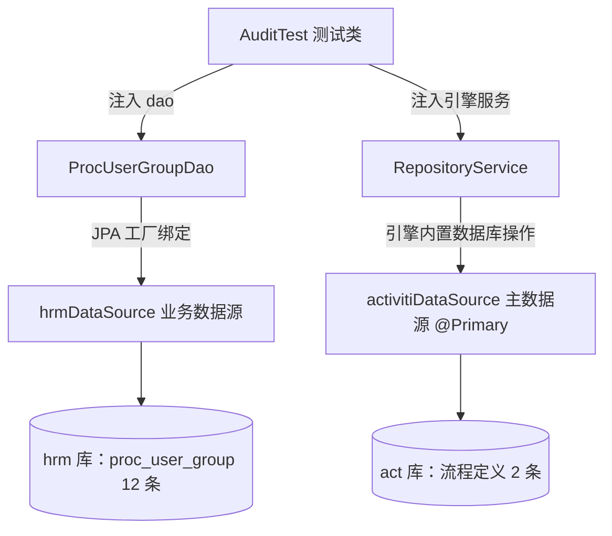

# 双数据源配好了怎么验证：两个单元测试分别打通业务库与引擎库

多数据源配置类写完、JPA 的工厂与事务管理器也重新绑定完，工程能正常启动。但「能启动」只说明 Bean 装配没报错，不能说明数据真的各回各的库：万一 JPA 的查询悄悄打到了引擎库，启动日志里未必看得出来。这一课用同一个测试类写两个测试方法，一个查业务库的表，一个走引擎接口查流程定义，两边各自命中预期数据，多数据源才算真正验收通过。

## 先给结论

- 测试类放在 `src/test` 下，包名与主代码保持一致，`@SpringBootTest` 加 `@RunWith(SpringJUnit4ClassRunner.class)` 拉起完整的 Spring Boot 上下文。
- 业务库验证：注入 `ProcUserGroupDao` 执行 `findAll()`，能查出 `proc_user_group` 表的 12 条记录，说明 JPA 走的是业务数据源。
- 引擎库验证：Activiti 的表不推荐直接写 SQL 去查，要通过它暴露的 `RepositoryService` 调 `createProcessDefinitionQuery().list()`，查出 2 条已部署的流程定义。
- 两个测试各命中一个库、互不串线，从结果侧证明了数据源分派正确。
- 测试会完整执行 Spring Boot 的启动流程，比普通 JUnit 慢属正常现象。

## 一、测试类怎么搭

**第一，dao 与实体先归位。** 前一课的重写配置把 JPA 的扫描范围钉死了：dao 接口必须在 `basePackages` 指定的 `com.example.audit.dao` 下，实体必须在 `packagesToScan` 指定的 `com.example.audit.entity` 下。测试要用的 `ProcUserGroupDao` 与 `ProcUserGroup` 就按这个纪律放好：

```java
package com.example.audit.entity;

@Entity
@Table(name = "proc_user_group")
@Data
@AllArgsConstructor
@NoArgsConstructor
public class ProcUserGroup {
    @Id
    private String id;
    private String name;
    private String param;
    private String isql;
}
```

```java
package com.example.audit.dao;

public interface ProcUserGroupDao extends JpaRepository<ProcUserGroup, String>,
        JpaSpecificationExecutor<ProcUserGroup> {
}
```

实体映射业务库的 `proc_user_group` 表，存流程与审批用户组的映射规则，`param` 与 `isql` 是后续解析审批人要用的参数与查询片段。

**第二，测试包与主包同名。** 在 `src/test/java` 下建与主代码同名的包，再建测试类 `AuditTest`。包名一致不是强迫症：`@SpringBootTest` 会从测试类所在包向上搜索标注 `@SpringBootConfiguration` 的引导类，测试类与引导类同包或在其子包下，上下文才能被自动定位。

## 二、两个测试方法的完整代码

```java
package com.example.audit;

import com.example.audit.dao.ProcUserGroupDao;
import com.example.audit.entity.ProcUserGroup;
import org.activiti.engine.RepositoryService;
import org.activiti.engine.repository.ProcessDefinition;
import org.junit.Test;
import org.junit.runner.RunWith;
import org.springframework.beans.factory.annotation.Autowired;
import org.springframework.boot.test.context.SpringBootTest;
import org.springframework.test.context.junit4.SpringJUnit4ClassRunner;

import java.util.List;

@SpringBootTest
@RunWith(SpringJUnit4ClassRunner.class) //SpringRunner 是它的别名，二者等价
public class AuditTest {

    /**
     * 测试业务数据库
     */
    @Autowired
    private ProcUserGroupDao procUserGroupDao;

    @Test
    public void test() {
        List<ProcUserGroup> list = procUserGroupDao.findAll();
        System.out.println(list.size());
    }

    /**
     * 测试引擎数据库：使用 Activiti 提供的接口
     * 引擎提供的内置对象：RepositoryService
     */
    @Autowired
    private RepositoryService repositoryService;

    @Test
    public void testActiviti() {
        //查看引擎中所有已部署的流程定义
        List<ProcessDefinition> list = repositoryService.createProcessDefinitionQuery().list();
        System.out.println(list.size());
    }
}
```

类上两个注解缺一不可：`@SpringBootTest` 负责启动整个 Spring Boot 上下文；`@RunWith(SpringJUnit4ClassRunner.class)` 让 JUnit 4 具备 Spring 测试能力，缺了它注入的对象全是 `null`。

## 三、测试一：业务库要能查出数据

运行 `test()` 方法，控制台把 Spring Boot 的启动日志完整走一遍，最后打印出数字 `12`。这 12 条正是业务库 `proc_user_group` 表里预先准备的记录。

这条查询的路径值得过一遍：`ProcUserGroupDao` 是 JPA 生成的代理接口，绑定在前一课重写的 `hrmEntityManager` 工厂上，工厂又持有 `hrmDataSource` 业务数据源。能查到业务库里的数据，就证明这条链路从头到尾都落在业务库，没有串到引擎库去。

## 四、测试二：引擎库要用引擎的接口查

验证引擎库之前先明确一条纪律：**Activiti 的 28 张表是引擎的私有实现，官方不提供表结构兼容承诺，直接写 SQL 查询属于耦合内部细节。** 引擎对外的正规入口是它提供的一组 Service 对象，`RepositoryService` 是其中负责流程定义与部署资源的那个。整合 Spring Boot 之后，引擎的自动配置会把这组 Service 注册成容器里的 Bean，所以它可以直接 `@Autowired` 注入，与 Spring 无缝集成。

`testActiviti()` 里那句查询拆开看：`createProcessDefinitionQuery()` 得到流程定义查询对象，调 `list()` 执行查询，返回所有已部署的流程定义。运行结果打印 `2`，对应库里此前部署过的两个流程：`ACT_RE_PROCDEF` 表里躺着 2 条流程定义，`ACT_GE_BYTEARRAY` 表里存着这两份流程文件的字节内容，数量正好对上。

两个测试合起来，验证路径如下图：



关键就是图里两条互不相交的链路：JPA 那条从 dao 走业务数据源落到业务库，引擎那条从 `RepositoryService` 走主数据源落到引擎库。两边各查出预期的记录数，多数据源的分派就从「配置正确」升级成了「结果可证」。

补一句运行体验：`@SpringBootTest` 每次都会完整执行工程启动动作（建两个连接池、连注册中心、初始化流程引擎），单方法跑十几秒很正常，只想验证某个 dao 方法时单独跑那一个方法即可。

## 常见误区

- **只写 `@SpringBootTest` 不加 `@RunWith`**：JUnit 4 环境下 Spring 上下文根本不会启动，注入的 dao 与 Service 全是 `null`，测试一跑就空指针。补上 `@RunWith(SpringJUnit4ClassRunner.class)`，或用别名 `SpringRunner.class`。
- **绕过引擎直接用 JDBC 查它的表**：能查到数据，但从此与引擎的内部表结构绑死，升级版本就可能碎掉。验证与操作引擎数据一律走 `RepositoryService` 这类官方 API。
- **测试类放到与引导类无关的包里**：`@SpringBootTest` 向上找不到 `@SpringBootConfiguration`，上下文起不来。测试类与引导类同包或在其子包下最省心。
- **把查询数量异常归罪于数据源**：数字不对时先确认库里本身有多少数据、连的是哪个库哪个端口。数据源分派错了通常表现为「查不到表」或「表建错了地方」，而不是数量差几条。

## 面试可能被问到的问题

1. 面试官追问：「Spring Boot 项目里写单元测试，最小必备的注解是哪几个？」
   答：JUnit 4 下是 `@SpringBootTest` 加 `@RunWith(SpringJUnit4ClassRunner.class)`，前者声明要启动 Spring Boot 上下文，后者让 JUnit 具备 Spring 测试能力。JUnit 5 改用 `@ExtendWith(SpringExtension.class)` 配合；`SpringRunner` 就是 `SpringJUnit4ClassRunner` 的别名，二者等价。

2. 面试官追问：「为什么不能直接写 SQL 查 Activiti 的表来验证数据？」
   答：那 28 张表是引擎的私有实现，官方不承诺表结构跨版本兼容，直接查询会把业务代码和引擎内部细节绑死。正确姿势是用引擎暴露的 Service 接口，例如 `RepositoryService` 的 `createProcessDefinitionQuery()`，由引擎把调用翻译成对内部表的读写。

3. 面试官追问：「`RepositoryService` 这个 Bean 是谁放进容器的？」
   答：由引擎的自动配置创建。整合 Spring Boot 后，自动配置基于流程引擎初始化一组服务对象，`RepositoryService`、`RuntimeService`、`TaskService` 等都注册为 Bean，直接按类型注入即可。

4. 面试官追问：「怎么证明两个数据源真的分开了，而不是都连到一个库？」
   答：做双向验证。业务侧注入业务 dao 查业务表，能查出业务库的数据；引擎侧注入 `RepositoryService` 查流程定义，结果与引擎库里的部署记录对得上。再对照启动日志里两个连接池各自的 `jdbc-url`，分派关系就能钉死。

## 配套资料

- 测试类：`materials/code/02/day16 薪资管理与工作流概述/day16/03-资料/04审批代码/ihrm_audit/src/test/java/com/ihrm/audit/AuditTest.java`（文中包名已统一改为 `com.example`）
- 业务 dao 与实体：`materials/code/02/day16 薪资管理与工作流概述/day16/03-资料/04审批代码/ihrm_audit/src/main/java/com/ihrm/audit/dao/ProcUserGroupDao.java`、`materials/code/02/day16 薪资管理与工作流概述/day16/03-资料/04审批代码/ihrm_audit/src/main/java/com/ihrm/audit/entity/ProcUserGroup.java`
- 数据源与端口配置：`materials/code/02/day16 薪资管理与工作流概述/day16/03-资料/04审批代码/ihrm_audit/src/main/resources/application.yml`
