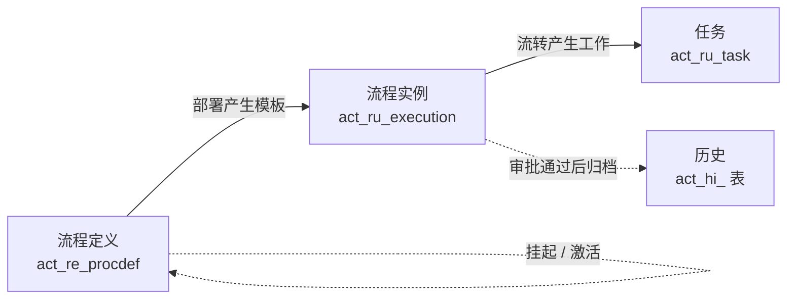

# 审批中心开工：定义、实例、任务三条线怎么铺

社保、考勤、薪资三个核心模块已经完成，工作流也开了头：请假流程画成了 BPMN 文件，并且通过部署代码进了引擎。到这里会出现一个很现实的尴尬：引擎里明明有流程，员工在系统里却发起不了请假，管理员也看不到任何一条审批单。流程部署只是把「模板」放了进去，围绕模板运转的业务一套都还没建。这一天的工作就是把审批中心从模板推进到可用。

## 先给结论

- 审批中心一天的内容分三段：流程定义管理（查询、挂起、激活），流程实例管理（发起与流转），任务管理（审批办理），先管模板，再管运行，最后管办理。
- Activiti 引擎只认流程骨架，谁申请的、申请的是什么、审批到哪一步了，这些业务数据引擎一概不管，必须自己建表补齐。
- 业务侧落地三张自建表：`proc_instance` 存申请单，`proc_task_instance` 存每次审批动作，`proc_user_group` 存审批人组，与引擎 28 张表分工明确。
- 系统里要有请假、加班、离职三类流程，资料包里三个 BPMN 文件一一对应，业务分析先行，代码随后。

## 一、一天要打通的三段路

把审批中心的职责按对象拆开，正好是三个层次，每一层对应引擎里不同的 API 入口：



**第一段管模板。** 部署进引擎的每个流程都会生成流程定义，这一天的第一件事就是把它查出来给管理员看，并且能控制状态：挂起是让流程暂时不可用，激活是把暂停的流程恢复使用。挂起的粒度可以精确到一个版本，后面专门展开。

**第二段管运行。** 员工发起请假，引擎按流程定义创建一条流程实例，实例沿着节点往前走，产生一条条待办任务。实例管理要做的是把「谁发起了什么申请、现在走到哪一步」记录下来，同时把申请的业务数据（请假几天、什么原因）一并保存。

**第三段管办理。** 审批人在待办列表里看到任务，做通过、驳回、撤回这些动作，动作本身和意见要落库，任务随之流转到下一个节点或者终结。发起、提交、审核、通过、驳回、撤回，整个审批功能围绕这条链展开。

## 二、为什么单靠 Activiti 不够

引擎自带的 28 张表能完整回答「流程走到哪了」，但回答不了业务问题。打开一张流程实例表，能看到实例 id、流程定义 id、当前节点，却看不到申请人是谁、部门在哪、请假理由是什么、入职时间有没有关联。这些字段属于业务，引擎没有义务也没有能力替你设计。

所以审批模块的搭法是「引擎表 + 业务表」双轨。课程资料里预先放好了业务侧的骨架，核心实体长这样（包名已改为 `com.example`）：

```java
@Entity
@Table(name = "proc_instance")
@Data
@AllArgsConstructor
@NoArgsConstructor
public class ProcInstance implements Serializable {

    @Id
    private String processId;            // 流程实例ID
    private String processDefinitionId;  // 流程定义ID
    private String processKey;           // 流程标识
    private String processName;          // 流程名称
    private String processState;         // 流程状态（1审批中；2审批通过；3审批不通过；4撤销)
    private String userId;               // 申请人ID
    private String username;             // 申请人
    private String departmentId;         // 部门ID
    private String departmentName;       // 部门
    private String procCurrNodeUserId;   // 当前节点审批人ID
    private String procCurrNodeUserName; // 当前节点审批人
    private Date   procApplyTime;        // 申请时间
    private Date   procEndTime;          // 结束流程时间
    private String procData;             // 申请的业务数据（JSON 字符串）
}
```

这张表的设计意图很清楚：`processId` 关联引擎的实例，业务字段（申请人、部门、状态、业务数据 JSON）全在自己手里。前端列表页直接查它就能渲染审批单，不用去解析引擎表。审批的每一次动作由 `ProcTaskInstance` 记录，处理人、处理时间、处理意见、处理类型（通过、不通过、撤销）各占一列，一张申请单的审批轨迹就是它的若干行记录。

## 三、三类流程，一次分析

人力资源系统里的审批不是只有请假一个场景。加班要算加班费，离职要走交接，两者的审批链路和请假不同，但发起、审批、归档的动作模型是一样的。资料包把三个流程的 BPMN 文件一次性给齐，以请假流程为例，节点结构是：

```xml
<bpmn2:process id="process_leave" name="请假" isExecutable="true">
  <bpmn2:startEvent id="START" name="开始"/>
  <bpmn2:userTask id="APPLY" name="提交申请" activiti:candidateGroups="PROCESS_LEAVE_APPLY_USERS"/>
  <bpmn2:userTask id="CHU" name="初审" activiti:candidateGroups="PROCESS_LEAVE_CHU_USERS"/>
  <bpmn2:userTask id="FU" name="复审" activiti:candidateGroups="PROCESS_LEAVE_FU_USERS"/>
  <bpmn2:userTask id="PI" name="领导审批" activiti:candidateGroups="PROCESS_LEAVE_PI_USERS"/>
  <bpmn2:endEvent id="END" name="结束"/>
</bpmn2:process>
```

每个节点用 `candidateGroups` 指向一个候选人组，组名按流程前缀加节点命名，比如 `PROCESS_LEAVE_CHU_USERS` 就是请假流程初审节点的组。组里有哪些人不在 BPMN 里写死，而是运行时从 `proc_user_group` 表按组名查出来填充。这个设计把「流程长什么样」和「谁来审批」解耦了：改审批人只动业务表，流程文件一字不改。

当天系统分析的目标就是把请假、加班、离职三条链路各自的节点和审批组定义清楚，之后的实例管理、任务管理全部建立在这份分析之上。

## 常见误区

- **以为部署完流程审批就能用**：部署只产生模板，实例与任务两条线的数据结构、接口都还没写，员工发起申请会直接失败。
- **把审批数据塞进引擎表**：申请人、审批意见这类业务字段引擎表里没有位置，硬往流程变量里塞会让历史查询和列表展示都很别扭，业务数据归业务表。
- **审批人写死在 BPMN 里**：节点上写死 `assignee`，换人就得重新画图重新部署；用候选人组加业务表配置，审批人的调整就是改几行数据。
- **三类流程只做请假**：加班影响薪资计算，离职影响账号与权限回收，三条链路共用同一套审批框架，缺了哪条业务都是断的。

## 面试可能被问到的问题

1. 面试官追问：「整合工作流引擎做审批，引擎表和业务表怎么分工？」
   答：引擎表管流程运行时的事实，实例在哪、任务归谁、历史怎么走；业务表管业务语义，申请人、部门、申请内容、审批意见。两者通过流程实例 id 关联，列表页查业务表保证查询简单，流程流转细节随时可以从引擎表回查。

2. 面试官追问：「Activiti 的流程定义和流程实例是什么关系？」
   答：流程定义是模板，一次部署产生；流程实例是按模板创建的一次运行，员工每发起一次申请就创建一个实例。同一个定义可以并发跑成百上千个实例，定义被挂起后新实例起不来，已存在的实例按挂起策略决定是否受影响。

3. 面试官追问：「审批节点的办理人有哪些指定方式，你选了哪种，为什么？」
   答：常见有写死 `assignee`、用流程变量、用候选人组或候选人。项目里选候选人组：BPMN 里只写组名，组内成员在业务表里维护，审批人调整不需要改动和重新部署流程，SaaS 多租户下每家企业还能配自己的审批组。

4. 面试官追问：「一个申请被驳回和被撤回，数据上怎么区分？」
   答：用状态字段区分。申请单上的流程状态定义了审批中、审批通过、审批不通过、撤销等取值，审批动作表里的处理类型也做了对应区分，两者结合能完整还原一单的去向，前端按状态渲染不同的操作入口。

5. 面试官追问：「审批中心一次要做多少功能，怎么排优先级？」
   答：按依赖顺序排。定义管理是地基，实例管理和任务管理依赖它；业务上先做发起与审批的主链路，让一条流程能完整走通，再做挂起激活、撤回、审批轨迹展示这类控制与增强功能。

## 配套资料

- 审批模块业务实体与 dao：`materials/code/02/day17 审批中心/day17/03-资料/02搭建环境代码/`（`entity/ProcInstance.java`、`entity/ProcTaskInstance.java`、`entity/ProcUserGroup.java` 及对应 dao，文中包名已改为 `com.example`）
- 三类流程 BPMN 文件：`materials/code/02/day17 审批中心/day17/03-资料/所有的流程bpmn文件/`（请假、加班、离职）
- 业务库建表与样例数据：`materials/code/02/day17 审批中心/day17/ihrm.sql`（含 `proc_instance`、`proc_task_instance` 等表）
- 引擎侧部署代码（上一阶段产出，本阶段的地基）：`materials/code/02/day16 薪资管理与工作流概述/day16/03-资料/04审批代码/ihrm_audit/src/main/java/com/ihrm/audit/service/ProcessService.java`
