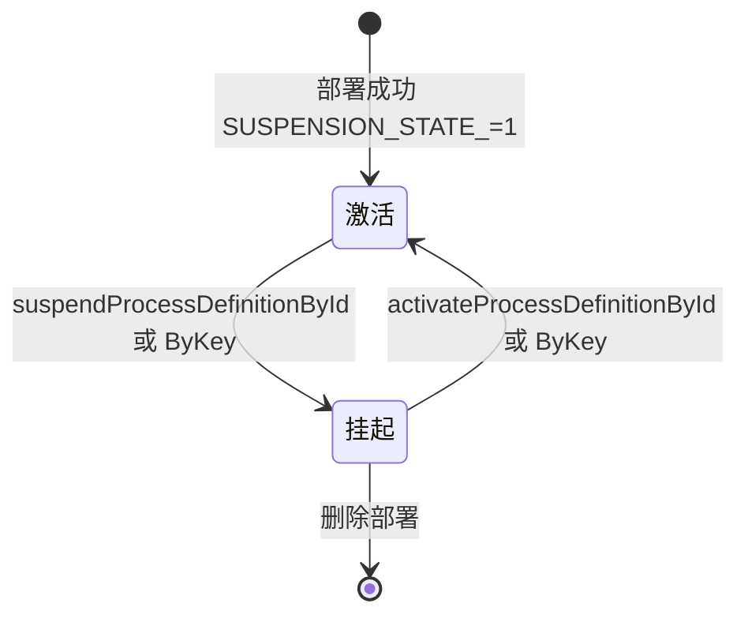

# 流程定义的挂起与激活：一个状态字段的两种运维姿势

请假流程部署进引擎之后忽然要改审批规则，旧流程必须立刻停用，可是在途的申请单还在里面跑着，直接删部署会把历史一起带走。这种「停用但不删除」的需求，答案就是流程定义的挂起与激活：挂起让定义暂时不可发起，激活把它恢复，全程只动一个状态字段。这一篇把 API、落库效果、粒度控制和升级发布的实战顺序一次讲清。

## 先给结论

- 挂起与激活都是 `RepositoryService` 的方法：`suspendProcessDefinitionById` 与 `activateProcessDefinitionById` 按定义 id 操作，另有按 key 操作的 `suspendProcessDefinitionByKey` / `activateProcessDefinitionByKey`。
- 落库效果只有一个字段：`act_re_procdef` 表的 `SUSPENSION_STATE_`，1 为激活，2 为挂起，部署成功的新定义默认是 1。
- 定义被挂起后不能再按它发起新的流程实例；在途实例是否一起停，由 `includeProcessInstances` 参数决定。
- 操作前可用 `repositoryService.isProcessDefinitionSuspended(id)` 预判当前状态，避免重复挂起或激活。
- 升级发布的标准顺序是：挂起旧版本、部署新版本，让用户永远从最新激活的模板发起申请。

## 一、两个方法，一挂一活

操作入口和查询列表是同一个服务。沿用测试类的骨架，挂起与激活各写一个测试方法（方法体按本课写法补全，包名已改为 `com.example`）：

```java
@Autowired
private RepositoryService repositoryService;

@Test
public void testSuspend() {
    //流程定义ID：来自列表查询结果，对应 act_re_procdef 的 ID_ 列
    String processDefinitionId = "process_leave:1:4";
    //挂起流程定义
    repositoryService.suspendProcessDefinitionById(processDefinitionId);
}

@Test
public void testActivate() {
    String processDefinitionId = "process_leave:1:4";
    //激活流程定义
    repositoryService.activateProcessDefinitionById(processDefinitionId);
}
```

执行 `testSuspend()` 后回到数据库刷新 `act_re_procdef`，那条定义的 `SUSPENSION_STATE_` 从 1 变成 2；执行 `testActivate()` 又从 2 变回 1。整个生命周期是一来一回的两条边：



图里唯一的数值变化就是 `SUSPENSION_STATE_` 在 1 和 2 之间切换，引擎不会物理删除任何东西，所以挂起随时可以撤销。

## 二、粒度：按 id 还是按 key，带不带在途实例

两个维度的选择组合出四种操作方式，适用场景各不相同：

```java
//1. 按 id 挂起：精确到某个版本，只挡住这个版本的新发起
repositoryService.suspendProcessDefinitionById(definitionId);

//2. 按 key 挂起：该流程所有版本一起挂起
repositoryService.suspendProcessDefinitionByKey("process_leave");

//3. 按 id 挂起并连带在途实例：新发起被挡，跑了一半的实例也暂停流转
repositoryService.suspendProcessDefinitionById(definitionId, true, null);

//4. 只挂定义，在途实例继续走完
repositoryService.suspendProcessDefinitionById(definitionId, false, null);
```

带两个参数的重载里，第二个参数是 `suspendProcessInstances`，第三个是定时生效时间 `suspensionDate`，传 `null` 表示立即执行。挂在途实例这个动作会把实例上的所有任务一起置为挂起，审批人列表里的待办随之不可办理，这是「流程紧急冻结」场景的完整实现。

**按 id 与按 key 的取舍看目的。** 临时下线某一个有问题的版本用 id；政策调整要停掉整个流程所有版本用 key。激活同理，方向相反而已。

## 三、升级发布：先挂旧版，再上新版

流程改版最怕用户拿着旧模板继续发起申请。实战顺序是三步：

```java
//1. 找到当前生效的旧版本
ProcessDefinition old = repositoryService.createProcessDefinitionQuery()
        .processDefinitionTenantId(companyId)
        .processDefinitionKey("process_leave")
        .latestVersion()
        .singleResult();

//2. 挂起旧版：挡住新发起，在途申请不受影响继续审批
repositoryService.suspendProcessDefinitionById(old.getId());

//3. 部署修改后的 BPMN：同一 key，版本自动加一，新版本默认激活
repositoryService.createDeployment()
        .addBytes(fileName, file.getBytes())
        .tenantId(companyId)
        .deploy();
```

这样切换之后，新申请走新版本，旧版本保留但不可发起，在途申请按旧版本走完。审批规则的变更对使用者来说无感知，对运维来说可回滚：把新版本挂起、旧版本激活，就退了回去。

挂起前先用状态接口做一次判断，可以让代码对重复操作免疫：

```java
if (repositoryService.isProcessDefinitionSuspended(old.getId())) {
    //已经是挂起状态，不必重复操作
} else {
    repositoryService.suspendProcessDefinitionById(old.getId());
}
```

## 四、引擎状态和业务状态是两本账

审批系统里有两处「状态」，别混为一谈。引擎这本账记在 `act_re_procdef` 的 `SUSPENSION_STATE_`，回答「这个模板还能不能发起新申请」；业务这本账记在自建表 `proc_instance` 的 `processState`，取值是审批中、审批通过、审批不通过、撤销，回答「某一单走到了什么地步」。定义挂起不会改任何一单的业务状态，在途申请该审批还审批。

两本账在前端各管一段：发起页面的入口按钮看引擎状态，查询列表接口返回的 `suspensionState` 为 2 时把发起入口置灰；审批单列表和详情页看业务状态，渲染进度与操作记录。判断发起入口用引擎接口：

```java
//从定义查询结果直接读，或单独调状态接口
boolean suspended = definition.isSuspended();
```

`ProcessDefinition` 对象上就带着 `isSuspended()` 方法，值来源于同一个状态字段，发起前的校验与列表页的展示共用一份事实，不会出现页面显示可用而引擎拒绝受理的分裂局面。

## 常见误区

- **把挂起当成删除**：挂起只是 `SUSPENSION_STATE_` 置 2，数据都在，随时可激活；删除部署才是物理清理，且会连带历史数据，两者混用会出事故。
- **以为挂起定义会自动停掉在途实例**：默认只挡新发起，在途流程照常流转。需要连在途一起冻结时必须显式传 `suspendProcessInstances = true`。
- **按 key 挂起后以为只有一个版本受影响**：`suspendProcessDefinitionByKey` 作用于该 key 的全部版本，只想停某个版本必须按 id 操作。
- **重复挂起或激活不校验状态**：对已挂起的定义再挂起、对已激活的定义再激活，有的版本会抛状态异常，操作前用 `isProcessDefinitionSuspended` 判断一次更稳妥。

## 面试可能被问到的问题

1. 面试官追问：「流程定义挂起的底层实现是什么？」
   答：更新 `act_re_procdef` 表的 `SUSPENSION_STATE_` 字段，1 表示激活、2 表示挂起。发起实例时引擎会校验该字段，定义处于挂起状态则拒绝创建新实例，本质是一个前置状态检查，没有数据被删除。

2. 面试官追问：「挂起流程定义后，已经发起的流程实例会停吗？」
   答：默认不停。不带实例参数的重载只影响新发起；调用带 `suspendProcessInstances` 参数的重载并传 true，才会把该定义下所有在途实例及其任务一并挂起，任务办理入口同样被校验挡住。

3. 面试官追问：「线上要紧急冻结一个审批流程，怎么操作最稳？」
   答：按 key 挂起并连带在途实例，`suspendProcessDefinitionByKey(key, true, null)`，所有版本的新发起与在途流转同时冻结；恢复时对应调用激活方法。操作前留一份当前状态记录，冻结与恢复都可精确对账。

4. 面试官追问：「流程改版上线，怎么保证用户用的一直是新流程？」
   答：先按 id 挂起旧版本（保留在途实例继续走），再部署新 BPMN，同 key 版本自动加一且默认激活，新发起全部落在新版本上。回滚就是反向操作：挂新版本、激活旧版本。

5. 面试官追问：「挂起和删除部署各自适合什么场景？」
   答：临时停用、改版过渡、紧急冻结这类需要保留现场和可回滚的场景用挂起；确认流程永久废弃才删除部署，且要评估 `deleteDeployment` 级联参数对在途实例与历史数据的影响。

## 配套资料

- 引擎测试类骨架（挂起与激活方法为按本课写法补全，类与查询代码来自该文件）：`materials/code/02/day16 薪资管理与工作流概述/day16/03-资料/04审批代码/ihrm_audit/src/test/java/com/ihrm/audit/AuditTest.java`
- 部署与租户 id 写入：`materials/code/02/day16 薪资管理与工作流概述/day16/03-资料/04审批代码/ihrm_audit/src/main/java/com/ihrm/audit/service/ProcessService.java`
- 引擎库建表脚本（`act_re_procdef` 与 `SUSPENSION_STATE_` 列所在库）：`materials/code/02/day16 薪资管理与工作流概述/day16/03-资料/act.sql`
- 引擎库数据源配置：`materials/code/02/day16 薪资管理与工作流概述/day16/03-资料/04审批代码/ihrm_audit/src/main/resources/application.yml`
