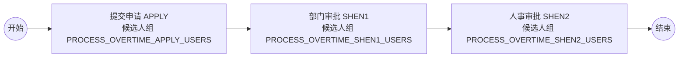
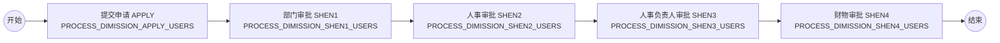

# 加班与离职流程设计：节点拆解、候选人组与流程 key 的落地分析

请假流程从画图到部署已经完整走通，但一个 HRM 系统的审批中心不可能只有请假。加班和离职这两个内置流程要补齐，而它们恰好代表了两种复杂度：加班是三方参与的三段式直线流程，离职则一路串起部门、人事、负责人、财务四个审批角色。把两个流程的人员分析、BPMN 节点、候选人组命名和流程 key 一次讲透，之后再遇到任何审批流程，拆法都是同一套。

## 先给结论

- 加班流程只有三个任务节点：提交申请（APPLY）、部门审批（SHEN1）、人事审批（SHEN2），流程 key 为 `process_overtime`。
- 离职流程五个任务节点：提交申请、部门审批、人事审批、人事负责人审批、财物审批，流程 key 为 `process_dimission`。
- 所有节点一律用 `activiti:candidateGroups` 指定候选人组，不在 BPMN 里写死某个具体的人。
- 候选人组的 id 与业务库 `proc_user_group` 表的主键严格对应，命名统一成 `PROCESS_流程_节点_USERS` 风格。
- 三个流程的 key（`process_leave` / `process_overtime` / `process_dimission`）全系统唯一，后续的发起、挂起、列表查询都靠它定位。

## 一、加班流程：三方参与的三段式审批

加班流程涉及的人员很简单：加班当事人、当事人的直属领导、人力资源的 HR。各公司的细则会有出入，最简版本就是一条直线：当事人发起加班申请，直属领导按实际情况审核，有异议直接驳回终止，没问题则继续向后走，最后由人事部门做终审，HR 认定加班无误，流程结束。

把这条线画成流程图就是三个 userTask 依次串联：



图里每个任务下方就是 BPMN 里配置的候选人组标识。值得注意的是第一个任务：提交申请的候选人组是 `PROCESS_OVERTIME_APPLY_USERS`，也就是加班当事人自己。把「发起」也做成任务节点，当事人签收并提交后流程才进入审批段，这样申请动作在引擎里同样有任务记录可查。

课程资料里的加班 BPMN 文件已经画好并可直接导入 Activiti 设计器，摘出核心定义部分（文件为课程资料原样）：

```xml
<process id="process_overtime" name="加班" isExecutable="true">
  <documentation>加班流程</documentation>
  <startEvent id="START" name="开始"></startEvent>
  <userTask id="SHEN1" name="部门审批" activiti:candidateGroups="PROCESS_OVERTIME_SHEN1_USERS"></userTask>
  <userTask id="SHEN2" name="人事审批" activiti:candidateGroups="PROCESS_OVERTIME_SHEN2_USERS"></userTask>
  <endEvent id="END" name="结束"></endEvent>
  <userTask id="APPLY" name="提交申请" activiti:candidateGroups="PROCESS_OVERTIME_APPLY_USERS"></userTask>
  <sequenceFlow id="sid-4E27E37B" sourceRef="START" targetRef="APPLY"></sequenceFlow>
  <sequenceFlow id="sid-F919C33A" sourceRef="APPLY" targetRef="SHEN1"></sequenceFlow>
  <sequenceFlow id="sid-B1BEB514" sourceRef="SHEN1" targetRef="SHEN2"></sequenceFlow>
  <sequenceFlow id="sid-07EE5703" sourceRef="SHEN2" targetRef="END"></sequenceFlow>
</process>
```

四个信息点值得圈出来：`id="process_overtime"` 就是流程 key；三个 `userTask` 的节点 id 用 APPLY、SHEN1、SHEN2 这种业务化命名，后续代码里按节点 key 判断「这一步该谁办」时依赖它们；每个任务通过 `activiti:candidateGroups` 绑定一个组；连线 `sequenceFlow` 把开始到结束串成单链，没有任何网关，加班审批不存在分支。

## 二、离职流程：五节点串联与多候选人

离职比请假和加班都复杂，因为里面的人多。参与角色从当事人算起有五层：当事人发起离职申请；直属领导对实际情况做评估，把风险拦截在最前面；然后进入人事部门的 HR 环节，这里往往是三个 HR 并列，任意一个审完就能通过；再往上是人事负责人，负责人通常要和当事人面谈，确认离职意向坚定后做最终审批；最后流转到财务，工资、补助、欠款该结清的结清，财务确认完毕整个流程才算落地。

对应的流程图是五个任务节点的长链：



BPMN 文件里的定义与加班完全同构，只是节点更多（摘录自课程资料，节点名为文件原样，SHEN4 的「财物审批」即财务审批）：

```xml
<bpmn2:process id="process_dimission" name="离职" isExecutable="true">
  <bpmn2:documentation>离职申请</bpmn2:documentation>
  <bpmn2:startEvent id="START" name="开始"></bpmn2:startEvent>
  <bpmn2:userTask id="APPLY" name="提交申请" activiti:candidateGroups="PROCESS_DIMISSION_APPLY_USERS"></bpmn2:userTask>
  <bpmn2:userTask id="SHEN1" name="部门审批" activiti:candidateGroups="PROCESS_DIMISSION_SHEN1_USERS"></bpmn2:userTask>
  <bpmn2:userTask id="SHEN2" name="人事审批" activiti:candidateGroups="PROCESS_DIMISSION_SHEN2_USERS"></bpmn2:userTask>
  <bpmn2:userTask id="SHEN3" name="人事负责人审批" activiti:candidateGroups="PROCESS_DIMISSION_SHEN3_USERS"></bpmn2:userTask>
  <bpmn2:userTask id="SHEN4" name="财物审批" activiti:candidateGroups="PROCESS_DIMISSION_SHEN4_USERS"></bpmn2:userTask>
  <bpmn2:endEvent id="END" name="结束"></bpmn2:endEvent>
</bpmn2:process>
```

人事审批环节「三个 HR 任意一人通过即可」这件事，在 BPMN 里没有任何特殊标记，它靠候选人组机制天然实现：SHEN2 绑定一个组，组里放三个 HR，任务对组内所有人可见，谁先签收（claim）任务就归谁办理，其他人待办里这条消失。BPMN 只负责把任务抛给一组人，「几个人怎么抢、怎么轮」是引擎任务分配与业务侧候选人查询配合的事。

## 三、流程 key：唯一、稳定、贯穿始终

三个流程的 key 汇总成一张表：

| 流程 | key | 任务节点 | 候选人组数量 |
|---|---|---|---|
| 请假 | `process_leave` | 提交申请、初审、复审、批准 | 4 组 |
| 加班 | `process_overtime` | 提交申请、部门审批、人事审批 | 3 组 |
| 离职 | `process_dimission` | 提交申请、部门、人事、负责人、财务 | 5 组 |

key 在整个审批体系里被反复消费：发起新申请时调 `startProcessInstanceByKey(key)`，按 key 而不是 id 发起，引擎自动取最新版本；前面写过的挂起切换接口按 `processDefinitionKey` 查询定义；审批列表页区分「请假单还是加班单」看的是业务表里的 `process_key` 字段，它的值同样来自这里。所以 key 一旦投入使用就是对外契约，改 key 等于断掉所有历史数据与流程的联系，取名时要一步到位。

候选人组的命名同样要有体系。`PROCESS_OVERTIME_SHEN1_USERS` 这类长名字看着啰嗦，但组 id 必须「流程 + 节点」双维度唯一，因为所有组共用 `proc_user_group` 一张表，靠 id 区分归属，命名散乱会让后续维护变成猜谜。

## 四、把两个流程部署进系统

流程图画好后不需要再动代码，回到系统的审批设置页，把加班和离职的 BPMN 文件依次上传，走的就是此前写好的 `deploy` 接口。引擎部署时以当前登录企业作为租户写入，完成后打开数据库验证：`act_re_procdef` 里租户 id 为 1 的记录变成了三行，请假、加班、离职各一条；BPMN 文件本身的字节内容存在 `act_ge_bytearray` 表里，定义表通过部署 id 引用它。至此系统的三个内置审批流程全部就位，审批中心从「引擎能跑」推进到「业务可用」，后面的章节就可以围绕发起申请和任务办理展开了。

## 常见误区

- **以为多人审批要在 BPMN 里画会签或多实例节点**：人事审批「任一人通过」的场景，候选人组天然支持，组内多人各自签收竞争办理，流程图仍是单任务节点。多实例会签是「所有人都要审」的场景，别混用。
- **候选人组只在 BPMN 里写个字符串就算完事**：组 id 必须能在业务库里解析出具体的人，`proc_user_group` 表里同名 id 的 `isql` 字段负责把组翻译成候选人名单，两边对不上，任务发起后无人可领。
- **把流程 name 当 key 用**：`name="加班"` 是给人看的显示名，代码里定位流程一律用 `id`（key）。用中文名查询查不到任何结果。
- **改版时顺手改 key**：key 变了引擎视为一个全新流程，历史版本、在途实例全部失去关联。流程演进靠版本号自动递增，key 保持不变。

## 面试可能被问到的问题

1. 面试官追问：「BPMN 里 candidateGroups 和 assignee 有什么区别？」
   答：assignee 把任务直接指派给某一个确定的用户，适合一对一场景；candidateGroups 把任务抛给一个候选组，组内所有人都可能在待办里看到它，任意一人签收后任务归属该人。审批场景人员由部门、岗位动态决定，候选组配合业务侧的组定义表更灵活。

2. 面试官追问：「三个 HR 审批只要一个人通过，BPMN 该怎么设计？」
   答：把该节点做成普通 userTask 并绑定候选人组，组内放三个 HR。任务对组内成员全部可见，一人 claim 之后任务独属于他，其他人不再可见。不需要多实例节点，多实例是所有人依次或并行审批的语义。

3. 面试官追问：「流程的 key 和 id 有什么区别？」
   答：key 是 BPMN 里 process 元素的 id 属性，业务上唯一且跨版本稳定；引擎里的完整 id 形如 `process_leave:1:4`，由 key、版本号和部署记录拼成，每个版本一条。发起、按 key 查询、挂起切换用 key，需要精确操作某个版本时才用完整 id。

4. 面试官追问：「离职流程为什么要把财务节点单独拉出来？」
   答：财务审批处理的是钱务交接，工资结算、补助清算与人事判断是两类职责，权限和数据来源都不同。独立成节点让候选人组可以绑定到财务人员，也让流程实例的每一步审批记录里能明确区分「人事责任段」和「财务责任段」。

5. 面试官追问：「新员工入职后怎么进入已有的候选人组？」
   答：候选人组在业务库里只是一条组定义加一段查询 SQL，发起流程时按部门或岗位参数实时查出组员。新员工的部门归属、岗位数据落库后，下一次查询自然包含他，不需要改任何 BPMN 文件。

## 配套资料

- 加班 BPMN（文中 XML 摘自此文件，`process_overtime`、三个 userTask 与候选人组）：`materials/code/02/day17 审批中心/day17/03-资料/所有的流程bpmn文件/加班.bpmn20.xml`
- 离职 BPMN（`process_dimission`、五个 userTask）：`materials/code/02/day17 审批中心/day17/03-资料/所有的流程bpmn文件/离职.bpmn20.xml`
- 请假 BPMN（对照三条流程的 key 与组命名）：`materials/code/02/day17 审批中心/day17/03-资料/所有的流程bpmn文件/请假.bpmn20.xml`
- 候选人组表种子数据（`proc_user_group` 里 `PROCESS_OVERTIME_*`、`PROCESS_DIMISSION_*` 各组的查询 SQL）：`materials/code/02/day17 审批中心/day17/ihrm.sql`
