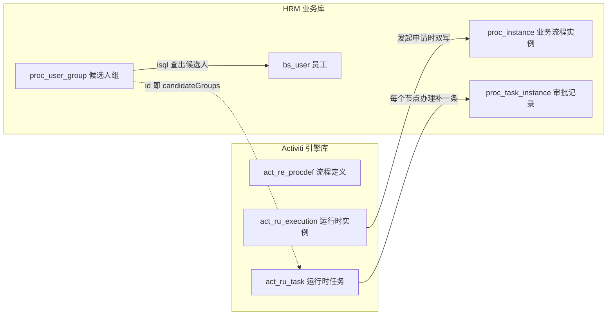

# 审批业务建模：引擎表之外，为什么还要三张业务扩展表

流程定义已经能上传、能挂起激活，审批中心的地基看起来齐了。可一旦有员工真的发起一张请假单，问题立刻暴露：请假的天数、事由、病假附件这些内容，Activiti 的表里没有任何一列能放；部门经理批了什么意见、目前卡在哪个审批人手上，引擎表能查但语义绕。引擎负责让流程「转起来」，业务数据得有自己的家。这一步建模决定了后面所有审批功能的开发难度。

## 先给结论

- 系统里并存两套表：Activiti 引擎库管流转（部署、定义、实例、任务），HRM 业务库管内容（申请数据、审批记录、候选人），同在 MySQL 但各管各的。
- 业务库扩展三张表：`proc_instance` 业务流程实例表、`proc_task_instance` 业务流程任务表、`proc_user_group` 业务流程用户组表。
- `process_state` 是业务状态机（0 已提交、1 审批中、2 审批通过、3 审批不通过、4 撤销），与引擎的挂起状态字段无关。
- `proc_user_group` 的 id 就是 BPMN 里 `candidateGroups` 的那串字符，`isql` 列存一条查询 SQL 负责把组翻译成具体的人。
- 表建模完成后，待实现的业务共四件：审批列表查询、申请详情查询、发起流程、提交流程（通过、驳回、撤销）。

## 一、两本账：引擎库管流转，业务库管内容

引擎库里按前缀分了家：`act_re_*` 存部署与流程定义，`act_ru_*` 存运行中的实例与任务，`act_hi_*` 存历史归档。它的职责边界很清晰，回答「流程走到哪一步、下一个任务归谁」这类问题。

但业务侧的问题它一个都答不了。用户发起请假时，A 公司要求填请假开始时间、结束时间、天数、事由，请病假还要上传病假单附件；B 公司可能只要一个原因。这些字段千差万别，引擎的通用表结构不可能为每个租户定制列。审批意见也一样，部门经理批注了什么、人事何时通过，这些内容需要业务自己的表来承载。两套表的关系如下：



读图的重点在两条双写实线：发起申请的那一刻，引擎创建运行时实例，业务库同时落一条 `proc_instance`；此后每个节点办理完，业务库追加一条 `proc_task_instance`。引擎记录「流转事实」，业务表记录「业务事实」，两者通过流程实例 id 关联。

## 二、proc_instance：一单申请的业务全貌

业务流程实例表的实体类直接看课程资料（包名已改为 `com.example`）：

```java
package com.example.audit.entity;

import lombok.Data;
import javax.persistence.Entity;
import javax.persistence.Id;
import javax.persistence.Table;
import java.io.Serializable;
import java.util.Date;

@Entity
@Table(name = "proc_instance")
@Data
public class ProcInstance implements Serializable {
    private static final long serialVersionUID = 1197039778202034930L;

    @Id
    private String processId; // 流程实例ID

    private String processDefinitionId; // 流程定义ID
    private String processKey; // 流程标识
    private String processName; // 流程名称
    private String processState; // 流程状态（1审批中；2审批通过；3审批不通过；4撤销）
    private String userId; // 申请人ID
    private String username; // 申请人
    private String departmentId; // 部门ID
    private String departmentName; // 部门
    private Date timeOfEntry; // 入职时间

    private String procCurrNodeUserId;   // 当前节点审批人ID
    private String procCurrNodeUserName; // 当前节点审批人
    private Date procApplyTime;          // 申请时间
    private Date procEndTime;            // 结束流程时间
    private String procData;             //申请的业务数据(需要转化为json)
}
```

几个设计点值得逐个拆。主键 `processId` 存的是引擎流程实例 id，业务表不自己生成主键，这样两张表天然可关联，省一次映射。`processKey`、`processName` 把请假、加班、离职区分开，审批列表按它筛选类型。`procData` 是整个设计的伸缩点：各企业、各流程的申请字段五花八门，统一序列化成 JSON 塞进这一列，表结构不用动，详情页拿到 JSON 后按流程类型反序列化成对应的表单对象。`procCurrNodeUserName` 这类当前审批人字段是典型的冗余换性能，列表页直接展示，不必每次去引擎任务表里联查。

`processState` 的取值以建表语句的注释为准共五种：0 已提交、1 审批中、2 审批通过、3 审批不通过、4 撤销。注意实体注释里少写了 0 已提交，两边有出入时以库里实际写入为准，这是一个很典型的「代码注释与 DDL 漂移」案例。

## 三、proc_task_instance：每个节点的审批流水

第二张表记录每一次任务办理，一个节点一条：

```java
@Entity
@Table(name = "proc_task_instance")
@Data
public class ProcTaskInstance implements Serializable {

    private static final long serialVersionUID = 1197039778202034930L;

    @Id
    private String taskId; // 任务实例ID
    private String handleOpinion; // 处理意见
    private Date   handleTime; // 处理时间
    private String handleType; // 处理类型（2审批通过；3审批不通过；4撤销）
    private String handleUserId; // 实际处理用户ID
    private String handleUserName; // 实际处理用户
    private String processId; // 流程实例ID
    private String taskKey; // 任务节点key
    private String taskName; // 任务节点
}
```

建表脚本里还有 `should_user_id`、`should_user_name` 两列，语义是「应审批人」：候选人组查出来的一批人都算应审批，而实际签收办理的那个人落到 `handle_user` 两列。两张表对照着看，一张申请单的完整履历就有了：`proc_instance` 说「这单请假现在审批中、卡在人事审批」，`proc_task_instance` 说「部门经理某时某分批了同意、意见是什么」。审批详情页的进度条和时间线全部来自这两张表的配合。

## 四、proc_user_group：候选人组的「名」与「实」

第三张表最绕也最关键。画 BPMN 时每个任务都配了 `candidateGroups`，那串 `PROCESS_OVERTIME_SHEN1_USERS` 只是组的名字，组里到底有谁、怎么查出来，答案在这张表里：

```java
@Entity
@Table(name = "proc_user_group")
@Data
public class ProcUserGroup {
    @Id
    private String id;
    private String name;
    private String param;
    private String isql;
}
```

四个字段环环相扣：`id` 与 BPMN 里的 `candidateGroups` 字符串完全一致，这是两张世界的连接点；`param` 声明这条 SQL 需要什么入参；`isql` 存真正的候选人查询语句。资料包 `ihrm.sql` 里的种子数据一眼就能看懂它的用法：

```sql
-- 组 id 与 BPMN 的 candidateGroups 一致，param 是入参，isql 是候选人查询
INSERT INTO proc_user_group (id, name, param, isql, isvalid) VALUES
('PROCESS_DIMISSION_APPLY_USERS', '离职申请人', 'user_id',
 'SELECT id,username FROM bs_user WHERE id = ${user_id}', '1'),
('PROCESS_DIMISSION_SHEN1_USERS', '离职部门审批用户组', 'department_id',
 'SELECT id,username FROM bs_user WHERE department_id = ${department_id}', '1'),
('PROCESS_OVERTIME_SHEN1_USERS', '加班部门审批用户组', 'department_id',
 'SELECT manager username, manager_id id FROM co_department WHERE id = ${department_id}', '1');
```

发起流程时，引擎拿到任务的 `candidateGroups`，业务侧按组 id 取出 `isql`，把 `${department_id}` 这类占位符替换成申请人所在部门，一执行就得到该节点所有候选人。直属领导、人事、财务的变动都只是 `bs_user`、`co_department` 里的数据变化，流程文件一行不改。这也回应了一个普遍疑问：Activiti 自带的用户、用户组模型在真实系统里很少直接用，把「组」的定义权收归业务库，才能和部门、岗位这些企业数据对齐。

## 五、双写之后要做的四件事

表设计齐了，审批中心剩下的功能开发就沿着表展开，共四件：审批列表查询，按「全部、我发起的、待审批」筛选 `proc_instance`；流程申请信息查询，单号取 `proc_instance` 加 `procData`，进度取 `proc_task_instance`；发起流程，最复杂的一步，引擎 `startProcessInstanceByKey` 与业务库写 `proc_instance` 要在一个事务里完成；提交流程，通过、驳回、撤销三种动作，每种都要既推进引擎任务又补业务记录。引擎与业务的双写一致性是贯穿这四件事的主线，也是后续所有代码的骨架。

## 常见误区

- **把业务字段塞进引擎表**：Activiti 的表结构是引擎私有的，随意加列或塞自定义数据会让升级与迁移变成灾难。业务字段一律进业务表，`procData` 这类 JSON 列就是为此设计的伸缩点。
- **混淆 process_state 与引擎挂起状态**：`process_state` 描述一单申请走到哪个结果，挂起状态描述流程模板还能不能发起，两者在不同表、不同维度，判断发起入口看引擎字段，渲染审批单状态看业务字段。
- **候选人组只配 BPMN 不配 proc_user_group**：组名字符串写上了，业务库里却没有对应 id 的组定义，任务发起后查不出任何候选人，流程卡死在第一个审批节点。
- **proc_task_instance 里不记 should_user 只记 handle_user**：审批详情页要展示「这一步谁可以审、最终谁审了」，缺了应审批人，候选人竞争办理的过程在履历里无法还原。

## 面试可能被问到的问题

1. 面试官追问：「为什么不用 Activiti 自带的用户和用户组表？」
   答：引擎自带的 Identity 模型是面向通用场景的独立用户体系，而审批系统里用户、部门、岗位已经存在业务库。复制一份到引擎表要做双向同步，且表达不了「部门主管」这种动态关系。把候选人组定义成业务表里的一条 SQL，查询时实时关联业务数据，维护成本最低。

2. 面试官追问：「业务表为什么要冗余当前审批人字段？」
   答：审批列表是高频查询，如果每次都联查引擎运行时任务表，既要多一次跨表查询还要理解引擎的表语义。发起和每次办理时顺手更新 `procCurrNodeUserName`，列表查询只碰业务库，空间换时间。

3. 面试官追问：「procData 用 JSON 存申请数据，怎么处理不同流程的字段差异？」
   答：各流程的表单字段定义不同，固定列永远追不上业务变化。统一序列化成 JSON 存一列，读取时按 processKey 反序列化成对应表单对象，新增审批类型不改表结构。代价是没法直接对 JSON 内字段做 SQL 筛选，这类需求要么冗余出关键列，要么在应用层过滤。

4. 面试官追问：「发起流程时引擎和业务库双写，怎么保证一致性？」
   答：两个库在同一个 MySQL 实例上时可以用本地事务覆盖；多数据源拆开部署后，常规做法是同事务内先写业务表再启动引擎，启动失败整体回滚；跨实例部署则要引入事务消息或对账补偿，以业务表状态和引擎实例做定期核对。

5. 面试官追问：「审批记录表为什么按节点一条一条存，而不是只存最终结果？」
   答：审批的核心价值是过程可追溯。每个节点的意见、时间、处理人构成详情页的时间线，驳回后重审的轨迹也只有逐节点记录才能还原。只存结果会把「为什么被驳回、谁拖延了」这类管理诉求全部丢掉。

## 配套资料

- 三张业务表的实体类（文中代码摘自此目录，包名已改为 `com.example`）：`materials/code/02/day17 审批中心/day17/03-资料/02搭建环境代码/entity/ProcInstance.java`
- `ProcTaskInstance` 与 `ProcUserGroup` 实体：`materials/code/02/day17 审批中心/day17/03-资料/02搭建环境代码/entity/ProcTaskInstance.java`
- 三个实体对应的 JPA DAO（`JpaRepository` + `JpaSpecificationExecutor`）：`materials/code/02/day17 审批中心/day17/03-资料/02搭建环境代码/dao/ProcInstanceDao.java`
- 业务库全量建表脚本（`proc_instance`、`proc_task_instance`、`proc_user_group` 的 DDL 与候选人组种子数据）：`materials/code/02/day17 审批中心/day17/ihrm.sql`
- 跨服务取用户与部门数据的 Feign 客户端（候选人解析要用的外部数据来源）：`materials/code/02/day17 审批中心/day17/03-资料/02搭建环境代码/client/FeignClientService.java`
