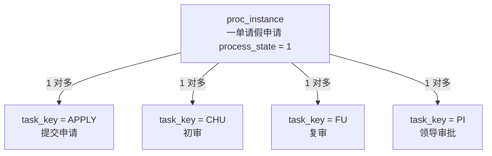

# 审批业务三张表逐列拆解：流程实例、任务实例与候选人组

Activiti 的 28 张引擎表负责让流程「转起来」，可审批列表要展示的申请人、部门、入职时间、请假天数这些内容，引擎表里一列都没有。上一节说清了「为什么必须自己建扩展表」，这里进入字段层，把三张表的每一列含义拆开讲，建表语句全部来自资料包的 `ihrm.sql`。

## 先给结论

- `proc_instance` 一单申请一行，主键直接用引擎的流程实例 id，`proc_data` 一列用 JSON 字符串承载不同流程的差异化业务数据。
- `process_state` 是业务状态机：0 已提交、1 审批中、2 审批通过、3 审批不通过、4 撤销。
- `proc_task_instance` 与实例表是一对多关系，一个审批节点一条记录，靠 `process_id` 关联。
- 当前节点审批人两列是冗余列，每流转一步都必须实时更新，列表查询才不用回引擎表联查。
- `proc_user_group` 的 `isql` 列存一条查询 SQL，组 id 就是 BPMN 里的 `candidateGroups` 字符串，查候选人等于执行这条 SQL。

## 一、proc_instance：一单申请的全部业务事实

先看建表语句：

```sql
CREATE TABLE `proc_instance` (
  `process_id` varchar(45) NOT NULL COMMENT '流程实例ID',
  `process_key` varchar(45) DEFAULT NULL COMMENT '流程标识',
  `process_name` varchar(45) DEFAULT NULL COMMENT '流程名称',
  `process_definition_id` varchar(100) DEFAULT NULL COMMENT '流程定义ID',
  `process_state` varchar(3) DEFAULT NULL COMMENT '流程状态（0已提交；1审批中；2审批通过；3审批不通过；4撤销）',
  `user_id` varchar(45) DEFAULT NULL COMMENT '申请人ID',
  `username` varchar(50) DEFAULT NULL COMMENT '申请人',
  `proc_apply_time` datetime DEFAULT NULL COMMENT '申请时间',
  `proc_curr_node_user_id` varchar(255) DEFAULT NULL COMMENT '当前节点审批人ID',
  `proc_curr_node_user_name` varchar(255) DEFAULT NULL COMMENT '当前节点审批人',
  `proc_end_time` datetime DEFAULT NULL COMMENT '结束流程时间',
  `proc_data` longtext COMMENT '流程业务数据(JSON)',
  `department_id` varchar(40) DEFAULT NULL COMMENT '部门ID',
  `department_name` varchar(40) DEFAULT NULL COMMENT '部门名称',
  `time_of_entry` datetime DEFAULT NULL COMMENT '入职时间',
  PRIMARY KEY (`process_id`)
) ENGINE=InnoDB DEFAULT CHARSET=utf8;
```

**第一，身份与类型列。** `process_id` 是主键，发起申请时由业务侧的分布式 id 生成器（IdWorker）生成，随后作为 `businessKey` 传给引擎，业务单据与引擎实例一对一绑定，后续按单据回查引擎状态全靠这一列。`process_key` 与 `process_name` 区分请假、加班、离职，key 填流程定义的标识（如 `process_leave`），名称是「请假」这样的展示文案；`process_definition_id` 记录这单申请当时走的是哪个版本的流程定义。

**第二，状态列。** `process_state` 共五个取值，DDL 注释里写得很全：0 已提交、1 审批中、2 审批通过、3 审批不通过、4 撤销。它和引擎的挂起状态（`SUSPENSION_STATE`）完全是两回事，一个描述单据走到哪个结果，一个描述流程模板还能不能发起。

**第三，申请人画像列。** `user_id`、`username`、`department_id`、`department_name`、`time_of_entry`。这些数据在用户微服务里，发起申请时通过 Feign 远程查一次再冗余进本表，列表页直接展示。`time_of_entry` 单独成列，是因为转正、离职审批都要看入职时间。

**第四，当前节点审批人列。** `proc_curr_node_user_id` 与 `proc_curr_node_user_name` 是最需要维护的两列。流程流转到部门经理，这两列就是部门经理；部门经理审完流转到人事，就得立刻换成人事专员。一单申请走完全程，这两列可能换三四次。`proc_curr_node_user_id` 定义成 `varchar(255)` 也和这个有关：候选组可能命中多人，多个 id 拼串存储。

**第五，`proc_data` 业务数据列。** 请假记天数和事由，加班记小时数，离职记离职原因，各流程字段对不齐，共同点是都不多，十来个封顶。于是统一序列化成 JSON 字符串塞进一列，库里实际存的内容长这样：

```sql
-- proc_data 列中一单请假申请的真实内容
{"duration":"1","reason":"个人原因","holidayType":"1",
 "processName":"请假","processKey":"process_leave",
 "startTime":"2019-09-16 00:00:00","applyUnit":"按天",
 "endTime":"2019-09-17 00:00:00","userId":"1066370498633486336"}
```

详情页查出这串字符串后按 `processKey` 反序列化成对应表单对象，新增一种审批类型也不用改表结构。

## 二、proc_task_instance：一对多的节点流水

第二张表记录每个节点的办理情况：

```sql
CREATE TABLE `proc_task_instance` (
  `process_id` varchar(45) DEFAULT NULL COMMENT '流程实例ID',
  `task_id` varchar(45) NOT NULL COMMENT '任务实例ID',
  `task_key` varchar(45) DEFAULT NULL COMMENT '任务节点key',
  `task_name` varchar(45) DEFAULT NULL COMMENT '任务节点',
  `should_user_id` varchar(45) DEFAULT NULL COMMENT '应审批用户ID',
  `should_user_name` varchar(2000) DEFAULT NULL COMMENT '应审批用户',
  `handle_user_id` varchar(2000) DEFAULT NULL COMMENT '实际处理用户ID',
  `handle_user_name` varchar(45) DEFAULT NULL COMMENT '实际处理用户',
  `handle_time` datetime DEFAULT NULL COMMENT '处理时间',
  `handle_opinion` varchar(45) DEFAULT NULL COMMENT '处理意见',
  `handle_type` varchar(45) DEFAULT NULL COMMENT '处理类型（2审批通过；3审批不通过；4撤销）',
  PRIMARY KEY (`task_id`)
) ENGINE=InnoDB DEFAULT CHARSET=utf8;
```

一张流程要经过多个任务节点，一个节点一条任务记录，`process_id` 就是两张表之间那条一对多的外键。以请假流程为例，一单申请留下的任务痕迹：



`task_key` 与 `task_name` 对应 BPMN 里用户任务的 id 和名称。`should_user` 与 `handle_user` 两组列值得单独说：候选人组查出来的一批人都算「应审批人」，`should_user_name` 定义成 `varchar(2000)` 就是为了装下这串名单；最终真正签收办理的那个人落到 `handle_user` 两列。两张表合起来，一张讲单据现状，一张讲每一步谁批了什么，详情页时间线全靠它们拼出来。

## 三、proc_user_group：把一组候选人翻译成一条 SQL

第三张表结构最简单，作用却最巧：

```sql
CREATE TABLE `proc_user_group` (
  `id` varchar(45) NOT NULL COMMENT '主键，即用户组标识',
  `name` varchar(100) DEFAULT NULL COMMENT '组名',
  `param` varchar(45) DEFAULT NULL COMMENT '入参',
  `isql` varchar(1000) DEFAULT NULL COMMENT '对应sql',
  `isvalid` varchar(2) DEFAULT NULL COMMENT '有效标记',
  PRIMARY KEY (`id`)
) ENGINE=InnoDB DEFAULT CHARSET=utf8;
```

画流程图时，每个审批节点都指定了候选组，BPMN 文件里是这样的：

```xml
<bpmn2:userTask id="APPLY" name="提交申请" activiti:candidateGroups="PROCESS_LEAVE_APPLY_USERS"></bpmn2:userTask>
<bpmn2:userTask id="CHU" name="初审" activiti:candidateGroups="PROCESS_LEAVE_CHU_USERS"></bpmn2:userTask>
```

那串 `PROCESS_LEAVE_CHU_USERS` 只是组名，组里到底有谁，答案在这张表的种子数据里：

```sql
INSERT INTO proc_user_group (id, name, param, isql, isvalid) VALUES
('PROCESS_LEAVE_APPLY_USERS', '请假申请人', 'user_id',
 'SELECT id,username FROM bs_user WHERE id = ${user_id}', '1'),
('PROCESS_LEAVE_CHU_USERS', '请假初审用户组', 'department_id',
 'SELECT manager username, manager_id id FROM co_department WHERE id = ${department_id}', '1');
```

逐列对上：`id` 与 BPMN 的 `candidateGroups` 完全一致，这是流程文件与业务库的连接点；`param` 声明这条 SQL 需要的入参名；`isql` 存真正的候选人查询语句，`isvalid` 控制组是否生效。流程流转到初审节点时，业务侧按组 id 取出 `isql`，把 `${department_id}` 占位符替换成申请人所在部门，一执行就得到该节点全部候选人。部门审批人可能有两三个，人事还会调整，写死在代码里迟早要返工；放一条 SQL，组织架构怎么变都只是数据问题，流程文件一行不改。

## 常见误区

- **把 `proc_user_group` 当成用户明细表**：它一行存一个组的定义（id、组名、入参、查询 SQL），不存用户本身，用户数据仍在员工表里，执行 `isql` 才查出人。
- **任务办理完不更新当前审批人列**：`proc_curr_node_user_id` 和 `proc_curr_node_user_name` 忘记随流转刷新，审批列表上永远显示上一位审批人，待审批筛选也就全错了。
- **拿引擎状态填 `process_state`**：引擎的挂起、激活描述流程模板，业务的五种状态描述单据结果，两者维度不同，混用会让列表筛选彻底乱掉。
- **用数字类型存业务主键**：主键由分布式 id 生成器（IdWorker）产出，位数很容易超出 `bigint` 的表达范围，主键列用字符类型才稳。

## 面试可能被问到的问题

1. 面试官追问：「不同审批流程的业务字段不一样，为什么不用每种流程一张表？」
   答：请假、加班、离职的字段差异大但总量小，十来个字段以内。统一序列化成 JSON 存进 `proc_data` 一列，表结构就稳定了，新增审批类型不改库。读取时按 `processKey` 反序列化成对应表单对象即可，代价是 JSON 内字段无法直接参与 SQL 过滤，关键筛选条件要冗余成独立列。

2. 面试官追问：「`proc_instance` 的主键为什么在业务侧生成，而不是回填引擎实例 id？」
   答：业务数据在开启流程之前就要组装成型，主键先用 IdWorker 生成，再作为 `businessKey` 传进 `startProcessInstance`，引擎实例从出生就挂着这个业务标记。两边各存一份 id 值但语义唯一，按单据查引擎、按实例对账业务都不需要额外映射表。

3. 面试官追问：「候选人组为什么用一条 SQL 表达，而不是建用户组关联表？」
   答：审批人往往跟着组织架构走，比如「部门负责人」「人事部全体」。关联表要在人员变动时人工维护，容易漏；SQL 方式实时关联员工表和部门表，数据变了候选人自动跟着变，维护成本最低。

4. 面试官追问：「`proc_task_instance` 里 should_user 和 handle_user 为什么要分开存？」
   答：候选组命中一批人时他们都算应审批人，最终只有一个签收办理。分开存才能还原「这一步谁有资格审、实际谁审了」的完整过程，也支撑审批超时提醒、代审统计这类基于候选名单的衍生需求。

5. 面试官追问：「审批列表查询走引擎表还是业务表？」
   答：走业务表。审批列表要按审批类型、状态、当前审批人、申请人筛选，还要展示部门、入职时间等业务画像，这些都在扩展表里；引擎表只管流转事实，语义绕且缺少业务字段。发起与办理时保持业务表与引擎双写一致，查询就只碰业务库。

## 配套资料

- 三张表的建表语句与候选人组种子数据：`materials/code/02/day17 审批中心/day17/ihrm.sql`（搜索 `proc_instance`、`proc_task_instance`、`proc_user_group`）
- 对应实体类：`materials/code/02/day17 审批中心/day17/03-资料/02搭建环境代码/entity/ProcInstance.java`
- 任务实例与用户组实体：`materials/code/02/day17 审批中心/day17/03-资料/02搭建环境代码/entity/ProcTaskInstance.java`
- 请假流程 BPMN（`candidateGroups` 与 `${days}` 分支条件的出处）：`materials/code/02/day17 审批中心/day17/03-资料/所有的流程bpmn文件/请假.bpmn20.xml`
