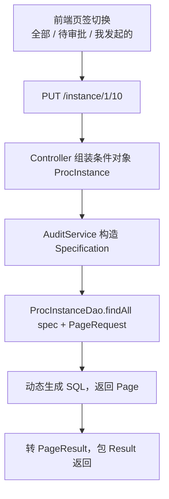

# 审批中心开工：补齐 audit 服务环境，写好「我的申请列表」动态分页查询

审批中心的第一批功能代码不碰引擎 API，先把 audit 服务的环境补齐：三张业务表对应的实体类、DAO、跨服务取用户的 Feign 客户端搬进工程，然后实现审批列表的分页条件查询。列表这个接口看着简单，藏了三个值得琢磨的细节：为什么请求方式用 PUT 而不是 GET，三个查询条件为什么分别用 `equal`、`in`、`like`，页码为什么要减一。

## 先给结论

- 环境补齐三件套：三个实体类对应三张 `proc_*` 业务表，三个 DAO 继承 `JpaRepository` 与 `JpaSpecificationExecutor`，一个 `FeignClientService` 封装跨服务取用户、部门的调用。
- 审批列表只查自己的 `proc_instance` 业务表，不去联查 Activiti 引擎库，实例表已经冗余了引擎 id 与业务画像。
- 接口用 `PUT /instance/{page}/{size}`，查询条件用 `@RequestBody` 的 `ProcInstance` 对象承载，所以不能用 GET。
- 三个条件的查询语义：审批类型单值用 `equal`，审批状态多个逗号分隔用 `in`，当前节点审批人是多人拼串用 `like` 模糊匹配。
- 分页交给 `procInstanceDao.findAll(spec, PageRequest.of(page - 1, size))`，页码从 0 开始，入参的 `page` 要先减一。

## 一、audit 服务环境补齐

数据库多建了三张 `proc_*` 表，工程里就多三组对应物。实体类和 DAO 在课程资料里都准备好了，做的是复制进 `audit` 模块再微调，不需要逐行手敲。

实体类 `ProcInstance`、`ProcTaskInstance`、`ProcUserGroup` 分别映射三张业务表。前两个在拆表设计时已经见过，`ProcUserGroup` 最短，四个字段：

```java
@Entity
@Table(name = "proc_user_group")
@Data
public class ProcUserGroup {
    @Id
    private String id;      // 组标识，与 BPMN 的 candidateGroups 一致
    private String name;    // 组名
    private String param;   // 候选人查询的入参名
    private String isql;    // 候选人查询语句
}
```

三个 DAO 都是标准 JPA 写法，唯独任务表多两个衍生查询方法：

```java
public interface ProcTaskInstanceDao extends JpaRepository<ProcTaskInstance, String>,
        JpaSpecificationExecutor<ProcTaskInstance> {

    // 根据流程ID和任务节点key查询
    ProcTaskInstance findByProcessIdAndTaskKey(String processId, String taskKey);

    // 根据流程ID查询全部任务节点，一个流程对应多个节点
    List<ProcTaskInstance> findByProcessId(String processId);
}
```

方法名就是查询语句，Spring Data JPA 按属性名解析出 SQL。`findByProcessId` 服务于审批详情页：一个流程发起后有多个节点、多个处理人，任务对实例是一对多，按流程 id 一次查出全部节点记录。

第三块是跨服务取数据的 Feign 门面。发起申请、渲染详情时都要拿申请人的姓名、部门、入职时间，这些在系统微服务里，所以补一个 client 包，放两个类。接口声明是常规的 Feign 姿势：

```java
@FeignClient("system-service")
public interface SystemFeignClient {

    @RequestMapping(value = "/sys/user/{id}", method = RequestMethod.GET)
    Result findById(@PathVariable(value = "id") String id);
}
```

`FeignClientService` 在接口之上做了一层业务包装：调 Feign 拿 `Result`，失败直接抛异常，成功把 `data` 反序列化成实体返回，调用方不用再关心解析细节：

```java
@Service
public class FeignClientService {

    @Autowired
    private SystemFeignClient systemFeignClient;

    // 根据用户ID查询用户信息
    public User getUserInfoByUserId(String userId) {
        if (userId == null) throw new RuntimeException("获取当前用户为空！");
        Result result = systemFeignClient.findById(userId);
        if (!result.isSuccess()) throw new RuntimeException("用户ID不存在，请联系管理员：" + userId);
        return JSON.parseObject(JSON.toJSONString(result.getData()), User.class);
    }
}
```

环境到此补齐：实体、DAO、Feign 门面三类文件复制到位。`ProcTaskInstanceDao` 资料里原本还有按流程 id 与任务 key 组合查询的 `findByProcessIdAndTaskKey`，这一课用不到就先注释掉，需要时再放出来。

## 二、接口约定：一个 PUT 承载多个查询条件

审批列表页有三个页签：全部、待审批、我发起的，外加按审批类型筛选。这些场景共用一个后端接口，差异全在查询条件里。条件整理下来有四类：审批类型对应 `processKey`，单值；审批状态对应 `processState`，可多选，多个值之间用逗号隔开；待审批页签传当前节点审批人 `procCurrNodeUserId`；我发起的传申请人 `userId`。

条件对象加两个分页参数，接口这样约定：

```java
// 查询申请列表：条件对象 + 分页参数
@RequestMapping(value = "/instance/{page}/{size}", method = RequestMethod.PUT)
public Result instanceList(@RequestBody ProcInstance instance,
                           @PathVariable int page,
                           @PathVariable int size) {
    //1.调用service分页查询
    Page<ProcInstance> pages = auditService.getInstanceList(instance, page, size);
    //2.Page对象转换为自己的PageResult
    PageResult<ProcInstance> pr = new PageResult<>(pages.getTotalElements(), pages.getContent());
    //3.返回
    return new Result(ResultCode.SUCCESS, pr);
}
```

查询条件用 `@RequestBody` 接收成 `ProcInstance` 对象，而 GET 请求携带请求体不符合主流客户端的约定，于是请求方式改用 PUT。这里的 PUT 只是借它的「带请求体」能力，不做资源替换语义，团队内约定一致即可。

Controller 里只有三步：调 Service 分页查询，拿到 Spring Data JPA 封装的 `Page` 对象；把 `Page` 转成项目统一的 `PageResult`（总数加当前页数据）；包成 `Result` 返回。整条链路是：



图中唯一可能出错的环节在最后两步：`Page` 是 JPA 的返回类型，直接吐给前端字段语义不友好，必须转一层 `PageResult`，这一步漏掉，前端拿到的分页结构和别处接口对不上。

## 三、Service：Specification 动态拼条件

条件多且可选，写死 SQL 或堆一排 DAO 方法都不合适，用 JPA 的 `Specification` 动态构造。Service 的完整实现：

```java
@Service
public class AuditService {

    @Autowired
    private ProcInstanceDao procInstanceDao;

    /**
     * 分页查询审批列表（全部 / 待审批 / 我发起的共用）
     */
    public Page<ProcInstance> getInstanceList(ProcInstance instance, int page, int size) {
        //1.使用Specification查询，按传入参数动态构造条件
        Specification<ProcInstance> spec = new Specification<ProcInstance>() {
            @Override
            public Predicate toPredicate(Root<ProcInstance> root,
                                         CriteriaQuery<?> query, CriteriaBuilder cb) {
                List<Predicate> list = new ArrayList<>();
                //审批类型（流程key，单值，等值匹配）
                if (!StringUtils.isEmpty(instance.getProcessKey())) {
                    list.add(cb.equal(root.get("processKey").as(String.class),
                            instance.getProcessKey()));
                }
                //审批状态（多个，每个状态之间用逗号隔开）
                if (!StringUtils.isEmpty(instance.getProcessState())) {
                    Expression<String> exp = root.get("processState").as(String.class);
                    list.add(exp.in(instance.getProcessState().split(",")));
                }
                //当前节点处理人（候选组可能命中多人，id 是拼串，模糊匹配）
                if (!StringUtils.isEmpty(instance.getProcCurrNodeUserId())) {
                    list.add(cb.like(root.get("procCurrNodeUserId").as(String.class),
                            "%" + instance.getProcCurrNodeUserId() + "%"));
                }
                //发起人（「我发起的」页签）
                if (!StringUtils.isEmpty(instance.getUserId())) {
                    list.add(cb.equal(root.get("userId").as(String.class),
                            instance.getUserId()));
                }
                return cb.and(list.toArray(new Predicate[list.size()]));
            }
        };
        //2.调用dao进行Specification查询，页码从0开始
        return procInstanceDao.findAll(spec, PageRequest.of(page - 1, size));
    }
}
```

**第一，每个条件先判空再追加。** 四个 `if` 各管一个字段，前端传了才 `list.add`，一个条件都不传时 `cb.and` 空数组退化为恒真条件，查询就是「全部」页签。一个方法覆盖三个页签，靠的是条件的动态组合而不是三份代码。

**第二，三种谓词各有理由。** `processKey` 是单值等值，用 `cb.equal`；`processState` 传「2,3」这样的多值串，`split(",")` 之后交给 `Expression.in` 生成 `in (2,3)`；`procCurrNodeUserId` 特殊，候选组命中多人时这一列存的是多个 id 拼成的串，等值匹配永远查不中，只能 `like` 前后加 `%` 做包含匹配。

**第三，分页参数减一。** JPA 的页码从 0 开始，用户界面上第一页是 1，所以 `PageRequest.of(page - 1, size)`。这一处写错，第一页永远空白，第二页才出数据。

照理还该有一个多租户条件 `companyId`，课程里因为业务表当时没预留这一列而留作练习：加上 `company_id` 列与对应 `if` 判断即可，思路与上面四个条件完全一致。

## 常见误区

- **GET 请求挂 `@RequestBody`**：部分客户端不发送 GET 请求体，网关也可能丢弃，条件传不到后端。约定用 PUT 承载带请求体的查询，或者改用查询参数拼接。
- **页码忘了减一**：`PageRequest.of(page, size)` 直接用入参页码，首页查出的是第二页数据，表现是「第一页空、翻页才有数据」。
- **当前审批人用 `equal` 查**：这一列是多人拼串，`equal` 只有全串相等才命中。用 `like` 加两侧 `%`，传完整串和单个 id 都能查中。
- **多值状态直接 `equal`**：前端传「2,3」整串去等值匹配，一个都查不到。必须先 `split(",")` 再 `in`。
- **返回值直接用 `Page`**：`Page` 的 JSON 结构是 JPA 视角，项目里其它分页接口都是 `PageResult`，统一转换才能让前端复用同一套渲染逻辑。

## 面试可能被问到的问题

1. 面试官追问：「Specification 动态查询和手写 SQL 比有什么优劣？」
   答：优势是条件按参数动态拼接，类型安全，改实体字段时编译期就能发现错，天然防注入；劣势是复杂关联、分组统计写起来啰嗦，可读性不如 SQL。简单多条件列表页用 Specification 合适，复杂报表该上 SQL 或查询构建器。

2. 面试官追问：「审批列表为什么不直接查 Activiti 的运行时任务表？」
   答：列表要按审批类型、业务状态、申请人、部门、入职时间筛选展示，这些字段引擎表没有；运行时任务表只反映当前节点，查历史还得换历史表。业务实例表冗余了引擎实例 id 与业务画像，一张表覆盖三种页签的查询，跨库查询的成本与风险都省了。

3. 面试官追问：「当前节点审批人为什么要存多人拼串再 like 查询，而不是单独建审批人表？」
   答：拼串是列表场景下的取舍，写入方便、单表查询快。单独建表查询要 join，语义更干净，还能支持精确索引。数据量大或审批人筛选成为高频精确查询时，应该拆表；本课场景一单流程候选人是两三个人，拼串够用。

4. 面试官追问：「`cb.and(list.toArray(...))` 在条件列表为空时返回什么？」
   答：返回一个恒真的 conjunction，等价于没有 where 限制，查出全表。这个行为正好契合「全部」页签；但也意味着忘了拼任何条件时不会报错而是全量返回，分页兜底之外，敏感列表最好加租户或部门条件兜底。

5. 面试官追问：「多租户 SaaS 系统里这类列表查询要注意什么？」
   答：所有业务查询必须带 `companyId` 条件，最好在 Service 层统一注入租户上下文，或用 Hibernate 的多租户过滤器自动补条件，避免某个开发漏写造成跨租户数据泄露。索引设计上租户列要放在联合索引最左。

## 配套资料

- 三个实体类与三个 DAO（文中代码摘自此目录，包名已改为 `com.example`）：`materials/code/02/day17 审批中心/day17/03-资料/02搭建环境代码/dao/ProcTaskInstanceDao.java`
- 实体与用户组定义：`materials/code/02/day17 审批中心/day17/03-资料/02搭建环境代码/entity/ProcUserGroup.java`
- Feign 门面与系统微服务客户端：`materials/code/02/day17 审批中心/day17/03-资料/02搭建环境代码/client/FeignClientService.java`
- 三张业务表 DDL 与多值状态列定义：`materials/code/02/day17 审批中心/day17/ihrm.sql`
- audit 服务既有工程（Controller、Service 在此基础上扩展）：`materials/code/02/day16 薪资管理与工作流概述/day16/03-资料/04审批代码/ihrm_audit/src/main/java/com/ihrm/audit/controller/ProcessController.java`
