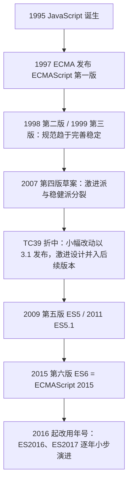

# ES6 到底是什么：从 JavaScript 十天诞生到 ECMAScript 2015 的版本演进

打开任何一份 React、Vue 或 Angular 的现成代码，满屏的 `let`、箭头函数、`class`、模块导入，这些写法在老教材里根本找不到。它们全部来自 ES6。这门课的项目前端选了 React，第一课自然要先把 ES6 讲清楚；而要真正理解 ES6 的分量，得从 ECMAScript 这门标准二十多年的演进史说起，那段历史里有一次著名的难产，直接塑造了今天的 JavaScript。

## 先给结论

- ES6 是 ECMAScript 第六版的简称，即 ECMAScript 2015，2015 年 6 月正式发布，是 JavaScript 语言的下一代标准。
- ECMAScript 是标准，JavaScript 与当年的 JScript 都是对这个标准的实现，浏览器厂商实现标准，标准由 ECMA 组织制定。
- 从 ES6 起版本号改用年号（ES2015、ES2016、ES2017），「ES6」也从一个版本号演变成泛指 ES5.1 之后新一代标准的历史名词。
- ES6 的目标是让 JavaScript 能编写复杂的大型应用程序，成为企业级开发语言，这是它与之前所有版本在定位上的本质区别。
- 对后端工程师，ES6 是必修课：主流前端框架代码全部建立在 ES6 语法之上，看不懂它就无法与前端协作。

## 一、ES6 是什么，目标又是什么

ES6 是 ECMAScript 6 的简称，属于 JavaScript 语言的下一代标准，2015 年 6 月正式发布。它的官方目标说得很直白：使 JavaScript 语言可以用于编写复杂的大型应用程序，成为企业级开发语言。

这句话的分量在于定位的转变。在 ES6 之前，JavaScript 的主流角色是网页里的一门脚本语言，做表单校验、写点动效；ES6 之后，语言层面补齐了模块化、类、块级作用域这些工程化能力，定位转向支撑大型应用。前面课程里预埋的那段示例已经能看出味道：类声明、构造方法与默认参数、静态方法、继承，这些在后端语言里理所当然的能力，都是 ES6 一次性带给 JavaScript 的。

## 二、标准从哪来：从脚本混战到 ECMA 接管

理解 ES6 之前得先分清三个词。ECMAScript 是规范（一份说明语言该怎么实现的文档），JavaScript 是这份规范最著名的实现，浏览器里的 V8、SpiderMonkey 等引擎是规范的又一层实现。这条链路是怎么形成的，要从网页的两次换代说起。

**web 1.0 时代，页面是纯静态的。** 以 HTML 为主，网页只读，信息从服务端到客户端单向流通，开发人员只需要关心页面的样式与内容，没有真正的前端交互可言。

**web 2.0 时代，脚本进了浏览器。** 1995 年，网景公司的工程师布兰登·艾克花了十天时间设计出 JavaScript，一门塞进浏览器的脚本语言；1996 年，微软发布了功能类似的 JScript。问题随之而来：两家各说各话，如果放任下去，每家浏览器厂商都可能推出自己的方言，开发者要为每个浏览器写一套代码。

**1997 年，标准登场。** ECMA（欧洲计算机制造商协会）出面，以 JavaScript 为基础制定了统一的语言标准，就是 ECMAScript。从此 JavaScript 与 JScript 都成了这个标准的实现，各浏览器厂商跟进实现标准。语言有了法定的公共契约，方言混战才画上句号。

## 三、版本演进：一次难产与一次转身

标准定型之后，版本演进的时间线值得完整看一遍：



前三版走得很顺，第三版（1999 年 12 月发布）之后规范已经相当完善稳定。麻烦出在第四版：2007 年 10 月草案公布，制定过程却陷入了内耗。委员会分成两个工作组同时开工，一边以 Adobe 与谷歌为主导，主张大刀阔斧的激进改动；另一边以微软与雅虎为主导，主张小幅更新，两边的思路分歧大到难以调和。最终 TC39 委员会拍板折中：把不那么激烈的改动保留下来，以 3.1 为基础继续发布，激进派的设计则并进后续版本。那段历史常被概括为一句话：ES4 难产，它的遗产在多年后的 ES6 里重生。

ES5 于 2009 年 12 月发布，2011 年 6 月的小版本 ES5.1 是旧时代的最后一站。2015 年 6 月，主角登场：第六版发布，同时命名规则换成 ECMAScript 2015，从此版本号改用年号，每年小幅演进。于是「ES6」有了双重身份：狭义指 ES2015 这一个版本，广义上大家习惯用它泛指 ES5.1 之后的整个新一代标准，ES2015、ES2016、ES2017 都算在这个伞下。本课说「学 ES6 新特性」，取的正是广义。

## 四、分水岭在哪：一段代码两种写法

ES6 为什么配得上「分水岭」这个词，把同一件事的两种写法摆在一起就一目了然。以前的 JavaScript 写法：

```javascript
// ES5：var 声明、函数表达式、字符串拼接
var User = function(name, age) {
    this.name = name;
    this.age = age;
};
User.prototype.sayHello = function() {
    return "hello, " + this.name;
};
```

ES6 之后的写法：

```javascript
// ES6：class、默认参数、模板字符串
class User {
    constructor(name, age = 20) {
        this.name = name;
        this.age = age;
    }
    sayHello() {
        return `hello, ${this.name}`;
    }
}
```

能力是等价的，表达力完全不同。块级作用域的 `let` 与 `const`、箭头函数、解构赋值、默认参数、模板字符串、`class` 与 `extends`、原生模块 `import` 与 `export`、Promise，这一批特性合起来把 JavaScript 从「能写」推向了「好维护」。对这门课而言更实际的问题是：React 的组件就是 ES6 class，props 靠解构取值，模块靠 `import` 组织，不理解这些语法，下一节课的每一行代码都读不顺。这也是「先 ES6 后 React」这个课程顺序的全部理由。

## 常见误区

- **把 ES6 等同于 ES2015 这一个版本**：狭义上没错，但工程语境里的 ES6 是泛指，涵盖 2015 之后逐年发布的特性。看到 ES2018 的语法别惊讶，它依然属于「ES6 体系」。
- **把 ECMAScript 当成另一门语言或一个产品**：它是规范文档，JavaScript 是实现。正确的说法是「JavaScript 实现了 ECMAScript 标准」，而不是「JavaScript 和 ECMAScript 是两门语言」。
- **记错关键版本时间**：常见的错误记忆是 ES5 在 2019 年发布，实际是 2009 年 12 月；ES6 与 ES2015 是同一版。记牢「2015 年起年号即版本」这条规则，就不再会乱。
- **担心浏览器不支持就不敢用 ES6**：现代构建工具链里有 Babel 这类转译器，源码写 ES6，构建时降级成目标环境兼容的代码，开发体验与兼容性两头都保住。

## 面试可能被问到的问题

1. 面试官追问：「ECMAScript 和 JavaScript 是什么关系？」
   答：ECMAScript 是语言规范，由 ECMA 组织的 TC39 委员会维护；JavaScript 是对该规范的实现，历史上的 JScript 也是实现之一。引擎（如 V8）实现规范，框架调用语言能力，层级是规范、实现、应用三层。

2. 面试官追问：「为什么说 ES6 是 JavaScript 的分水岭？」
   答：两点。语言定位上，它首次明确面向大型企业级应用设计，补齐了模块、类、块级作用域等工程化能力；生态上，此后 React、Vue 等主流框架的代码全部建立在 ES6 语法之上，不用 ES6 等于读不了现代前端代码。

3. 面试官追问：「ES4 为什么失败了，这段历史有什么启示？」
   答：第四版制定时委员会分裂成激进与稳健两个工作组，主张冲突无法调和，最终 TC39 决定保留小幅改动（3.1，后来成为 ES5），激进设计并入后续版本并在 ES6 落地。启示是语言演进而非革命，大改动需要渐进路径与广泛共识。

4. 面试官追问：「后端工程师为什么必须掌握 ES6？」
   答：后端不做前端页面，但联调接口、排查问题、评审前端数据结构都要读前端代码，现代框架代码几乎全由 ES6 语法构成。看不懂 ES6 意味着与前端协作时永远隔着一层，这类跨栈阅读能力在中小团队里是刚需。

5. 面试官追问：「ES6 代码如何在旧浏览器上运行？」
   答：借助 Babel 等转译工具，把 ES6 语法编译为 ES5 等价的降级代码，配合构建工具在打包阶段完成，源码与产物分离。开发者始终写 ES6，兼容性问题交给转译目标配置解决。

## 配套资料

- 本教学日资料包暂无配套源码（`materials/code/03/day01-ES6新特性以及ReactJS入门/`），文中代码对照示例为按本课写法补全
- 版本演进与标准沿革的讲义出处为该日的课程课件，未随源码包提供
