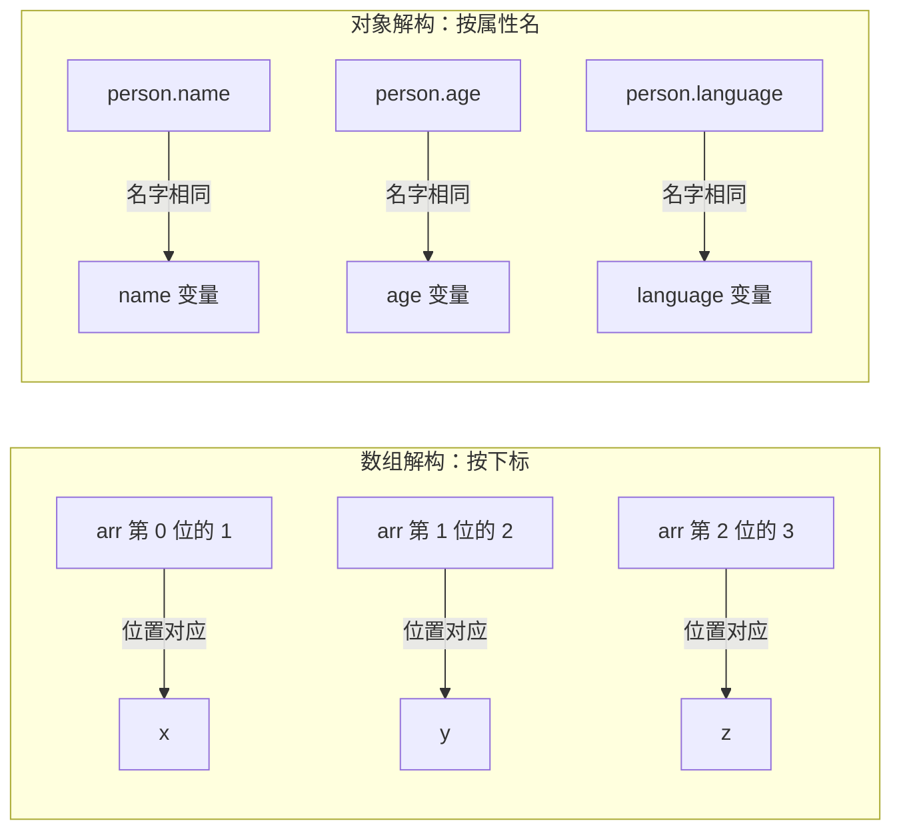

# 告别逐个下标与属性取值：ES6 解构表达式，一行从数组和对象里拿数据

从对象里取三个字段，ES5 只能一行一个：`const name = person.name; const age = person.age;`。数组取值也好不到哪去，`arr[0]`、`arr[1]` 排着队写。ES6 给了一种新模式化的取值方式：允许按照一定的模式，从数组或对象中提取值，再对变量进行赋值，官方名字叫解构。文字定义有点抽象，放一段代码立刻就懂。

## 先给结论

- 数组解构按下标对位：`let [x, y, z] = arr;` 把 1、2、3 依次交给 x、y、z。
- 对象解构按属性名对位：`let {name, age, language} = person;`，变量名必须与属性名一致。
- 数组可以只解构前几个元素，左边写几个右边就取几个。
- 对象解构支持重命名：`let {name: n} = person;` 冒号前是属性名，冒号后是新变量名。
- 解构还能直接用在函数参数上，下一课的参数默认值会大量用到这个组合。

## 一、数组解构：按下标对位

老写法用下标一个一个取：

```javascript
let arr = [1, 2, 3];
console.log(arr[1]);   // 2
```

ES6 的解构写法，左边声明变量、右边给数组，位置一一对应：

```javascript
let arr = [1, 2, 3];
let [x, y, z] = arr;
console.log(x, y, z);   // 1 2 3
```

左边方括号里的 x、y、z，按顺序对应右边数组的第 0、1、2 位，`let` 与 `const` 都能用来声明。能一次拿全部，也能只拿一部分，左边只写一个变量就只取第 0 位：

```javascript
let [x1] = arr;
console.log(x1);   // 1
```

需要全部就全写，只需要前两个就写两个，模式完全由左边的书写形式决定，这也是「按一定模式提取值」的含义。

解构模式还支持嵌套，左边写多少层括号，右边就得有对应层级的结构，内层变量与内层元素对位，比如 `let [a, [b, c]] = [1, [2, 3]];` 会把 1 交给 a，把 2、3 分别交给 b 与 c。处理二维数组或分组数据时，这种写法省掉了先取外层再取内层的两步下标访问。

## 二、对象解构：按属性名对位

对象解构的规则与数组类似，但符号必须换成花括号。课堂里专门强调过这一点：对象不能用方括号，因为对象没有下标，对位依据从「位置」变成了「属性名」。演示用的对象：

```javascript
const person = {
    name: "jack",
    age: 21,
    language: ["java", "js", "css"]
};
let {name, age, language} = person;
console.log(name, age, language);
// jack 21 [ 'java', 'js', 'css' ]
```

`name` 拿到 `person.name`，`age` 拿到 `person.age`，`language` 拿到 `person.language`。注意最后一个解出来的本身还是个数组，控制台会原样打印出 `[ 'java', 'js', 'css' ]`，解构只负责取值，不会把数组拆散。

**第一，变量名必须和属性名一致。** 写 `{nane}` 这种对不上号的名字，解出来是 `undefined`，而且不报错，属于静默失败。

**第二，想换个名字，用冒号重命名。** 冒号左边是对象里的属性名，右边是新变量名：

```javascript
let {name: n, age: a, language: l} = person;
console.log(n, a, l);
// jack 21 [ 'java', 'js', 'css' ]
```

打印结果与不重命名时完全一致。读懂这个语法的关键是把左边看成「模式」而不是「变量列表」：真正被赋值的是冒号右边的变量。

两种解构的对位规则画出来一目了然：



左图靠顺序，右图靠名字，这是两种解构唯一的本质区别，其余语法差异都由此派生。

## 三、往前一步：解构直接用在函数参数上

把解构模式写进形参，函数体内就不用再写 `obj.xxx`：

```javascript
function show({name, age}) {
    console.log(`${name} 今年 ${age} 岁`);
}
show(person);   // jack 今年 21 岁
```

实参传整个对象，形参的花括号就是对象解构模式，函数一进来 `name` 与 `age` 就已经就位。上一课的模板字符串在这里顺手完成拼接。这个组合在下一课「参数默认值」里会大量出现，也是 React 组件接收 props 的标准姿势。

另外，实参对象上多余的属性在解构时会被直接忽略，形参里只声明用得到的字段即可，调用方不必为某个函数专门裁剪数据。接收接口返回的大对象时，各函数各自声明需要的字段，互不干扰，这也是参数解构比逐个写 `obj.xxx` 更整洁的原因。

## 常见误区

- **对象解构误写成方括号。** `let [name, age, language] = person;` 不报语法错，但对象按下标解构，三个变量全是 `undefined`。看到对象就该条件反射地敲花括号。
- **以为解构失败会报错。** 属性名写错、对象上没有该属性，结果都是 `undefined` 而不是异常，排错时只能靠打印确认；对不存在的属性可以在解构时给默认值兜底。
- **数组解构跳位不会写。** 只想要第 2 个元素，不能把前面的变量删掉了事，要用逗号占位：`let [, two] = arr;` 拿到 2。省略占位符会把后面的值整体前移。
- **对 null 或 undefined 解构。** 右侧不是可迭代对象或对象时直接抛 `TypeError`，解构前要确认数据源存在。

## 面试可能被问到的问题

1. 面试官追问：「数组解构和对象解构的对位规则有什么区别？」
   答：数组解构按下标，变量顺序与元素顺序一一对应，名字无关紧要；对象解构按属性名，变量名（或冒号前的模式）必须与属性名匹配，顺序无关。前者是位置模型，后者是键模型。

2. 面试官追问：「let {name: n} = person 里的 name 和 n 分别是什么？」
   答：冒号前的 name 是匹配模式，对应对象上的属性名；冒号后的 n 才是真正被声明并赋值的变量。整个左边是一个解构模式，赋值发生在模式的最右端。

3. 面试官追问：「怎么用解构交换两个变量？」
   答：`[a, b] = [b, a];` 一行完成，右边先构建新数组，左边按位置重新赋值。注意若 a、b 之前是 let 声明，这行不需要再写声明关键字，直接作为赋值表达式执行。

4. 面试官追问：「解构一个 undefined 会发生什么？」
   答：立即抛 TypeError: Cannot destructure property xxx of undefined。因为解构需要读取右侧的属性，null 与 undefined 上读属性本身就是错误，接口返回值先判空再解构是必要的防御。

5. 面试官追问：「解构在实际项目里最常用的三个场景？」
   答：一是函数参数传对象时在形参上解构，减少函数体内的属性访问；二是接收接口返回的 JSON，一行取出需要的字段；三是配合展开运算符做对象浅拷贝与默认值合并，React 的 props 处理基本都建立在这几个用法上。

## 配套资料

- 本教学日资料包暂无配套源码（`materials/code/03/day01-ES6新特性以及ReactJS入门/`），文中示例为按本课写法补全的可运行代码，数组解构、对象解构、重命名与函数参数解构四段均可粘贴到 HTML 的 `<script>` 标签里直接验证
