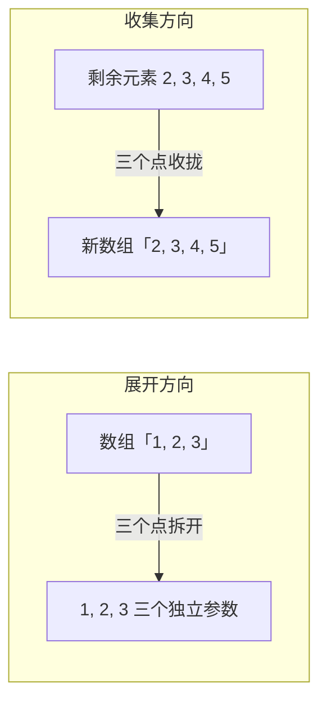

# 扩展运算符：同一个三个点，展开与收集两个方向

代码里孤零零的三个点 `...`，初学者第一反应多半是打错了。它其实是 ES6 的扩展运算符，作用是把数组转为用逗号分隔的参数序列。更有意思的是，同一个符号放进解构里方向反转，从「拆开一个数组」变成「收拢剩余元素」。一拆一收两个方向分清，数组操作的大半便利都来自这三个点。

## 先给结论

- 扩展运算符 `...` 把数组拆开成逗号分隔的参数序列，这是展开方向。
- 展开的典型用途：逐个打印数组元素、把数组当实参传给多参函数、合并数组、把字符串拆成字符数组。
- 在解构模式末尾写 `...rest`，把剩余元素收进一个新数组，这是收集方向。
- 收集只允许出现在最后一位，rest 得到的是全新数组。
- 函数形参处的 `...args` 叫 rest 参数，与调用处的展开是同一个符号的两个相反方向。

## 一、展开：数组拆成参数序列

```javascript
console.log([1, 2, 3]);      // [1, 2, 3]
console.log(...[1, 2, 3]);   // 1 2 3
```

第二行在数组前加了三个点，打印的不再是一个数组，而是三个独立的值。三个点把数组展开，数组作为整体消失，元素变成一个个参数。展开还能和手写的参数混在一起：

```javascript
console.log(0, ...[1, 2, 3], 4, 5);   // 0 1 2 3 4 5
```

0 是自己写的，1、2、3 是数组展开出来的，4、5 又是自己写的，前后自由拼接。可以把三个点理解成「剥掉方括号」：数组字面量拆掉外壳后剩下的元素序列，原样嵌进它所在的位置，位置在哪儿由书写处决定，理解了这一点，传参、混拼、合并都顺理成章。

## 二、把数组传给多参函数

函数要求两个参数，手里却是一个数组，三个点直接解决：

```javascript
function add(x, y) {
    return x + y;
}
var numbers = [1, 2];
console.log(add(...numbers));   // 3
```

`add(...numbers)` 等价于 `add(numbers[0], numbers[1])`。ES5 时代要靠 `add.apply(null, numbers)` 借 apply 拆参数，还得绑一个无关的 `this`，展开运算符把这件事变成了字面语义。

再往前一步，多参的 Math.max、Math.min 也能这样直接喂数组：`Math.max(...[3, 1, 9, 7])` 得到 9，省掉了手写循环比较或者 apply 绕路的功夫，这也是展开运算符最高频的用途之一。

## 三、合并数组与字符串转数组

两个数组用三个点拼进一个数组字面量：

```javascript
// 数组合并
let arr = [...[1, 2, 3], ...[4, 5, 6]];
console.log(arr);   // [1, 2, 3, 4, 5, 6]
```

`[1, 2, 3]` 和 `[4, 5, 6]` 各自展开成元素序列，再被外层的方括号收回来，得到一个新数组，原来的两个数组不受影响。concat 能做到的合并，这里写得更直白，而且新旧数组、散元素混拼也顺手，外层方括号里也可以只展开一个数组、补几个手写元素。字符串同样可以展开，拆成单字符数组：

```javascript
// 将字符串转成数组
console.log([...'hello']);   // ["h", "e", "l", "l", "o"]
```

## 四、收集方向：解构里的 rest

同一个符号，放进解构就方向反转。数组五个元素，只想要第一个，剩下的收进一个数组：

```javascript
// 与解构结合
const [first, ...rest] = [1, 2, 3, 4, 5];
console.log(first);   // 1
console.log(rest);    // [2, 3, 4, 5]
```

`first` 对应第一个元素，`...rest` 把剩下的全部收进新数组。两个方向用一张图对照：



## 五、与 rest 参数区分：位置决定含义

**第一，展开发生在调用处或字面量里。** `add(...numbers)`、`[...a, ...b]`，作用是拆，把已有的结构散成独立的值。

**第二，收集发生在解构模式或函数形参里。** `const [first, ...rest] = ...`、`function f(a, ...rest)`，作用是收，把剩余的值拢成新数组。函数形参处的三个点有专门的名字，rest 参数（此例为按本课写法补全的示例）：

```javascript
function sum(...nums) {             // 收集：所有实参收进数组 nums
    return nums.reduce((a, b) => a + b, 0);
}
console.log(sum(1, 2, 3, 4));       // 10
console.log(sum(...[1, 2, 3, 4]));  // 10：调用处展开，形参处再收集
```

调用处展开、形参处收集，一来一回刚好抵消，函数体内拿到的 `nums` 还是 `[1, 2, 3, 4]`。rest 参数必须放在形参列表的最后一位，道理与解构相同：收集无法预知终点，只能收尾。它也是 `arguments` 的现代替代品：是真数组，`map`、`reduce` 随便用，还能配合前面的具名参数。

## 常见误区

- **rest 不放在解构最后。** `const [...rest, last] = [1, 2, 3]` 直接语法错误，收集只允许发生在末尾。
- **以为 rest 与原数组共享引用。** rest 是解构时新建的数组，替换它的元素不影响原数组；但它是一层浅拷贝，元素若是对象，对象本身仍共享引用。
- **对不可迭代的东西用三个点。** `[...1]`、`[...null]` 直接抛 `TypeError`，展开要求目标是可迭代结构，数字、null 都不行。
- **把对象展开和数组展开混为一谈。** `{...obj}` 是后续标准给对象字面量加的能力，本课的 `...` 针对数组与可迭代结构，两者的适用位置不完全一样。

## 面试可能被问到的问题

1. 面试官追问：「扩展运算符和 rest 参数是什么关系？」
   答：同一个符号 `...` 的两个方向。用在调用处或数组字面量里是展开，把可迭代结构拆成独立元素；用在解构模式或函数形参里是收集，把剩余元素收成新数组。方向相反，位置决定含义。

2. 面试官追问：「rest 参数和 arguments 有什么区别？」
   答：`arguments` 是类数组对象，没有数组方法，箭头函数里还没有它；rest 参数是真数组，可以直接 `map`、`reduce`，能按需搭配前面的具名参数，箭头函数中也可使用。

3. 面试官追问：「[...'hello'] 得到什么，和 split 有什么不同？」
   答：得到 `["h", "e", "l", "l", "o"]`。区别在 Unicode 处理：扩展运算符按码点迭代，生僻字、表情符号能完整拆出；`split("")` 按码元切分，遇到这些字符会拆成乱码。

4. 面试官追问：「用扩展运算符合并数组和 concat 有什么区别？」
   答：结果都是新数组，原数组都不变。`[...a, ...b]` 更直观，中间还能穿插普通元素，例如 `[0, ...a, 7]`；concat 在多数组拼接时调用链更啰嗦。性能差异可忽略，按可读性选即可。

5. 面试官追问：「展开运算符能复制数组吗，是深拷贝吗？」
   答：可以，`[...arr]` 得到新数组，替换或重排元素不影响原数组。但它是一层浅拷贝，数组里的对象元素仍指向同一个引用，嵌套结构要深拷贝得用其他手段。

## 配套资料

- 本教学日资料包暂无配套源码（`materials/code/03/day01-ES6新特性以及ReactJS入门/`），文中示例为按本课写法补全的可运行代码：展开打印、`add(...numbers)`、数组合并、解构收集与字符串转数组均与课件演示一致；`sum(...nums)` 为 rest 参数的补充示例，可粘贴到 HTML 的 `<script>` 标签里在浏览器控制台验证
