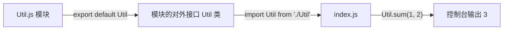

# 模块化：用 export 与 import 实现 JavaScript 版的导包

Java 工程里代码天生是分文件、分包的，要用谁就 `import` 谁。JavaScript 长期没有包的概念，早期项目把所有代码塞进一个文件或一堆全局变量里，想复用一段逻辑基本靠复制。ES6 带来了模块化，JS 里第一次有了官方的「导包」能力，后面的 React 开发会大量用到它，这一课把两个关键字吃透。

## 先给结论

- 模块化就是把代码拆分，方便重复利用，效果类似 Java 中的导包；JS 没有包的概念，用模块实现同样的效果，一个文件就是一个模块。
- 模块功能主要由两个命令构成：`export` 规定模块的对外接口，`import` 导入其他模块提供的功能。
- 导出用 `export default Util;`，导入用 `import Util from './Util';`，路径不写 `.js` 会默认补上。
- 导入之后 `Util` 就是一个普通类，静态方法直接 `Util.sum(1, 2)` 调用。
- ES6 模块之外还有 Node.js 的 CommonJS 一套（`module.exports` 与 `require`），两套体系要分得清。

## 一、什么是模块化：JavaScript 版的导包

在 Java 里想复用一个类，通常把它打进一个包，别的工程导入这个包就能用。JavaScript 过去没有这套机制，代码复用全靠人肉搬运。ES6 的模块化补上了这块：把一段独立的代码放进一个 `.js` 文件，这个文件就是一个模块；模块自己声明「我对外提供什么」（导出），别的文件声明「我要用谁」（导入）。

对照 Java 会非常好记：`export` 相当于把类打成一个对外的包，`import` 相当于导包语句。一个管出，一个管进。

## 二、export：把 Util 类导出为模块

在上一课的 UmiJS 工程里新建一个 `Util.js` 文件，里面写一个 `Util` 类，提供一个做求和的静态方法，然后把它导出：

```javascript
class Util {
    static sum = (a, b) => a + b;
}

// 导出类
export default Util;
```

`static sum = (a, b) => a + b;` 是静态属性配箭头函数的写法，效果与静态方法一致，通过类名调用。真正的新东西是最后一句 `export default Util;`：`default` 意味着这个模块的「默认对外接口」就是 `Util` 类，别的文件导入这个模块，拿到的就是它。

## 三、import：导入并使用

把 `index.js` 的内容清空，写两行：

```javascript
// 导入模块
import Util from './Util'

// 使用模块中的方法
console.log(Util.sum(1, 2));   // 3
```

保持 `umi dev` 运行，浏览器控制台输出 `3`。模块化就这么完成了：`Util` 被拆成一个独立模块，谁需要谁 `import`。

两个细节值得留意。第一，路径写 `'./Util'` 没带 `.js`，省略时导入时会默认补上 `.js`，当然写全 `./Util.js` 也没问题；路径前的 `./` 表示从当前目录找，不能省。第二，导入语句结尾的分号加不加都能执行，习惯上还是补上，保持风格统一。另外，导出时用的是 `export default`，导入时写的名字 `Util` 与导出名保持一致最清晰，后面第四节会说明 default 导入的名字其实可以自定。

一次导出加一次导入的完整链路如下：



从图上能读出模块化的分工：`Util.js` 只负责声明和导出，`index.js` 只负责导入和调用，两边通过 `export` 与 `import` 声明的接口对接，中间不需要任何全局变量。

## 四、export default、命名导出与 CommonJS 对照

`export` 其实有两种姿势，结合 Node.js 的 CommonJS 对照着看更清楚（对照部分为按主流写法补全的示例）：

**第一，默认导出 `export default`。** 一个模块最多一个，导入时不带花括号、名字可以自定：`import U from './Util'` 一样能用。适合「这个模块就是为它而生」的场景，比如一个文件一个组件。

**第二，命名导出 `export`。** 导出时可以有很多个，导入时必须带花括号、名字与导出严格对应：

```javascript
// Util2.js：命名导出（示例，按主流写法补全）
export const version = "1.0";
export function sum(a, b) { return a + b; }

// index.js：导入时花括号加名字，一一对应
import { version, sum } from './Util2';
```

**第三，CommonJS 对照。** Node.js 采用的是 CommonJS 规范，ES6 模块出现得更晚，两者在语义上高度对应：

```javascript
// CommonJS：导出
const Util = { sum: (a, b) => a + b };
module.exports = Util;

// CommonJS：导入
const Util = require('./Util');
```

| 对照项 | ES6 模块 | CommonJS |
|---|---|---|
| 导出 | `export default` / `export` | `module.exports` / `exports` |
| 导入 | `import ... from` | `require(...)` |
| 加载方式 | 编译时静态分析，依赖关系早确定 | 运行时动态加载 |

React 工程普遍走 ES6 模块这一套，`import App from './App'` 这类语句就是本课的写法在真实项目里的形态，所以这两条命令必须练到条件反射。

## 常见误区

- **省略路径里的 `./`。** `import Util from 'Util'` 会被当成第三方包名去 `node_modules` 里找，直接报模块找不到；引用自己的文件必须以 `./` 或 `../` 开头。
- **以为 default 导入的名字必须和导出名一致。** `export default Util` 之后 `import U from './Util'` 完全合法，default 导入的名字可自定；命名导出才要求花括号里的名字严格对应。
- **花括号乱用。** `import Util from`（默认导出）与 `import { sum } from`（命名导出）是两套规则，给默认导出硬套花括号，导入回来就是 `undefined`，排查半天才知道是写法错了。
- **离开工程环境双击直跑。** 浏览器对模块的加载有额外要求，课程示例跑在 UmiJS 的开发服务里，由转码和打包环节处理模块，直接把文件拖进浏览器不是等价环境。

## 面试可能被问到的问题

1. 面试官追问：「export 和 import 各自的作用是什么？」
   答：`export` 规定模块的对外接口，声明这个模块对外提供什么；`import` 用于导入其他模块提供的功能。两者配合实现代码拆分与复用，类似 Java 中的打包与导包。

2. 面试官追问：「export default 和命名导出的区别？」
   答：`export default` 是模块的默认接口，一个模块最多一个，导入时不带花括号且名字可自定；命名导出用 `export`，一个模块可以有多个，导入时必须带花括号且名字与导出严格一致。

3. 面试官追问：「ES6 模块和 CommonJS 有什么区别？」
   答：语法上 ES6 用 `import`/`export`，CommonJS 用 `require`/`module.exports`；加载机制上 ES6 模块是编译时静态分析，依赖关系在代码运行前就能确定，CommonJS 是运行时加载。前者便于做静态优化与按需打包，后者灵活但依赖要到执行时才确定。

4. 面试官追问：「import 的路径不写 .js 可以吗？」
   答：可以。省略扩展名时会默认补上 `.js`，这是打包工具按约定做的解析；但 `./` 这类相对路径前缀不能省，否则会被当作包名去 `node_modules` 查找。

5. 面试官追问：「React 项目里为什么大量使用模块化？」
   答：React 的组件天然按文件拆分，一个文件一个组件，页面由组件按层级组合而成，组件之间的复用全靠 `export` 与 `import` 连接。没有模块化就没有组件化的工程组织，所以它在 React 开发里是基础设施级别的语法。

## 配套资料

- 本教学日资料包暂无配套源码（`materials/code/03/day01-ES6新特性以及ReactJS入门/` 解压后为空），示例为按本课写法补全的可运行代码：`Util.js`（`static sum` 静态属性加箭头函数、`export default Util`）与 `index.js`（`import Util from './Util'`、`Util.sum(1, 2)` 输出 3）均与课件演示一致；第四节命名导出与 CommonJS 对照为按主流写法补全的示例，可在 UmiJS 工程中直接验证
