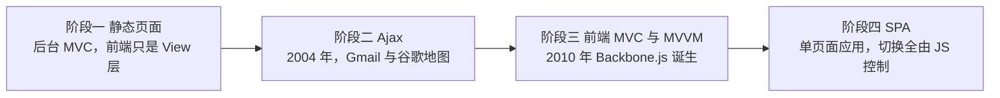
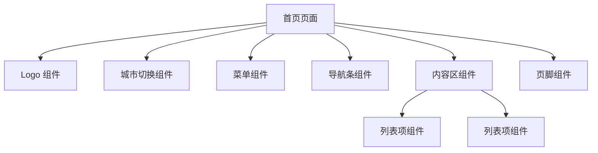
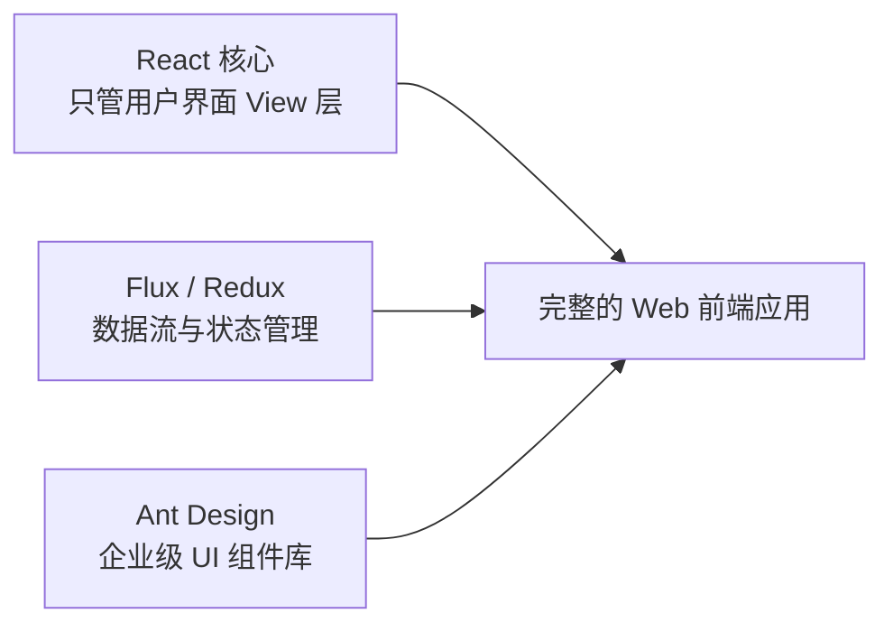
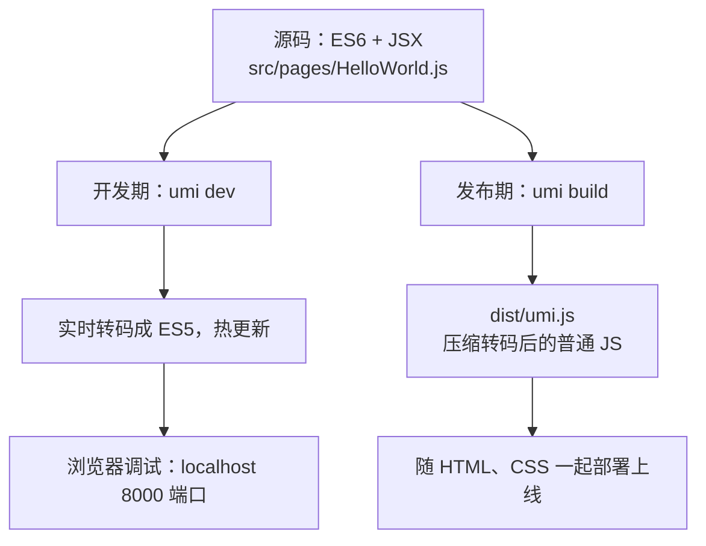
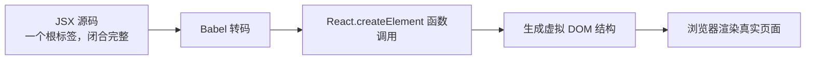
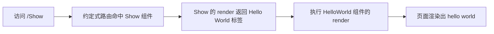
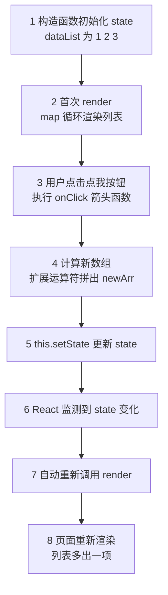
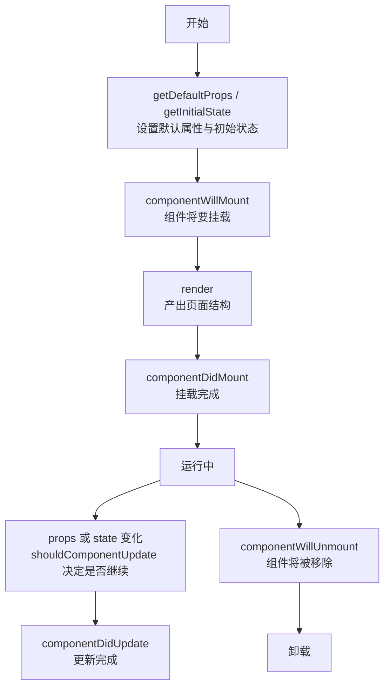

# ReactJS入门之六部曲：从前端四阶段演变到组件生命周期

## 先给结论

- 系列定位：好客租房前端技术栈的地基课，从「前端这份工作是什么」一路讲到「组件怎么生老病死」，为后续 Ant Design 与项目实战铺路。
- 主线先立坐标：前端开发四阶段（静态页面、Ajax、前端 MVC、SPA），如今正处 SPA 阶段；React 是用于构建用户界面的 JavaScript 库，核心思想是组件化，只负责视图层。
- 工程落地用 UmiJS：`tyarn init` 建工程、`yarn add umi --dev` 装依赖、`umi dev` 起服务，pages 目录按约定自动映射路由，`umi build` 产出可发布的转码压缩产物。
- JSX 是在 JS 里写 HTML 的自创语法：标签必须闭合、return 只能有一个根标签、大括号插 JS 表达式、多行要用小括号包住再 return，属性名与 HTML 有差异（如 className）。
- 组件是核心概念：定义固定四步（导入 React、继承 React.Component、实现 render、导出），props 承接外部传入，state 保存内部状态，修改状态只有 `setState` 一条路。
- 生命周期分三阶段：挂载走 constructor、componentWillMount、render、componentDidMount；更新看 shouldComponentUpdate 与 componentDidUpdate；卸载在 componentWillUnmount 收尾清理副作用。
- 全系列实操基于 UmiJS 工程的 src/pages 目录，代码可直接运行验证；该教学日资料包暂无配套源码，示例按课件与演示画面整理补全。
- 学习重心：state 驱动视图的机制是 React 的根基，JSX 规矩与生命周期钩子的执行顺序是高频面试考点。

## 第1部分：前端开发的四个阶段：从静态页面到 SPA 应用

正式学 React 之前，值得先回答一个问题：前端这份工作为什么从「切页面」变成了「开发应用程序」？答案藏在二十年的技术演变里。前端开发到目前为止经历了四个阶段，如今处在第四阶段 SPA，React、Vue、Angular 都是这个阶段的产物。理清这条线，才能明白 React 解决的是哪个阶段的哪个问题，学起来才不是孤立地背 API。

### 一、阶段一：静态页面，前端就是 View 层
最早的前端工作非常简单纯粹：页面是静态的，所有代码和数据都由后台生成，前端要做的只是把后台返回的内容展现出来。JS 脚本在这个阶段的作用是加特效，比如页面里飞来飞去的广告，属于点缀，不承担正经逻辑。

那个年代的网站开发整体走 MVC 模式，这里的 MVC 是后台的 MVC：

| 层 | 职责 | 由谁负责 |
|---|---|---|
| Model（模型层） | 提供/存储数据 | 后台 |
| Controller（控制器层） | 数据处理，实现业务逻辑 | 后台 |
| View（视图层） | 展示数据，提供用户界面 | 前端 |

对照这张表能看清前端的处境：M 和 C 都在后台，前端只是 View，是后台渲染结果的一层「皮」。这个定位在下一个阶段被彻底动摇。

### 二、阶段二：Ajax 让 JS 从特效工具变成交互主角
2004 年，Ajax 技术诞生，改变了前端开发。谷歌的 Gmail 和谷歌地图两款革命性产品是这一阶段的标志：页面不用整页刷新，就能在原地与用户交互、悄悄从后台取数据。开发者由此发现，前端能做的不只是静态展示和飞来飞去的广告，还可以做大量与用户的交互动作。

从这一刻起，JS 脚本的复杂度开始上升。它不再是玩具性的特效工具，而要承担取数、局部更新、交互状态管理这些正经工作。当年让所有人眼前一亮的那套写法，核心不过如此（示例，按主流写法补全）：

```javascript
// Ajax 的核心：不刷新整页，向后台要数据再局部更新
let xhr = new XMLHttpRequest();
xhr.open("GET", "/api/house/list", true);
xhr.onreadystatechange = function () {
    if (xhr.readyState === 4 && xhr.status === 200) {
        document.getElementById("list").innerHTML = xhr.responseText;
    }
};
xhr.send();
```

整页不刷新，数据却能持续更新，页面第一次有了「活」的感觉。前端的第一丝「工程味」就是从这里来的。

### 三、阶段三：前端 MVC 与 MVVM
交互逻辑一多，散着写就控制不住了，前端也需要自己的架构模式。2010 年，第一个前端 MVC 框架 Backbone.js 诞生。它基本上是把后台的 MVC 模式搬到了前端，但只搬了一半：只有 M（读写数据）和 V（展示数据），没有 C（处理数据）。原因也好理解，数据的最终处理权仍需在后台，前端当时的诉求只是把「读写数据」和「展示数据」在代码层面分开。

随后有些框架提出了 MVVM 模式：用 ViewModel 代替 Controller。数据由 Model 拿到之后，交由 ViewModel 处理，处理完成再交给视图去展现。因为只是把 C 换成了 VM，组织思想一脉相承，所以 MVVM 通常也归类在前端 MVC 这个阶段里。今天 Vue 宣传的 MVVM，源头就是这里。

### 四、阶段四：SPA，前端变成开发应用程序
现阶段所处的第四阶段叫 SPA，即 Single Page Application，单页面应用程序。这个阶段的前提是前端已经可以读写数据、切换视图、处理用户交互，把这几件事连起来看，网页实际上就是一个应用程序。注意这个定位的变化：前端不再只是「做页面」，而是把整个前端当作一个应用程序来开发，复杂度直逼手机上的 APP。

SPA 的形态是：用户请求到网站之后，整个网站就只有这一个页面，列表页、详情页等各种各样的切换都发生在这一个页面里，而所有切换全部由 JS 来控制。2010 年之后，前端工程师从开发页面（切页面）逐步变成了开发「前端应用」，可以把它理解成跑在浏览器里的应用程序，就像运行在 Android 或 iOS 上的 APP 一样。

四个阶段串成一条时间线：



这条时间线上每往右一步，JS 的职责就重一分：从特效，到交互，到架构分层，再到接管整站视图切换。目前最流行的前端框架 Vue、Angular、React 等都属于 SPA 开发框架。三者的背景可以各记一句：Angular 出自谷歌，是其中最早的，近年在国内的使用率有下降趋势；Vue 是国人主导的国产框架，写法上与 Angular 有相似之处，在国内使用人数多、生态活跃；React 的使用人数多、应用率高，在全球范围内的应用率尤其突出。本套课程的主角就是 React，后面所有前端开发都围绕它展开。

## 第2部分：React 简介：一个用于构建用户界面的 JavaScript 库

前端演变的四个阶段理清了坐标：如今是 SPA 的时代，React、Vue、Angular 都是这一阶段的产物。这一课正面认识课程的主角 React：官网的一句话定义、组件化的核心思想、围绕它生长起来的生态三件套。把这些定位问题先想清楚，后面搭环境、写 JSX、定义组件时，每个动作才能对上号。

### 一、官网一句话：构建用户界面的 JavaScript 库
打开 React 官网 reactjs.org，首页一句话就把它的身份交代了：A JavaScript library for building user interfaces，一个用于构建用户界面的 JavaScript 库。这句话里有两个信息值得抠出来。

**第一，用词是 library（库），不是 framework（框架）。** 课程讲解里也提到，可以把它理解成库，或者说一个框架，但官方的自我定位是库。区别在于职责边界：React 只管「用户界面长什么样」这一件事，路由怎么做、状态怎么管、请求怎么发，都不在它的核心职责里，要靠生态补齐。这一点决定了后面会看到大量「React 加某某」的组合，比如 React 加 Redux、React 加 Ant Design。

**第二，它是 Facebook 开发并开源的。** 一款有商业公司长期维护的开源库，社区生态和更新节奏都有保障，这也是它能在全球范围保持高应用率的原因之一。

另外官网还有一个「一个简单组件」的示例，先混个脸熟，组件的细节后面两课展开：

```jsx
class HelloMessage extends React.Component {
  render() {
    return (
      <div>
        Hello {this.props.name}
      </div>
    );
  }
}

ReactDOM.render(
  <HelloMessage name="Taylor" />,
  document.getElementById('mountNode')
);
```

定义一个类继承 `React.Component`，`render` 方法里 `return` 一段 HTML，再把组件挂到页面节点上，页面就渲染出 `Hello Taylor`。在 JS 文件里直接写 HTML 标签，这种写法叫 JSX，是 React 自创的语法，后面专门有一课拆它。

### 二、核心思想：组件化拼装页面
React 的核心思想可以用一句话概括：把复杂的页面拆分成一个个组件，再将这些组件一个个拼接起来，就会呈现多样化的页面。

拿一个常见的信息服务类网站首页来拆：左上角是 Logo 组件，顶部是切换城市的组件，左侧是菜单组件，横向的导航条是组件，中间的内容区是组件，页脚也是组件。整张网页就是一棵组件树：



拆得越细，复用和拼装的空间越大：列表项组件写一次，内容区里出现十次就复用十次；换个页面需要同样的导航条，直接把导航条组件搬过去。

官网把 React 的特性总结为三条，可以对上号理解：

| 特性 | 大白话解释 |
|---|---|
| 声明式 | 描述界面在某个数据状态下长什么样，数据变了 React 负责把界面更新到位 |
| 组件化 | 页面由一个个组件拼装而成，组件可复用、可组合 |
| 一次学习随处编写 | 同一套组件模型既能开发 Web 页面，也能开发原生客户端 |

其中「声明式」最值得多说两句。传统写法是命令式的：拿到数据后，一行行命令浏览器「找到那个元素，改它的 innerHTML」。声明式反过来，`render` 方法里直接声明「数据是这份列表时，界面就长这个样子」，至于数据变了以后怎么找到该改的节点、怎么改，交给 React。它的底层支撑是虚拟 DOM：数据变化时先在内存里算出新的界面结构，和旧结构比对出差异，再把差异部分刷到真实 DOM 上。这套机制让「组件拼装页面」不只是组织代码的方式，更让视图能随数据自动更新，后面组件状态那一课会第一次亲眼见到这个循环。

### 三、与 Vue 的定位差异
前面梳理前端演变时提过三大框架的背景，这里从定位角度再补一刀：React 官方定位是 UI 库，只管视图层，路由、状态管理都交给社区生态，项目里用什么、怎么组合由团队自己选；Vue 的定位是渐进式框架，官方连路由、状态管理都提供了配套方案，开箱即用的倾向更明显。这没有优劣之分，是两种产品哲学：React 给的是积木和自由度，Vue 给的是装好的全家桶。理解了这一点，再看 React 生态里层出不穷的配套库，就不会觉得散，它们都是在给「库」补「框架」的那一角。

### 四、生态三件套：Flux、Redux、Ant Design
React 管视图，工程化还缺数据组织和现成组件，这三块拼图各有代表：



**Flux，单向数据流的架构模式。** Flux 是 Facebook 为建立客户端 Web 应用提出的前端架构，利用单向的数据流来补充 React 的组件视图。注意课件里的原话：这更是一种模式而非框架。也就是说 Flux 给出的是「数据只能朝一个方向流动」的组织思路，而不是一个拿来就装的包。

**Redux，JavaScript 状态容器。** Redux 提供可预测化的状态管理，让 React 组件之间的状态共享变得简单。组件一多，一个页面里的状态要跨组件共享，散落在各处就难以维护，Redux 把状态集中到一个容器里统一管理，每一步变化都可预测。课程后续会用到它，但不直接使用，而是通过封装之后的工具来使用，这是后面课程的安排。

**Ant Design of React，课程直接使用的框架。** Ant Design 是阿里开源的、基于 React 的企业级产品级组件库，其中衔接了 Flux、Redux 这类数据方案的能力。它提供的组件非常丰富：按钮、表单、菜单、布局、分页、树形组件、日期选择等等，足以支撑开发功能丰富的后台系统页面。本课程的安排是：先用接下来的几课把 React 本体入门，后面的课程就切换到 Ant Design 与 Ant Design Pro（同一体系下的企业级中后台产品）来完成项目页面。

## 第3部分：用 UmiJS 搭起 React 工程：从空工程到 Hello World 再到可发布产物

环境链路前面已经铺好：Node.js、yarn、umi 全局命令都能用，转码这件事也亲眼验证过。这一课把工具落到一个正经工程上：在 IDEA 里建工程、装 UmiJS 依赖、写出第一个 React 页面，最后用 `umi build` 产出真正能上线的文件。走完这一遍，「开发时写的代码」和「发布上线的文件」是什么关系，就彻底清楚了。

### 一、创建工程：Static Web 工程加一份 package.json
前端工程的创建比 Java 工程随意得多：IDEA 里 `New Project`，选 `Static Web` 模板，工程命名为 `reactjs-demo`（课件工程名已按中性命名改写），finish 完成后得到一个空壳工程。

在 IDEA 底部打开终端（Terminal 默认就停在工程目录），先做初始化。这条命令前面课程用过：

```bash
# 初始化 Node 工程，生成 package.json
tyarn init
```

初始化完成后工程里多出一个 `package.json`，它记录项目的名称、版本、依赖信息，是 Node 工程的身份文件：

```json
{
  "name": "reactjs-demo",
  "version": "1.0.0",
  "license": "MIT",
  "devDependencies": {
    "umi": ">=2.4"
  }
}
```

接下来给工程添加 umi 依赖：

```bash
# 安装 umi 并写入 devDependencies（用 tyarn add umi --dev 等价，走淘宝镜像更快）
yarn add umi --dev
```

这一步花了大概两分多钟，结束后工程里多出一个 `node_modules` 目录，工程所需的全部依赖都自动装在里面。目录内容不用去关心，它完全由包管理工具维护，只要保证机器联网即可。

这里出现了一个 Java 工程师熟悉的影子：`package.json` 之于 Node 工程，就像 `pom.xml` 之于 Maven 工程；`devDependencies` 记录依赖及版本，`node_modules` 对应 Maven 本地仓库里的那堆 jar。`--dev` 的含义也顺带说清：它表示这条依赖是开发期工具，版本信息写进 `devDependencies` 而不是生产依赖里，UmiJS 这类构建框架正属于此类。

### 二、三步写出 Hello World
#### 第一步：建全局配置文件 config.js

在工程根目录创建 `config` 目录，再在它下面创建 `config.js`：

```js
// 导出一个对象，暂时设置为空对象，后面再填入内容
export default {};
```

这个文件是 UmiJS 的全局配置文件，以后项目级配置都写在这里，内容会越来越多。此刻先放一个空配置占位，文件存在本身就有意义：UmiJS 启动时会读它。

写配置前顺带认识 UmiJS 2.x 的目录约定，后面所有文件都往这些位置放：

```text
config/        全局配置目录，config.js 所在
mock/          模拟数据目录，后面课程会用到
dist/          构建产物目录，umi build 的输出
src/pages/     页面目录，约定式路由的来源
src/layouts/   布局目录
```

#### 第二步：创建页面文件

按约定建目录 `src/pages`，在里面创建 `HelloWorld.js`：

```js
export default () => {
  return <div>Hello world</div>;
};
```

文件内容先不用逐字理解，语法是 ES6 的箭头函数加导出，`return` 的那行 HTML 是 React 自创的 JSX 写法，下一课专门讲。此刻只需记住：这个文件导出了一个「返回一段界面」的函数，它就是一个最简单的页面组件。

#### 第三步：启动开发服务

```bash
# 启动 UmiJS 开发服务
umi dev
```

编译成功后控制台输出服务地址：

```bash
success webpack compiled in 636ms
DONE. Compiled successfully in 6645ms
App running at:
- Local: http://localhost:8000 (copied to clipboard)
- Network: http://172.16.55.194:8000/
```

服务跑在 8000 端口，并会自动打开浏览器。首页显示的是一个 404 页面，这不是出错，因为工程里还没有 index 页面，这个 404 页面会把当前可用的路由列出来。点击其中的 `HelloWorld` 链接，页面上渲染出 `Hello world`，第一个 React 程序就算跑通了。

它能被直接访问，靠的是 UmiJS 的约定式路由：`pages` 下的每个 js 文件自动映射成一条路由，`src/pages/HelloWorld.js` 对应访问 `http://localhost:8000/HelloWorld`。路由是框架自动生成好的，不需要手写配置；想自定义路由也可以，具体配置后面课程再讲。

### 三、引入 umi-plugin-react 插件：只引入，不开启
先把 `umi dev` 服务停掉，再装 React 插件（服务运行时不动依赖，这是习惯）：

```bash
# 安装 UmiJS 的 React 插件
yarn add umi-plugin-react --dev
```

装完后观察 `package.json`，`devDependencies` 里多出了 `umi` 和 `umi-plugin-react` 两条。刚才敲命令时尾部那个 `--dev`，作用就是把插件的版本信息写到 `devDependencies` 下面去。

接着在全局配置里引入插件，把 `config.js` 改成：

```js
export default {
  plugins: [
    'umi-plugin-react',
    //暂时不启用任何功能
  ]
};
```

这里有一个容易忽略的点：插件引入进来了，不代表它的功能就开了。`umi-plugin-react` 里捆着一大堆功能（按需开启），此刻注释里写得明白：暂时不启用任何功能。后面的课程需要什么功能，再在 `plugins` 配置里逐个打开。引入和开启是两步，这个概念在 UmiJS 的插件体系里贯穿始终。

### 四、构建与发布：umi build 之后浏览器执行的是什么
写代码时留下了两个疑问：开发用的是 ES6 新语法加 JSX，浏览器并不认识；项目发布上线时，最终发的又是什么文件？两个疑问是同一个答案的两面。

开发期，`umi dev` 内部的转码器把 ES6 与 JSX 实时转成浏览器能执行的 ES5 代码，热更新让保存即生效，这一环前面转码器课程已经验证过。发布期则要一个产物文件，执行：

```bash
F:\code\reactjs-demo>umi build
[16:10:44] webpack compiled in 5s 983ms
DONE. Compiled successfully in 3992ms
File sizes after gzip:
77.24 KB dist/umi.js
```

工程里多出一个 `dist` 目录，其中的 `umi.js` 已经压缩成一行，gzip 后 77.24 KB。在文件里搜索 `HelloWorld`，能定位到自己写的代码，它变成了类似这样的调用（压缩产物做过展开示意）：

```js
// 转码产物示意：JSX 与 ES6 都变成了浏览器认识的普通 JS
React.createElement('div', null, 'Hello world')
```

和源码里的 `<div>Hello world</div>` 一个意思：创建一个 div 元素，内容是 `Hello world`。整个链路画出来是这样的：



关键路径就在右下角：最终发布的不是源码，而是 `umi build` 生成的转码产物。开发期的代码形态（ES6、JSX）和上线后的文件形态（普通 HTML、JS、CSS）由 UmiJS 全权衔接，工程从开发到发布的闭环由此打通。

## 第4部分：JSX 语法：在 JS 里写 HTML 的几条硬规矩

上一课的 `HelloWorld.js` 里，`return` 后面直接跟着一段 HTML，文件后缀还是 `.js`，编译却一次通过。这种「在 JS 文件里嵌入 HTML 片段」的写法就是 JSX，React 自创的语法。它上手极快，但有几条硬规矩，踩线就是编译失败。这一课把规矩和报错现场都过一遍，以后见到那串英文报错就知道往哪改。

### 一、JSX 是什么：不是字符串，是会被转码的语法
课件里的定义很直接：JSX 语法就是嵌入 HTML 片段，是 React 自创的一种语法。两个关键词圈定了它的本质。

**第一，它是语法，不是字符串。** `<div>Hello world</div>` 写在 JS 文件里，周围没有引号，它不是一段 HTML 文本，而是 JS 代码的一部分。转码工具（UmiJS 底层集成的 Babel）会把每个标签转成函数调用，上一课在 `dist/umi.js` 里已经见过产物：`React.createElement('div', null, 'Hello world')`。浏览器最终执行的正是这些普通函数调用，而不是 HTML。

**第二，它和普通 JS 混在一个文件里。** 整个文件仍然是合法的 JS 模块，import、变量、函数照常写，只有 `return` 的那段界面是 JSX。

编辑器这边有一个实用细节：IDEA 默认按普通 JS 解析这段代码，会一直标红报错。把光标放在 JSX 上，将其显式标记为 React JSX（语言注入）之后，编辑器就按 JSX 的规则检查，红色报错消失。这是编辑器层面的识别问题，不影响编译，但早切换早清净。

### 二、两条硬规矩：闭合与单根标签
课件把使用 JSX 的注意事项归结为两点，都值得动手试一遍。

**规矩一：所有标签必须闭合。** `<div>hello world</div>` 这样写没问题；写成 `<div>hello world` 只有开头没有结束，转码直接失败。JSX 更接近 JS 而不是 HTML，容不得浏览器式的不严谨。

**规矩二：只能有一个根标签。** 在页面文件里把 `return` 改成两个并列的 div：

```js
export default () => {
  return <div>hello</div> <div>world</div>;
}
```

浏览器立刻给出真实报错：

```text
./src/pages/HelloWorld.js
Module build failed (from ./node_modules/babel-loader/lib/index.js):
SyntaxError: Adjacent JSX elements must be wrapped in an enclosing tag. Did you want a JSX Fragment?
```

报错说得很清楚：相邻的 JSX 元素必须包在一个外层标签里。解法也简单，外面再包一个 div：

```js
export default () => {
  return (
    <div>
      <div>hello</div>
      <div>world</div>
    </div>
  );
}
```

编译通过，页面照常渲染。顺带注意上面这段代码的写法：`return` 之后的内容换行了，所以用一对小括号把整个 JSX 包住。多行时这条不是可选的格式偏好：JS 会在 `return` 关键字后自动插入分号，不加小括号的话函数等于 `return;`，页面直接渲染成 undefined。课件里强调的「多行时加的不是大括号，是小括号」说的就是这件事。

### 三、大括号：往 JSX 里插 JS 的通道
在 JSX 的 HTML 片段里想插入 JS 脚本，靠的是一对大括号。定义一个箭头函数，然后在 JSX 里用 `{t()}` 执行它：

```js
const t = () => '好客租房';

export default () => {
  return (
    <div>
      <div>hello</div>
      <div>world {t()}</div>
    </div>
  );
}
```

页面上渲染出 `hello` 与 `world 好客租房`：大括号里的 `t()` 作为普通 JS 表达式求值，结果填进对应位置。这个通道是 JSX 与 JS 世界的唯一接口，后面组件里插变量、插函数调用、做列表循环，全走这里。

课件里还有一个带分支的例子，演示大括号插值与条件返回的组合（课件原稿中的函数名与实现有出入，此处按其写法补全为可运行版本）：

```jsx
const user = { name: '张三' };

const formatName = (u) => u.name;

const getName = (u) => {
  if (u) {
    return <div>Hello, {formatName(u)}!</div>;
  }
  return <div>Hello, stranger.</div>;
};
```

两段 JSX 分别在两个 `return` 上，各自只有一个根标签，分支逻辑写在普通 JS 的 `if` 里。JSX 负责「长什么样」，JS 负责「什么条件」，边界很清晰。

JSX 从源码到页面的完整路径如下：



这条链路的关键在第二步：转码发生在执行之前，所以任何不合规的 JSX（没闭合、多个根）都在编译期被拦下，页面根本走不到渲染那一步。

### 四、和 HTML 不完全一样：属性名的差异
按 HTML 的直觉写 JSX，还会撞到一批属性名差异，最典型的是 `class`。`class` 是 JS 的保留字，JSX 里的类名要写成 `className`（此坑课件未展开，示例按主流写法补全）：

```jsx
// 错误：<div class="box">...</div>
// 正确：
<div className="box">hello</div>
```

同类差异还有 `for` 要写成 `htmlFor`，`style` 接收对象而不是字符串。规则可以记成一句话：JSX 里的属性名以 JS 的立场命名，而不是照抄 HTML。

## 第5部分：React 组件与组件状态：四步定义组件，用 setState 驱动视图

工程跑通了，JSX 的规矩也摸清了，这一课进入 React 最重要、最核心的概念：组件。简介那一课说过，React 的核心思想就是把复杂页面拆成一个个组件再拼装起来，现在轮到亲手做。这一课解决两件事：怎么定义一个组件、怎么给组件传参；然后往前再走一步，组件的状态 state 与 setState，让页面随数据变化自动更新，React 声明式的威力第一次真正落地。

### 一、网页是组件拼出来的：定义组件固定四步
先建立直觉。任何一个网站首页，都可以看成组件的组合：左上角的 Logo 是组件，切换城市的下拉框是组件，左侧菜单、横向导航条、中间内容区、页脚，全是组件。页面 = 组件树，组件 = 页面上一块可复用的独立区域。

React 中定义组件的步骤是固定的四步：

1. 导入 React：`import React from 'react'`；
2. 定义一个类，继承 `React.Component`（类名建议与文件名相同，这是约定不是强制）；
3. 在类里实现 `render()` 方法，`render` 就是渲染，返回这个组件的界面；
4. `export default` 把组件导出，给别的文件用。

把上一课的 `HelloWorld.js` 按这四步重写一遍（课件示例补全了类体缺失的右花括号）：

```js
import React from 'react'; // 第一步，导入 React

class HelloWorld extends React.Component { // 第二步，编写类并继承 React.Component
  render() { // 第三步，编写 render 方法，返回页面内容
    return <div>hello world</div>; // JSX 语法
  }
}

export default HelloWorld; // 第四步，导出该组件
```

对比上一课的箭头函数版 `export default () => { return <div>Hello world</div>; }`：功能一样，但类组件是 React 最正统的组件形态，四步走完，`render` 里能拿到 `this`，后面用 props 和 state 全靠它。保存刷新，浏览器渲染出 `hello world`，第一个手写的 React 组件完成。

### 二、使用组件：import 进来，当标签写
组件写出来是给别人用的。新建一个 `Show` 组件，在它里面引用 `HelloWorld`：

```js
import React from 'react';
import HelloWorld from './HelloWorld'; // 导入自定义组件，.js 后缀可以省略

class Show extends React.Component {
  render() {
    return (
      <HelloWorld />
    );
  }
}

export default Show;
```

导入方式和导入 React 一样，`from './HelloWorld'` 指向当前目录下的那个组件文件。用法关键在 `render` 里：把导入的组件当成一个标签写，`<HelloWorld />`。这个标签对应的对象正是刚定义的那个组件，React 遇到它就去执行组件的 `render` 方法。启动服务访问 `http://localhost:8000/Show`，页面渲染出 `hello world`，自定义组件的引用链路就通了：



这张图的关键一环是标签到组件的映射：`<HelloWorld />` 不是 HTML 标签，而是对导入组件的引用，真正产出界面的是组件自己的 `render`。

### 三、给组件传参：props 的两种接收方式
组件要复用，就不能把内容写死，参数得能传进来。组件之间传参分别通过属性和标签包裹的方式传递，接收时对应两个写法。

**属性传递。** 使用组件时在标签上写属性，和写 HTML 属性一个手感：

```js
// Show.js：通过属性传参
<HelloWorld name="张三" address="上海" />
```

组件内部通过 `this.props` 接收，属性名即 `props` 上的键名：

```js
import React from 'react';

class HelloWorld extends React.Component {
  render() {
    return (
      <div>
        hello world name={this.props.name} address={this.props.address}
        <div>内容 = {this.props.children}</div>
      </div>
    );
  }
}

export default HelloWorld;
```

**标签内容传递。** 既然组件当标签用，标签中间自然也能包内容：

```js
// Show.js：通过标签包裹传参
<HelloWorld name="张三" address="上海">我是被包裹的内容</HelloWorld>
```

被包裹的内容在组件内部用 `this.props.children` 拿到，它是该标签全部子节点的内容。两种传法对应关系如下：

| 传参方式 | 使用组件时 | 组件内接收 |
|---|---|---|
| 标签属性 | `name="张三"` | `this.props.name` |
| 标签包裹内容 | `<HelloWorld>文本</HelloWorld>` | `this.props.children` |

访问 `/Show`，页面输出 `hello world name=张三 address=上海` 与 `内容 = 我是被包裹的内容`。所有传入的值都挂在 `this.props` 上，props 是组件从外部拿数据的唯一入口；它由父组件传入、在组件内部只读，这一点和接下来要出场的 state 形成分工。

### 四、组件状态：this.state 保存数据，变化驱动重渲染
组件光有外部传入的 props 不够，还得有自己的「随身数据」。每一个组件都有一个状态，值保存在 `this.state` 中；当状态的值发生变化时，React 框架会自动调用 `render` 方法，重新渲染页面。这句话是本课的题眼，先用一个案例把它逼出来。

需求：`pages` 下新建 `List.js`，页面上一个列表显示 1、2、3，下面一个「点我」按钮，每点一次往列表追加一个新数字。先看写死版本的问题：

```js
import React from 'react';

class List extends React.Component {
  render() {
    return (
      <div>
        <ul>
          <li>1</li>
          <li>2</li>
          <li>3</li>
        </ul>
        <button>点我</button>
      </div>
    );
  }
}
```

页面能显示，但 1、2、3 写死在 JSX 里，按钮点了也追不上去。数据得从页面里挪出去，放进 state。

**第一步，在构造函数里初始化 state。** 构造函数接收 `props`，第一行用 `super` 调用父类构造函数把它传过去（固定写法），然后给 `this.state` 赋一个对象：

```js
import React from 'react';

class List extends React.Component {
  constructor(props) {
    super(props);
    this.state = {
      dataList: [1, 2, 3]
    };
  }

  render() {
    return (
      <div>
        <ul>
          {
            this.state.dataList.map((value, index) => {
              return <li key={index}>{value}</li>;
            })
          }
        </ul>
        <button>点我</button>
      </div>
    );
  }
}
```

render 里的变化是用 `this.state.dataList.map()` 做循环渲染：`map` 是数组的映射方法（ES6 课程里专门练过），对每一项执行回调并返回一个 `<li>`，结果拼成列表。回调用箭头函数写，`value` 是每一项的值，`index` 是下标。这里踩到了本课第一个坑：列表循环的每一项必须给一个 `key` 属性，不给的话页面能出，控制台却会警告列表项缺少唯一 key。补上 `key={index}` 警告消失，页面效果和写死版完全一样，但数据已经活了：改 state 里的数组，列表就变。

### 五、setState：修改状态的唯一正确方式
给按钮绑定点击事件，直觉写法是直接给 state 重新赋值：

```js
<button onClick={() => {
  this.state.dataList = [1, 2, 3, 4]; // 错误示范
}}>点我</button>
```

刷新后点「点我」，既没有报错，也没有任何效果。原因回到第四节那句话：React 只在 state 发生变化时重新调用 render。这种直接赋值 React 感知不到，state 的值悄悄变了，render 却不会被触发，页面自然纹丝不动。

正确姿势是调用 `this.setState`，把要改的字段作为参数传进去：

```js
<button onClick={() => {
  this.setState({
    dataList: [1, 2, 3, 4]
  });
}}>点我</button>
```

点击，列表多出一个 4。原理正是那句话：`setState` 更新了 state 中的值，React 感知到变化，自动重新执行 `render`，`map` 重新循环一遍，页面就多了一项。

但这个版本有个隐藏缺陷：`dataList` 被写死成 `[1, 2, 3, 4]`，第二次点击时 state 的值没有变化，React 不再触发重渲染，按钮「失灵」。要每次都追加一个新数字，新值得动态算出来。在 state 里再加一个 `maxNum` 记录当前最大值，用 ES6 的扩展运算符拼出新数组：

```js
import React from 'react';

class List extends React.Component {
  constructor(props) {
    super(props);
    this.state = {
      dataList: [1, 2, 3],
      maxNum: 3
    };
  }

  render() {
    return (
      <div>
        <ul>
          {this.state.dataList.map((value, index) => {
            return <li key={index}>{value}</li>;
          })}
        </ul>
        <button onClick={() => {
          let maxNum = this.state.maxNum + 1;
          let newArr = [...this.state.dataList, maxNum];
          this.setState({
            dataList: newArr,
            maxNum: maxNum
          });
        }}>点我</button>
      </div>
    );
  }
}

export default List;
```

每次点击先算出新的最大值，再用展开运算符把旧数组「展开」后追加新值，得到一个全新的数组交给 `setState`。这样每次 state 都真的在变，点一次多一个数字，一直点一直涨。这一小段代码把 ES6 的箭头函数、扩展运算符和 React 的状态机制串在了一起，是 day01 前半程所有知识点的汇合处。

### 六、一次点击背后发生了什么
把「点我」从点击到渲染的完整链路拆成四步：



链路里最值得体会的是第 5 到第 7 步：开发者只做了「改数据」这一个动作，找到 DOM、更新列表这些事全部由 React 框架完成。简介那一课讲的声明式，在这里第一次完整落地：`render` 声明了「state 是这样时界面长这样」，state 一变，界面跟着变，全程没有一行手动操作 DOM 的代码。

收束一下组件状态的两个注意点：初始值必须在构造函数里完成设置；修改值必须调用 `this.setState` 方法，不能直接对 `this.state` 赋值。再补一张 props 与 state 的分工表，两组概念就不会混：

| | props | state |
|---|---|---|
| 数据来源 | 父组件通过标签传入 | 组件自己在构造函数里初始化 |
| 读写性 | 只读，组件内不可修改 | 可变，但只能通过 setState 修改 |
| 变化后果 | 父组件重传时子组件重渲染 | setState 后 React 自动重渲染 |

## 第6部分：React 组件生命周期：挂载、更新、卸载三阶段的钩子函数

List 案例跑通之后，组件的「生老病死」其实一直被框架悄悄管着：页面为什么一打开就渲染了？组件什么时候算初始化完毕？切换路由时它又去哪了？想在「挂载完成那一刻」发请求、想在「组件被移除前」清掉定时器，代码该挂在哪个方法里？这些问题都指向同一个知识点：组件的生命周期。这也是 day01 ReactJS 入门的最后一课。

### 一、生命周期是什么：给组件的阶段装上钩子
一句话说清：组件从创建、运行到销毁像一个产品的完整生命周期，框架在每个关键节点留了一个「口子」，开发者把代码挂进这些口子，就能在恰当时机执行自己的逻辑。做过 Java Web 的工程师可以用 Servlet 类比：`init` 对应挂载，`service` 对应运行中反复更新，`destroy` 对应卸载，思路一模一样。

按阶段划分，React 组件生命周期分三段：挂载（开始）、运行中（更新）、卸载（结束）。课件流程图画的是 React 16 时代的经典全貌：



从上到下是挂载主线，右侧分叉是更新与卸载两条支线。图里开头的 `getDefaultProps` 与 `getInitialState` 属于早期 React 的写法，对应「设置默认属性、设置初始状态」，如今默认属性用 `static defaultProps`、初始状态在 `constructor` 里给 `this.state` 赋值来完成；其余节点都是可以直接重写的钩子函数。

### 二、挂载阶段：从 constructor 到 componentDidMount
把生命周期钩子逐个装进一个 LifeCycle 组件，每个钩子里打一行日志，页面渲染什么内容反而是次要的。按本课演示整理的完整代码（原稿缺 `componentWillMount` 的日志与 `shouldComponentUpdate` 的返回值，已按钩子语义补全）：

```js
import React from 'react';

class LifeCycle extends React.Component {
  constructor(props) {
    super(props);
    // 构造方法
    console.log("constructor()");
  }
  componentWillMount() {
    // 组件将要挂载，在 render 之前调用
    console.log("componentWillMount()");
  }
  componentDidMount() {
    // 组件挂载后调用
    console.log("componentDidMount()");
  }
  componentWillUnmount() {
    // 在组件从 DOM 中移除之前立刻被调用
    console.log("componentWillUnmount()");
  }
  componentDidUpdate() {
    // 在组件完成更新后立即调用，初始化时不会调用
    console.log("componentDidUpdate()");
  }
  shouldComponentUpdate(nextProps, nextState) {
    // 每当 this.props 或 this.state 有变化，在 render 方法执行之前调用
    // 返回 false 时 UI 不会更新；组件挂载时 render 的第一次执行不会触发它
    console.log("shouldComponentUpdate()");
    return true;
  }
  render() {
    return (
      <div>
        <h1>React Life Cycle!</h1>
      </div>
    );
  }
}

export default LifeCycle;
```

把文件放进 `src/pages`，访问 `http://localhost:8000/LifeCycle`，控制台按顺序打出三行：

```text
constructor()
componentWillMount()
componentDidMount()
```

刷新一次页面，三个钩子各执行一次，顺序固定：`constructor` 完成属性与状态的初始化，`componentWillMount` 在 `render` 之前执行，两者都发生在页面真正画出来之前；`componentDidMount` 则在挂载完成后执行，此刻真实 DOM 已经就绪。`componentWillUnmount` 和 `componentDidUpdate` 没有出现，因为组件既没有被移除也没有经历更新，这也正好印证了「钩子按阶段触发」的设计。

三个挂载钩子各有分工：`constructor` 是初始化 state 的地方；`componentWillMount` 是 render 前的最后一步，但它在新版本 React 中已被标记为不安全钩子，不建议往里堆逻辑；`componentDidMount` 是最常用的一个，请求后台数据、操作 DOM 都放在这里，本项目的后续功能开发会反复用到它。

### 三、更新与卸载：剩下的两个节点
给 LifeCycle 的按钮绑一个 `setState`，点击后控制台会依次出现 `shouldComponentUpdate()` 与 `componentDidUpdate()`：props 或 state 一变，`shouldComponentUpdate` 先被询问「这次还要不要渲染」，它返回 `false` 就到此为止，UI 保持原样；返回 `true` 则继续执行 `render`，更新完成后 `componentDidUpdate` 收尾。只有明确返回 `false` 才能拦下更新，方法体里不写返回值拦不住。

卸载阶段很好验证：从 `/LifeCycle` 切到别的路由（比如 List 页面），组件从 DOM 中移除，控制台立刻打出 `componentWillUnmount()`。它是组件留给人间的最后一句话，定时器、事件订阅、未完成的请求都应该在这里清掉。

### 四、现场踩坑：路由 404 与文件扩展名
把代码拷进工程时现场出过一个小状况：新建页面文件时扩展名没建对，UmiJS 的约定式路由没有把它识别成页面组件，浏览器访问 `/LifeCycle` 直接 404。把文件重命名为 `.jsx` 后刷新，页面和日志立即恢复正常。

坑不大，第一次遇到却很懵：404 不一定是路径写错，先检查文件是否放在 `src/pages` 下、扩展名是否是 js 或 jsx，再查路由大小写。约定式路由的一切都建立在「文件放对位置、名字取对」上，这也是 UmiJS「约定优于配置」的另一面：配置省了，约定就必须守。

到这里，day01 的 ReactJS 入门收束：组件、props、state、生命周期四块拼图凑齐，剩下的悬念是数据住在哪里，day02 的 Model 层正面回答它。

## 常见误区

- **把后台 MVC 和前端 MVC 混为一谈。** 阶段一讲的 MVC 是整个网站的架构，M 和 C 在后台，前端只是其中的 View 层；阶段三的前端 MVC 是前端内部代码的组织方式，两者的作用范围完全不同。
- **把 MVVM 当成与 MVC 无关的第五种模式。** MVVM 的做法是用 ViewModel 代替 Controller，M 与 V 的角色没变，思想上仍可归入前端 MVC 阶段。
- **认为 SPA 就是「只有一个页面、后端没用了」。** SPA 只是视图切换由前端 JS 接管，数据依旧要靠后台接口提供，后端不但没退场，分工反而更纯粹。
- **把 Ajax 当成某个具体的软件或库。** Ajax 是一组技术的统称，核心是借助浏览器提供的异步请求能力与后台交换数据并局部更新页面，Gmail 与谷歌地图让它广为人知。
- **把 React 当成一整套前端框架。** 它只负责用户界面这一层，路由要靠 React Router 之类的方案，状态管理要靠 Redux 之类的方案，「React 加生态」才是完整的工程形态。
- **把 Flux 当成必须安装的库。** Flux 是单向数据流的架构模式，理解思路即可；实际落地时多数项目用的是实现了类似思想的 Redux。
- **认为 Redux 必须先学透才能用 React。** 状态共享变简单是它的价值，但课程里它是经由封装后使用的，入门阶段先把 React 本体玩熟。
- **把组件当成单纯的 HTML 模板。** 组件除了复用，更重要的是隔离与组合：每个组件管好自己的结构与数据，页面是组件树，状态一变视图自动更新。
- **把 404 页面当成启动失败。** `umi dev` 启动后首页是 404，是因为没有 index 页面，这个页面同时列出了可用路由，点击 `HelloWorld` 就能进到自己的页面。
- **页面建错了目录。** UmiJS 1.x 的约定是根目录下的 `pages`，2.x 改成了 `src/pages`；本课依赖是 `umi >= 2.4`，页面放错位置约定式路由找不到，浏览器只剩 404。
- **以为 `--dev` 可以省略。** 不加 `--dev` 依赖会写进生产依赖段，语义就错了；构建工具类依赖属于开发依赖，应当用 `yarn add xxx --dev` 写进 `devDependencies`。
- **动手去改 `node_modules` 或 `dist/umi.js`。** 前者是包管理工具全自动维护的，后者是构建产物，每次 `umi build` 都会重新生成；看不懂压缩产物很正常，只要能搜到自己代码被转成了 `React.createElement` 调用，就说明链路通了。
- **服务没停就装新依赖。** 装 `umi-plugin-react` 前先把 `umi dev` 停掉，装完、改完配置再启动，避免热更新与依赖安装互相干扰。
- **把 JSX 当字符串包进引号。** `return '<div>hello</div>'` 渲染出来的就是一段带标签符号的文本。JSX 不加引号，它是要转码的语法。
- **并列写多个根标签。** 报错 `Adjacent JSX elements must be wrapped in an enclosing tag`，外面包一层 div 即可解决。
- **多行 JSX 不加小括号。** `return` 后直接换行，JS 自动分号插入让函数返回 undefined，页面空白且没有报错，非常难查；多行一律用小括号包住。
- **大括号里写语句。** `{}` 里只能放表达式，`{if (x) {...}}` 直接报错，条件场景用三元表达式或者把逻辑放在 JSX 之外。
- **类名照 HTML 写 `class`。** 样式不生效还伴随控制台警告，JSX 里必须写 `className`。
- **直接给 `this.state` 赋值。** `this.state.dataList = [...]` 既不报错也不刷新页面，React 感知不到这种修改；修改状态只有 `this.setState` 一条路。
- **构造函数里漏掉 `super(props)`。** 没有 super 就使用 `this`，JS 会直接抛错；`super(props)` 是类组件构造函数的固定第一行。
- **map 循环不给 key。** 页面能渲染，控制台持续警告列表项应带唯一 key；每项补上 `key` 属性，一般用 `index` 或数据的唯一标识。
- **把 props 当 state 改。** props 是父组件传入的只读数据，在子组件里改它属于越权；需要可变数据就放进自己的 state。
- **事件绑定写成 HTML 的手感。** JSX 里事件名是驼峰的 `onClick`，值是一个函数（箭头函数最常见），写成字符串或全小写的 `onclick` 都不会生效。
- **在 `componentWillMount` 里发请求。** 能跑，但 React 16.3 起它被改名为 `UNSAFE_componentWillMount`，官方明确不建议使用；数据请求放 `componentDidMount`，那时 DOM 已真实存在，拿到数据直接 `setState` 即可。
- **以为 `shouldComponentUpdate` 不写返回值就等于放行。** 只有明确返回 `false` 才会拦下更新；要做性能优化就认真比较新旧 props 与 state，别让方法空转。
- **把 `componentWillUnmount` 当可有可无的摆设。** 组件销毁后定时器、订阅不会自动消失，会继续占用内存甚至报错；创建过的副作用都要在这里撤销。
- **以为每次更新都会重走一遍挂载钩子。** `constructor` 与 `componentWillMount` 只在挂载阶段执行一次，更新阶段走的是 `shouldComponentUpdate` → `render` → `componentDidUpdate` 这条线。

## 面试可能被问到的问题

1. 面试官追问：「前端开发经历了哪几个阶段？」
   答：四个阶段：静态页面阶段，前端只做展示、JS 只做特效；Ajax 阶段，2004 年起前端开始承担用户交互；前端 MVC 阶段，2010 年 Backbone.js 诞生，随后出现 MVVM；SPA 阶段，单页面应用程序，视图切换全由 JS 控制，当前正处在这个阶段。

2. 面试官追问：「Ajax 的出现给前端带来了什么变化？」
   答：以 Gmail、谷歌地图为代表的产品证明页面可以不整页刷新就完成交互和数据更新，前端从静态展示走向用户交互，JS 脚本的复杂度大幅上升，为后面前端架构化的出现埋下伏笔。

3. 面试官追问：「为什么说 Backbone.js 只有 M 和 V，没有 C？」
   答：Backbone.js 把后台 MVC 模式搬到前端，但只搬了读写数据（M）和展示数据（V）两层，数据处理与业务逻辑仍留在后台完成，前端在当时并不需要完整的 Controller 层。

4. 面试官追问：「MVVM 和 MVC 是什么关系？」
   答：MVVM 用 ViewModel 代替 Controller，由它承接数据处理并把结果交给视图展现，Model 与 View 的角色不变，所以它可以看作 MVC 在前端的变体，通常归类在前端 MVC 阶段，Vue 是这一模式的典型代表。

5. 面试官追问：「什么是 SPA？它和传统多页应用的核心区别是什么？」
   答：SPA 即 Single Page Application，单页面应用程序。用户请求到网页之后整站只有这一个页面，列表页、详情页等视图切换全部由 JS 控制，不需要整页刷新；传统多页应用的每次跳转都要向后台重新请求完整页面。SPA 把前端变成了跑在浏览器里的应用程序开发。

6. 面试官追问：「Vue、Angular、React 各是什么背景？为什么这套课程选 React？」
   答：Angular 由谷歌推出，是三者中最早的，国内使用率有所下降；Vue 是国人主导的框架，与 Angular 思路相近，国内生态活跃、使用者众多；React 使用人数多、应用率高，在全球范围尤其突出。课程选择 React，看中的正是它的应用率与生态成熟度。

7. 面试官追问：「React 是什么？由谁开发？」
   答：React 是一个用于构建用户界面的 JavaScript 库，官方定位是 library 而不是 framework，只负责视图层，由 Facebook 开发并开源。完整的工程能力由生态补齐，比如路由、状态管理、UI 组件库。

8. 面试官追问：「React 的核心思想是什么？」
   答：组件化。把复杂页面拆分成一个个组件，再把组件拼装起来呈现多样化页面。配合声明式的开发方式，数据变化时 React 通过虚拟 DOM 比对出差异并自动更新视图，开发者不需要手动操作 DOM。

9. 面试官追问：「什么是声明式？和命令式的区别在哪？」
   答：命令式是一步步命令浏览器完成更新，比如先查到节点再改内容；声明式是在 render 里描述「数据是什么状态时界面长什么样」，更新动作由框架完成。声明式把开发者从 DOM 操作细节里解放出来，代码更接近界面本身的逻辑。

10. 面试官追问：「Flux、Redux、Ant Design 分别是什么？」
   答：Flux 是 Facebook 提出的单向数据流前端架构，更是一种模式而非框架；Redux 是 JavaScript 状态容器，提供可预测的状态管理，让 React 组件间的状态共享变简单；Ant Design 是阿里开源的基于 React 的企业级组件库，提供按钮、表单、布局、分页等大量现成组件。

11. 面试官追问：「React 和 Vue 的定位有什么差异？」
   答：React 定位是 UI 库，路由、状态管理交给社区生态，团队自由选型组合；Vue 定位是渐进式框架，官方提供路由、状态管理等配套方案，开箱即用程度更高。两者没有绝对优劣，是自由度与统一性之间的取舍。

12. 面试官追问：「React 能用于哪些架构？」
   答：它可以用于 MVC 架构，充当其中的 View 层，也可以用于 MVVM 或其他架构。React 本身不绑定某一种架构模式，这也是它作为视图层库的定位决定的。

13. 面试官追问：「yarn add umi --dev 里的 --dev 是什么意思？」
   答：把该依赖作为开发依赖安装，版本信息写入 package.json 的 devDependencies 字段。UmiJS 这类构建与开发工具只在开发期使用，发布产物不直接包含它，所以归入开发依赖。

14. 面试官追问：「UmiJS 的约定式路由是怎么工作的？」
   答：pages 目录下的每个 js 文件自动映射为一条路由，文件名即路径，例如 src/pages/HelloWorld.js 对应 /HelloWorld。框架按约定自动生成路由配置，开发者不需要手写；有特殊需要时也可以在配置里自定义路由。

15. 面试官追问：「config/config.js 是什么文件？用来做什么？」
   答：UmiJS 2.x 的全局配置文件，位于工程根目录的 config 目录下，默认导出一个配置对象。路由方式、插件等工程级配置都写在这里，通过 plugins 字段引入 umi-plugin-react 等插件。

16. 面试官追问：「umi dev 和 umi build 的区别是什么？」
   答：umi dev 启动开发服务，实时把 ES6 与 JSX 转码成 ES5 并提供热更新，供本地调试；umi build 做一次性构建，把全部页面转码压缩后输出到 dist 目录（如 umi.js），是发布上线用的产物。

17. 面试官追问：「项目最终发布的文件是什么？umi.js 从哪来？」
   答：最终发布的仍然是普通 HTML、JS、CSS，浏览器能直接执行。umi.js 是 umi build 的产物：把工程全部页面源码转码、压缩、合并成的一个 JS 文件，里面能搜到源码对应的 React.createElement 调用。

18. 面试官追问：「插件引入了为什么不生效？」
   答：在 UmiJS 里引入和开启是两步。config.js 的 plugins 里写入插件名只是完成引入，插件提供的具体功能需要以配置项的形式逐个开启；不开启时插件只是就位，不改变工程行为。

19. 面试官追问：「JSX 是什么？浏览器能直接执行吗？」
   答：JSX 是 React 自创的、在 JS 中嵌入 HTML 片段的语法。浏览器不能直接执行，需要 Babel 等转码工具把它转成 React.createElement 之类的普通函数调用后再执行，上一课的构建产物里能直接看到转换结果。

20. 面试官追问：「在 JSX 里插入 JS 代码用什么语法？能插什么？」
   答：用一对大括号。大括号里可以放任意 JS 表达式：变量、函数调用、三元表达式、算式都可以，求值结果会渲染到对应位置；语句（如 if、for）不能直接放，循环场景一般配合数组的 map 方法。

21. 面试官追问：「为什么 return 多行 JSX 要用小括号包起来？」
   答：JS 有自动分号插入机制，return 关键字后换行会被当作 return; 处理，函数返回 undefined，页面渲染不出内容。用小括号把 JSX 包住，起止明确，也顺便保证了只能有一个根标签的书写空间。

22. 面试官追问：「Adjacent JSX elements must be wrapped in an enclosing tag 这个报错是什么原因？」
   答：return 的 JSX 里出现了多个并列的根元素，转码器无法为它们生成单一结构。解决办法是加一个外层标签（如 div）包住全部元素，新版 React 也可以使用 Fragment 语法返回多个子元素而不产生额外节点。

23. 面试官追问：「JSX 和 HTML 有哪些区别？」
   答：至少四点：标签必须闭合；只能有一个根标签；属性名不同，class 写成 className、for 写成 htmlFor、style 收对象；JSX 里可以通过大括号嵌任意 JS 表达式，HTML 做不到。

24. 面试官追问：「JSX 最终被转码成什么？」
   答：转成对 React.createElement 的嵌套调用，参数是标签类型、属性对象和子元素，调用结果生成虚拟 DOM 结构，再由 React 渲染到真实页面。这也是 JSX 不是字符串、能在编译期做语法校验的原因。

25. 面试官追问：「React 里定义一个类组件有哪些步骤？」
   答：四步：import 导入 React；定义类继承 React.Component；实现 render 方法返回 JSX；export default 导出。类名约定与文件名一致，render 是组件产出界面的唯一入口。

26. 面试官追问：「props 和 state 的区别是什么？」
   答：props 是父组件传入的参数，通过标签属性或标签包裹内容传递，在子组件里只读，接收方式分别是 this.props.name 与 this.props.children；state 是组件私有的可变状态，在构造函数里初始化，只能通过 setState 修改。props 用于外部到内部的数据流入，state 用于组件内部自己维护的数据。

27. 面试官追问：「为什么不能直接修改 state，而要调用 setState？」
   答：React 的渲染机制建立在「state 变化触发 render 重新执行」上，直接赋值 React 感知不到，视图不会更新，还会造成数据与界面不一致。setState 会更新状态并通知框架重新渲染，是修改状态的唯一正规入口。

28. 面试官追问：「setState 之后发生了什么？」
   答：setState 先把传入的对象合并到组件的 state，随后 React 监测到状态变化，自动重新调用该组件的 render 方法，render 里的 JSX 按新状态重新求值，页面完成重渲染。整个过程开发者只负责改数据，DOM 更新全部由框架完成。

29. 面试官追问：「列表循环渲染时 key 是干什么的？」
   答：key 是 React 识别每一列表项的唯一标识，重渲染时框架靠它对比新旧列表，判断哪些项要新增、删除或移动，从而做最小化的更新。不给 key 会有控制台警告，且多项同时变化的场景下更新行为不可控，一般用数据唯一标识或 index。

30. 面试官追问：「组件标签包裹的内容在组件里怎么拿到？」
   答：通过 this.props.children。使用组件时写在标签对中间的内容，无论是一段文本还是一组子元素，都会作为 children 传入组件，组件里可以把它渲染在任何位置，这是实现通用容器类组件的基础。

31. 面试官追问：「React 组件生命周期分几个阶段，各有哪些常用钩子？」
   答：三个阶段。挂载阶段常用 constructor、componentWillMount、render、componentDidMount；更新阶段有 shouldComponentUpdate、componentWillReceiveProps、componentDidUpdate；卸载阶段是 componentWillUnmount。挂载只发生一次，更新可以反复发生，卸载前是最后的清理机会。

32. 面试官追问：「componentWillMount 和 componentDidMount 都在首次渲染附近执行，发请求该放哪个？」
   答：推荐 componentDidMount。它执行时组件已挂载、DOM 已就绪，请求回来的数据可以直接 setState 触发重渲染；componentWillMount 在 render 之前执行，且新版本 React 已将它标记为不安全钩子。

33. 面试官追问：「shouldComponentUpdate 有什么用？」
   答：它在 render 之前执行，接收更新前后的 props 与 state，返回布尔值决定是否继续渲染。返回 false 时本次更新被拦下，UI 不变，这是手动做性能优化、跳过无意义重渲染的入口。组件首次挂载时不会调用它。

34. 面试官追问：「componentWillUnmount 里一般做什么？」
   答：清理副作用。清除定时器、取消事件监听与订阅、终止未完成的请求都在这里做，否则组件销毁后这些残留任务仍在内存里运行，轻则警告重则泄漏。

35. 面试官追问：「constructor、componentWillMount、render、componentDidMount 的执行顺序是怎样的？」
   答：constructor 最先执行，完成 state 与 props 的初始化；随后 componentWillMount；接着 render 产出虚拟 DOM 并完成挂载；最后 componentDidMount 表示挂载结束。前两个发生在页面画出来之前，componentDidMount 执行时已经能拿到真实 DOM。

## 配套资料

- 本教学日资料包暂无配套源码（`materials/code/03/day01-ES6新特性以及ReactJS入门/` 解压后为空），本课为概念梳理课：四阶段划分、MVC 三层职责表、2004 年 Ajax 与 2010 年 Backbone.js 的时间线、三大框架的背景与定位均按课件与讲解整理；第二节 Ajax 代码片段为按主流写法补全的机制示意，非本课课件代码
- 本教学日资料包暂无配套源码（`materials/code/03/day01-ES6新特性以及ReactJS入门/` 解压后为空）。本课为概念梳理课：官网定义、三大特性、组件化拆分思路与 Flux、Redux、Ant Design 的定位均按课件与讲解整理；第一节 JSX 示例为 React 官网公开示例，按课程演示画面原样收录
- 本教学日资料包暂无配套源码（`materials/code/03/day01-ES6新特性以及ReactJS入门/` 解压后为空），本课命令与输出（`tyarn init`、`yarn add umi --dev`、`umi dev`、`yarn add umi-plugin-react --dev`、`umi build` 及 `package.json`、`config.js`、`HelloWorld.js`、构建日志）均按课件与课程演示画面整理；课件工程名已按中性命名改写为 `reactjs-demo`
- 本教学日资料包暂无配套源码（`materials/code/03/day01-ES6新特性以及ReactJS入门/` 解压后为空），本课演示代码（单根标签报错与修复、箭头函数插值）按课程演示画面与课件整理，插值函数返回值已按中性文案改写；第四节的 `className` 属性差异与第三节带分支的课件示例为按本课写法补全的可运行示例
- 本教学日资料包暂无配套源码（`materials/code/03/day01-ES6新特性以及ReactJS入门/` 解压后为空），本课代码（组件定义四步、Show 引用 HelloWorld、props 两种传参与 List 状态案例）均按课件与课程演示画面整理；课件示例缺失的类体右花括号与 `export default List` 已补全，传参演示文案按中性改写，代码可在 UmiJS 工程的 `src/pages` 下直接运行验证
- 本教学日资料包暂无配套源码（`materials/code/03/day01-ES6新特性以及ReactJS入门/` 解压后为空），LifeCycle 组件示例为按本课演示画面整理补全：课件原稿缺 `componentWillMount` 的日志语句与 `shouldComponentUpdate` 的返回值，均已按钩子语义补上，代码放入 UmiJS 工程 `src/pages/LifeCycle.jsx` 即可直接运行验证
