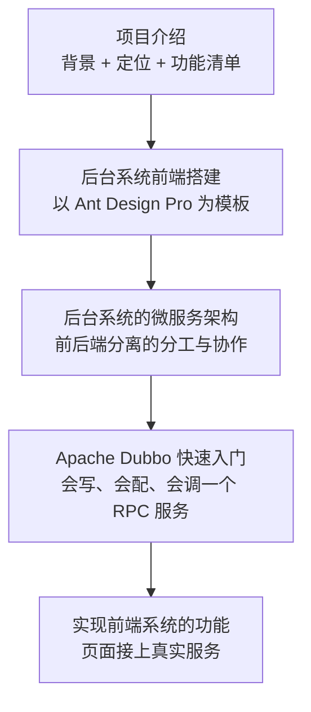

# day03 导览：好客租房正式开工，后台系统前端与 Dubbo 微服务双线并进

前两天都在练基本功：ES6 的新语法、React 的组件化、Ant Design 的界面件、Ant Design Pro 的工程模板。积木备齐了，今天开始拼房子。开工第一天要回答三个问题：要做的是一个什么项目、后台系统的前端怎么起、后端服务怎么给前端供数。day03 的课程安排就是按这三问展开的。

## 先给结论

- 今天正式进入好客租房项目：先介绍项目背景、定位与功能清单，再动手开发。
- 后台系统的前端继续以 Ant Design Pro 为模板搭建，前两天的前端储备直接落位。
- 后台整体采用前后端分离：前端用 ReactJS 开发界面，后端以微服务架构对外提供数据服务。
- 后端微服务的核心框架是 Apache Dubbo，它由阿里巴巴捐赠给 Apache 软件基金会孵化，今天安排快速入门。
- 学完今天的内容，读者应能说清项目是什么、前后端如何分工、Dubbo 在架构里站在哪个位置。

## 一、两天的储备，各自落进项目哪个工位

开工之前先对账，看看练过的每一样东西在项目里的落点：

| 已掌握的技术 | 在项目里的位置 |
|---|---|
| ES6 新特性 | Pro 源码与项目代码的基础语法，解构、箭头函数、模块化随处可见 |
| ReactJS 组件化 | 前台系统与后台系统前端的视图层写法 |
| Ant Design | 后台管理界面里的表格、表单、弹窗等成品组件 |
| Ant Design Pro | 后台管理系统前端的工程底座，菜单、路由、布局直接复用 |
| dva 数据流 | 前端 model 层的组织方式，接口数据的取数与存数 |

对完账会发现没有一块白学：今天搭后台系统前端时，Pro 的部署、路由、新增页面流程全部照此前练过的路径走一遍，只是页面内容从演示换成了租房业务。

## 二、今天的路线图

day03 的内容排布是一条从抽象到具体的线：



项目介绍解决「做什么」：市场需求、用户角色、功能模块逐一过一遍，后面几节展开。后台系统前端搭建解决「界面从哪来」：Pro 模板裁剪改造，业务页面逐个填进去。微服务架构与 Dubbo 入门解决「数据从哪来」：这是今天的重头，也是整个项目后端的起点。

## 三、前后端分离下，前端靠什么吃饭

**第一，分离的本质是契约。** 前端不再依赖后端渲染页面，ReactJS 独立开发、独立部署，运行时通过 HTTP 接口向后端要 JSON 数据。双方只认接口地址与数据结构，进度互不牵制，这正是此前练 mock 的意义：接口没就位时前端照常开工，就位后无缝切换。

**第二，后端是一群微服务，不是一个单体。** 好客租房后台采用微服务架构，房源、用户、订单这类业务各自成独立服务，服务与服务之间通过 RPC 互相调用。承担这条服务总线的核心框架就是 Dubbo：服务提供方把实现注册到注册中心，消费方按接口引用远程服务，调用远程方法像调用本地方法一样。

一个 Dubbo 服务的最小形态长这样（示例为按本课技术栈补全，下一课 Dubbo 入门会完整展开）：

```java
/**
 * 房源服务接口：提供方实现，消费方引用（示例）
 */
public interface HouseService {

    /**
     * 分页查询房源列表
     */
    PageResult<HouseVO> pageQuery(HouseQuery query);
}
```

提供方实现接口并声明为 Dubbo 服务，消费方拿到的是同一个接口的远程代理：

```java
// org.apache.dubbo.config.annotation.Service（示例）
@Service
public class HouseServiceImpl implements HouseService {
    @Override
    public PageResult<HouseVO> pageQuery(HouseQuery query) {
        // 查库、组装分页结果，消费方调用时这段代码跑在提供方进程里
        return houseRepository.queryPage(query);
    }
}
```

**第三，前端与 Dubbo 之间隔着接口层。** 浏览器里的 React 应用并不直接发起 RPC 调用，请求先落在后端的 Web 接口层，接口层再通过 Dubbo 调用内部微服务。把这条链路记清楚，后面看架构图才不会晕：前端面向 HTTP，服务之间面向 Dubbo。

## 常见误区

- **把「后台系统」当成「后端」。** 后台系统指运营管理那一整套界面，它同样分前端与后端；今天搭的是后台系统的前端部分，后端服务另起一条线。
- **以为前端会直接调 Dubbo。** Dubbo 是后端服务之间的 RPC 框架，浏览器只能发 HTTP；前端对接的是后端暴露的接口层，Dubbo 藏在接口层后面。
- **把微服务理解成某个具体框架。** 微服务是架构思想，Spring Boot、Dubbo、注册中心是实现它的工具组合；框架换了，思想不变。
- **低估项目介绍的价值。** 背景与需求文档决定功能边界，后续每个页面、每个接口都能在需求里找到出处，跳过它写代码，做到一半就要返工。

## 面试可能被问到的问题

1. 面试官追问：「前后端分离的好处是什么，代价是什么？」
   答：好处是前后端并行开发、独立部署，前端专注体验、后端专注服务，接口契约固定后互不阻塞；代价是需要维护接口文档与联调成本，SEO 与首屏性能要额外处理，团队协作规范的要求更高。

2. 面试官追问：「Dubbo 是什么，现在归谁管？」
   答：Dubbo 是一款高性能 Java RPC 框架，最初由阿里巴巴开源，后捐赠给 Apache 软件基金会孵化，现为 Apache 顶级项目。它让服务消费方像调用本地方法一样调用远程服务，配合注册中心完成服务发现。

3. 面试官追问：「微服务和 SOA 是什么关系？」
   答：两者都是面向服务的架构思想，都主张按业务拆分服务、通过服务接口协作。微服务可以看作 SOA 理念的进一步演进：拆分粒度更细、去中心化更彻底、每个服务可独立部署与伸缩，工程实践上常与 Spring Boot、容器化配合。

4. 面试官追问：「后台管理系统前端为什么选 Ant Design Pro 而不是从零搭？」
   答：后台系统的典型页面（登录、布局、菜单、表格列表、表单）Pro 全部预置，技术栈与团队已掌握的 React、dva、Ant Design 一致，拿来改造能省掉大量工程搭建工作，把精力留给业务功能。

## 配套资料

- 本教学日资料包暂无配套源码与讲义（`materials/code/03/` 下未收录 day03-项目介绍以及开发后台系统，`materials/docs/` 亦无本阶段文档），文中 Dubbo 接口与实现代码为按本课技术栈补全的可运行示例，待后续 Dubbo 入门课程展开后以课程实际工程为准
