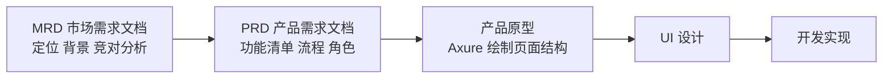
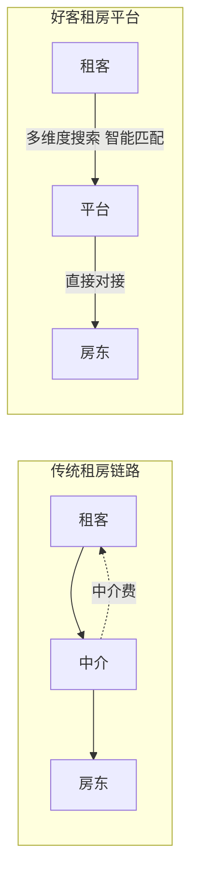

# 好客租房立项复盘：一份 MRD 里的市场痛点、平台定位与两类用户

程序员的直觉是拿到需求就开写，可写什么、为什么写、写给谁用，答案都在动手之前就要落定。好客租房项目的第一份材料是市场需求文档（MRD），它回答的正是这些问题：市场缺什么、产品站在哪、用户是谁、对手强在哪。把这份文档的读法搞懂，以后接手任何项目都能快速进入状态。

## 先给结论

- 产品立项三件套按顺序咬合：MRD 定市场与定位，PRD 定功能与流程，RP 原型（Axure 绘制）定页面形态，开发依据后两者。
- 市场背景是硬逻辑：北上广深外来人口占比接近一半，房价高企让买房难、租房成为主流，房屋租赁市场前景极大。
- 平台定位一句话：促成房东与租户直接对接，房东发布房源，租客多维度搜索与智能匹配，砍掉中介环节费用，提高匹配成功率。
- 两类目标用户：有上网经验、家中有闲置房屋的房东；深受中介困扰、想直连靠谱房东的年轻租客。
- 竞争对手看链家网、安居客、58 同城这类成熟平台，分析维度是市场与战略、用户、产品三层。

## 一、三份文档管住一个项目

**第一，MRD 是想法。** 市场需求文档描述项目定位、项目背景，分析产品竞争对手、双方优劣势，一切与市场相关的内容都写在这里。它回答的是「这门生意值不值得做」。

**第二，PRD 是落地。** 产品需求文档把想法变成清单：有哪些功能、每个功能的流程如何、功能包含哪些子功能、涉及哪些角色，逐项写清楚。它回答的是「产品长成什么样」。

**第三，原型是图纸。** RP 文件由 Axure 软件生成，把 PRD 里的文字描述画成页面原型。开发人员看原型就能知道产品经理如何定义每个功能、页面大概长什么样。三份文档的接力关系如下：



接力不可跳跃：没有 MRD 就没有立项依据，没有 PRD 开发就没有验收标准，没有原型设计师无从下手。课程配套的 MRD 文档章节骨架如下（按本课讲解整理）：

```text
1 项目概要
2 市场分析
  2.1 目标市场
  2.2 市场定位
  2.3 目标市场现状
  2.4 市场趋势（PEST 分析）
  2.5 产品格局和形态
3 用户分析
  3.1 目标用户群体和特征
  3.2 用户画像
  3.3 使用场景
  3.4 用户需求
4 竞争对手分析（市场及战略、用户、产品）
5 产品分析（定位、核心目标、产品结构、产品路线）
```

## 二、市场痛点与平台定位

**第一，痛点长在链路上。** 传统租房的典型链路是：租客找中介，中介带着看房，签约时收一笔中介费。信息经过中介转手，费用落在租客头上，房东与租客之间隔着一层。这个行业现状就是产品的切入口。

**第二，定位就是砍掉中间层。** 好客租房的市场定位是直接促成房东与租户对接的生活服务平台：房东发布房源，租客按多维度条件搜索房源、获得智能匹配推荐。对比两条链路，省掉的与多出来的都清晰可见：



平台模式省下中介费用，同时用搜索与匹配提高房东与租客的撮合成功率，两端用户都得到实惠，这是定位成立的根本。

**第三，行业现状佐证可行性。** 早期的租房类应用（58 同城、赶集网）因房源信息不匹配饱受吐槽，说明痛点真实存在；链家、自如等产品让租房行业多元化发展，用户选择面变宽；蘑菇租房在 2014 年获得 3000 万 A 轮投资。整个租房应用市场巨大、炙手可热，市场有前景，产品跟着市场走才有前景。

**第四，趋势用 PEST 看四面。** PEST 是市场趋势的分析框架，四个字母对应四个维度：

| 维度 | 含义 | 关注点举例 |
|---|---|---|
| P（Political） | 政策因素 | 住房租赁相关的监管与扶持政策 |
| E（Economic） | 经济因素 | 房价水平、租赁市场规模与增速 |
| S（Social） | 社会因素 | 外来人口流动、年轻群体的居住观念 |
| T（Technological） | 技术因素 | 移动互联网、地图与智能匹配技术 |

## 三、两类用户与用户画像

**第一，目标用户两头都要能上网。** 平台的用户分两类：一类是有上网经验的房东，一类是有租房需求的年轻群体。平台是线上产品，双方都必须具备基本的上网能力，否则模式无从谈起。

**第二，特征决定功能。** 房东侧的特征：有一定上网经验、乐于接受新鲜事物、家中有闲置房屋，闲置房才有动力出租。租客侧的特征：广受中介困扰，不想再通过中介找房，希望通过靠谱的房东直租。房源发布、审核与直聊功能服务房东侧，搜索、筛选与直连房东功能服务租客侧，功能清单都能从特征里长出来。

**第三，画像把抽象特征变成具体的人。** 文档为两类用户各立了一份画像（示例为按本课讲解整理的画像要素）：

```json
{
  "画像一": {
    "年龄": 31,
    "角色": "房东",
    "特征": "有上网经验，接受新鲜事物，家中有闲置房屋希望出租"
  },
  "画像二": {
    "年龄": 28,
    "角色": "租客",
    "特征": "不满中介费用与套路，希望直接对接靠谱房东的年轻群体"
  }
}
```

画像不是虚构小说，它是设计功能时的校准器：每个页面的目标读者是谁、操作路径是否符合这个人的习惯，拿画像对照即可。

## 四、竞争对手分析怎么读

**第一，竞对是镜子不是模板。** 做产品不能埋头自干，市场上已有链家网租房、安居客、107 间等成熟玩家，文档对他们逐一分析。分析的价值在于看清对方占据了什么位置，从而找到差异化空档。

**第二，分析固定三问。** 对每个竞争对手回答三个问题：市场及战略层面，它占据什么市场、主打什么策略；用户层面，它服务谁、体验如何；产品层面，它有哪些功能、强在哪里弱在哪里。58 同城类平台的房源信息不匹配问题，恰好是新平台用「房东直发 + 智能匹配」建立差异的机会点。

**第三，产品分析收束为路线。** 文档最后落到自家产品分析：产品定位、核心目标、产品结构，以及按一期、二期划分的产品路线。先做哪些功能、后做哪些功能，从这里开始向 PRD 过渡，下一节内容就是 PRD 与系统架构。

## 常见误区

- **把 MRD 与 PRD 混为一谈。** MRD 说市场与定位，PRD 说功能与流程，前者面向立项决策，后者面向开发实现，混写会让文档既说服不了老板也指导不了开发。
- **把原型当设计稿。** 原型定的是页面结构、元素与流转关系，低保真即可；视觉层面的配色、字体、切图是 UI 设计阶段的事，顺序颠倒会拖慢整个流程。
- **把用户画像当编故事。** 画像由目标群体特征抽象而来，用途是让功能设计有具体的对照对象；脱离调研特征凭空编人物，画像就失去校准作用。
- **把竞对分析做成功能抄写清单。** 抄功能只看到表面，竞对分析要回答的是战略占位与差异机会，抄来的功能堆在一起反而丢失自己的定位。

## 面试可能被问到的问题

1. 面试官追问：「MRD、PRD、产品原型各自解决什么问题？」
   答：MRD 描述市场定位、背景与竞争格局，解决项目值不值得做的问题；PRD 列出功能清单、流程与角色，解决产品做成什么样的问题；原型用图形化方式呈现页面结构与流转，解决开发与设计如何理解需求的问题。三者层层递进，是立项到开发的完整依据链。

2. 面试官追问：「什么是 PEST 分析？」
   答：PEST 是宏观环境分析框架，从政策（Political）、经济（Economic）、社会（Social）、技术（Technological）四个维度评估市场趋势。做租赁平台时对应住房租赁政策、市场规模与房价、人口流动与居住观念、移动互联网与地图技术四类因素。

3. 面试官追问：「好客租房平台的市场定位是什么，痛点依据是什么？」
   答：定位是促成房东与租户直接对接的生活服务平台，房东发布房源、租客多维度搜索与智能匹配。痛点依据是传统链路里信息经中介转手、租客承担中介费，且早期租房平台房源信息不匹配问题突出，直连模式同时降低费用与提高撮合成功率。

4. 面试官追问：「平台的两类目标用户是谁，分别有什么特征？」
   答：房东侧是有上网经验、乐于接受新鲜事物、家中有闲置房屋的群体，核心诉求是出租闲置房；租客侧是有租房需求、深受中介困扰、希望直连靠谱房东的年轻群体，核心诉求是省费用、拿真房源。

5. 面试官追问：「做竞争对手分析，你会从哪些维度入手？」
   答：市场及战略维度看对方的定位与打法，用户维度看目标人群与使用体验，产品维度看功能覆盖与强弱项。三个维度合起来回答两个问题：市场格局是什么样，自己的差异化空间在哪里。

## 配套资料

- 本教学日无配套源码与文档包（`materials/code/03/` 与 `materials/docs/` 均未收录本阶段资料），项目 MRD、PRD 与原型文档仅随课程视频展示，文中章节骨架、链路图与用户画像为按本课演示画面与讲解整理补全的示例
