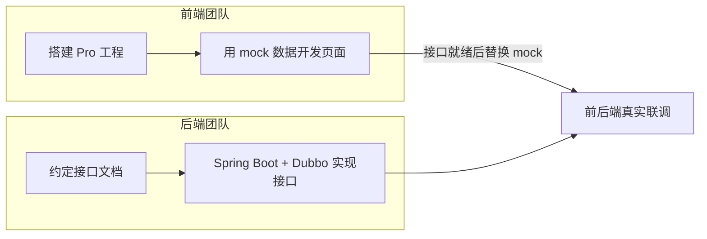
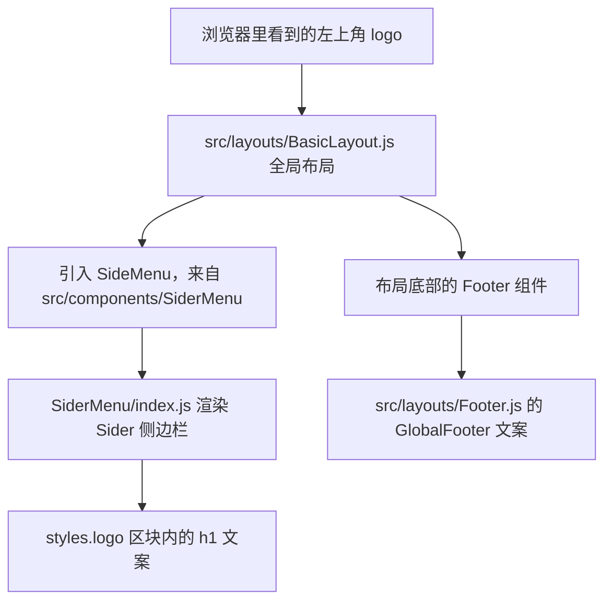

# 后台前端系统搭建：把 Pro 模板工程跑起来，找到 logo 与版权的改造点

后台系统是整个租房项目数据的源头，动工的第一步不是写业务，而是把前端骨架立起来。拿到手的只是一个基于 Ant Design Pro 的模板工程压缩包：解压、导入 IDE，目录里只有源码没有依赖，页面的 logo 和页脚版权还是模板方的默认内容。这一课解决三件事：工程怎么跑起来，logo 藏在哪一层组件里，版权信息在哪一行代码上。

## 先给结论

- 前后端分离是两个团队沿同一条时间轴并行开发：后端接口未就绪时，前端用 mock 数据顶上，接口完成后替换成真实联调，互不阻塞。
- 前端骨架选 Ant Design Pro 模板做改造，后端用 Spring Boot 加 Dubbo 提供服务，配合 Spring MVC 与 MyBatis。
- 模板工程只含源码不含依赖：导入 IDE 后先 `yarn install` 把两千多个包装进 `node_modules`，再 `yarn start` 启动，编译完成自动打开 `http://localhost:8000`。
- logo 不在 `BasicLayout.js` 本体里，而在它引用的侧边菜单组件 `src/components/SiderMenu/index.js` 的 `styles.logo` 区块中，用一段 `<h1>` 文案替换模板图片。
- 页脚版权在 `src/layouts/Footer.js` 里，`GlobalFooter` 包裹的那行文案就是浏览器底部显示的字。

## 一、前后端分离：并行开发，mock 顶上

所谓前后端分离，就是前端团队与后端团队沿同一条时间轴同时开工。麻烦出现在接口上：前端页面开发到一半想调后端接口，后端还没写完，调不到。解决办法是 mock，前端自己模拟一份接口返回，页面照常开发；等后端把接口真正开发好，再把 mock 换掉做联调。



这张图里两条泳道互不依赖，只在「联调」一点汇合。这种模式最大的好处就是前后端互不影响、并行推进，开发效率比串行等待高得多。好客租房项目里，前端采用 Pro 作为模板系统改造，后端以 Spring Boot 加 Dubbo 为主要架构提供服务，Spring MVC 与 MyBatis 负责请求处理和数据访问。

## 二、导入工程与两条命令

工程压缩包在资料目录的开发环境相关文件夹里，即管理端前端工程 `haoke-manager-web.zip`。把它解压到 code 目录，然后在 IDE 里选择 Import Project 导入。要注意，这一步导入的仅仅是源码，`package.json` 里声明的一堆依赖一个都还没装。

在项目根目录打开控制台，执行第一条命令：

```bash
yarn install
# 解析 package.json，逐个下载依赖，本课示例共 2306 个包
# 完成后项目下多出 node_modules 目录，所有依赖都在里面
```

依赖装完，执行第二条命令启动服务：

```bash
yarn start
# webpack 编译，完成后自动打开浏览器
# 应用运行在 http://localhost:8000
```

启动稍微有点慢，等编译完成、浏览器自动打开，就能看到后台页面。默认进入的是 dashboard 分析页；由于示例工程已经做过一轮改造，侧边菜单里房源管理、新增房源、看房请求等业务菜单已经就位。另外 IDE 打开这类 `.js` 文件时会提示切换语言模式为 JavaScript/JSX，确认切换，编辑器的语法报错就会消失。

## 三、logo 在哪：顺着布局文件找组件

想改 logo，得先找到渲染它的组件。全局布局文件在 `src/layouts` 目录下，里面有 `BasicLayout.js`、`Footer.js`、`Header.js`、`MenuContext.js` 四个文件。`BasicLayout.js` 是全局布局的主体，它的导入区能看到关键线索：

```jsx
import SideMenu from '@/components/SiderMenu';
import Authorized from '@/utils/Authorized';
import logo from '@/assets/logo-haoke.png';
import Footer from '@/Footer';
import Header from '@/Header';
```

这个 `SideMenu` 并不是 Ant Design 官方提供的 UI，而是自定义组件。Pro 项目把公用的 UI 组件统一放在 `src/components` 目录下，`SiderMenu` 就在其中。没有写具体文件名时，默认找的是该目录下的 `index.js`。打开 `src/components/SiderMenu/index.js`，在 return 渲染的 `Sider` 组件里就能看到 logo 区块：

```jsx
<div className={styles.logo} id="logo">
  <Link to="/">
    {/* 模板自带的图片 logo 注释掉，替换为文字 */}
    {/*  */}
    <h1>好客租房 - 管理系统</h1>
  </Link>
</div>
```

把 `` 注释、换成 `<h1>` 文案，左上角的 logo 就变成「好客租房 - 管理系统」。整个定位过程像顺藤摸瓜，链路如下：



图上两条支线分别通向 logo 与版权两个改造点，起点都是布局文件。掌握这条查找路径，比记住某个具体文件名更重要：模板工程二次开发，改造点永远可以这样一层层组件引用找出来。

## 四、版权信息：Footer.js 里改文案

`BasicLayout.js` 渲染内容区的最后挂着 `<Footer />`，它来自 `src/layouts/Footer.js`。打开这个文件，`GlobalFooter` 包裹的文案就是页面底部的版权信息，默认写的是模板方的名字，按项目需求改掉即可：

```jsx
import React, { Fragment } from 'react';
import { Icon } from 'antd';
import GlobalFooter from '@/components/GlobalFooter';

const FooterView = () => (
  <GlobalFooter>
    <Fragment>
      Copyright <Icon type="copyright" /> 2018 好客租房 出品
    </Fragment>
  </GlobalFooter>
);

export default FooterView;
```

保存后页面热更新，底部版权随之变化。改 logo 与改版权，两处修改合起来，模板痕迹就基本清掉了，后台系统从此以自己的面目示人。做实际项目时，这类品牌信息按同样的两个位置自定义即可。

## 常见误区

- **没装依赖就执行 `yarn start`。** 新解压的工程只有源码，启动会因缺模块直接报错；顺序必须是先 `yarn install` 再 `yarn start`，`node_modules` 不随工程压缩包分发。
- **在 `BasicLayout.js` 里找 logo 文案。** 翻遍布局文件也找不到那行字，logo 渲染在它引用的 `SiderMenu` 子组件里；从布局文件顺着组件引用往下找才是正路。
- **只换 `<h1>` 文案，不管图片引用。** `` 注释掉之后，文件顶部的 `import logo` 就成了无用引用，要一并注释，否则 lint 检查会提示未使用变量。
- **版权改到 `components/GlobalFooter` 里去。** `GlobalFooter` 是通用组件，负责样式与结构；项目文案写在 `layouts/Footer.js`，改错文件会影响所有复用该组件的页面。

## 面试可能被问到的问题

1. 面试官追问：「前后端分离开发，接口没写完前端怎么办？」
   答：先约定接口文档，前端依据文档用 mock 数据模拟接口返回，页面开发不被阻塞；后端接口就绪后把 mock 替换成真实请求做联调。两个团队沿同一时间轴并行，效率比串行等待高。

2. 面试官追问：「`yarn install` 做了什么，为什么 `node_modules` 不进版本库？」
   答：它读取 `package.json`，解析整棵依赖树并下载到 `node_modules`。该目录体积巨大且可由锁文件完整还原，版本库只保存 `package.json` 与锁文件，任何人拉取代码后执行一次 install 即可复原环境。

3. 面试官追问：「BasicLayout 在 Pro 项目里承担什么职责？」
   答：它是全局布局组件，组装侧边菜单、顶栏、内容区与页脚，同时负责页面标题、响应式断点、菜单收起状态，并通过 Authorized 对路由做权限包裹。业务页面只填充内容区，框架能力都在布局层。

4. 面试官追问：「拿到一个模板工程，怎么快速定位要改造的界面元素？」
   答：从布局文件入手。全局布局决定了页面骨架，顺着 JSX 里的组件引用层层下钻，公共组件集中在 `src/components`，项目级布局在 `src/layouts`。找到渲染目标元素的组件后，样式类名与文案都在其 return 的 JSX 里。

## 配套资料

- 本教学日资料包未收录源码（`materials/code/03/` 下 day03 无解压内容），文中布局目录结构、`SiderMenu` 与 `Footer.js` 代码片段为按本课演示画面整理补全的示例，可与 Ant Design Pro v2 脚手架的 `src/layouts/`、`src/components/SiderMenu/` 目录对照验证
