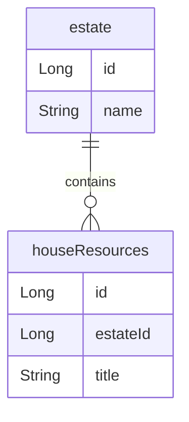

# 楼盘与房源数据结构：一对多建模，字段从产品原型里长出来

新增房源页面摆着十几项输入：楼盘名称、地址、租金、支付方式、户型、面积、楼层、配套设施。前端为什么长这样？因为页面表单项是照着后端数据结构文档画的，不是前端拍脑袋定的。前后端分离开发时，两套团队先要把数据结构聊清楚，这份结构文档就是页面与接口之间的契约。

## 先给结论

- 核心实体两个：楼盘 `estate` 与房源 `houseResources`，一个楼盘下有多套房源，一对多关系。
- 外键放在多方：房源表必有 `estateId` 字段，记录自己属于哪个楼盘。
- 楼盘字段覆盖基础信息（名称、省市区、地址）与楼盘档案（建筑年代、建筑类型、物业费、物业公司、开发商），外加 `created`、`updated` 审计字段。
- 房源字段围绕「这一套房子」展开：标题、楼栋楼层、户型、租金、租赁方式、支付方式、配套设施等。
- 字段设计的两个来路：从产品原型的表单项反推，以及参照竞品房产网站的楼盘页。

## 一、楼盘一对多房源：外键落在多方

用大白话先把两个实体分开：楼盘是小区维度的容器，比如「中远两湾城」，一套房源是其中具体的某栋、某单元、某户。一个楼盘里挂着许多套房源，反过来每套房源只属于一个楼盘，标准的一对多。落到表设计上，规则只有一条：外键建在多的那一方，房源表带一个 `estateId` 指向所属楼盘。



图里 `estate` 与 `houseResources` 之间是一对多：读法从左往右，一个楼盘包含零到多套房源；从右往左读，每套房源通过 `estateId` 归属唯一的楼盘。查询某个楼盘下所有房源，条件就是 `estateId` 相等；反过来查房源属于哪个楼盘，拿 `estateId` 回楼盘表主键定位。

## 二、楼盘字段：基础信息加楼盘档案

楼盘表的字段按本课前后端开发文档整理如下：

| 字段 | 类型 | 说明 |
|---|---|---|
| `id` | Long | 楼盘 id |
| `name` | String | 楼盘名称 |
| `province` | String | 所在省 |
| `city` | String | 所在市 |
| `area` | String | 所在区 |
| `address` | String | 具体地址 |
| `year` | String | 建筑年代 |
| `type` | String | 建筑类型 |
| `propertyCost` | String | 物业费 |
| `propertyCompany` | String | 物业公司 |
| `developers` | String | 开发商 |
| `created` | datetime | 创建时间 |
| `updated` | datetime | 更新时间 |

字段分三拨看：`name` 到 `address` 是定位一栋楼盘的基础信息；`year` 到 `developers` 是楼盘档案，回答这楼盘哪年建的、什么结构、物业费多少、谁开发谁管理；`created` 与 `updated` 是审计字段，记录数据何时产生、何时变更，排查问题时全靠它们。

省、市、区拆成三列而不是存成一串地址，是为后面的地图找房做准备：按区域聚合房源数量时，直接按 `city`、`area` 分组即可，不必从整段地址文本里做字符串切分。

## 三、房源字段：描述具体的一套房

房源字段比楼盘多得多，本课文档与页面代码中出现过的核心部分如下（完整字段以后端文档为准）：

| 字段 | 说明 |
|---|---|
| `id` | 房源 id |
| `title` | 房源标题 |
| `estateId` | 所属楼盘 id，一对多的外键 |
| `buildingNum`、`buildingFloorNum` | 楼号与楼层，楼层形如 `8/26`，26 层楼里的 8 层 |
| `houseType` | 户型，形如 `2室1厅1阳台` |
| `coveredArea` | 建筑面积 |
| `orientation` | 朝向 |
| `rent` | 租金 |
| `rentMethod` | 租赁方式，整租或合租 |
| `paymentMethod` | 支付方式，付一押一、付三押一、付六押一、年付押一、其它 |
| `facilities` | 配套设施，多选值合并存储，形如 `1,2,3` |

这份字段清单和新增房源页面的表单项一一对应：页面上有租金输入框，是因为数据结构里有 `rent`；页面上支付方式是下拉选择，是因为 `paymentMethod` 取值固定几种。页面长什么样由结构说了算，顺序不能颠倒。

## 四、字段设计从哪来：原型反推加竞品参照

房源数据不是凭空设计出来的，课程里给了两条来路。**第一，从产品原型反推。** 原型画出了新增房源页的每个输入项与选项，表单项翻成字段名、下拉选项翻译成枚举值，数据结构自然浮出来。**第二，参照竞品。** 打开主流房产网站的楼盘详情页，小区名称、具体地址、建筑年代、建筑类型、物业费、物业公司，与本课楼盘表的字段几乎一一对应，说明这套字段设计覆盖了行业里的通用信息面。

原型给结构，竞品做校验，两边都对得上，这套字段就可以定稿交给前后端共同遵守。前端拿着它画表单，后端拿着它建表、写接口，沟通成本降到最低。

## 五、页面如何消费这份结构

页面侧对应的是 `AddResource.js` 新增房源组件，表单项与字段一一挂钩。楼盘名称一栏用自动补全组件做联动，示例工程用一份演示数据模拟楼盘表：

```javascript
// 演示用数据：楼盘名 -> 楼盘id|省,市,区,详细地址
const estateMap = new Map([
  ['中远两湾城', '1001|上海市,上海市,普陀区,远景路97弄'],
  ['上海新城', '1002|上海市,上海市,闵行区,莘松路358弄'],
  ['保利西海岸', '1003|上海市,上海市,松江区,广富林路1188弄'],
]);
```

选中楼盘名称后，从映射值里拆出 `estateId` 与地址，地址回填到楼盘地址输入框，`estateId` 随表单一起提交，房源与楼盘就在页面层完成了关联。支付方式这样的枚举字段则渲染成下拉选择，选项与文档规定的取值严格一致：

```jsx
<Select style={{ width: '100%' }}>
  <Option value="1">付一押一</Option>
  <Option value="2">付三押一</Option>
  <Option value="3">付六押一</Option>
  <Option value="4">年付押一</Option>
  <Option value="5">其它</Option>
</Select>
```

真实项目里 `estateMap` 应来自后端楼盘接口，这里用演示数据是为了让页面先跑通。表单组件本身的用法与提交逻辑，下一课单独拆解。

## 常见误区

- **房源表不存 `estateId`，只存楼盘名字符串。** 楼盘改名后旧房源全部对不上，按楼盘聚合查询也只能做字符串比较；关联关系靠外键，不靠名称。
- **把楼盘字段复制一份进房源表。** 物业公司、开发商这类信息在房源侧冗余存储，一旦楼盘档案更新就要批量刷房源表；归属信息一张关联查询就能拿到。
- **省市区存成一个地址大字段。** 地图找房、按区筛选都要区域维度，拆成 `province`、`city`、`area` 三列，聚合与筛选都是普通条件查询。
- **先写页面再补数据结构。** 页面写到一半发现缺字段、缺枚举值，返工成本远高于动工前把结构文档对齐；字段先行，页面跟进。

## 面试可能被问到的问题

1. 面试官追问：「楼盘和房源是怎么建模的？」
   答：两个实体，一对多关系。楼盘表存小区维度的信息，房源表存具体某套房的信息，房源表带 `estateId` 外键指向所属楼盘。查楼盘下所有房源按 `estateId` 查，查房源归属按主键回查楼盘表。

2. 面试官追问：「为什么省市区拆成三个字段？」
   答：业务上有按区域聚合与筛选的需求，例如地图找房要统计各区域房源数量。拆列之后按 `city`、`area` 分组或过滤都是普通 SQL 操作，合成一个地址字段则只能做字符串匹配，性能与可维护性都差。

3. 面试官追问：「数据结构的字段设计依据是什么？」
   答：主要依据产品原型，页面上每个输入项对应一个字段，下拉与多选对应枚举或值集；同时参照竞品产品校验信息覆盖面，例如房产网站楼盘页的名称、地址、建筑年代、物业费等字段。定稿后的结构文档作为前后端共同契约。

4. 面试官追问：「配套设施这种多选值为什么存成 `1,2,3` 的字符串？」
   答：配套设施是一对多的取值集合，页面提交时把勾选数组用逗号连接成一个字符串存库，与文档约定的格式对齐，简化存储；展示时再按逗号拆开反查字典表。代价是无法直接按单个设施建索引筛选，量大时通常改用关联表。

5. 面试官追问：「`created`、`updated` 这类字段有什么用？」
   答：审计字段，记录数据产生与最近一次变更的时间。数据对不上、疑似被改时，靠它们定位变更时间点；配合定时同步、增量抽取的场景也依赖更新时间做增量条件。

## 配套资料

- 本教学日资料包未收录源码与文档（`materials/code/03/` 下 day03 无解压内容），楼盘字段表按本课前后端开发文档画面整理，房源字段表为文档画面与页面代码的摘录，`estateMap` 为按本课演示画面补全的前端示例数据，可对照主流房产网站楼盘详情页验证字段覆盖面
