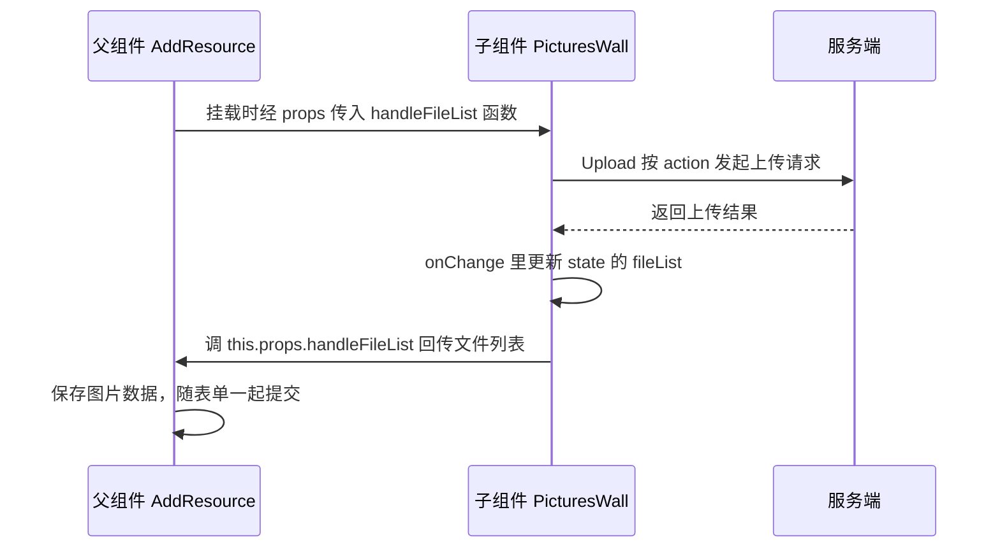

# 图片上传：Upload 组件、预览删除与父子组件数据回传

新增房源表单里有一块「上传室内图」：点添加按钮选图片，出缩略图，最多传 5 张，点眼睛图标放大预览，也可以逐张删掉。上传能力来自 Ant Design 的 Upload 组件，但这一课真正的难点不在上传本身，而在数据位置：图片列表存在自定义上传组件（子组件）的 state 里，提交按钮却在外层表单页面（父组件）上，提交时父组件怎么拿到子组件手里的图片数据？把这条通路讲明白，是本课的核心任务。

## 先给结论

- 上传能力由 Ant Design 的 Upload 组件提供，课程把它包了一层，封装成自定义组件 PicturesWall 再放进表单。
- Upload 的 `action` 属性是上传请求的提交地址，本课前端先指向 `/upload.do` 占位，真实的服务端存储在后面的课时接入。
- 预览与删除不需要自己写逻辑：`onPreview` 打开 Modal 展示大图，删除由 fileList 的增删驱动界面刷新。
- 上传结果保存在子组件 state 的 fileList 里，父组件通过 props 传一个函数下去，子组件调用它把数据送回父组件。
- 传函数时执行 `bind(this)`，把父组件的上下文随函数一起交接，子组件里调用时函数体内访问的仍是父组件。

## Upload：画一个图片上传卡片

Upload 是 Ant Design 的上传组件，`listType` 设为 `picture-card` 时呈现为图片卡片样式，添加按钮是一个带加号的方框。课程没有在表单页里直接铺 Upload，而是封装成 PicturesWall 组件，内部结构如下：

```jsx
import { Upload, Icon, Modal } from 'antd';

class PicturesWall extends React.Component {
  state = {
    previewVisible: false,  // 预览弹窗开关
    previewImage: '',       // 预览的大图地址
    fileList: [],           // 已上传文件列表，核心数据
  };

  handleCancel = () => this.setState({ previewVisible: false });

  handlePreview = (file) => {
    this.setState({
      previewImage: file.url || file.thumbUrl,
      previewVisible: true,
    });
  };

  handleChange = ({ fileList }) => {
    this.setState({ fileList });
    // 把最新的文件列表交给父组件
    this.props.handleFileList(this.state.fileList);
  };

  render() {
    const { previewVisible, previewImage, fileList } = this.state;
    const uploadButton = (
      <div>
        <Icon type="plus" />
        <div className="ant-upload-text">Upload</div>
      </div>
    );
    return (
      <div>
        <Modal visible={previewVisible} footer={null} onCancel={this.handleCancel}>
          
        </Modal>
        <Upload
          action="/upload.do"
          listType="picture-card"
          fileList={fileList}
          onChange={this.handleChange}
          onPreview={this.handlePreview}
        >
          {fileList.length >= 5 ? null : uploadButton}
        </Upload>
      </div>
    );
  }
}
```

几个关键点值得逐个说清。

**第一，`action` 是真实的上传请求地址。** 选中文件后 Upload 自动发起请求，把文件以 multipart 表单形式发往这个 URL。课程阶段先指向 `/upload.do` 占位，等后台实现了图片存储接口，这里换一个地址就能接上，组件其余代码不动。后端接收这类请求时按 multipart/form-data 解析出文件流，存储后返回图片访问地址，这正是后续课时要做的事。

**第二，fileList 是唯一数据源。** state 里的 fileList 既作为受控属性传给 Upload（决定当前显示哪些图），也是之后要交给表单的提交数据，一处维护，界面与数据不会脱节。

**第三，预览与删除是现成的交互。** 点缩略图上的预览图标触发 `onPreview`，把 `file.url` 或 `thumbUrl` 塞进 Modal 展示大图，`handleCancel` 关闭；点删除图标后 fileList 少一项，界面自动刷新，全部删完上传按钮重新出现。数量限制就藏在这行条件里：列表满 5 张就不再渲染 uploadButton，添加入口随之消失。

## 真正的问题：数据在子组件，提交在父组件

页面结构是这样的：AddResource 是外层表单页面（父组件），渲染各个表单项并持有提交按钮；上传室内图的位置引用了 PicturesWall（子组件）。上传成功后，图片数据存在子组件的 state 里，而表单提交发生在父组件的 `handleSubmit` 里。提交那一刻，父组件必须拿到子组件那份 fileList，否则图片根本进不了请求。

React 的数据流是单向的：父组件可以把数据经 props 传给子组件，子组件却不能直接修改父组件的数据，也不能伸手到别的组件 state 里拿东西。图片偏偏产生在子组件里，这就需要一条「子到父」的回传通道。React 入门课讲 props 时传的是数据，方向自上而下；这一次传的是函数，让数据能够自下而上回流。



图里最能说明问题的是最后两步：数据不是父组件主动来「取」，而是子组件通过父组件给的函数「送」出去。函数是父组件的，this 也是父组件的，子组件只是触发它。

## 解法：属性传函数，bind 定住 this

父组件引用子组件时多传一个属性，值是一个函数：

```jsx
<FormItem {...formItemLayout} label="上传室内图">
  <PicturesWall handleFileList={this.handleFileList.bind(this)} />
</FormItem>
```

父组件这边的函数定义：

```jsx
handleFileList = (obj) => {
  // obj 就是子组件回传的 fileList，提交表单时并入 payload
  console.log(obj, '图片列表');
};
```

子组件通过 `this.props.handleFileList(this.state.fileList)` 调用这个函数，参数是子组件里的文件列表，父组件就在 `handleFileList` 的形参 `obj` 里拿到了数据。`handleChange` 里 `setState` 更新自身状态之后紧接着调回调，父组件手里的列表始终是最新的。

`.bind(this)` 是这条链路上最容易被忽略的一环。JavaScript 里函数的 this 由调用位置决定，父组件的方法被传到子组件里执行时，this 默认不再指向父组件；一旦函数体里要访问父组件的 state 或 props，就会取到错误的对象甚至直接报错。bind 返回一个 this 被固定的函数，这里固定成父组件实例，保证无论函数在哪个组件里被调用，函数体内看到的都是父组件的世界。React 官方文档也专门提醒过：JSX 回调里的类方法默认不会绑定 this，需要用 bind、箭头函数或在构造函数里绑定。课程统一在传函数时写 `.bind(this)`，把这件事变成不需要思考的固定动作。

## 提交时把图片并入表单

拿到 fileList 之后，提交拼装就顺理成章：`handleSubmit` 校验通过后，values 里已经汇集了所有注册过的表单字段，把图片列表整理进去（通常是每张图上传后返回的访问地址），一并 `dispatch` 给 model 发起请求。课程演示阶段只在 `handleFileList` 里把 obj 打印出来确认通路，真实落库在后台服务就绪后接入，届时上传接口返回的图片地址会随房源数据一起写入数据库。通路先打通，业务再填肉，前端这一侧的改造就到此为止。

## 常见误区

- **在子组件里直接改父组件的 state。** React 不允许跨组件修改状态，界面也不会按预期刷新；数据回传一律走「父传函数、子调用」这条正路。
- **传普通方法忘了 bind。** 方法被传到子组件里调用时 this 指向错误，函数体里访问父组件的 state 得到 undefined；用 bind 或定义成箭头函数属性二选一。
- **只 setState 不回传。** `handleChange` 里更新了自己的 fileList 就结束，父组件拿到的永远是旧数据甚至拿不到；更新完 state 要紧接着调 props 里的回调。
- **把 action 当成展示配置随意填。** action 是真实的请求地址，写错了上传就直接 404，页面上只看到一个转圈后失败的缩略图。

## 面试可能被问到的问题

1. 面试官追问：「React 父组件怎么拿到子组件的数据？」
   答：主流做法是父组件通过 props 传一个回调函数给子组件，子组件在合适的时机以自身数据为参数调用它，数据就从子流向父。受控组件是另一种思路：父组件把值和 onChange 一起传下去，数据源头放在父组件，子组件只负责展示与触发。

2. 面试官追问：「bind(this) 在这里解决什么问题？」
   答：JavaScript 函数的 this 由调用方式决定。父组件的方法传到子组件里调用时，this 默认不再指向父组件，函数内访问父组件的 state 会失败。bind 返回一个 this 被固定的函数，保证任何地方调用都指向父组件实例；定义成箭头函数属性也能达到同样效果。

3. 面试官追问：「Upload 的 onChange 什么时候触发，参数长什么样？」
   答：上传状态每次变化都会触发，上传中、成功、失败各调一次。参数里带着 file 和整体 fileList，file.status 标识 uploading、done、error 等状态，课程以 fileList 为准整体更新 state，避免只盯单个文件造成列表错乱。

4. 面试官追问：「上传多张图片时 fileList 怎么维护？」
   答：fileList 由 Upload 受控传入，每次 onChange 返回的 fileList 已经合并了本次上传的文件，直接 setState 覆盖即可；删除操作同理，Upload 内部处理完把新列表交回来。数量限制可以在 render 里按长度决定要不要渲染上传按钮。

5. 面试官追问：「预览功能一定要用 Modal 吗？」
   答：不是必须。onPreview 只是事件入口，拿到文件之后想怎么展示都行：课程用 Modal 配合 img 展示原图，也可以新窗口打开 URL 或引入图片查看器组件，交互方式完全自定义。

## 配套资料

- 本教学日资料包未收录源码（`materials/code/03/` 下无 day03 解压内容），文中 `PicturesWall` 组件、父组件引用与 `handleFileList` 为按本课演示画面与讲义思路整理补全的示例；Upload 与 Modal 的属性以 Ant Design v3 官方文档「上传」「对话框」两节为准，`action` 的后端实现见后续图片存储课时
