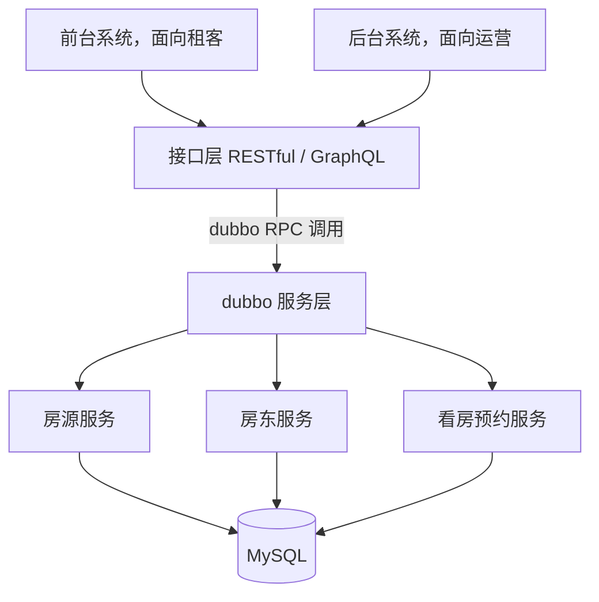

# 后台服务的四层架构：从 MySQL 到 dubbo 服务再到 REST 接口

前端的新增房源页面已经能填表、能上传、能校验，点提交也弹「提交成功」，但这个成功是假的：后台服务还不存在，请求被 mock 数据接住了，数据哪儿也没去。要让房源真的落库，就得开始搭后台。动手之前先把图纸画出来：后台纵向分四层，最底下是 MySQL，往上是按业务拆开的 dubbo 服务，再往上是 RESTful/GraphQL 接口层，最顶层才是前台系统与后台系统。这一课把每一层的职责、层与层之间的调用方式讲清楚。

## 先给结论

- 后台纵向四层：MySQL 数据库、dubbo 服务层、接口层（RESTful/GraphQL）、应用系统（前台系统、后台系统）。
- 核心在 dubbo 服务层：房源、房东、看房预约等每个业务域独立成一个服务，这就是微服务的落法。
- 接口层以 RESTful 或 GraphQL 对外提供 HTTP 服务，是服务层对外的门面；应用系统只跟接口层打交道。
- 接口层到服务层之间走 dubbo 的 RPC 调用，浏览器感知不到，它只认 HTTP。
- dubbo 在这里的角色是服务治理框架，具体怎么用从下一课开始展开。

## 先看现状：提交成功是 mock 出来的

把表单认认真真填完，联系人、手机号、租金、配套设施、图片一样不缺，点提交，页面提示提交成功。实际上后台连一个服务都没有，前端 dva model 里接的是 mock，校验、数据加工、dispatch 这套流程全走通了，唯独最后一步没有真实的服务端接应。课程不打算引入更多 mock 来糊弄下去，开发重心从这一课起转向后台：新增房源、房源列表、房东列表这些能力，都需要真正的服务来提供。前端那套表单代码不用改，等接口层的地址从 mock 切到真实服务，同一套提交流程就能把数据写进数据库。

## 四层架构：每一层干什么

课程给出的架构图从下往上画了四层，职责分明：

- **MySQL 数据库**：数据的最终归宿，现阶段所有服务共享一个库。
- **dubbo 服务层**：把系统按业务域拆成若干独立服务，房源服务、房东服务、看房预约服务等，每个服务自己管自己的业务逻辑，数据库操作只发生在这一层。
- **接口层**：以 RESTful 或 GraphQL 的方式对外暴露 HTTP 接口，做协议转换、参数校验与结果聚合。
- **应用系统**：后台系统面向运营，前台系统面向租客，还有其他外围系统，它们都是接口层的调用方。



这张图从上往下读就是一次请求的完整路径：浏览器发 HTTP 请求到接口层，接口层把请求翻译成对某个 dubbo 服务的 RPC 调用，服务完成业务逻辑后读写 MySQL，结果原路返回。课程反复强调，整套架构里最核心的是 dubbo 服务这一层，因为它承载了全部业务逻辑，接口层只是门面；把每个功能独立成服务、独立开发独立部署，这正是微服务架构的本义。

## 为什么浏览器不直连服务层

**第一，协议不通。** 浏览器里跑的是 HTTP，前端能发出的永远是 HTTP 请求；dubbo 服务之间走的是 RPC，不是浏览器能直接发起的调用。中间必须有接口层做翻译：HTTP 进来，RPC 出去。

**第二，职责不同。** 接口层（web 层）只做参数校验、组装与转发，不写业务；服务层（service 层）装着全部业务逻辑与数据访问。业务放服务层，多个入口就能共享同一份实现：后台系统要新增房源，前台系统要展示房源，调的都是同一个房源服务，逻辑只写一遍。业务抄两份的后果是改一处漏一处，这在多人协作里是事故之源。

**第三，方便扩容与治理。** 服务独立部署，房源访问量大就单独给房源服务加实例，接口层通过注册中心拿到地址列表自动分流；哪个服务出问题，影响范围也被圈定在那个服务里。这是单体工程做不到的。

接口层的代码大致长这样（示例，按本课架构补全）：

```java
package com.example.web.controller;

import com.example.house.api.HouseService;
import com.example.house.api.dto.HouseDTO;
import org.apache.dubbo.config.annotation.Reference;
import org.springframework.web.bind.annotation.*;

@RestController
@RequestMapping("/api/house")
public class HouseController {

    @Reference          // dubbo 的引用注解，拿到的是远程服务代理
    private HouseService houseService;

    @PostMapping
    public Object add(@RequestBody HouseDTO house) {
        houseService.addHouse(house);   // 写法像本地调用，实际走 dubbo RPC
        return "success";
    }
}
```

服务层是独立工程，只依赖接口定义（示例，按本课架构补全）：

```java
package com.example.house.service;

import com.example.house.api.HouseService;
import com.example.house.api.dto.HouseDTO;
import org.apache.dubbo.config.annotation.Service;

@Service   // dubbo 的 @Service，把实现暴露成 RPC 服务，注意别和 Spring 的混淆
public class HouseServiceImpl implements HouseService {

    @Override
    public void addHouse(HouseDTO house) {
        // 参数校验、业务规则、落库，全部发生在服务层
    }
}
```

配合的服务端配置（示例，按本课架构补全）：

```yaml
dubbo:
  application:
    name: house-service
  registry:
    address: zookeeper://127.0.0.1:2181   # 服务注册与发现依赖注册中心
  protocol:
    name: dubbo
    port: 20880                            # dubbo 协议默认端口
```

接口与服务之间能像本地方法一样互调，靠的是 dubbo 把远程调用包装成了接口代理，Controller 里那句 `houseService.addHouse(house)` 背后是一次跨进程通信。

## dubbo 调用链路预告

把链路预演一遍，后面几课的内容都能挂上去：服务提供者启动时，把自己的地址与接口注册到注册中心；消费者（接口层）启动时订阅关心的服务，从注册中心拿到提供者地址列表；调用时按负载均衡策略挑一个地址直连提供者，请求以 RPC 方式发出；双方把调用次数与耗时上报给监控中心。注册中心中途宕机并不影响已经建立的调用，因为地址列表在消费者本地有缓存。这条链路里的每个角色，下一课讲 dubbo 概念时会逐个登场。

## 常见误区

- **以为前端要连 dubbo。** 浏览器只发 HTTP，dubbo 的 RPC 调用发生在接口层与服务层之间的内网；前端永远只跟接口层对话，这层边界不能破。
- **把业务逻辑写进接口层。** Controller 里堆业务，等于前台、后台各抄一份实现；业务只放服务层，接口层做转发与聚合。
- **把 dubbo 的 @Service 和 Spring 的 @Service 混着用。** 同名注解两个含义：暴露 RPC 服务用 dubbo 的，声明 Spring Bean 用 Spring 的，import 错了服务发布不出去，报错还不容易看懂。
- **以为服务拆得越细越好。** 拆分粒度跟着业务域走，房源、房东、看房预约是清晰的边界；为了拆而拆，只会换来部署与排查成本的暴涨。

## 面试可能被问到的问题

1. 面试官追问：「为什么要分 web 层和 service 层，一个工程全写了不行吗？」
   答：分层换来复用与独立伸缩。业务收在 service 层，web 层只是门面，多个应用共享同一套服务实现；服务层可以独立部署、独立扩容，某个业务高峰只加对应服务的机器。单体工程改一个模块要整体重新发布，服务化之后互不影响。

2. 面试官追问：「REST 接口和 RPC 调用为什么并存？」
   答：对外用 REST，因为浏览器与移动端只认 HTTP，接口也更容易调试和跨语言；对内用 RPC，因为服务间调用追求性能与开发效率，dubbo 把调用包装成接口代理，二进制序列化的开销远小于文本协议。两类调用各守一段链路，互不越界。

3. 面试官追问：「这个架构里注册中心起什么作用？」
   答：提供者上线时把地址注册上去，消费者订阅后拿到地址列表，提供者增减时注册中心推送变更。消费者据此完成负载均衡与故障摘除，服务之间不需要硬编码对方的地址，扩容缩容对调用方透明。

4. 面试官追问：「微服务架构下数据库怎么处理？」
   答：本课阶段各服务共享一个 MySQL，业务简单时够用；更严格的做法是每个服务只管自己的表，需要别人的数据时通过服务接口去取，而不是直连别人的库，避免多方改动同一份数据引发一致性问题。

5. 面试官追问：「GraphQL 和 RESTful 什么区别？」
   答：RESTful 按资源组织接口，一个接口返回固定结构的资源表述，字段多了少了客户端都得接受；GraphQL 由客户端声明要哪些字段，服务端按查询返回精确结构，一个入口还能聚合多个资源。接口层可以两种都提供，课程后续也会实现 GraphQL 服务。

## 配套资料

- 本教学日资料包未收录源码（`materials/code/03/` 下无 day03 解压内容），文中 Controller、服务实现与 dubbo 配置为按本课架构图补全的示例；四层架构与「RPC 采用 dubbo 框架作为服务治理框架，对外接口采用 RESTful 和 GraphQL 接口方式」的表述出自本课课件的架构图与说明文字
