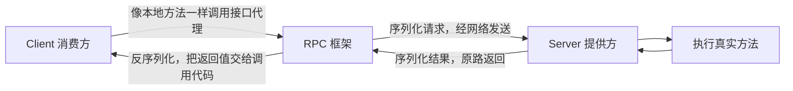
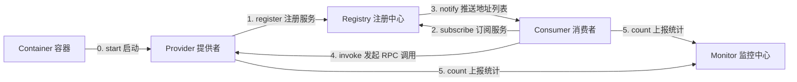

# 什么是 dubbo：高性能 Java RPC 框架的角色与分工

后台架构图里写了，接口层调用服务层走的是 dubbo。这一课回答两个最基础的问题：dubbo 是个什么东西，RPC 又是什么。这两点不弄清，后面几课的注册中心、协议、负载均衡就没有挂靠的地方；弄清了再看 dubbo 的官方架构图，五个角色五条连线，一条都不难懂。

## 先给结论

- Apache Dubbo 是一款高性能的 Java RPC 框架，由阿里巴巴团队研发并开源，后来捐给 Apache 基金会孵化，2019 年正式毕业成为 Apache 顶级项目。
- RPC 的意思是远程过程调用：调用远端机器上的方法，像调用本地方法一样写，网络细节全部由框架处理。
- dubbo 的服务模型只有两种角色：Provider 提供服务，Consumer 消费服务；两端经由 Registry 注册中心完成服务注册与发现，Monitor 监控中心负责统计调用数据。
- 与直接发 HTTP 请求相比，RPC 面向接口代理，调用者拿到接口的代理对象直接调方法，序列化、传输、负载均衡都由框架接管。
- 课程选 dubbo 而不是 Spring Cloud 做服务治理框架，目的之一是多掌握一种主流方案。

## dubbo 的身世：从阿里开源到 Apache 毕业

官网 dubbo.apache.org 上的定位只有一句话：Apache Dubbo 是一款高性能 Java RPC 框架。它的来历值得了解：框架由阿里巴巴团队研发，在阿里内部支撑了大规模的服务化实践，随后开源，早期官网自称「分布式服务框架，致力于提供高性能和透明化的远程调用方案，是 SOA 服务化治理方案的核心框架」，并强调按分层方式架构、各层之间解耦。

中间有一段历史常被拿来说事：项目曾经停止维护数年，那几年不少用户转向了 Spring Cloud，这也解释了社区里「选 dubbo 还是选 Spring Cloud」的争论从何而来。2018 年项目重启并进入 Apache 孵化器，当时的官网标题还带着 incubating 字样，毕业需要 Apache 成员投票通过；如今它已经正式毕业，是 Apache 的顶级项目。重启后的 dubbo 补上了对 Spring Boot 的支持，用 Spring Boot 的方式就能把它管起来，课程后续正是以 Spring Boot 为基础框架来使用 dubbo。两者都是微服务落地的成熟选项，本套课程选 dubbo，多熟悉一种框架的思路没有坏处。

官网列出的六大特性也值得混个脸熟，后面每课都能对上号：面向接口代理的高性能 RPC 调用、智能负载均衡、服务自动注册与发现、高度可扩展能力、运行期流量调度、可视化的服务治理与运维。

## 什么是 RPC

RPC 全称 Remote Procedure Call Protocol，远程过程调用协议。定义是：一种通过网络从远程计算机上请求服务，而不需要了解底层网络通信细节的协议。听起来抽象，拆成两点就直白了。

**第一，「远程」解决共享与复用。** 服务端定义了一个方法，客户端要用它。在客户端本地再写一遍一模一样的方法，麻烦倒在其次，真正的问题是：如果有一百个客户端，同一段逻辑就要抄一百份，方法升级时改一百处。把方法放到远程服务端，所有客户端通过网络请求来调用它，一份实现大家共享，升级只改服务端一处，所有调用方自动跟着受益。

**第二，「调用」解决透明问题。** 调用方拿到的是一个接口代理，写 `helloService.sayHello("dubbo")` 与调本地方法没有任何区别；参数怎么序列化、请求走哪条连接、结果怎么反序列化，全部由 RPC 框架在幕后完成。这正是官网特性里「面向接口代理」的含义。



图里两端是对等的：调用方感受不到网络存在，提供方也不关心请求从哪来，两边的编解码与传输都由 RPC 框架包办。dubbo 就是把这套事情做到高性能的 Java 实现。

## 三大角色：Provider、Consumer、Registry

dubbo 从服务模型的角度只抽象出两种角色：服务的提供方叫 Provider，服务的消费方叫 Consumer，要么提供、要么消费，模型非常简单。再加上 Registry 注册中心、Monitor 监控中心和承载 Provider 的 Container 容器，官方架构图一共五条连线，按编号走一遍：



- **0 与 1**：容器启动 Provider，Provider 就绪后把自己的地址与服务接口注册到注册中心，这一步叫 register。
- **2 与 3**：Consumer 启动时向注册中心订阅自己关心的服务，叫 subscribe；注册中心把该服务的提供者地址列表推送给 Consumer，叫 notify，此后提供者增减都会推送更新。
- **4**：Consumer 从地址列表里按负载均衡策略选一个，直接对 Provider 发起调用，叫 invoke，这一步不经过注册中心。
- **5**：双方定期把调用次数、耗时等统计上报给 Monitor，叫 count。

一个容易忽略的细节：注册中心只在「建立联系」的阶段出场，真正的调用是 Consumer 与 Provider 点对点直连的。所以注册中心宕机，影响的只是新服务的注册发现和地址变更推送，已经在跑的服务互不影响。

## 与 HTTP 调用的区别

直接用 HTTP 调远程服务行不行？行，事实上接口层对浏览器就是 HTTP。但服务与服务之间，dubbo 这类 RPC 框架的差异相当明显：

| 维度 | 直接 HTTP 调用 | dubbo RPC |
|---|---|---|
| 调用方式 | 手动构造 URL 与请求体，再解析响应 | 面向接口代理，调方法就是调远程 |
| 协议与序列化 | 文本协议，可读性好，体积大 | 默认 dubbo 协议，二进制序列化，长连接，开销小 |
| 服务发现 | 地址写死在配置或依赖网关 | 注册中心自动注册与发现，地址动态推送 |
| 负载均衡 | 自己配合 nginx 等实现 | 框架内置多种策略，调用时自动选择 |
| 适用场景 | 对外暴露给浏览器、第三方 | 内网服务之间的高性能调用 |

一句话概括：HTTP 赢在通用，RPC 赢在性能与治理。所以本课的架构里，对浏览器走 RESTful/GraphQL，接口层到服务层走 dubbo，两段链路各取所长。

## 官网快速启动的雏形

官网「快速开始」页面上说，只需几行代码就能构建一个 dubbo 应用。服务端启动的示例是这样的（按官网示例整理）：

```java
public class Application {
    public static void main(String[] args) throws Exception {
        ServiceConfig<HelloService> service = new ServiceConfig<>();
        service.setApplication(application);
        service.setRegistry(registry);              // 注册中心
        service.setProtocol(protocol);              // 对外暴露的协议
        service.setInterface(HelloService.class);   // 暴露哪个接口
        service.setRef(new HelloServiceImpl());     // 接口的真实实现
        service.export();                           // 发布服务
        System.in.read();                           // 保持进程存活
    }
}
```

`export()` 一执行，HelloService 的实现就以指定协议暴露出去，地址写进注册中心。消费方那头拿到的是接口的代理对象：

```java
ReferenceConfig<HelloService> reference = new ReferenceConfig<>();
reference.setApplication(application);
reference.setRegistry(registry);
reference.setInterface(HelloService.class);
HelloService hello = reference.get();    // 得到远程服务的代理
String msg = hello.sayHello("dubbo");    // 写法与本地调用无异，实际是一次网络请求
```

Provider 侧 `ServiceConfig` 加 `export`，Consumer 侧 `ReferenceConfig` 拿代理；两个配置对象恰好对应上一节的角色：注册中心挂在 `setRegistry` 上，双方靠 `setInterface` 的同一个接口对齐。后续课程把这些 API 换成 Spring Boot 的注解与配置，骨架不变，理解了这两段代码，后面的一切配置都有出处。

## 常见误区

- **把 RPC 当成某一种具体网络协议。** RPC 是远程调用的思想与协议族，具体怎么传输由实现决定：dubbo 默认走自己的 TCP 长连接协议，也有 RPC 实现用 HTTP 承载。
- **以为调远程服务要自己写网络代码。** 拿到接口代理后，调用远程方法与本地方法写法相同，序列化、连接、超时、重试都由 dubbo 处理。
- **以为调用要经过注册中心。** invoke 阶段 Consumer 直连 Provider，注册中心只是地址簿；排查调用失败先查提供者与网络，别只盯着注册中心。
- **混淆服务治理与网关。** dubbo 管的是内网服务间的注册发现与调用治理，浏览器侧的 HTTP 流量不归它管，对外仍需要接口层或网关。

## 面试可能被问到的问题

1. 面试官追问：「dubbo 是什么，核心特性有哪些？」
   答：Apache Dubbo 是一款高性能 Java RPC 框架，由阿里团队研发、现已是 Apache 顶级项目。核心特性包括面向接口代理的高性能 RPC 调用、智能负载均衡、服务自动注册与发现、高度可扩展能力、运行期流量调度，以及可视化的服务治理与运维。

2. 面试官追问：「Provider、Consumer、Registry 三者怎么协作？」
   答：Provider 启动后向 Registry 注册自己的地址与接口；Consumer 启动时向 Registry 订阅，拿到地址列表，此后变更由 Registry 推送；调用时 Consumer 依据负载均衡策略直连某个 Provider，不经过注册中心；双方把调用统计上报给 Monitor。

3. 面试官追问：「注册中心挂了，已运行的服务还能互相调用吗？」
   答：能。Consumer 本地缓存了 Provider 地址列表，调用是点对点直连，不依赖注册中心在线。注册中心不可用只影响新服务的注册发现与地址变更推送，恢复之后自动补齐。

4. 面试官追问：「RPC 调用和 HTTP 接口调用怎么选？」
   答：内网服务间调用优先 RPC，性能高、面向接口的开发效率高，注册发现与负载均衡开箱即用；对外给浏览器或第三方暴露能力用 HTTP 风格的 REST 接口，通用、跨语言、易于调试。本课架构就是内外各一段，互不替代。

5. 面试官追问：「dubbo 和 Spring Cloud 有什么区别？」
   答：dubbo 聚焦 RPC 与服务治理，默认二进制协议性能更好，与 Spring Boot 整合后使用也很轻量；Spring Cloud 是一整套微服务解决方案，网关、配置中心、熔断器等组件齐全，基于 HTTP 生态。dubbo 曾停滞数年，期间部分用户流向 Spring Cloud，进入 Apache 后生态重新活跃。选型看团队现状与性能诉求，两者都是成熟方案。

6. 面试官追问：「为什么说 dubbo 实现了透明化的远程调用？」
   答：消费方拿到的是接口的动态代理，调用方法时代理把参数序列化、经网络发给提供方，再把返回值反序列化交回调用代码，整个过程对业务不可见。开发者像写本地调用一样写远程调用，这正是「面向接口代理」的含义。

## 配套资料

- 本教学日资料包未收录源码（`materials/code/03/` 下无 day03 解压内容），文中快速启动代码为按 dubbo 官网 Quick Start 示例整理的片段；框架定位、五角色架构图与六大特性出自 dubbo 官网（dubbo.apache.org）与本课课件，历史沿革部分已按项目公开事实补充到「毕业为 Apache 顶级项目」的当前状态
