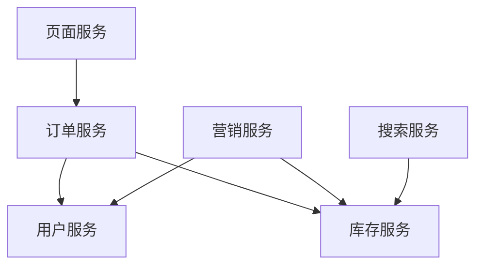

# 拆完服务怎么管：dubbo 出现的背景与服务治理需求

单体应用按业务拆成一个个独立服务之后，性能问题得到缓解，管理问题立刻冒头：服务之间互相调用，地址谁来维护、依赖关系谁来理清、机器什么时候加什么时候减，全都成了悬而未决的事。沿着互联网架构演进的四个阶段走一遍，就能看清 RPC 与服务治理分别是在哪一步变成刚需的，也就明白了 dubbo 诞生的土壤。

## 先给结论

- 网站架构演进出四个阶段：单一应用架构、垂直应用架构、分布式服务架构、流动计算架构，关键技术依次是 ORM、MVC、RPC、SOA。
- 垂直应用越拆越多，应用之间的交互不可避免，核心业务被抽成独立服务形成稳定的服务中心，RPC 在这一步成为关键技术，dubbo 正是这一阶段的产物。
- 服务规模继续膨胀，URL 配置困难、F5 硬件负载均衡单点压力大、依赖关系错综复杂、容量无从评估，这些问题共同指向同一个答案：服务治理。
- 服务治理靠四个中心支撑：注册中心让服务位置透明，治理中心理清应用依赖，监控中心统计调用量与响应时间，调度中心做资源调度。

## 四个阶段：架构是被流量推着走的

dubbo 官方给过一张架构演进路线图，横轴就是网站规模：单一应用架构对应 1～10 台机器的量级，垂直应用架构对应 10～1000，分布式服务架构对应 1000～10000，流动计算架构对应 10000 以上。

图从左到右是四次被动升级，每次升级都是因为上一阶段的优化手段把红利吃完了。

**第一，单一应用架构，省的是部署节点与成本。** 网站流量小，把所有功能部署在一个应用里最划算。这个阶段的技术关键是 ORM：流量压力不大，怎么用数据访问框架简化增删改查、提高开发效率，才是大家关心的重点。

**第二，垂直应用架构，把大应用拆开。** 访问量增大后，对单一应用做优化的空间越来越小，提速的「加速度」越来越小，于是按业务拆成互不相干的几个应用，各自独立部署、独立扩展。此时前端页面的开发速度成了瓶颈，MVC 框架是这个阶段的关键。

**第三，分布式服务架构，把核心业务抽成服务。** 垂直应用越来越多，应用之间的调用不可避免：页面要展示订单，订单要查库存，拆开之后这些调用全变成远程调用。调用越来越频繁，就必须把核心业务抽取出来作为独立的服务，逐渐形成稳定的服务中心；前端应用专心响应多变的市场需求，服务端集中稳定，应用与服务分离后开发也更容易，因为应用层变化多、服务层变化少。RPC 是这一阶段的关键，dubbo 的主战场就在这里。

**第四，流动计算架构，加一个调度中心。** 服务越来越多之后，新的矛盾不是不够用，而是浪费：每个服务独占的机器利用率参差不齐，容量评估做不准，小服务常年占着资源。于是需要一个调度中心统一管理服务，提高机器利用率、做好资源调度，SOA 成为本阶段的关键词。

## 服务一多，麻烦清单自动变长

在白板上画一个真实的微服务集群就能感受到问题：几十个服务，A 调 B、B 调 C、C 又被 D 和 E 调，调用关系织成一张网。

这张网规模小时靠文档和记忆力还能维持，服务一多就全面失控，痛点集中在四处。

**第一，URL 配置困难，F5 单点压力大。** 服务少时，每个消费方把提供方的 IP 和端口写进配置文件还能凑合；服务一多，配置文件跟着爆炸。传统做法是在前面挂一台 F5 硬件负载均衡器统一分发，所有流量都压在它身上，单点压力越来越大。此时就需要一个注册中心，动态注册和发现服务，让服务的位置透明。

**第二，依赖关系理不清。** 服务之间的依赖错综复杂之后，甚至分不清哪个应用要在哪个应用之前启动，架构师都难以完整描述出应用的架构关系。治理中心的用武之地就在这里：自动画出应用之间的依赖关系，帮架构师理清谁依赖谁。

**第三，容量规划没有依据。** 服务调用量越来越大，每个服务需要多少台机器支撑、什么时候加机器、什么时候减机器，拍脑袋回答不了。

**第四，资源浪费。** 上百个服务里，有的扛着核心流量需要扩容，有的一天被调不了几次却常年占着机器，缺一个统一的资源调度视角。

## 治理这件事具体怎么落

面对上面的问题，官方给出的做法可以归纳成三步。

第一步，把每个服务每天的调用量和响应时间统计出来，作为容量规划的参考指标。数据在手，加机器还是减机器、要不要调权重，判断才有依据。

第二步，用加压的方式反推总容量：在线上把某台机器的权重逐步调大，记录响应时间的变化，直到响应时间达到阈值，记下此时的访问量，再以访问量乘以机器数反推出该服务的总容量。每台机器该分多少资源，就有了相对科学的算法。

第三步，把这些能力交给专门的设施。在调用关系网之上叠加四个中心：注册中心负责服务的注册与发现，治理中心负责依赖梳理，调度中心负责资源调度，监控中心负责调用统计。官方服务治理图里还有服务授权、服务熔断、负载均衡、服务路由、服务质量协定、服务注册与发现、服务测试等条目，外加服务文档与责任人，这些条目合起来就是「服务治理」的完整含义。

dubbo 怎么用注册中心、监控中心这些角色落地这套治理，属于架构篇的内容；先把「为什么需要」记牢，后面架构图上的每一条线才不会看成装饰。

## 常见误区

- **把服务治理当成某个具体软件。** 它是一组能力的总称：注册发现、依赖管理、监控统计、资源调度。注册中心、监控中心、治理中心只是承载这些能力的角色，dubbo 提供了落地接口，部分能力也可以由独立组件承担。
- **认为拆了服务就自动获得治理能力。** 拆服务只解决独立部署与独立扩展，调用关系管理、容量评估都要额外引入注册中心与监控设施；不做这一步，分布式只会比单体更乱。
- **以为注册中心是拿来做流量转发的。** 注册中心是地址簿，解决服务位置透明与动态感知；F5 这类负载均衡解决的是流量分发。dubbo 场景下消费方从注册中心拿地址列表后自己做负载均衡，不再需要前置硬件。
- **把容量规划等同于压一次测。** 正确路径是持续统计调用量与响应时间，再用权重加压记录阈值时刻的访问量、乘以机器数反推总容量，是持续运营动作，不是一次性结论。

## 面试可能被问到的问题

1. 面试官追问：「架构演进四个阶段分别是什么，各阶段关键技术是什么？」
   答：单一应用架构关键在 ORM，垂直应用架构关键在 MVC，分布式服务架构关键在 RPC，流动计算架构关键在 SOA。演进动力是访问量与服务规模：先拆应用提速，再抽核心业务做服务，最后引入调度中心管资源。

2. 面试官追问：「为什么垂直应用拆多了就需要注册中心？」
   答：服务数量一多，消费方手工维护提供方地址的配置会失控，前置 F5 又带来单点压力。注册中心提供动态注册与发现，服务位置透明，提供方上下线自动感知，消费方不再关心具体地址。

3. 面试官追问：「服务治理到底治理什么？」
   答：核心是让大规模服务可管理：注册与发现、依赖关系梳理（自动画出应用依赖图帮助理清启动顺序）、调用统计与容量规划（统计每天调用量与响应时间作为扩缩容依据）、负载均衡、服务路由、授权、熔断、服务测试等运行期管控。

4. 面试官追问：「容量怎么估算，官方给过什么方法？」
   答：先统计服务的日调用量与响应时间作为参考；再把某台机器的权重逐步加大，记录响应时间直到达到阈值，记下此时的访问量，用访问量乘以机器数反推总容量，据此制定机器资源分配。

5. 面试官追问：「SOA 与微服务是什么关系？」
   答：SOA 强调把功能沉淀为服务并集中治理，早期常依赖企业服务总线；微服务是更细粒度、去中心化的演进，按业务独立部署、轻量通信。dubbo 属于服务化框架，它用注册中心承担了服务注册发现与治理的一部分职责，是 SOA 思想在 RPC 领域的落地实现。

## 配套资料

- 本教学日资料包未收录源码（`materials/code/03/` 下无 day03 解压内容），本课为纯概念课，无代码示例；架构演进四阶段、服务治理条目与容量反推方法出自本课课件内容整理。
- 同一套课程后续阶段的 Dubbo 服务发现实战工程可对照阅读：`materials/code/10/nacos-discovery-RESTful服务发现与Dubbo服务发现/`（含真实拆分的 Provider 与 Consumer 工程）
