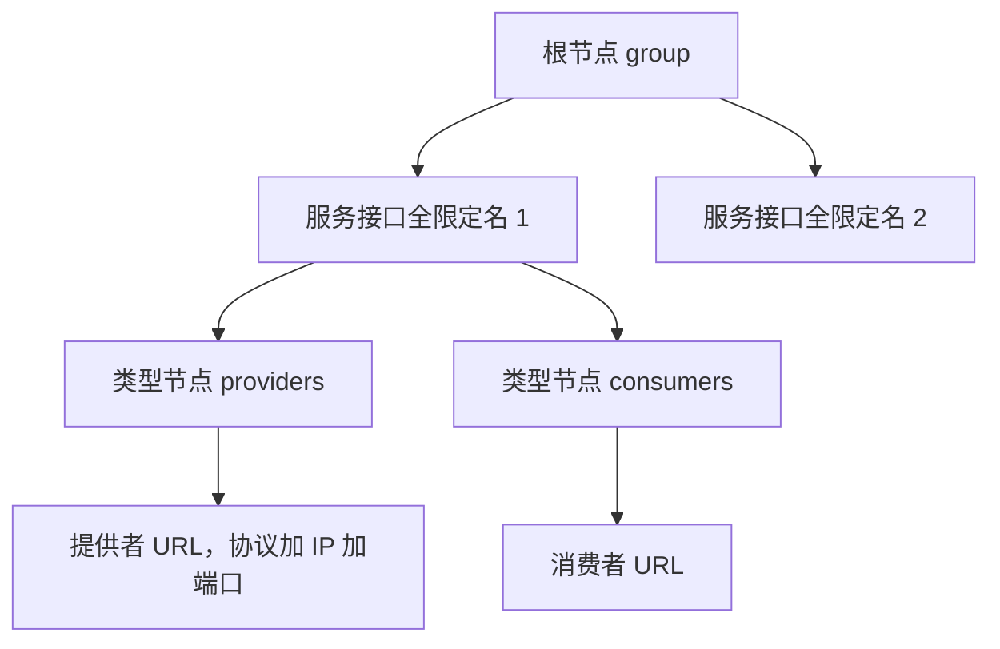

# 注册中心就位：用 Docker 部署并验证 ZooKeeper

架构图上，Provider 要把服务注册进 Registry，Consumer 要从 Registry 订阅服务，中间这个角色是整套体系的地基。地基选什么、怎么搭、搭完怎么验证它活着，就是这一课要解决的三件事：选型 ZooKeeper，用 Docker 三条命令把它跑起来，再用可视化工具连上去亲眼确认。

## 先给结论

- dubbo 支持 Multicast 广播、ZooKeeper、Redis、Simple 四种注册中心，官方推荐 ZooKeeper，课程与生产实践也以它为主。
- ZooKeeper 是 Apache Hadoop 的子项目，本质是树形目录服务，支持变更推送，工业强度较高，可直接用于生产环境。
- 生产部署推荐容器化：`docker pull zookeeper:3.5` 拉镜像，`docker create --name zk -p 2181:2181 zookeeper:3.5` 建容器，`docker start zk` 启动，2181 是它的默认客户端端口。
- 验证用 ZooInspector 可视化工具连接虚拟机 IP 加 2181 端口，能看到 zookeeper 根节点即部署成功。
- 服务注册后，Provider 的 URL 会写在 ZooKeeper 的服务目录树下，目录名随服务接口变化，不是写死的。

## 为什么是 ZooKeeper

**第一，官方推荐。** dubbo 官网注册中心参考手册列出了四种实现：Multicast 广播、ZooKeeper 注册中心、Redis 注册中心、Simple 注册中心。手册明确推荐使用 ZooKeeper，本套课程同样选它。

**第二，能力与需求吻合。** ZooKeeper 是 Apache Hadoop 的子项目，本身是一个树形的目录服务，支持变更推送，这与 dubbo 的注册发现模型天然匹配：Provider 往目录里写地址，Consumer 订阅目录，节点一变就推送。官方评价它工业强度较高，可用于生产环境并推荐使用。

**第三，久经考验。** ZooKeeper 在大数据领域应用非常广泛，Hadoop 生态的大量组件都构建在它之上，可靠性经过了大规模生产的长期验证。把它放在 dubbo 架构的中心位置，稳。

## 注册中心里长什么样：一棵服务目录树

dubbo 往 ZooKeeper 里写的数据组织成一棵树，官方流程图的结构是这样的：



树分四层：根节点之下按服务接口分目录，接口目录下按类型分节点，URL 挂在类型节点下面。三个角色各自往树上写什么、读什么，官方流程说明讲得很清楚：

- 服务提供者在启动时，向本服务的 providers 类型节点下写入自己的 URL。注意目录名取自服务接口的全限定名，注册不同的服务会落到不同的目录，没有任何写死的地方。
- 服务消费者在启动时，向该服务节点发起订阅，同时把自己的 URL 写到 consumers 类型节点下，让治理方也能看到消费方在哪。
- 监控中心启动时，订阅根节点下所有提供者与消费者的 URL，因为调用量统计需要两边的数据。

## 注册中心替你自动做的事

这些行为都依托 ZooKeeper 自身的特性（临时节点与会话机制）实现，官方文档在注册中心一节列得很全：

- 提供者出现断电等异常退出时，注册中心自动删除该提供者的信息，消费方随即收到推送，不会再往坏节点上调。
- 注册中心重启后，能自动恢复注册数据与订阅请求。
- 会话过期时，自动恢复注册数据与订阅数据。
- 可以设置记录失败的注册与失败的订阅请求，由后台定时重试补齐。
- 支持设置用户名密码访问 ZooKeeper，保证注册中心的使用安全。
- 可以通过 group 参数指定根节点，不设置时使用无根树；课程示例里服务最终挂在 `dubbo` 这个根目录下，这个名字正是默认分组。
- 可以使用通配符做匹配，一次订阅所有分组、所有版本的提供者。

## 动手部署：Docker 三条命令

部署方式选 Docker 有明确的理由：课程后续全是微服务架构，微服务加 Docker 是目前非常主流的部署方式，对日常开发、发布上线、后续的集群扩容都更方便。不熟悉 Docker 的同学用传统方式装也一样能跑通，只是建议抽时间补上这块知识。

环境采用 Ubuntu 16.04 加 Docker 17，Ubuntu 对 Docker 的支持比较好；用 CentOS 也可以，步骤等价。环境不一致的话按资料中的环境文档统一：安装 Ubuntu 16.04 虚拟机、设置 root 密码并允许 root 远程登录、升级软件包、安装 lrzsz 上传下载工具与 JDK 1.8，最后用 apt 安装 Docker：

```bash
apt install docker.io -y
```

接下来是正题，拉镜像、建容器、启动：

```bash
# 拉取镜像，统一使用 3.5 版本
docker pull zookeeper:3.5
# 创建容器：命名为 zk，主机 2181 端口映射到容器 2181 端口
docker create --name zk -p 2181:2181 zookeeper:3.5
# 查看容器列表，此时状态应为 Created
docker ps -a
# 启动容器
docker start zk
# 再次查看，确认状态为 Up 且端口映射存在
docker ps
```

2181 是 ZooKeeper 的默认客户端端口，`-p 2181:2181` 把主机的 2181 转发给容器的 2181，外部程序连主机端口就等于连容器里的 ZooKeeper。

## 验证：用 ZooInspector 连上去看

裸命令只能确认容器在跑，要确认服务真的对外可用，用资料里提供的 ZooKeeper 可视化查看工具 ZooInspector：双击 start.bat 启动，点击运行按钮，在连接框里填虚拟机地址与端口，例如 `172.16.55.185:2181`，点击 OK 等待连接。

连接成功后，左侧树里出现 zookeeper 根节点，说明虚拟机上用 Docker 部署的 ZooKeeper 已经正常对外服务。连接速度稍慢属于正常现象，等它连上即可；一直连不上就回头检查端口映射和防火墙。

## 传统方式部署要配什么

如果不用 Docker，传统安装的方式是下载压缩包、解压，然后把 `conf/zoo_sample.cfg` 复制为 `zoo.cfg` 再启动，效果完全一样。核心配置长这样（示例，按主流写法补全；Docker 镜像里这些值已内置，无需手改）：

```properties
# 心跳间隔，单位毫秒
tickTime=2000
# 数据目录
dataDir=/tmp/zookeeper
# 客户端连接端口
clientPort=2181
# follower 初始连接时允许的 tick 数上限
initLimit=10
# 请求应答与同步允许的 tick 数上限
syncLimit=5
```

之后执行 `bin/zkServer.sh start` 启动，同样以 2181 对外服务。两条路任选其一，注册中心就位即可。

## 常见误区

- **端口映射写成大写 `-P 2181:2181`。** 小写 `-p` 才是手工指定主机端口到容器端口的映射，大写 `-P` 是让 Docker 随机分配高端口，写错后客户端会一直连不上 2181。
- **部署完就认为注册中心是核心依赖。** ZooKeeper 只在建立联系阶段出场，消费方本地缓存了地址列表；注册中心短暂不可用不影响已在运行的调用，别把它当成每次调用都要经过的网关。
- **验证失败就怀疑镜像有问题。** 先 `docker ps` 确认容器状态与端口映射，再确认虚拟机 IP 与防火墙，ZooInspector 连接偏慢多等几秒，绝大多数「连不上」都是网络与映射问题。
- **把 ZooKeeper 当数据库用。** 它只存服务地址这类元数据，节点内容有大小限制，业务数据放进注册中心既低效又危险。

## 面试可能被问到的问题

1. 面试官追问：「dubbo 支持哪些注册中心，为什么选 ZooKeeper？」
   答：支持 Multicast 广播、ZooKeeper、Redis、Simple 四种。ZooKeeper 是 Apache Hadoop 子项目，树形目录服务，支持变更推送，与 dubbo 的注册发现模型契合，工业强度高，可用于生产环境，官方也推荐使用。

2. 面试官追问：「dubbo 在 ZooKeeper 里的目录结构是怎样的？」
   答：按「根节点、服务接口全限定名、类型节点、URL」四层组织。providers 类型节点下是提供者 URL，consumers 下是消费者 URL，监控中心订阅整个根目录拿到全部数据，目录名随服务接口动态生成。

3. 面试官追问：「提供者直接断电了，注册中心怎么感知的？」
   答：提供者注册时创建的是临时节点，会话由长连接维持；进程消失后会话过期，ZooKeeper 自动删除对应节点，注册中心随即把变更推送给订阅的消费方，不用人工摘除。

4. 面试官追问：「用 Docker 部署 ZooKeeper 的关键命令是什么？」
   答：`docker pull zookeeper:3.5` 拉镜像；`docker create --name zk -p 2181:2181 zookeeper:3.5` 创建容器并做端口映射；`docker start zk` 启动；`docker ps` 确认状态。2181 是默认客户端端口。

5. 面试官追问：「group 参数有什么用？」
   答：group 用来指定 ZooKeeper 里的根节点，实现注册数据的逻辑隔离，不设置时使用无根树。配合通配符还可以一次订阅所有分组、所有版本的提供者，便于治理工具做全局视图。

6. 面试官追问：「注册中心重启会不会丢服务？」
   答：不会。提供者与消费者的连接恢复后，注册数据与订阅请求会自动恢复；这也是官方列出的注册中心特性之一，失败注册与订阅请求还会由后台定时重试补齐。

## 配套资料

- 本教学日资料包未收录源码与讲义（`materials/code/03/` 下无 day03 解压内容），Docker 部署命令、ZooInspector 验证流程与注册中心特性清单出自本课实操画面；`zoo.cfg` 配置为按主流写法补全的示例，Docker 镜像内置默认配置，照抄即可运行。
- 环境准备涉及 Ubuntu 16.04 虚拟机安装文档，资料包中未收录；同系列 Dubbo 服务发现工程可对照：`materials/code/10/nacos-discovery-RESTful服务发现与Dubbo服务发现/`
