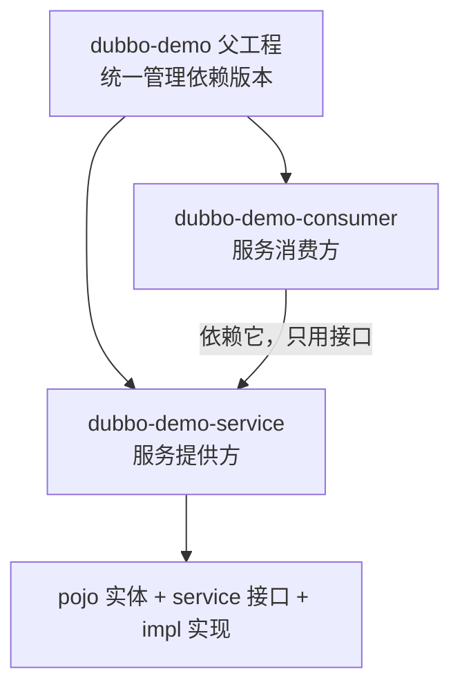
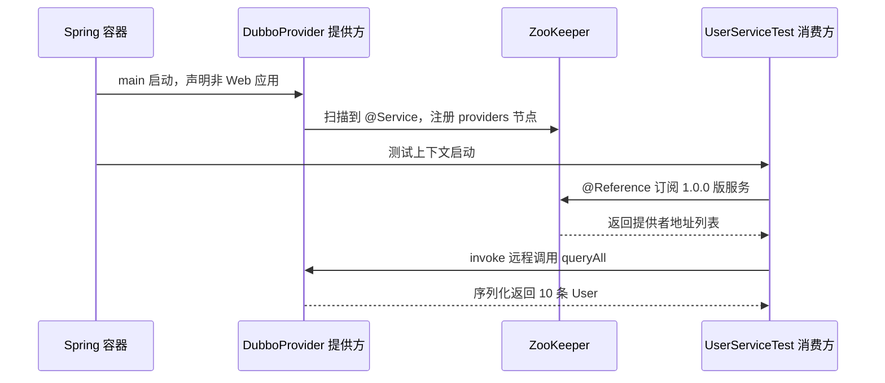

# 服务提供方与消费方实战：一次 dubbo 调用从零跑通

> 🔒 安全提示：文中示例的口令/密钥均为课程教学环境演示口径，生产环境的安全要求见《安全与合规须知》。

ZooKeeper 已经在虚拟机里跑起来，架构图上还差两个角色：Provider 发布一个 `UserService`，Consumer 在另一个工程里调用它，最后打印出 10 条远程传回的数据。这一课把 dubbo 最核心的两段代码写完，后面的负载均衡、协议、监控都建立在这套骨架上。

## 先给结论

- 工程结构是父工程管依赖，`dubbo-demo-service` 子模块做服务提供方，`dubbo-demo-consumer` 子模块做服务消费方；消费方依赖提供方工程，只为拿接口。
- 提供方三件事：实现类上标 dubbo 的 `@Service` 注解声明服务与版本；`application.properties` 里配应用名、扫描包、dubbo 协议 20880 端口、ZooKeeper 地址；启动类以非 Web 方式启动。
- 跨网络传输的对象必须实现 `Serializable`，这是 dubbo 的硬性要求，实体类还要显式声明 `serialVersionUID`。
- 消费方用 `@Reference(version = "1.0.0")` 拿远程代理，写法与本地调用无异；它不提供服务，不需要配置协议与端口。
- 注册成功的标志：ZooInspector 里 `/dubbo/服务接口名/providers` 下出现带 IP、20880 端口与版本号的 URL。

## 工程结构：父工程加两个子模块

新建 Maven 工程 `dubbo-demo`（groupId 用 `com.example.dubbo`），再右键新建 module `dubbo-demo-service` 作为提供方，消费方模块 `dubbo-demo-consumer` 用同样方式创建。结构如下：



依赖方向是消费方指向提供方，方向别搞反。

## 服务提供方：把 UserService 发布出去

### 依赖：父管版本，子装客户端

父工程 `pom.xml` 的关键部分：

```xml
<!-- spring boot parent，统一管理版本 -->
<parent>
    <groupId>org.springframework.boot</groupId>
    <artifactId>spring-boot-starter-parent</artifactId>
    <version>2.0.0.RELEASE</version>
</parent>

<dependencies>
    <dependency>
        <groupId>org.springframework.boot</groupId>
        <artifactId>spring-boot-starter-test</artifactId>
        <scope>test</scope>
    </dependency>
    <!-- dubbo 与 spring boot 整合的 starter -->
    <dependency>
        <groupId>com.alibaba.boot</groupId>
        <artifactId>dubbo-spring-boot-starter</artifactId>
        <version>0.2.0</version>
    </dependency>
    <!-- 显式指定 dubbo 版本，覆盖 starter 传递进来的 2.6.2 -->
    <dependency>
        <groupId>com.alibaba</groupId>
        <artifactId>dubbo</artifactId>
        <version>2.6.4</version>
    </dependency>
</dependencies>
```

`dubbo-spring-boot-starter` 自身传递进来的 dubbo 是 2.6.2，显式声明 2.6.4 后依赖仲裁会优先采用直接声明的版本；依赖列表没自动刷新，就去设置里勾上 Maven importer 的 auto import。

提供方子模块的依赖：

```xml
<dependencies>
    <!-- 提供方不对外开 HTTP，非 web 的 starter 就够 -->
    <dependency>
        <groupId>org.springframework.boot</groupId>
        <artifactId>spring-boot-starter</artifactId>
    </dependency>
    <!-- ZooKeeper 客户端依赖，与注册中心通信全靠它们 -->
    <dependency>
        <groupId>org.apache.zookeeper</groupId>
        <artifactId>zookeeper</artifactId>
        <version>3.4.13</version>
    </dependency>
    <dependency>
        <groupId>com.github.sgroschupf</groupId>
        <artifactId>zkclient</artifactId>
        <version>0.1.0</version>
    </dependency>
</dependencies>
```

zookeeper 与 zkclient 两个客户端依赖缺一不可，少了任何一个都连不上注册中心。提供方不需要 Web 能力，引非 web 的 `spring-boot-starter` 就行；误引入 `spring-boot-starter-web` 也能跑，只是容器白白多监听一个端口。

### 实体类：序列化是硬性要求

```java
package com.example.dubbo.pojo;

/**
 * dubbo 要求跨网络传输的对象必须实现序列化接口
 */
public class User implements java.io.Serializable {

    private static final long serialVersionUID = -7341603993352159322L;

    private Long id;
    private String username;
    private String password;
    private Integer age;
    // getter 与 setter 省略
}
```

方法入参和返回值都要经过序列化在网络上传输，`serialVersionUID` 建议显式写出来：两端类结构演进时，序列化兼容与否由它仲裁。

### 接口、实现类与版本号

接口只有一个查询方法：

```java
package com.example.dubbo.service;

import com.example.dubbo.pojo.User;
import java.util.List;

public interface UserService {
    List<User> queryAll();
}
```

实现类是整个发布动作的核心：

```java
package com.example.dubbo.service.impl;

import com.alibaba.dubbo.config.annotation.Service;
import com.example.dubbo.pojo.User;
import com.example.dubbo.service.UserService;
import java.util.ArrayList;
import java.util.List;

@Service(version = "${dubbo.service.version}")   // 声明这是一个 dubbo 服务
public class UserServiceImpl implements UserService {

    // 模拟查询，不连数据库，能返回数据即证明链路打通
    public List<User> queryAll() {
        List<User> list = new ArrayList<User>();
        for (int i = 0; i < 10; i++) {
            User user = new User();
            user.setId(Long.valueOf(i + 1));
            user.setPassword("123456");
            user.setUsername("username" + i);
            list.add(user);
        }
        return list;
    }
}
```

这里有个高频翻车点：`@Service` 的 import 必须是 `com.alibaba.dubbo.config.annotation.Service`，不是 Spring 的 `org.springframework.stereotype.Service`。Spring 那个只会把类注册成本地 Bean，服务不会发布到注册中心，表现就是消费方一直找不到提供者。

版本号 `${dubbo.service.version}` 从配置文件读取。定版本是为了升级从容：直接改 1.0 的实现，所有消费方可能被迫跟着改代码；有了版本，2.0.0 可以与 1.0.0 并存发布，老消费者继续用 1.0.0，新消费者直接指定 2.0.0，什么时候切由消费方自己决定，这也是灰度发布的基础。

### 配置文件

`application.properties`：

```properties
# Spring Boot 应用配置
spring.application.name = dubbo-demo-service
server.port = 9090
# 服务版本
dubbo.service.version = 1.0.0
# 服务扫描包，dubbo 到这里找标了 @Service 的实现
dubbo.scan.basePackages = com.example.dubbo.service
# dubbo 应用名称，注意与 spring.application.name 是两个独立配置
dubbo.application.name = dubbo-provider-demo
# 协议与端口
dubbo.protocol.name = dubbo
dubbo.protocol.port = 20880
# ZooKeeper 注册中心
dubbo.registry.address = zookeeper://172.16.55.185:2181
dubbo.registry.client = zkclient
```

逐条看重点：`dubbo.scan.basePackages` 指向 service 包，实现类上的 dubbo `@Service` 就是发布动作的触发点；`dubbo.application.name` 与 `spring.application.name` 是两个独立配置，互不替代，都不能漏。

协议为什么需要：消费者与提供方大概率不在同一台机器，调用要走网络，双方要约定协议，这里用 dubbo 自定义的 dubbo 协议，单一长连接加二进制序列化，端口 20880。注册中心地址就是上一课部署的 ZooKeeper，`zkclient` 指定注册中心的客户端实现。

### 启动类与注册验证

```java
package com.example.dubbo;

import org.springframework.boot.WebApplicationType;
import org.springframework.boot.autoconfigure.SpringBootApplication;
import org.springframework.boot.builder.SpringApplicationBuilder;

@SpringBootApplication
public class DubboProvider {

    public static void main(String[] args) {
        new SpringApplicationBuilder(DubboProvider.class)
                .web(WebApplicationType.NONE)   // 非 Web 应用，不起内嵌容器
                .run(args);
    }
}
```

与普通 Spring Boot 应用只差 `.web(WebApplicationType.NONE)`：提供方不提供 HTTP 接口，没必要起内嵌容器，非 Web 方式启动更快也更省资源。

运行 main 方法，控制台日志里能看到 zkclient 连接 ZooKeeper 的过程。启动完成后打开 ZooInspector 连上注册中心：`dubbo` 根节点下出现了 `com.example.dubbo.service.UserService` 目录，providers 节点里是一条完整 URL，协议 dubbo、IP 加端口 20880、接口全限定名，参数里还带着 `version=1.0.0`。对照架构图：Spring 容器 start 启动 Provider，Provider 完成 register，注册中心里已有它的名字。

## 服务消费方：用接口拿回 10 条数据

### 依赖：只为接口，不为实现

消费方模块的依赖与提供方几乎一致：非 web 的 starter、zookeeper、zkclient，多出来的一条是提供方工程本身：

```xml
<dependency>
    <groupId>com.example.dubbo</groupId>
    <artifactId>dubbo-demo-service</artifactId>
    <version>1.0-SNAPSHOT</version>
</dependency>
```

依赖提供方工程的目的不是用它的实现类，而是拿 `UserService` 接口，实现类只留在提供方工程里。更正规的做法是把工程一分为二：api 工程只放接口与实体，提供方与消费方都依赖它；课程为演示方便直接依赖了 service 工程，生产项目要拆开。

### 测试类：@Reference 注入远程代理

```java
package com.example.dubbo;

import com.alibaba.dubbo.config.annotation.Reference;
import com.example.dubbo.pojo.User;
import com.example.dubbo.service.UserService;
import org.junit.Test;
import org.junit.runner.RunWith;
import org.springframework.boot.test.context.SpringBootTest;
import org.springframework.test.context.junit4.SpringRunner;
import java.util.List;

@SpringBootTest
@RunWith(SpringRunner.class)
public class UserServiceTest {

    @Reference(version = "1.0.0")   // 通过注册中心查找服务，注入远程代理
    private UserService userService;

    @Test
    public void testQueryAll() {
        List<User> list = userService.queryAll();
        for (User user : list) {
            System.out.println(user);
        }
    }
}
```

`@Reference` 触发订阅，把 `UserService` 的代理对象注入进来：调用 `queryAll()` 时，代理把参数序列化后经 dubbo 协议发给提供方，拿到结果再反序列化返回，写法与本地调用一致。`version` 必须与提供方一致；注册中心里 1.0.0 与 2.0.0 并存时，改这一处就完成切版本。

### 配置文件与一次真实报错

第一次跑测试直接失败，栈顶指向 `DubboProtocol`，报连接 20880 出错，原因是配置文件漏写了。补上：

```properties
spring.application.name = dubbo-demo-consumer
# 注册中心地址，与提供方一致
dubbo.registry.address = zookeeper://172.16.55.185:2181
dubbo.registry.client = zkclient
```

注意消费方没有配 `dubbo.protocol` 与端口：它不提供服务，只要能连上注册中心完成订阅即可。

补完再跑，控制台打印出 10 条 User，username 从 username0 排到 username9，全部来自提供方 `queryAll()` 里构造的模拟数据，是走网络从提供方拿回来的，RPC 链路至此打通。

## 全链路回顾



到这里五个角色全部出场：Spring 容器当 Container，`DubboProvider` 是 Provider，测试类是 Consumer，ZooKeeper 是 Registry；Monitor 没有部署，但它只等统计上报，缺它不影响链路。

## 常见误区

- **导入 Spring 的 `@Service`。** 全限定名必须是 `com.alibaba.dubbo.config.annotation.Service`，Spring 的注解只注册本地 Bean 不发布服务，消费方将一直报找不到提供者。
- **实体类忘实现 `Serializable`。** 运行期直接抛序列化异常，接口写得再对也调不通；`serialVersionUID` 也要显式声明。
- **消费方也去配协议与端口。** 它不提供服务，`dubbo.protocol.port` 没有意义，同一台机器上还可能因此端口占用启动失败。
- **依赖实现工程后直接 new 实现类。** 那是本地调用，绕过了注册中心与 RPC，测试「看起来通过」实际什么都没验证；正确姿势是 `@Reference` 注入代理，生产上把接口拆成独立 api 模块。

## 面试可能被问到的问题

1. 面试官追问：「dubbo 的 @Service 和 Spring 的 @Service 有什么区别？」
   答：dubbo 的 `@Service` 把实现类发布成 RPC 服务，触发服务注册与协议暴露；Spring 的 `@Service` 只把类注册为本地容器 Bean。注解名相同但全限定名不同，import 时要特别确认。

2. 面试官追问：「@Reference 注入的对象到底是什么？」
   答：dubbo 生成的接口动态代理。调用方法时代理完成地址选择、协议编码、网络发送与结果反序列化，对业务代码透明；版本、超时等属性可以直接标注在 `@Reference` 上。

3. 面试官追问：「服务版本 version 有什么用？」
   答：让新旧版本并存，消费方自主决定升级时机。服务端发布 2.0.0 不影响仍调用 1.0.0 的老消费者，消费方改造完成后把 version 改成 2.0.0 即完成切换，是灰度发布的基础。

4. 面试官追问：「dubbo 对传输对象有什么要求？」
   答：入参与返回值都要在网络上传输，必须实现 `java.io.Serializable`，并建议显式声明 `serialVersionUID` 保证跨版本兼容，否则运行期抛序列化异常。

5. 面试官追问：「提供方为什么用非 Web 方式启动？」
   答：提供方只暴露 dubbo 协议端口 20880，不提供 HTTP 接口，没必要启动内嵌 Tomcat。用 `SpringApplicationBuilder` 的 `web(WebApplicationType.NONE)` 声明非 Web，启动更快、占用更少；若同时要对外开 HTTP 再选 SERVLET。

6. 面试官追问：「怎么确认服务发布成功了？」
   答：看注册中心。ZooInspector 连上后，dubbo 根节点下出现接口全限定名目录，providers 节点里是提供者 URL，含协议、IP、端口 20880 与 version 参数。

## 配套资料

- 本教学日资料包未收录源码（`materials/code/03/` 下无 day03 解压内容），文中工程结构、依赖、配置、注解与启动类均按本课实操画面整理补全，包名统一改写为 `com.example.dubbo`，代码可直接照抄运行。
- 同系列后续阶段的 Dubbo 服务发现真实工程可对照阅读：`materials/code/10/nacos-discovery-RESTful服务发现与Dubbo服务发现/`（接口 api 模块与实现 server 模块分离的标准结构，即本课提到的「一分为二」做法）
