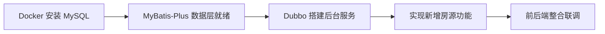

# day04 导览：把数据库、数据层与第一个完整功能一口气打通

前三天的进度是：前端系统已经搭好并能跑，系统架构也定了下来，注册中心 ZooKeeper 已经用 Docker 部署到位。但对照架构图看，所有服务之间那条真正的业务链路还一条都没走通，数据库也没影。这时候最容易犯的毛病是继续在图纸上打转，迟迟不动第一行业务代码。

今天的任务就是打破这个僵局：数据层补齐、服务端立起来，然后硬碰硬地把「新增房源」这个功能从前端一路打通到数据库。一个功能真正跑通，整套架构才算验收合格。

## 先给结论

- 今天四件事依次展开：用 Docker 安装 MySQL、入门 MyBatis-Plus、基于 Dubbo 搭建后台服务系统、实现新增房源并完成前后端整合。
- 数据库选 MySQL 的衍生版 Percona，性能优于原生版本，使用层面与原生 MySQL 完全一致，没有额外学习成本。
- 持久层继续用 MyBatis，但配上 MyBatis-Plus 增强插件，单表 CRUD 不再手写 SQL 和 XML。
- 后台服务用前面学过的 Dubbo 做服务治理，服务提供方与消费方今天正式接上数据。
- 衡量今天是否达标的标准只有一条：新增房源能从浏览器页面操作，数据最终落进 MySQL。

## 今天的四步棋，顺序不能乱

**第一步，先把数据库装出来。** 底层存储选的是 MySQL，部署方式用 Docker 容器化。这一步是后面所有工作的地基，库都没建，MyBatis-Plus 学了也没有落点。核心动作就是三行命令（细节与验证下一篇展开）：

```bash
# 拉取 MySQL 衍生版 Percona 的镜像
docker pull percona:5.7.23
# 创建容器，数据目录挂到宿主机，3306 端口映射出去
docker create --name percona -v /data/mysql-data:/var/lib/mysql -p 3306:3306 -e MYSQL_ROOT_PASSWORD=root percona:5.7.23
# 启动容器
docker start percona
```

安装过程会选一个 MySQL 的衍生版，选它的理由放在下一篇单独讲。

**第二步，把 MyBatis-Plus 学起来。** 学这门课的人对 MyBatis 应该已经比较熟了，它的优势是写 SQL 灵活，做复杂查询得心应手；缺点是简单的单表增删改查也要一套接口加 XML 地写，效率上不去。MyBatis-Plus 就是 MyBatis 的增强插件，把它引入之后，单表操作基本不用自己写 SQL，开发效率明显提升。它只做增强、不做改变，已有的 MyBatis 用法一点都不会作废。

**第三步，用 Dubbo 把后台服务搭起来。** 数据库和持久层就位之后，就基于它们搭建后台服务系统，服务治理框架用的是前面学过的 Dubbo。之前部署的 ZooKeeper 注册中心、讲的 Dubbo 架构，今天都要在真实的工程里用上。

**第四步，实现新增房源并整合前端。** 后台系统搭好之后，第一个要实现的功能是新增房源。功能写完还不算完，还要和已经搭好的前端做整合，联调通过，这个功能才算真正交付。

四步的依赖关系是一条直线，倒着走不通：



图上从左到右就是今天的推进顺序，每一步都是下一步的前置条件，数据库不通则服务无从调试，服务不立则前端联调没有对接方。

## 关于 Percona，先解除一个误会

装 MySQL 的时候会出现一个新名词：Percona。不用紧张，它不是一门要重新学的新数据库。

MySQL 是开源的，于是有不少个人、组织和企业基于它的源码，结合自身业务做了改进，形成了很多衍生版本。Percona 是其中比较出名的一个，对原生 MySQL 在功能和性能上都有显著提升，尤其是提升了高负载情况下 InnoDB 存储引擎的性能，还给 DBA 提供了一些实用的性能诊断工具。

两个要点记牢：一是它只在底层做改进，使用层面和原生 MySQL 没有任何区别，SQL 语法、客户端、驱动全都照旧；二是 Percona Server 只包含服务器端，客户端和 GUI 工具没有改动，客户端继续用 MySQL 官方提供的或者第三方工具即可。所以学习成本约等于零，会 MySQL 就会用 Percona。

## 为什么「跑通一个功能」比「学会十个知识点」重要

一个新增房源，表面上看只是一个表单提交，背后却把整条链路全部串了一遍：前端页面发请求，请求经过服务消费方，Dubbo 按注册中心里的地址找到服务提供方，提供方用 MyBatis-Plus 操作数据库，数据写进 MySQL，结果层层返回，前端展示成功。

这套链路里任何一个环节出问题，功能都通不了。所以第一个功能的攻坚价值最高，它逼着把配置、依赖、注册、调用、映射每一个环节都真正调对。而一旦跑通，意味着架构骨架已经成型，后面再去实现其他功能，走的都是同一条路子，差别只是业务逻辑不同。这也是课程把今天安排成「搭建加首功能」的原因：先立骨架，再批量复制。

## 常见误区

- **把 Percona 当成新数据库去学。** 它是 MySQL 的衍生版，使用方式与原生 MySQL 完全一致，不需要额外学习，把它当作「性能更好的 MySQL」来用即可。
- **以为引入 MyBatis-Plus 就要抛弃 MyBatis。** 插件的定位是只做增强、不做改变，复杂查询和多表关联仍然用 MyBatis 原生方式写，两者长期共存。
- **环境没就绪就开始写业务代码。** 数据库没装好、注册中心没验证就动手建服务工程，报错时问题混在一起无从下手。按今天的顺序，先把地基打完。
- **把「实现功能」理解成只写后端。** 新增房源的验收标准是前端页面操作能落库，后端写完不算完成，前后端整合联调也是今天的目标之一。

## 面试可能被问到的问题

1. 面试官追问：「你们项目的持久层为什么选 MyBatis 而不是 JPA？」
   答：项目里有不少业务相关的复杂查询，MyBatis 写 SQL 灵活可控，优化空间大；它属于半自动化 ORM 框架，SQL 完全在自己手里。单表简单操作的开发效率问题，通过引入 MyBatis-Plus 插件补齐，两者互补。

2. 面试官追问：「MyBatis-Plus 会不会影响已有的 MyBatis 代码？」
   答：不会。它的定位是在 MyBatis 基础上只做增强、不做改变，引入后现有工程不需要任何改动，原有的接口、XML、SQL 照常运行，新增的只是通用 CRUD、分页等增强能力。

3. 面试官追问：「你们数据库是怎么部署的？」
   答：采用 Docker 容器化部署，选用了 MySQL 的衍生版 Percona，它在高负载下 InnoDB 性能更好，使用上与原生 MySQL 没有区别。数据目录通过数据卷挂载到宿主机，容器重建数据不丢。

4. 面试官追问：「一个新增房源功能，请求在你项目里是怎么流转的？」
   答：前端页面提交表单，请求打到服务消费方；消费方通过 Dubbo 从注册中心获取提供方地址并发起 RPC 调用；提供方用 MyBatis-Plus 的通用 Mapper 做持久化，数据写入 MySQL；结果沿原路返回，前端提示操作成功。

## 配套资料

- 本教学日资料包未收录源码（`materials/code/03/day04-服务的具体实现以及MybatisPlus的入门/` 下仅存清单文件），文中工程结构为按本课写法补全，数据库与服务搭建的实操画面即本课内容本身。
- MyBatis-Plus 官方讲义可对照预习：`materials/docs/10/Mybatis-Plus讲义v1.0.md`（简介、特性、架构、快速入门的章节划分与本课一致）。
- 可运行的 MyBatis-Plus 示例工程见 `materials/code/10/mp-springboot/`（含 Spring Boot 集成、通用 Mapper 与分页插件配置，可与后续两篇正文对照阅读）。
