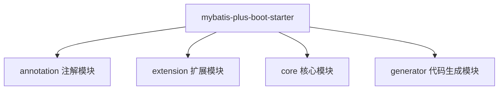
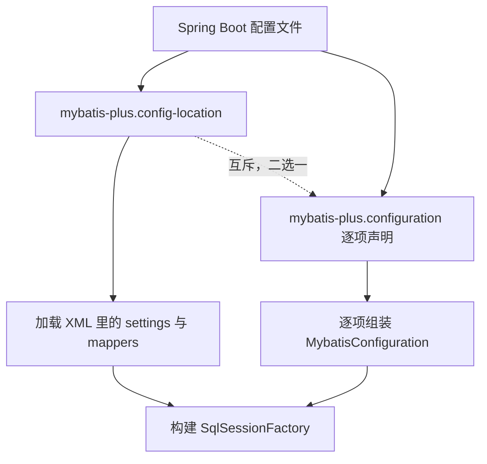
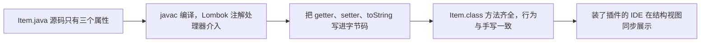

# MybatisPlus入门四讲：架构原理、BaseMapper 通用 CRUD、配置详解与 Lombok 实体瘦身

## 先给结论

MyBatis-Plus 是 MyBatis 的增强插件而不是替代品：它在外围生成 SQL，交回 MyBatis 执行，单表 CRUD 不用再写 XML。全系列四讲从架构原理讲到通用 CRUD、配置收拢与 Lombok 实体瘦身，构成一套完整的入门动线。
第一讲立定位与快速入门：五步跑通第一条查询，顺带看清它在外围工作的架构。第二讲吃透 BaseMapper：按主键与按条件查询、插入的主键策略连环坑、更新只动非空字段、分页先装插件。第三讲把 MyBatis 原生配置搬进 Spring Boot，避开 config location 与 plugin 互斥的坑。第四讲用 Lombok 的注解在编译期生成 getter 与 setter，给 MP 实体瘦身。
三处易踩的坑先标出来：id_type 不配导致主键报错、配置位置写错引发互斥、Lombok 不装插件则 IDE 报红。
四讲依次是：
- 介绍与架构：只做增强的插件定位与五分钟快速入门。
- BaseMapper 详解：一套通用方法覆盖单表 CRUD 与物理分页。
- 配置讲解：三个基本配置项、进阶配置与互斥的坑。
- Lombok 使用：常用注解逐个试与 MP 实体瘦身。

## 第1部分：MyBatis-Plus 入门：只做增强的插件，从架构原理到五分钟跑通第一条查询

用 MyBatis 写过几天业务的人，一定经历过这种重复：一张单表，先写实体类，再写 Mapper 接口，然后是接口对应的 XML，`insert`、`deleteById`、`updateById`、`selectById` 一套下来上百行，全是模板代码，换一张表再抄一遍。SQL 灵活是灵活了，可这类没有技术含量的单表操作占日常工作量的大头。

MyBatis-Plus（简称 MP）就是冲着这个问题来的：它是一个 MyBatis 的增强工具，在 MyBatis 的基础上只做增强、不做改变，为简化开发、提高效率而生。数据库就用上一篇用 Docker 装好的那个，这一篇从定位讲到架构原理，再一步步把第一条查询跑通。

### 一、定位：MyBatis 的增强插件，不是替代品

先把 MyBatis 本身说透。严格讲 MyBatis 不能算完整的 ORM 框架，更接近半自动 ORM：对象和 SQL 的映射它帮你做，但 SQL 本身要自己写。这既是它的优点也是它的短板：写复杂查询时灵活可控，做单表增删改查时又显得繁琐。

插件生态正是为了补短板。MyBatis 的插件很多，目前主流的一款就是 MyBatis-Plus，课程在 ORM 这一层选择「MyBatis 加 MP 插件」的组合，理由很直接：既不损失 MyBatis 的灵活性，又通过插件增强了开发效率。

官方给它的定位画得很形象：MyBatis 的图标是红色角色，MyBatis-Plus 的图标是蓝色角色，配色灵感来自经典游戏魂斗罗里的红衣蓝衣两个人物，愿景是做 MyBatis 最好的搭档，既有搭配，效率翻倍。红蓝搭档各管一摊：MyBatis 管灵活，MP 管效率。

特性清单过一遍，抓住每条解决什么问题：

- **无侵入、损耗小**：只做增强不做改变，启动即自动注入基本 CRUD，直接面向对象操作。损耗小不等于零损耗，生成 SQL 终究消耗一点 CPU，但相对很小。
- **强大的 CRUD 与 Lambda 调用**：内置通用 Mapper，单表增删改查开箱即用；查询条件可用 Lambda 表达式写，不怕把字段名抄错。
- **多数据库与主键自动生成**：MySQL、Oracle 等主流库都支持；主键策略多达 4 种（含分布式唯一 ID 生成器），可自由配置。
- **XML 热加载与 ActiveRecord 模式**：简单 CRUD 可以无 XML 启动；实体继承 Model 类即可直接增删改查。
- **关键词自动转义与自定义全局操作**：`order`、`key` 这类数据库关键词自动转义，防撞名。
- **内置代码生成器**：可自动生成 Mapper、Model 等代码，后续课程会实际用到。
- **内置分页插件**：基于 MyBatis 物理分页，配置好之后写分页等同于普通查询。
- **内置性能分析、全局拦截与 SQL 注入防范**：可输出 SQL 与执行时间，能对全表 delete、update 做智能阻断，预防误操作与注入。

这份清单不必背，但要知道它划出了 MP 的能力边界：绝大多数增强都围绕「单表操作自动化」展开，多表关联这些真正复杂的活，仍然留给 MyBatis。

### 二、架构：它在外围生成 SQL，交回 MyBatis 执行

看懂架构，MP 的一切行为就都能解释了。架构图分左右两块，右边是它提供的模块，左边是它的工作流程。

先看模块。MP 对 Spring Boot 的支持集中在一个叫 `mybatis-plus-boot-starter` 的模块里，课程的基本框架是 Spring Boot，所以用的正是它。这个 starter 背后还带着几个兄弟模块：



四个模块各管一摊：`annotation` 提供常用注解，后面天天用；`extension` 是对 MyBatis 做的扩展；`core` 是核心；`generator` 负责生成代码文件。名字带 boot-starter，就是给 Spring Boot 项目做便捷集成用的。

再看左边的工作流程，这是理解 MP 的关键：


流程从上到下走一遍：MP 先扫描工程里的实体类，通过反射提取出表名与字段信息，分析后生成对应的增删改查 SQL 语句，最后把这些 SQL 注入 MyBatis 容器，交给 MyBatis 执行并封装结果。

图里最重要的一点是：MP 自己从不执行 SQL，它只在外围「造 SQL、注 SQL」，执行引擎从头到尾都是 MyBatis，所以对原框架零侵入，这正是「只做增强、不做改变」在架构层面的保证。后面会用到的 `@TableName`、`@TableId` 等注解，本质都是在给「扫描实体」这一步提供更准确的表信息。

### 三、快速入门：五步跑通第一条查询

理论讲完，动手验证。目标是：不写一行 SQL、不建一个 XML，查出表里的全部数据。

#### 1 建库建表

用上一篇部署好的数据库，先建库，字符集选 utf8，再建表并插入几条测试数据：

```sql
CREATE DATABASE `haoke` CHARACTER SET 'utf8' COLLATE 'utf8_general_ci';

CREATE TABLE `user` (
    id BIGINT(20) NOT NULL COMMENT '主键ID',
    name VARCHAR(30) DEFAULT NULL COMMENT '姓名',
    age INT(11) DEFAULT NULL COMMENT '年龄',
    email VARCHAR(50) DEFAULT NULL COMMENT '邮箱',
    PRIMARY KEY (id)
) ENGINE=InnoDB DEFAULT CHARSET=utf8;
```

表就四个字段：`id`、`name`、`age`、`email`。插入 5 条数据作为演示集（示例数据，与后续查询演示一致）：

```sql
INSERT INTO `user` (`id`, `name`, `age`, `email`) VALUES
(1, 'Jone', 18, 'test1@example.com'),
(2, 'Jack', 20, 'test2@example.com'),
(3, 'Tom',  28, 'test3@example.com'),
(4, 'Sandy', 21, 'test4@example.com'),
(5, 'Billie', 24, 'test5@example.com');
```

#### 2 建工程、引依赖

建一个标准 Maven 工程，坐标取 `com.example.mybatisplus`。pom 的核心是继承 Spring Boot 父工程，然后引四个依赖（包名已改为中性的 `com.example`）：

```xml
<?xml version="1.0" encoding="UTF-8"?>
<project xmlns="http://maven.apache.org/POM/4.0.0"
         xmlns:xsi="http://www.w3.org/2001/XMLSchema-instance"
         xsi:schemaLocation="http://maven.apache.org/POM/4.0.0 http://maven.apache.org/xsd/maven-4.0.0.xsd">
    <modelVersion>4.0.0</modelVersion>
    <parent>
        <groupId>org.springframework.boot</groupId>
        <artifactId>spring-boot-starter-parent</artifactId>
        <version>2.1.0.RELEASE</version>
    </parent>
    <groupId>com.example.mybatisplus</groupId>
    <artifactId>mybatis-plus-quickstart</artifactId>
    <version>1.0-SNAPSHOT</version>
    <dependencies>
        <dependency>
            <groupId>org.springframework.boot</groupId>
            <artifactId>spring-boot-starter</artifactId>
        </dependency>
        <dependency>
            <groupId>org.springframework.boot</groupId>
            <artifactId>spring-boot-starter-test</artifactId>
            <scope>test</scope>
        </dependency>
        <!--mybatis-plus 的 spring boot 支持-->
        <dependency>
            <groupId>com.baomidou</groupId>
            <artifactId>mybatis-plus-boot-starter</artifactId>
            <version>3.0.5</version>
        </dependency>
        <dependency>
            <groupId>mysql</groupId>
            <artifactId>mysql-connector-java</artifactId>
            <version>5.1.47</version>
        </dependency>
    </dependencies>
    <build>
        <plugins>
            <plugin>
                <groupId>org.springframework.boot</groupId>
                <artifactId>spring-boot-maven-plugin</artifactId>
            </plugin>
        </plugins>
    </build>
</project>
```

三个细节值得点出。**第一，引入 `mybatis-plus-boot-starter` 之后，不需要再单独引入 mybatis-plus 插件本体**，依赖传递会把它带进来，这个 starter 正是架构图里的那个模块，`com.baomidou` 是官方的 groupId，照抄即可。**第二，简化代码工具包 Lombok 暂不引入**，后面有专门章节讲它，本课的 getter 和 setter 先手写。**第三，`mysql-connector-java` 是数据库驱动**，连 MySQL 必备。

#### 3 配置数据源

在 `src/main/resources` 下新建 `application.properties`：

```properties
spring.application.name = mybatis-plus-quickstart
spring.datasource.driver-class-name=com.mysql.jdbc.Driver
spring.datasource.url=jdbc:mysql://127.0.0.1:3306/haoke?useUnicode=true&characterEncoding=utf8&allowMultiQueries=true&autoReconnect=true
spring.datasource.username=root
spring.datasource.password=root
```

应用名随意，数据源四件套是关键：驱动类、URL、用户名、密码。课程环境连的是虚拟机上的数据库，本机部署时把地址写成 `127.0.0.1` 即可；URL 后面那串参数指定了编码与重连行为，照抄不会有问题。

#### 4 实体与 Mapper

在 `com.example.mybatisplus.pojo` 包下建实体类 `User`，字段与 `user` 表一一对应：

```java
package com.example.mybatisplus.pojo;

public class User {
    private Long id;
    private String name;
    private Integer age;
    private String email;

    // 省略 getter、setter 与 toString
}
```

然后在 `com.example.mybatisplus.mapper` 包下建 Mapper 接口。如果用原生 MyBatis，这里要定义一堆方法再配 XML；用 MP 只需要一行继承：

```java
package com.example.mybatisplus.mapper;

import com.baomidou.mybatisplus.core.mapper.BaseMapper;
import com.example.mybatisplus.pojo.User;

public interface UserMapper extends BaseMapper<User> {
}
```

`BaseMapper` 是 MP 提供的通用接口，泛型指定要操作的实体。点进去能看到 `insert`、`delete`、`update`、`select` 系列方法全有。自己的接口继承它，就等于拥有了一整套单表 CRUD，一个方法都不用自己写，一个 XML 都不用建。

#### 5 启动类与测试

启动类是标准的 Spring Boot 写法，多了一个 `@MapperScan`：

```java
package com.example.mybatisplus;

import org.mybatis.spring.annotation.MapperScan;
import org.springframework.boot.SpringApplication;
import org.springframework.boot.autoconfigure.SpringBootApplication;

@SpringBootApplication
@MapperScan("com.example.mybatisplus.mapper")
public class MyApplication {

    public static void main(String[] args) {
        SpringApplication.run(MyApplication.class, args);
    }
}
```

`@MapperScan` 指明去哪个包扫描 Mapper 接口，包名千万别写错，写错了接口注册不上。保险起见，从 mapper 包上直接复制全路径过来。

测试类放在测试目录的 `com.example.mybatisplus.mapper` 包下，两个注解起手：

```java
package com.example.mybatisplus.mapper;

import com.example.mybatisplus.pojo.User;
import org.junit.Test;
import org.junit.runner.RunWith;
import org.springframework.beans.factory.annotation.Autowired;
import org.springframework.boot.test.context.SpringBootTest;
import org.springframework.test.context.junit4.SpringRunner;

import java.util.List;

@RunWith(SpringRunner.class)
@SpringBootTest
public class UserMapperTest {

    @Autowired
    private UserMapper userMapper;

    @Test
    public void testSelect() {
        List<User> users = this.userMapper.selectList(null);
        for (User user : users) {
            System.out.println(user);
        }
    }
}
```

`selectList` 的参数是查询条件包装对象，传 `null` 表示不加任何条件，也就是查全表；返回值是实体列表，遍历打印即可。

运行测试，控制台依次打出 5 个用户对象，查询成功。此刻值得停下来体会一下：没有建任何 XML，没有写一句 SQL，只写了一个继承 `BaseMapper` 的空接口，单表查询就完成了。

#### 关于那个红色报错

写完 `@Autowired private UserMapper userMapper;`，IDE 通常会标红提示找不到该接口的实现类。这个提示可以忽略：工程里确实没有手写的实现类，但 MP 会在运行时为 Mapper 接口生成实现并注入容器，程序跑起来一切正常；实在看着难受，可以在 IDE 设置里关掉这条检查。
## 第2部分：BaseMapper 用法详解：一套通用方法覆盖单表 CRUD 与物理分页

上一篇快速入门里，Mapper 接口继承了 `BaseMapper`，一行方法没写就查出了全表。这个接口以后几乎天天要碰，值得单独展开：它定义了哪些方法、条件查询怎么拼、主键策略怎么配、分页为什么是物理分页。这一篇用同一张 `user` 表，把增删改查与分页整套流程走一遍。

### 一套方法看懂 BaseMapper

`BaseMapper` 的源码注释写得很直白：Mapper 继承该接口后，无需编写 mapper.xml 文件，即可获得 CRUD 功能。泛型参数 `<T>` 指定操作的实体，每个实体对应一个自己的 Mapper 接口。常用方法按增删改查分四组：

| 方法 | 作用 |
|---|---|
| `insert(T)` | 插入一条，生成的主键回填进实体对象 |
| `deleteById(id)` / `deleteBatchIds(ids)` / `delete(wrapper)` | 按主键删、批量删、按条件删 |
| `updateById(T)` / `update(T, wrapper)` | 按主键更新非 null 字段 / 按条件更新 |
| `selectById(id)` / `selectList(wrapper)` / `selectCount(wrapper)` / `selectPage(page, wrapper)` | 按主键查、条件查列表、计数、分页 |

有一条边界必须刻在脑子里：**这些方法仅适用于单表操作。** 查一张用户表、操作一张条目表，这类需求尽管交给它；涉及多表 join 的查询，还是老老实实写 MyBatis 原生接口和 XML。通用方法换来的是「单表零 SQL」，代价是「多表零覆盖」。

### 查询：按主键查与按条件查

按主键查询最简单，注意类型对应：表里 `id` 是 `bigint`，Java 侧就用 `Long`，传参写 `3L` 而不是 `3`。

条件查询用 `QueryWrapper`，它是 MP 的查询条件构造器，负责拼 where 子句。两个典型用法放在一起看：

```java
@Test
public void testSelectById() {
    // bigint 对应 Long，字面量写 3L
    User user = this.userMapper.selectById(3L);
    System.out.println(user);
}

@Test
public void testSelectByLike() {
    // 名字里包含字母 a 的用户
    QueryWrapper<User> wrapper = new QueryWrapper<>();
    wrapper.like("name", "a");
    List<User> list = this.userMapper.selectList(wrapper);
    for (User user : list) {
        System.out.println(user);
    }
}
```

比较条件同样一行搞定，查年龄小于等于 20 的用户：

```java
QueryWrapper<User> wrapper = new QueryWrapper<>();
wrapper.le("age", 20);
List<User> list = this.userMapper.selectList(wrapper);
```

两条条件查询各命中两条数据，年龄 18 和 20 的两位留下，另外三位都大于 20 岁被过滤掉。`QueryWrapper` 继承自 `AbstractWrapper`，条件方法一大家子都在：`eq` 等于、`ne` 不等于、`gt` 大于、`ge` 大于等于、`lt` 小于、`le` 小于等于，加上 `like`、`isNull`、`isNotNull`、`between` 等，方法名就是 SQL 关键词，基本不用查文档。多个条件之间默认用 and 连接，wrapper 里的每个条件最终都会出现在 where 子句里。

### 插入：一个主键策略引发的连环坑

插入本身一行代码，坑全在主键上：

```java
@Test
public void testInsert() {
    User user = new User();
    user.setName("张三");
    user.setAge(25);
    user.setEmail("zhangsan@example.com");
    this.userMapper.insert(user);
    System.out.println(user.getId());   // 主键已回填到实体
}
```

不加任何配置直接跑，插入成功，但库里出现的 id 是一长串数字，而不是期望的 6。原因是没有配置主键策略时，MP 默认用雪花算法一类的 ID 生成器自己造主键，完全不依赖数据库自增。

修正是两处同步改，缺一不可。**第一处，实体类的 id 属性加注解**，告诉 MP 这个主键交给数据库自增，框架不参与生成：

```java
import com.baomidou.mybatisplus.annotation.IdType;
import com.baomidou.mybatisplus.annotation.TableId;

@TableId(type = IdType.AUTO)
private Long id;
```

**第二处，表结构的主键列也要设成自增。** 演示时表里 `id` 并没有开 `AUTO_INCREMENT`，勾上之后还要处理一个遗留问题：第一次插入把自增计数器拉到了一个巨大的值，直接再插还是大数字。把脏数据删掉，再把计数器归位到 6：

```sql
ALTER TABLE `user` AUTO_INCREMENT = 6;
```

再跑一次插入，id 是 6；再插一次，id 是 7，恢复正常。顺带注意 `insert` 之后实体对象的 `id` 属性已经被回填成生成的主键，业务里需要新记录主键时直接读对象即可，不用回查数据库。

### 更新与删除：一个只动非空字段，一个按主键走

删除按主键来，把刚才插入的 id 为 7 的测试数据删掉：

```java
@Test
public void testDelete() {
    this.userMapper.deleteById(7L);
}
```

更新的写法值得仔细看：

```java
@Test
public void testUpdate() {
    User user = new User();
    user.setId(6L);          // 主键作为更新条件
    user.setName("李四");     // 要更新的字段
    this.userMapper.updateById(user);
}
```

原来的名字是张三，改完查库验证两点：名字确实变成了李四；同时 age、email 等其他字段原封未动，没有被置成 null。这揭示了 `updateById` 的语义：**实体里不为 null 的字段进入 set 子句，主键值作为 where 条件，null 字段完全不参与更新。** 这个设计对「只改一个字段」的场景很友好，但也意味着想用 `updateById` 清空某字段是做不到的，那需要 `UpdateWrapper` 的 `set` 方法显式写。

### 分页查询：先装插件，再传 Page 对象

**第一步，往 Spring 容器里注册分页插件。** 在启动类或配置类里声明一个 Bean，注册的是一个配置了分页功能的拦截器：

```java
import com.baomidou.mybatisplus.extension.plugins.PaginationInterceptor;
import org.springframework.context.annotation.Bean;
import org.springframework.context.annotation.Configuration;

@Configuration
public class MybatisPlusConfig {

    // 注册分页插件，本质是一个 MyBatis 拦截器
    @Bean
    public PaginationInterceptor paginationInterceptor() {
        return new PaginationInterceptor();
    }
}
```

**第二步，查询时构造 `Page` 对象传进去。** 第一个参数是页码，第二个参数是每页条数，条件参数没有就传 null：

```java
@Test
public void testSelectPage() {
    Page<User> page = new Page<>(1, 2);          // 当前第 1 页，每页 2 条
    IPage<User> userPage = this.userMapper.selectPage(page, null);

    System.out.println("总条数：" + userPage.getTotal());
    System.out.println("当前页码：" + userPage.getCurrent());
    System.out.println("每页条数：" + userPage.getSize());
    for (User user : userPage.getRecords()) {
        System.out.println(user);
    }
}
```

表里共 6 条数据：页码 1 时拿到第 1、2 条，`getTotal()` 返回 6；把 `new Page<>(1, 2)` 改成 `new Page<>(2, 2)` 再跑，拿到的就是第 3、4 条。返回的 `IPage` 对象把分页需要的一切都装好了：总条数、总页数、当前页码、每页条数、数据列表。

为什么叫物理分页？插件的本质是一个 MyBatis 拦截器，在 SQL 真正执行前把语句改写：先发一条 count 查总数，再给原 SQL 拼上 limit 让数据库只返回当前页的行，数据量再大，内存里也只装这一页。没注册插件就调 `selectPage`，行为就不对了，所以「先装插件」不是可选项。


### 打开 SQL 日志，亲眼看它拼了什么

上面每一处「它生成的 SQL 长什么样」都不必靠猜，开发环境打开 SQL 日志即可。在 `application.properties` 里加一行（示例，按本课写法补全）：

```properties
mybatis-plus.configuration.log-impl=org.apache.ibatis.logging.stdout.StdOutImpl
```

再跑任何一个测试，控制台会打印出 `Preparing:` 开头的完整 SQL 和 `Parameters:` 开头的实际参数值，like 查询带 `%a%`、分页多出一条 count 语句，一目了然。排查数据问题时，先看日志再下结论，能省掉大半的瞎猜。
## 第3部分：MyBatis-Plus 的配置去哪儿了：把 MyBatis 原生配置搬进 Spring Boot

快速入门与 BaseMapper 两课下来，工程里除了 DataSource 几乎没写过任何配置，「零配置」名副其实。可 MyBatis 时代的那些配置项并没有消失：全局配置文件、mapper.xml 的位置、别名扫描包、驼峰映射，真要用起来的时候写到哪儿？按老习惯建一个 `mybatis-config.xml` 丢进 resources，Spring Boot 根本不认识它。这一课把 MP 的配置体系讲清楚：所有 MyBatis 原生配置项都收进了 Spring Boot 的配置文件，统一挂在一个前缀之下。

### 一、零配置的真相：配置只是被收拢了

MyBatis 原生的玩法是在 `mybatis-config.xml` 里堆 settings、typeAliases、mappers，再用 SqlSessionFactory 加载它。MP 没有另造一套配置体系，它把这些配置项原封不动搬进 Spring Boot 的配置文件，前面统一加 `mybatis-plus` 前缀，交给 Spring Boot 的配置绑定机制去读。官方文档把配置分两档：**基本配置**是 `config-location`、`mapper-locations`、`type-aliases-package` 这类高频项；**进阶配置**是 `configuration.*` 之下的 MyBatis 原生 settings，以及 `global-config` 之下的 MP 自有配置。文档里每一种都给了 Spring Boot 与 Spring MVC 两种写法，工程里用 properties 或 yaml 任选其一。

### 二、三个基本配置项

一个真实 MP 工程的 `application.properties`（包名已改为中性命名）：

```properties
# 指定 MyBatis 全局配置文件的位置
mybatis-plus.config-location = classpath:mybatis/mybatis-config.xml
# 指定 mapper.xml 文件的位置
mybatis-plus.mapper-locations = classpath*:mybatis/mapper/*.xml
# MyBatis 别名扫描包
mybatis-plus.type-aliases-package = com.example.mp.pojo
```

三行各管一件事。`config-location` 指向的 `mybatis-config.xml` 就是老朋友：

```xml
<?xml version="1.0" encoding="UTF-8" ?>
<!DOCTYPE configuration
        PUBLIC "-//mybatis.org//DTD Config 3.0//EN"
        "http://mybatis.org/dtd/mybatis-3-config.dtd">
<configuration>
    <settings>
        <!-- 开启下划线列名到驼峰属性的自动映射 -->
        <setting name="mapUnderscoreToCamelCase" value="true"/>
    </settings>
</configuration>
```

`type-aliases-package` 的价值在 mapper.xml 里看得最直接：配好别名包之后，`resultType` 直接写类名首字母小写，不必再写全限定名。

```xml
<mapper namespace="com.example.mp.mapper.UserMapper">
    <select id="findById" resultType="user" parameterType="java.lang.Long">
      select * from tb_user where id = #{id}
    </select>
</mapper>
```

别名不区分大小写，`resultType="user"` 能对上 `com.example.mp.pojo.User`。同一套配置换成 yaml，键名一致只是层级变了：

```yaml
mybatis-plus:
  config-location: classpath:mybatis/mybatis-config.xml
  mapper-locations: classpath*:mybatis/mapper/*.xml
  type-aliases-package: com.example.mp.pojo
```

### 三、进阶配置与那个互斥的坑

不想维护全局 XML 的，MyBatis 原生 settings 全都可以平铺进配置文件，走 `configuration` 节点：

```yaml
mybatis-plus:
  configuration:
    map-underscore-to-camel-case: true
    log-impl: org.apache.ibatis.logging.stdout.StdOutImpl
```

`map-underscore-to-camel-case` 解决的是数据库与 Java 两套命名规范的对接：列名 `user_name` 是下划线风格，属性 `userName` 是驼峰风格，开了它结果集自动映射就生效。`log-impl` 是 BaseMapper 一课打印 `Preparing:` 与 `Parameters:` 日志用的开关，开发期排查 SQL 全靠它。

关键约束藏在真实工程的配置文件里，那行注释原文如下：

> 开启自动驼峰映射，注意：配置 configuration.map-underscore-to-camel-case 则不能配置 config-location

原因不复杂：`config-location` 表达的是「MyBatis 的设置以这份 XML 为准」，`configuration.*` 表达的是「设置以这份配置文件为准」，两处同时指定，框架不知道听谁的。选择标准也简单：XML 能表达的 yml 都能表达，纯 Spring Boot 工程直接走 `configuration.*`；只有从老工程迁移、XML 里堆了一堆历史配置时，才用 `config-location` 整体接管。

两条配置分支的走向如下：



两条分支殊途同归，最终都汇到 `SqlSessionFactory`，差别只在设置从哪份文件来。

### 四、还有哪些配置项值得知道

官方文档的配置清单还有一串，按用途归类记最省事：

| 配置项 | 用途 |
|---|---|
| `type-handlers-package` | 类型处理器扫描包，自定义 JavaType 与 JdbcType 的转换 |
| `type-enums-package` | 枚举类型扫描包 |
| `check-config-location` | 启动时校验 config-location 指向的文件是否存在 |
| `configuration-properties` | 占位符变量配置文件 |
| `configuration.aggressive-lazy-loading` | 激进懒加载开关 |
| `configuration.auto-mapping-unknown-column-behavior` | 查出未知列时的行为策略 |

主键策略也在配置体系里，只是挂得更高一层。BaseMapper 一课用的是注解方案 `@TableId(type = IdType.AUTO)`，全局方案则是：

```yaml
mybatis-plus:
  global-config:
    db-config:
      id-type: auto
```

一处声明，所有实体生效；实体上标了注解的仍以注解优先，适合「绝大多数表自增、个别表特殊」的工程。
## 第4部分：Lombok 瘦身实体类：源码里看不见的 getter 与 setter

手写一个只有三个字段的 Item 实体，id、title、price，配上 getter、setter、toString 就铺满一屏。MP 项目里实体动辄二三十个字段，BaseMapper 的 insert、updateById 又处处依赖 setter 与 getter，样板代码和业务字段的比例严重失衡。Lombok 专治这件事：注解写一行，方法它来造，POJO 从此只留业务该有的样子。

### 一、它凭什么「没写却有」

Lombok 的机制是编译期注解处理器。javac 编译时，注解处理器扫描 `@Data` 这类注解，直接把对应方法写进字节码。源码里看不到方法，class 文件里真实存在，运行期没有任何反射与代理，性能与手写一模一样。



理解了这条流水线，两个日常现象就顺理成章：IDE 不装插件时结构视图里只有属性，因为插件做的就是把生成结果同步到视图；反编译 class 能看到全套 getter 与 setter，因为方法确实被造出来了。

### 二、装依赖，装插件

真实工程的 pom 依赖（原样）：

```xml
<!-- 简化代码的工具包 -->
<dependency>
    <groupId>org.projectlombok</groupId>
    <artifactId>lombok</artifactId>
    <optional>true</optional>
</dependency>
```

两处细节值得停一下。`<optional>true</optional>` 表示这个依赖不参与传递：A 工程这样引入 lombok，B 工程依赖 A，B 的 classpath 里不会有 lombok。B 想用 Lombok 注解就得自己显式引一条，版本号可以不写，Spring Boot 父工程已经仲裁过 lombok 的版本。这个设计是合理的：lombok 是编译期工具，只对写了注解的工程有意义，强行传给下游反而污染别人的依赖树。

插件环节以 IDEA 为例：Settings 打开 Plugins，搜索 Lombok，安装后重启。不装插件会怎样？代码照样编译、照样运行，但编辑器与结构视图里看不到 getter 与 setter，点方法定位也定不过去，看上去「什么都没生成」。团队协作里这是隐形地雷：装了插件的人一切正常，没装的人打开同一个项目满屏报红。

### 三、常用注解逐个试

先备一张速查表：

| 注解 | 标注位置 | 作用 |
|---|---|---|
| `@Data` | 类 | getter、setter、equals、canEqual、hashCode、toString 一次到位 |
| `@Getter` / `@Setter` | 类或属性 | 生成访问器，标在属性上可只控制单个字段 |
| `@NoArgsConstructor` | 类 | 生成无参构造 |
| `@AllArgsConstructor` | 类 | 生成全参构造 |
| `@Slf4j` | 类 | 提供名为 log 的 slf4j 日志对象 |
| `@Builder` | 类 | Builder 模式链式构建对象 |

从最朴素的实体开始对比：

```java
public class Item {
    private Long id;
    private String title;
    private Long price;
}
```

传统写法要补三对 getter 与 setter 加 toString，六七个方法一屏就没了。换成 Lombok：

```java
import lombok.Data;

@Data
public class Item {
    private Long id;
    private String title;
    private Long price;
}
```

类上标一个 `@Data`，访问器全套到位，代码里直接 `item.getTitle()` 编译照常通过，而源码里一个方法都找不到。

日志注解的观感更强烈：

```java
import lombok.extern.slf4j.Slf4j;

@Slf4j
public class Item {

    public Item() {
        log.info("实例化 Item 对象");
    }
}
```

类上加了 `@Slf4j`，一个名为 `log` 的日志对象就自动出现在类里，源码中并没有这行定义，没有注解时这段代码编译都过不去。以前每个类手写 `LoggerFactory.getLogger(...)` 的活，从此一行注解搞定。

构建器玩法：

```java
import lombok.Builder;
import lombok.Data;

@Data
@Builder
public class Item {
    private Long id;
    private String title;
    private Long price;
}
```

```java
Item item = Item.builder()
        .id(1L)
        .title("hello")
        .price(100L)
        .build();
System.out.println(item);   // Item(id=1, title=hello, price=100)
```

链式一路设下去，`build()` 一收，对象就绪，字段多的时候比一长串构造参数可读得多。

### 四、给 MP 实体瘦身

真实工程里的 User 实体改造后长这样（包名已改为中性命名，字段有精简）：

```java
package com.example.mp.pojo;

import com.baomidou.mybatisplus.annotation.IdType;
import com.baomidou.mybatisplus.annotation.TableField;
import com.baomidou.mybatisplus.annotation.TableId;
import com.baomidou.mybatisplus.annotation.TableName;
import lombok.AllArgsConstructor;
import lombok.Data;
import lombok.NoArgsConstructor;
import lombok.ToString;

@Data
@ToString
@NoArgsConstructor
@AllArgsConstructor
@TableName("tb_user")
public class User {

    @TableId(value = "id", type = IdType.ID_WORKER)
    private Long id;

    @TableField("user_name")
    private String userName;

    private String password;
    private String name;
    private Integer age;
    private String email;
}
```

改造前，这几个字段要配一对对 getter 与 setter；改造后，测试代码里 `user.setName("曹操")`、`user.setAge(20)` 照常工作，跑 BaseMapper 的插入与更新，行为与手写版完全一致。MP 的通用 CRUD 处处依赖访问器：insert 读属性拼参数，查询结果靠 setter 回填，实体瘦身恰好落在它最吃这套东西的地方，两者是绝配。

注解组合里藏着一个细节：`@AllArgsConstructor` 一旦引入，编译器就不再默认生成无参构造，而 MyBatis 反射实例化实体、各类 JSON 反序列化都依赖无参构造，所以真实工程同时标了 `@NoArgsConstructor`。这两个注解成对出现，不是顺手写写。
## 常见误区

- **引入 MP 后把 MyBatis 的知识清空。** MP 的增强集中在单表 CRUD 与条件构造，多表关联、复杂报表仍走 MyBatis 原生接口加 XML，两套能力长期共存。
- **忘记 `@MapperScan` 或包名写错。** 启动不报错，但测试一跑就抛找不到 Bean 的异常，Mapper 接口必须在扫描路径下，包名建议直接复制。
- **实体字段与表字段对不上。** MP 默认按「下划线转驼峰」映射列名与属性名，对不上时查询结果的对应字段就是 null，要么改名要么用注解显式指定。
- **以为 `selectList(null)` 是语法错误。** 参数是查询条件包装器，传 `null` 表示「无条件」，等价于不带 where 子句的查询。
- **starter 版本与 Spring Boot 版本乱配。** 课程组合是 Spring Boot 2.1.0 加 MP 3.0.5，跨大版本组合时先查兼容说明，别用最新版互相硬凑。
- **只改实体不改表，或只改表不改实体。** 自增主键要两处同时生效：实体 `@TableId(type = IdType.AUTO)` 加表列 `AUTO_INCREMENT`，改一处另一处不动，主键照样按默认策略生成。
- **测试数据把自增计数器拉飞了不会修。** 误插过大主键后，后续自增全部跳号。删掉脏数据，用 `ALTER TABLE 表名 AUTO_INCREMENT = 期望值` 归位。
- **想用 `updateById` 清空字段。** null 字段不进 set 子句，永远改不掉；需要置空时改用 `UpdateWrapper` 的 `set` 方法。
- **没注册分页插件就调 `selectPage`。** 查询结果不符合分页预期。`PaginationInterceptor` 的 Bean 是分页生效的前提，注册一次全局有效。
- **bigint 对应 Integer。** 主键列是 `bigint`，实体属性要用 `Long`，`selectById` 传参写 `3L`；用 `Integer` 遇到大主键会溢出或类型不匹配。
- **`config-location` 与 `configuration.*` 同时配置。** 配置来源冲突，启动报错，二选一；从 properties 往 yml 迁移时最容易踩。
- **`mapper-locations` 写成 `classpath:`。** 多模块工程里它只从当前模块的类路径找，写成 `classpath*:` 才会扫描所有类路径根；另外路径拼错时启动不报错，调用自定义方法时才抛找不到语句的异常，先确认编译产物里 XML 是否真的在。
- **改了包名忘了同步 `type-aliases-package`。** mapper.xml 里的别名瞬间解析失败，启动报别名注册异常；包名调整时这三个基本配置项要一起过一遍。
- **以为开了驼峰映射就万事大吉。** 映射的前提是「下划线列名对应驼峰属性」这个约定成立，列名不规范（比如大小写混用）仍需要 `@TableField` 显式指定。
- **担心 Lombok 运行时反射影响性能。** 生成发生在编译期，class 文件里就是普通方法，运行期与手写没有任何区别。
- **IDE 没装插件，以为注解没生效。** 编译其实通过了，只是视图里看不到；新环境先装 Lombok 插件再打开工程，能省掉一轮「方法不存在」的误判。
- **只加 `@AllArgsConstructor` 不补 `@NoArgsConstructor`。** 无参构造被顶掉，MyBatis 实例化实体、JSON 反序列化时直接报实例化异常。
- **不理解 `optional=true` 就复制粘贴依赖。** 下游工程继承不到 lombok，注解全是红的；要用就显式引入，版本交给父工程仲裁。

## 面试可能被问到的问题

1. 面试官追问：「MyBatis-Plus 和 MyBatis 是什么关系？」
   答：MP 是 MyBatis 的增强工具，在 MyBatis 基础上只做增强、不做改变。它简化单表 CRUD 与常见操作，MyBatis 的写法与配置全部保留，两者是插件与宿主的关系，不是替代关系。

2. 面试官追问：「不写 SQL 就能 CRUD，它是怎么做到的？」
   答：启动时扫描实体类，反射提取表名与字段信息，分析后生成通用 SQL 并注入 MyBatis 容器。真正执行 SQL 的还是 MyBatis，MP 只负责在启动期把 SQL 准备好。

3. 面试官追问：「引入 MP 对现有 MyBatis 工程有影响吗？」
   答：没有侵入。它生成 SQL 并注入容器后交由 MyBatis 执行，原有接口、XML、SQL 照常工作；新能力通过继承 BaseMapper 获得，属于增量增强。

4. 面试官追问：「`@MapperScan` 不写会怎样？」
   答：Mapper 接口没有被扫描注册成 Bean，注入处直接抛找不到 Bean 的异常。它负责把指定包下所有 Mapper 接口注册进容器，包路径必须与实际一致。

5. 面试官追问：「为什么说 MP 性能损耗小而不是零损耗？」
   答：损耗发生在启动期，反射分析实体、生成 SQL 都消耗 CPU 与时间；运行期执行的仍是普通 MyBatis 语句，没有额外开销，一次性投入换来开发效率。

6. 面试官追问：「MP 内置了哪些实用插件？」
   答：分页插件（基于 MyBatis 物理分页）、性能分析插件（输出 SQL 与执行时间）、全局拦截插件（阻断全表 delete 与 update 等误操作），以及 SQL 注入防范处理。

7. 面试官追问：「BaseMapper 为什么能不写 SQL 就有 CRUD？」
   答：MP 启动时扫描实体，反射拿到表名与字段，生成这套单表 CRUD 的 SQL 并注入 MyBatis 容器；Mapper 接口继承 BaseMapper 后与这些语句绑定，运行时以代理对象执行，全程不需要手写 XML。

8. 面试官追问：「插入时主键是一长串数字，怎么回事？」
   答：默认主键策略是雪花算法一类的 ID 生成器，由框架生成分布式友好的长数字主键。要数据库自增，需在实体 id 上加 `@TableId(type = IdType.AUTO)`，并保证表的主键列开了 AUTO_INCREMENT。

9. 面试官追问：「updateById 传 null 字段会怎样？」
   答：null 字段不会进入 update 语句，数据库原值保留；只拼实体里非 null 的字段，主键作为 where 条件。要清空某个字段得用 UpdateWrapper 的 set 显式置 null。

10. 面试官追问：「MP 的分页是物理分页还是内存分页，原理是什么？」
   答：物理分页。PaginationInterceptor 是 MyBatis 拦截器，查询前先发 count 语句取总数，再把业务 SQL 改写拼接 limit 交给数据库执行，内存中只持有当前页数据；使用前提是插件 Bean 已注册。

11. 面试官追问：「QueryWrapper 有哪些常用条件方法？」
   答：eq 等于、ne 不等于、gt 与 ge 大于及大于等于、lt 与 le 小于及小于等于、like 模糊、isNull 与 isNotNull 判空、between 区间，方法名与 SQL 关键词对应，多个条件默认 and 连接。

12. 面试官追问：「BaseMapper 能做关联查询吗，不能的话怎么办？」
   答：不能，BaseMapper 的通用方法限定单表。多表 join 时按 MyBatis 原生方式在 Mapper 接口里自定义方法并编写 XML，与通用方法可以共存于同一套 Mapper 体系。

13. 面试官追问：「MP 是怎么兼容 MyBatis 原生配置的？」
   答：MP 在 MyBatis 之上做了增强，但没有改变其配置模型。它把 MyBatis 配置项整体搬进 Spring Boot 配置文件并加 `mybatis-plus` 前缀，`configuration.*` 对应原生 settings，`global-config` 扩展 MP 自有配置，最终仍组装成 MyBatis 的 Configuration 与 SqlSessionFactory。

14. 面试官追问：「config-location 和 configuration 能同时配置吗，为什么？」
   答：不能。前者指定全局配置文件，设置以 XML 为准；后者在配置文件里逐项声明设置。两处同时指定会让配置来源冲突，启动报错。纯 Spring Boot 工程推荐只用 configuration，老工程迁移才用 config-location。

15. 面试官追问：「map-underscore-to-camel-case 解决什么问题？」
   答：数据库列用下划线命名、Java 属性用驼峰命名，两套规范需要自动对接。开启后查询结果按该约定映射到实体属性，是绝大多数团队默认开启的项。

16. 面试官追问：「classpath 与 classpath* 有什么区别？」
   答：classpath 只从第一个匹配的类路径根查找，classpath* 会遍历所有类路径根。多模块工程里 mapper.xml 分布在不同模块时，必须用 classpath* 才能全部扫到。

17. 面试官追问：「id-type 有哪些取值？注解和全局配置谁优先？」
   答：常用取值有 AUTO 数据库自增、ID_WORKER 雪花算法长整型、UUID 字符串、INPUT 手动输入、NONE 跟随全局。实体上 @TableId 的 type 优先于 global-config 的全局 id-type，个别特殊的表用注解覆盖全局即可。

18. 面试官追问：「Lombok 的实现原理是什么？」
   答：编译期注解处理器。javac 编译时由注解处理器解析 @Data 等注解，直接修改抽象语法树，把 getter、setter、toString 等方法插入字节码。运行期没有反射与代理，产物与手写代码等价。

19. 面试官追问：「@Data 包含哪些能力？」
   答：全部属性的 getter 与 setter，外加 equals、canEqual、hashCode、toString，不包含构造方法。需要构造器时另行标注 @NoArgsConstructor 与 @AllArgsConstructor。

20. 面试官追问：「为什么加了 @AllArgsConstructor 之后 MyBatis 插入报实例化失败？」
   答：全参构造注解会让编译器放弃默认的无参构造，而 MyBatis 反射创建实体依赖无参构造。补上 @NoArgsConstructor 即可，这两个注解通常成对出现。

21. 面试官追问：「Lombok 有什么争议？」
   答：主要三点：依赖 IDE 插件支持，协作环境要统一安装；生成代码不可见，调试与断点不如显式方法直观；@Data 默认生成的 equals 与 hashCode 在继承体系里需要 callSuper 参数介入。收益是样板代码锐减，多数团队选择只在实体与 DTO 上使用。

22. 面试官追问：「@Slf4j 和自己写 getLogger 有什么区别？」
   答：效果等价。@Slf4j 由编译期生成 private static final 的 slf4j Logger，省掉每类一行的样板；类名变化时也不用改 getLogger 的参数，因为注解处理器取的是当前类。

23. 面试官追问：「依赖里的 optional=true 是什么含义？」
   答：声明该依赖不参与依赖传递，仅当前工程可用。下游工程若也需要它，必须显式声明自己的依赖，版本号可省略，交给父工程仲裁。

## 配套资料

- 本教学日资料包未收录源码（`materials/code/03/day04-服务的具体实现以及MybatisPlus的入门/` 下仅存清单文件），文中工程为按本课画面写法补全的可运行示例，建表 SQL 与配置项抄录自本课屏幕。
- MyBatis-Plus 官方讲义（简介、特性、架构、快速入门章节与本课一一对应）：`materials/docs/10/Mybatis-Plus讲义v1.0.md`。
- 同系列可运行 MP 工程可对照：`materials/code/10/mp-springboot/`（含 pom 依赖、启动类 `@MapperScan`、实体注解与完整测试类）。
- 本教学日资料包未收录源码（`materials/code/03/day04-服务的具体实现以及MybatisPlus的入门/` 下仅存清单文件），文中测试代码为按本课画面写法补全的可运行示例，主键策略与分页插件的写法出自本课实操演示。
- 同系列真实工程中可对照：`materials/code/10/mp-springboot/`（`MybatisPlusConfig` 的分页插件注册、`UserMapperTest` 的 CRUD 与 `selectPage` 用法均与正文一致）。
- MyBatis-Plus 官方讲义（BaseMapper 与条件构造器章节）：`materials/docs/10/Mybatis-Plus讲义v1.0.md`。
- 本教学日资料包未收录源码（`materials/code/03/day04-服务的具体实现以及MybatisPlus的入门/` 下仅存清单文件），文中 yaml 片段与配置项清单按本课画面引用的官方文档写法补全。
- 真实 MP 工程可对照：`materials/code/10/mp-springboot/`（`application.properties` 中的三个基本配置项与那条互斥注释、`mybatis/mybatis-config.xml` 的驼峰设置、`mybatis/mapper/UserMapper.xml` 里 `resultType="user"` 的别名用法均与正文一致，包名已改写为中性命名）。
- 官方讲义「2.6 配置」章节：`materials/docs/10/Mybatis-Plus讲义v1.0.md`。
- 真实 MP 工程可对照：`materials/code/10/mp-springboot/`（`pom.xml` 中 optional 的 lombok 依赖、`pojo/User.java` 的注解组合、`UserMapperTest.java` 里对实体 setter 的使用均与正文一致，包名已改写为中性命名）。
- 官方讲义 2.7 Lombok 章节（配置安装与常用注解清单）：`materials/docs/10/Mybatis-Plus讲义v1.0.md`。
- 本教学日资料包未收录 day04 源码（`materials/code/03/day04-服务的具体实现以及MybatisPlus的入门/` 下仅存清单文件），Item 演示代码为按本课画面写法补全的可运行示例。
