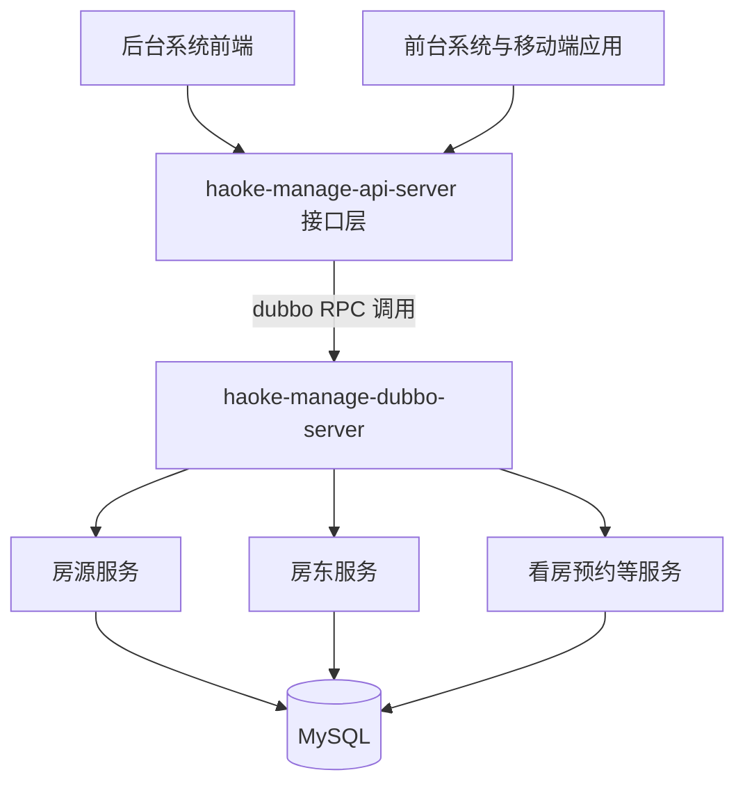

# 后台服务系统动工：SOA 架构下的 API 与 dubbo 服务双工程骨架

架构图把四层职责讲清楚了，前端页面还在等一个真实的后台来接住那句「提交成功」。动工第一步不是写业务代码，是立骨架：整个后台服务系统按 SOA（面向服务架构）思想组织，把各业务模块拆成一个个独立的服务，服务治理交给 dubbo。这一课把父工程与两个子系统建出来、把依赖理顺，后续所有业务功能都长在这副骨架上。

## 先给结论

- 后台系统一分为二：`haoke-manage-api-server` 对外提供 RESTful 接口，`haoke-manage-dubbo-server` 承载内部 dubbo 服务实现，两者挂在同一个父工程下。
- 调用链固定不变：各端应用只访问 API 系统，API 系统经 dubbo 调用一个一个的服务，服务读写 MySQL。
- 公共依赖下沉到父 pom：spring-boot-starter-test、dubbo-spring-boot-starter、dubbo、commons-lang3、zookeeper 与 zkclient，子工程自动继承。
- 按角色领依赖：api-server 引 `spring-boot-starter-web`，dubbo-server 引非 web 的 `spring-boot-starter`。
- zookeeper 客户端依赖放父 pom 的原因：提供者要注册、消费者要订阅，谁也躲不开注册中心。

## 一、SOA 思想与调用链

SOA 是面向服务的架构思想，一句话说透：把系统按业务域拆成一个个服务，服务之间通过网络调用协作，而不是把所有功能塞进一个单体。治理服务的注册、发现与调度的框架，这里选的是 dubbo。落到工程上，后台系统拆成两个子系统，职责一刀切：



这张图自上而下就是一次请求的完整路径：各端应用发 HTTP 到 api-server，api-server 把请求翻译成对某个 dubbo 服务的 RPC 调用，服务完成业务后读写 MySQL，结果原路返回。API 系统是唯一的门面，dubbo-server 是唯一的业务实现，两端应用永远接触不到服务层。

## 二、父工程与两个子工程

工程结构如下（工程名与包名按中性命名重写，去掉了机构前缀）：

```text
haoke-manage                          后台系统父工程，packaging 为 pom
├── haoke-manage-api-server           对外接口系统，web 应用
└── haoke-manage-dubbo-server         内部服务系统，packaging 为 pom
    └── 后续继续挂房源、房东等服务模块
```

两个子系统的定位决定了形态：api-server 是要跑起来的应用；dubbo-server 内部还会长出很多服务模块，所以它自己也是个父工程。父工程 pom（沿用本课画面里的 Spring Boot 2.1.0 版本）：

```xml
<?xml version="1.0" encoding="UTF-8"?>
<project xmlns="http://maven.apache.org/POM/4.0.0"
         xmlns:xsi="http://www.w3.org/2001/XMLSchema-instance"
         xsi:schemaLocation="http://maven.apache.org/POM/4.0.0 http://maven.apache.org/xsd/maven-4.0.0.xsd">
    <modelVersion>4.0.0</modelVersion>

    <parent>
        <groupId>org.springframework.boot</groupId>
        <artifactId>spring-boot-starter-parent</artifactId>
        <version>2.1.0.RELEASE</version>
    </parent>

    <groupId>com.haoke.manage</groupId>
    <artifactId>haoke-manage</artifactId>
    <version>1.0-SNAPSHOT</version>
    <packaging>pom</packaging>

    <modules>
        <module>haoke-manage-api-server</module>
        <module>haoke-manage-dubbo-server</module>
    </modules>
</project>
```

创建工程时 IDE 会弹一个 Enable Auto Import 的提示，点下去，Maven 依赖变更自动刷新，后面每加一个依赖都省一次手动 Reimport。

## 三、父 pom 的公共依赖清单

依赖直接写在父工程的 `<dependencies>` 里（不是 dependencyManagement），两个子工程自动全部继承：

```xml
<dependencies>
    <dependency>
        <groupId>org.springframework.boot</groupId>
        <artifactId>spring-boot-starter-test</artifactId>
        <scope>test</scope>
    </dependency>
    <!-- dubbo 与 Spring Boot 整合的 starter -->
    <dependency>
        <groupId>com.alibaba.boot</groupId>
        <artifactId>dubbo-spring-boot-starter</artifactId>
        <version>0.2.0</version>
    </dependency>
    <!-- 显式指定 dubbo 版本，覆盖 starter 传递的 2.6.2 -->
    <dependency>
        <groupId>com.alibaba</groupId>
        <artifactId>dubbo</artifactId>
        <version>2.6.4</version>
    </dependency>
    <!-- Apache 工具包，StringUtils 等常用工具在这里 -->
    <dependency>
        <groupId>org.apache.commons</groupId>
        <artifactId>commons-lang3</artifactId>
    </dependency>
    <!-- 注册中心 ZooKeeper 及其客户端 -->
    <dependency>
        <groupId>org.apache.zookeeper</groupId>
        <artifactId>zookeeper</artifactId>
        <version>3.4.13</version>
    </dependency>
    <dependency>
        <groupId>com.github.sgroschupf</groupId>
        <artifactId>zkclient</artifactId>
        <version>0.1.0</version>
    </dependency>
</dependencies>
```

dubbo 相关版本沿用阶段一 dubbo 实战一课的写法；commons-lang3 的版本由 Spring Boot 父工程统一仲裁，不必写。逐条对一下角色：test 框架两个工程写单测都用得上；dubbo 两个工程一个是消费方一个是提供方，都躲不开；commons-lang3 是工具层的基础设施；zookeeper 与 zkclient 是注册中心客户端，Provider 要注册地址、Consumer 要订阅地址，两边都要连注册中心，放父 pom 一份到位。

## 四、子工程按角色领依赖

api-server 对外提供 RESTful 服务，要有 HTTP 能力：

```xml
<dependency>
    <groupId>org.springframework.boot</groupId>
    <artifactId>spring-boot-starter-web</artifactId>
</dependency>
```

dubbo-server 只发布 dubbo 服务，不开 HTTP：

```xml
<!-- 非 web 项目支持，不起内嵌 Tomcat -->
<dependency>
    <groupId>org.springframework.boot</groupId>
    <artifactId>spring-boot-starter</artifactId>
</dependency>
```

依赖的差异就是角色的差异：门面有门面的装备，服务有服务的装备。到这里骨架完工。dubbo-server 内部还会按业务域继续拆模块，第一个登场的是房源服务，工程一多，名字里的层级（manage、dubbo-server、服务名）就是天然的导航图。

## 常见误区

- **把业务实现写进 api-server。** 门面层只做校验、组装与转发；实现进了门面，前台、后台各抄一份逻辑的灾难就开始了。
- **父 pom 的 dependencies 与 dependencyManagement 混用不清。** 前者是真引入，子工程自动拥有；后者只统一版本号，不引入依赖。公共必用依赖下沉用前者，只想管版本用后者。
- **漏掉 zookeeper 或 zkclient。** 两个客户端依赖缺一个，启动时连不上注册中心，服务注册与订阅全部失败，报错栈往往绕一大圈才指向缺依赖。
- **子工程重复声明公共依赖。** 父 pom 已经引入的依赖再写一遍没有意义，还会让版本仲裁路径变长，排查依赖冲突时多走弯路。

## 面试可能被问到的问题

1. 面试官追问：「SOA 和微服务是什么关系？」
   答：SOA 是面向服务的架构思想，主张按业务域拆分服务、通过网络协作；微服务是它的进一步演化，拆分粒度更细、去中心化更彻底。这里的做法是典型 SOA 落地：按业务拆服务，用 dubbo 做服务治理。

2. 面试官追问：「后台系统为什么要拆成 api-server 和 dubbo-server 两个工程？」
   答：职责分离。api-server 只做协议转换、参数校验与聚合，对外暴露 HTTP；dubbo-server 装全部业务实现。多个前端共用同一套服务实现，服务层还能独立部署、独立扩容，改动互不牵连。

3. 面试官追问：「父 pom 里 dependencies 和 dependencyManagement 的区别？」
   答：dependencies 是真实引入，所有子模块自动继承这些依赖；dependencyManagement 只做版本与作用域的统一管理，子模块要用还得自己声明，声明时不写版本号。公共必用依赖下沉用前者，版本约束用后者。

4. 面试官追问：「为什么 zookeeper 客户端依赖要放在父 pom？」
   答：注册中心是 Provider 与 Consumer 的公共依赖。提供者启动要注册地址，消费者启动要订阅地址列表，两个子系统都直接连 ZooKeeper，放父 pom 一份声明全覆盖，也避免两边客户端版本不一致。

5. 面试官追问：「dubbo-server 为什么不引 spring-boot-starter-web？」
   答：它只通过 dubbo 协议在 20880 端口提供服务，不对外开 HTTP，内嵌 Tomcat 没有用武之地。引非 web 的 starter 更省资源，也避免无意义的端口占用。

6. 面试官追问：「这个架构里一个新增房源请求的完整链路是什么？」
   答：后台前端发 HTTP 请求到 api-server，api-server 校验参数后通过 dubbo 调用 dubbo-server 里的房源服务，服务完成校验与落库写 MySQL，结果沿调用链原路返回，前端拿到 JSON 响应。

## 配套资料

- 本教学日资料包未收录源码（`materials/code/03/day04-服务的具体实现以及MybatisPlus的入门/` 下仅存清单文件），工程结构、依赖与版本按本课画面与课件整理补全，工程名与包名去机构前缀后改为中性命名，dubbo 相关版本沿用阶段一 dubbo 实战一课的写法。
- 接口模块与服务实现模块分离的标准结构可对照：`materials/code/10/nacos-discovery-RESTful服务发现与Dubbo服务发现/`。
