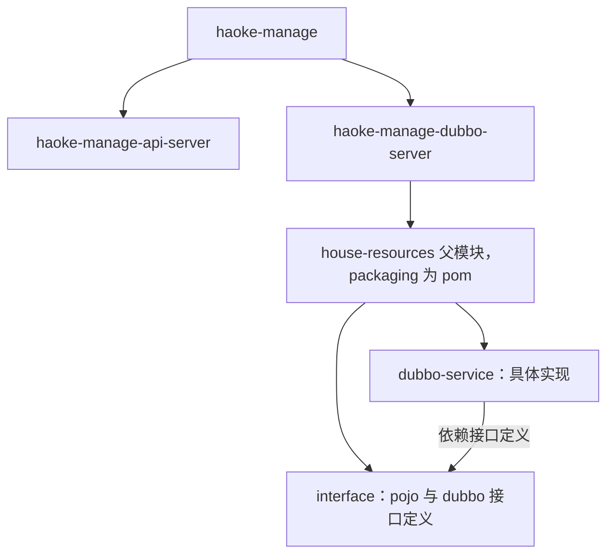

# 新增房源服务起步：楼盘与房源两张表，加 interface 与 service 分层

后台骨架立住了，第一个业务功能选了新增房源。写代码之前有两件事必须先定：数据长什么样、代码放哪里。数据上是两张表，楼盘与房源；代码上是 dubbo-server 下的继续拆分，接口定义与具体实现各占一个模块。这一课把表建好、模块拆清，实体与 Mapper 的骨架一并就位。

## 先给结论

- 新增房源涉及两张表：楼盘表 `tb_estate` 与房源表 `tb_house_resources`，房源通过 `estateId` 归属楼盘，一对多；楼盘表初始化 5 条数据，房源表留空等新增。
- dubbo-server 下按业务域拆出 house-resources 模块，它再拆两层：`interface` 放 pojo 与 dubbo 接口定义，是对外 SDK；`dubbo-service` 放具体实现。
- 接口定义与实现必须分家：对外发布的包里混进实现类，SDK 就失去了意义。
- house-resources 父模块统一引 lombok、mybatis-plus-boot-starter、mysql 驱动，都标 `optional=true`，谁用谁显式再引。
- dubbo-service 依赖 interface（实现依赖接口定义），另引 `spring-boot-starter-jdbc` 为事务做准备。

## 一、两张表与一对多

租房项目里，房源不可能悬空存在：一套房一定属于某个楼盘、某个小区。所以数据结构从两个实体入手，楼盘是容器，房源是被容纳的对象。一个楼盘下挂多套房，标准的一对多；反过来每套房源只属于一个楼盘，外键 `estateId` 落在房源表里。课程资料提供的 sql 脚本建出这两张表，楼盘表长这样（资料包未收录该脚本，内容按本课画面整理）：

```sql
CREATE TABLE `tb_estate` (
  `id` bigint(20) NOT NULL AUTO_INCREMENT,
  `name` varchar(100) DEFAULT NULL COMMENT '楼盘名称',
  `province` varchar(10) DEFAULT NULL COMMENT '所在省',
  `city` varchar(10) DEFAULT NULL COMMENT '所在市',
  `area` varchar(10) DEFAULT NULL COMMENT '所在区',
  `address` varchar(100) DEFAULT NULL COMMENT '具体地址',
  `year` varchar(10) DEFAULT NULL COMMENT '建成年代',
  `type` varchar(10) DEFAULT NULL COMMENT '建筑类型',
  `property_cost` varchar(10) DEFAULT NULL COMMENT '物业费',
  `property_company` varchar(20) DEFAULT NULL COMMENT '物业公司',
  `developers` varchar(20) DEFAULT NULL COMMENT '开发商',
  PRIMARY KEY (`id`)
) ENGINE=InnoDB DEFAULT CHARSET=utf8 COMMENT='楼盘表';
```

画面里的建表脚本把 `city` 的注释顺手写成了所在区，复制粘贴的痕迹，这里已修正；同一份脚本里还有支付方式表 `tb_payment_method` 等配套表。脚本执行完刷新数据库，楼盘表已初始化 5 条数据，房源表空着，等新增房源功能上线后由它来填。字段设计与前端新增房源的表单一一对应，楼盘档案（年代、类型、物业费、开发商）在前端页面里都有出处。

## 二、模块拆分：接口定义与实现分家

dubbo-server 内部会有很多服务：房源、房东、看房预约……第一个是房源服务，工程名 house-resources。它不是直接写代码的模块，而是再拆两个子工程：



拆分的理由回到 dubbo 的使用原则：对外提供的东西不能包含实现。api-server 要调房源服务，它依赖的应该是只有 pojo 和接口定义的 SDK 包，拿到的只是方法签名；如果接口和实现混在一个包里发出去，等于把实现也拱手送人，这个包的语义就没了。所以 interface 模块只放实体与接口声明，实现类全部留在 dubbo-service 里，依赖方向是 dubbo-service 指向 interface，别搞反。

## 三、三个 pom 的依赖怎么摆

house-resources 父模块统一下沉依赖：

```xml
<!-- 简化代码的工具包 -->
<dependency>
    <groupId>org.projectlombok</groupId>
    <artifactId>lombok</artifactId>
    <optional>true</optional>
</dependency>
<!-- MyBatis-Plus 的 Spring Boot 支持 -->
<dependency>
    <groupId>com.baomidou</groupId>
    <artifactId>mybatis-plus-boot-starter</artifactId>
    <version>3.0.5</version>
    <optional>true</optional>
</dependency>
<!-- MySQL 驱动 -->
<dependency>
    <groupId>mysql</groupId>
    <artifactId>mysql-connector-java</artifactId>
    <version>5.1.47</version>
    <optional>true</optional>
</dependency>
```

三条都带 `<optional>true</optional>`，含义在 Lombok 那一课出现过：不参与依赖传递。这几个依赖真正的使用者是 dubbo-service，要连数据库、要用 MP、实体要 Lombok；interface 模块眼下一条都用不上，所以先不下发，谁用谁显式引，版本号交给父模块仲裁。

interface 模块暂时零依赖，先空着，等接口定义真的需要什么再补。dubbo-service 模块的关键三条：

```xml
<!-- 依赖接口定义模块，实现类才能 implements -->
<dependency>
    <groupId>com.haoke.manage</groupId>
    <artifactId>haoke-manage-dubbo-server-house-resources-interface</artifactId>
    <version>1.0-SNAPSHOT</version>
</dependency>
<!-- 事务控制要走 Spring 的 JDBC 事务管理器 -->
<dependency>
    <groupId>org.springframework.boot</groupId>
    <artifactId>spring-boot-starter-jdbc</artifactId>
</dependency>
<!-- 父模块的 optional 依赖不传递，这里要用就得显式引入 -->
<dependency>
    <groupId>org.projectlombok</groupId>
    <artifactId>lombok</artifactId>
</dependency>
```

lombok 不写版本号，父模块已声明；mybatis-plus 与 mysql 驱动在真正写 Mapper、配数据源时再补。`spring-boot-starter-jdbc` 单独拎出来说一句：新增房源后面要操作两张表，涉及事务控制，Spring 的事务管理器由它带进来，提前就位。

## 四、实体与 Mapper 的骨架

实体归 interface 模块，它要被 api-server 与 dubbo-service 共同引用。示例骨架如下（按本课写法补全，完整字段以后续实现为准）：

```java
package com.haoke.manage.dubbo.server.pojo;

import com.baomidou.mybatisplus.annotation.IdType;
import com.baomidou.mybatisplus.annotation.TableId;
import com.baomidou.mybatisplus.annotation.TableName;
import lombok.Data;

@Data
@TableName("tb_house_resources")
public class HouseResources {

    @TableId(type = IdType.AUTO)
    private Long id;

    /** 所属楼盘 id，房源与楼盘多对一的锚点 */
    private Long estateId;

    private String title;
    private String price;
}
```

Mapper 归 dubbo-service 模块，继承 `BaseMapper` 拿到单表 CRUD（示例，按本课写法补全）：

```java
package com.haoke.manage.dubbo.server.mapper;

import com.baomidou.mybatisplus.core.mapper.BaseMapper;
import com.haoke.manage.dubbo.server.pojo.HouseResources;

public interface HouseResourcesMapper extends BaseMapper<HouseResources> {
}
```

骨架就位后，新增房源的接口方法、实现类、落库与事务在下一课展开。房源数据是整个系统里量最大的一类数据，把它的读写收拢在独立的 house-resources 模块里，后面房东、预约等服务如法炮制，各自独立成模块，dubbo-server 的服务清单就这么一张张长出来。

## 常见误区

- **把 pojo 与接口定义写进 dubbo-service。** 对外发布的包混进实现，SDK 语义尽失；接口进 interface，实现留 dubbo-service，方向不能反。
- **以为父模块引了依赖子模块就能用。** `optional=true` 切断了传递链，dubbo-service 里 lombok、MP、驱动都要显式声明，少一条编译就报找不到类。
- **依赖方向写成 interface 依赖 dubbo-service。** 实现依赖接口定义才是正解，反向依赖会形成环，Maven 直接拒绝构建。
- **建表脚本照抄不检查。** 课程脚本里 `city` 的注释就带着复制粘贴的错；注释不影响运行，但字段语义靠注释传达，错注释比没注释更误导。

## 面试可能被问到的问题

1. 面试官追问：「dubbo 服务为什么要把接口定义和实现拆成两个模块？」
   答：消费方只需要接口与实体来编译和生成代理，不应该拿到实现。拆开后 interface 模块作为纯 SDK 发布，api-server 依赖它即可完成调用，实现模块只部署在服务端，边界清晰也便于版本管理。

2. 面试官追问：「optional=true 是什么意思，子模块怎么用这些依赖？」
   答：optional 声明依赖不参与传递，仅当前工程可用。子模块需要时必须显式声明自己的依赖，版本号可省略，由父模块的声明参与版本仲裁。

3. 面试官追问：「房源和楼盘的表关系怎么设计？」
   答：一对多，外键落在多方。房源表带 estateId 指向楼盘表主键，查一个楼盘下所有房源按 estateId 过滤，查某套房源的归属按 estateId 回查楼盘。

4. 面试官追问：「dubbo-service 为什么要依赖 interface 模块？」
   答：实现类要 implements 接口才能被 dubbo 发布、让消费方按接口代理调用。依赖接口模块是编译期的硬要求，也保证发布出去的契约与实现严格一致。

5. 面试官追问：「spring-boot-starter-jdbc 在这个工程里的作用？」
   答：它带来 DataSource 自动配置与 Spring 的事务管理器。新增房源要写多张表，需要 @Transactional 保证一致性，事务抽象由这个 starter 提供。

6. 面试官追问：「新增房源涉及两张表，怎么保证数据一致？」
   答：同一数据库内用 Spring 声明式事务，方法上标 @Transactional，任一步失败整体回滚，这也是工程提前引入 jdbc 依赖的原因；跨库场景才需要考虑分布式事务方案。

## 配套资料

- 本教学日资料包未收录源码（`materials/code/03/day04-服务的具体实现以及MybatisPlus的入门/` 下仅存清单文件），建表脚本与工程结构按本课画面整理，实体与 Mapper 为按本课写法补全的可运行示例，完整字段以课程后续实现为准。
- 真实 MP 写法可对照：`materials/code/10/mp-springboot/`（实体注解组合与 Mapper 继承 BaseMapper 的结构，包名已改写为中性命名）。
