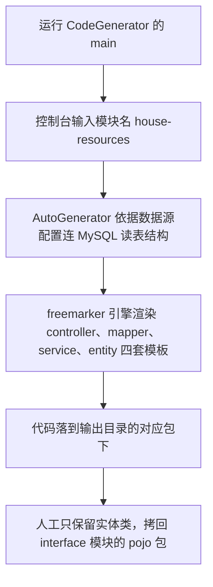

# 用 AutoGenerator 从数据库表一键生成房源 pojo

房源表 `tb_house_resources` 有二十多个字段，逐个手写 pojo 是不折不扣的体力活，何况每个实体都要带上 `created` 与 `updated` 两个通用字段，还要实现 `Serializable`，因为 dubbo 网络传输对象要求实体可序列化。MyBatis-Plus 自带的代码生成器 AutoGenerator 干的就是这件事：连库读表结构，按模板把代码一批批吐出来。

## 先给结论

- 通用字段先收进父类 `BasePojo`：只有 `created` 与 `updated` 两个属性，加 `@Data`，实现 `Serializable`，声明为抽象类专供继承。
- 代码生成器放独立的 `generator` 模块，不混进业务工程；它需要 MyBatis-Plus 与 freemarker 模板引擎两块依赖，是一次性工具，用完即弃。
- `AutoGenerator` 的配置分五段：全局管输出目录与作者，数据源管连哪个库，包配置管生成到哪个包，策略管命名转换与实体父类，模板引擎选 freemarker。
- 生成的 controller、service 在当前工程并不实用，只保留实体，拷回 `interface` 模块后修整四步：去 `tb` 前缀、`@TableName` 指定表名、`@TableId` 自增、字段类型对齐数据库。

## 一、BasePojo：实体的公共父类

新增房源之前先把地基打好。所有业务实体的表里都有 `created` 与 `updated` 两列，这份公共性值得上提到父类，以后新增实体只要继承它，两个字段就自动有了。pojo 放在 `interface` 模块，因为它要被 dubbo 服务实现与 API 消费方共同引用：

```java
package com.haoke.manage.dubbo.server.pojo;

import lombok.Data;

import java.io.Serializable;
import java.util.Date;

/**
 * 实体公共父类，业务实体统一继承
 */
@Data
public abstract class BasePojo implements Serializable {

    /** 创建时间 */
    private Date created;

    /** 更新时间 */
    private Date updated;
}
```

两处细节值得停留。`@Data` 由 Lombok 提供，getter 与 setter 一行注解全部到位，入门篇单独讲过；`implements Serializable` 不是画蛇添足，dubbo 调用要把实体在进程之间搬运，走网络的对象必须可序列化，否则直接抛序列化异常。

## 二、生成器工程：独立模块，用完即弃

生成代码是开发期的一次性动作，不是业务能力，所以生成器单独开一个 `generator` 模块挂在 `dubbo-server` 父工程下，与 `interface`、`dubbo-service` 平级。它的 pom 关键依赖三条：

```xml
<dependencies>
    <!-- MyBatis-Plus 及其生成器 -->
    <dependency>
        <groupId>com.baomidou</groupId>
        <artifactId>mybatis-plus-boot-starter</artifactId>
        <version>3.0.5</version>
        <optional>true</optional>
    </dependency>
    <!-- freemarker 模板引擎，生成器靠它渲染代码模板 -->
    <dependency>
        <groupId>org.freemarker</groupId>
        <artifactId>freemarker</artifactId>
        <version>2.3.28</version>
    </dependency>
    <!-- MySQL 驱动，连库读表结构用 -->
    <dependency>
        <groupId>mysql</groupId>
        <artifactId>mysql-connector-java</artifactId>
        <version>5.1.47</version>
        <optional>true</optional>
    </dependency>
</dependencies>
```

少依赖会在第一步就报错：`MybatisPlusException`、`AutoGenerator` 都来自 MyBatis-Plus 的包，没有 freemarker，模板渲染无从谈起。工程提示缺哪个就补哪个。

## 三、CodeGenerator：五段配置跑一遍

生成器入口类没有手写的必要，官方示例改一改就能用。资料包未收录本课源码，下面是按本课画面写法补全的可运行示例，包名做了中性化处理：

```java
package com.haoke.manage.dubbo.server.generator;

import com.baomidou.mybatisplus.core.exceptions.MybatisPlusException;
import com.baomidou.mybatisplus.core.toolkit.StringUtils;
import com.baomidou.mybatisplus.generator.AutoGenerator;
import com.baomidou.mybatisplus.generator.config.*;
import com.baomidou.mybatisplus.generator.config.rules.NamingStrategy;
import com.baomidou.mybatisplus.generator.engine.FreemarkerTemplateEngine;

import java.util.Scanner;

public class CodeGenerator {

    /** 读取控制台输入，空输入直接拒绝 */
    public static String scanner(String tip) {
        Scanner scanner = new Scanner(System.in);
        System.out.println("请输入" + tip + "：");
        if (scanner.hasNext()) {
            String ipt = scanner.next();
            if (StringUtils.isNotEmpty(ipt)) {
                return ipt;
            }
        }
        throw new MybatisPlusException("请输入正确的" + tip + "！");
    }

    public static void main(String[] args) {
        // 代码生成器
        AutoGenerator mpg = new AutoGenerator();

        // 全局配置：输出目录、作者、生成后不弹资源管理器
        GlobalConfig gc = new GlobalConfig();
        String projectPath = System.getProperty("user.dir");
        gc.setOutputDir(projectPath + "/src/main/java");
        gc.setAuthor("haoke");
        gc.setOpen(false);
        mpg.setGlobalConfig(gc);

        // 数据源配置：连哪个库，就按哪个库的表生成
        DataSourceConfig dsc = new DataSourceConfig();
        dsc.setUrl("jdbc:mysql://127.0.0.1:3306/haoke?useUnicode=true&characterEncoding=utf8&autoReconnect=true");
        dsc.setDriverName("com.mysql.jdbc.Driver");
        dsc.setUsername("root");
        dsc.setPassword("root");
        mpg.setDataSource(dsc);

        // 包配置：模块名运行时输入，父包固定为 dubbo 服务的包
        PackageConfig pc = new PackageConfig();
        pc.setModuleName(scanner("模块名"));
        pc.setParent("com.haoke.manage.dubbo.server");
        mpg.setPackageInfo(pc);

        // 策略配置：表名与列名下划线转驼峰，实体统一继承 BasePojo
        StrategyConfig strategy = new StrategyConfig();
        strategy.setNaming(NamingStrategy.underline_to_camel);
        strategy.setColumnNaming(NamingStrategy.underline_to_camel);
        strategy.setSuperEntityClass("com.haoke.manage.dubbo.server.pojo.BasePojo");
        strategy.setEntityLombokModel(true);
        strategy.setInclude("tb_house_resources");
        mpg.setStrategy(strategy);

        mpg.setTemplateEngine(new FreemarkerTemplateEngine());
        mpg.execute();
    }
}
```

五段配置各管一件事，跑起来的流程是这样的：



图里有两处值得多看一眼。模块名在运行时输入，输入 `house-resources` 后生成的代码会多一层同名包路径；输出目录取 `System.getProperty("user.dir")`，多模块工程里它指向运行时工作目录，IDEA 默认是工程根目录，结果可能落在根工程而非预期模块，生成完先看路径再拷贝。

## 四、生成物只留实体，拷回后修整四步

AutoGenerator 一口气生成 controller、mapper、service、serviceImpl 与实体五类文件，但这个 dubbo 工程的 Mapper 与 Service 要按自己的分层写，真正需要的只有实体一个文件。把它拷进 `interface` 模块的 pojo 包，类名从 `TbHouseResources` 改成 `HouseResources`，然后做四步修整：

```java
package com.haoke.manage.dubbo.server.pojo;

import com.baomidou.mybatisplus.annotation.IdType;
import com.baomidou.mybatisplus.annotation.TableId;
import com.baomidou.mybatisplus.annotation.TableName;
import lombok.Data;
import lombok.experimental.Accessors;

/**
 * 房源表
 */
@Data
@Accessors(chain = true)
@TableName("tb_house_resources")
public class HouseResources extends BasePojo {

    private static final long serialVersionUID = 7371055939778754278L;

    /** 主键，数据库自增 */
    @TableId(value = "id", type = IdType.AUTO)
    private Long id;

    /** 房源标题 */
    private String title;

    /** 楼盘 id */
    private Long estateId;

    /** 楼号（栋） */
    private String buildingNum;

    /** 租赁方式，1 整租 2 合租 */
    private Integer rentMethod;

    /** 租金 */
    private Integer rent;

    // 户型、面积、朝向、楼层等其余字段与 tb_house_resources 一一对应
}
```

**第一步，删掉 `@EqualsAndHashCode(callSuper = true)`。** 生成器默认给实体重写 equals 与 hashCode，业务用不到这层等价性判断，留着反而让对象比较语义变复杂。

**第二步，保留 `@Accessors(chain = true)`。** 它让 setter 返回当前对象而不是 void，链式赋值从此成立：`new HouseResources().setTitle("东方曼哈顿 3室2厅").setRent(16000)`，字段越多这一笔越划算。

**第三步，表名与主键对齐数据库。** 类名改成 `HouseResources` 后，MyBatis-Plus 默认按驼峰转下划线去找 `house_resources` 表，真实表名却是 `tb_house_resources`，对不上就报表不存在，`@TableName` 显式指定即可。生成的类没有主键注解，`@TableId(type = IdType.AUTO)` 声明为数据库自增，插入后自增 id 回填到实体。

**第四步，字段类型与数据库对齐。** 租赁方式这类字典字段在数据库里存的是 1 与 2，生成器看到 tinyint 可能推断成 `Boolean`，语义就丢了，手工改成 `Integer` 包装类型；`created` 与 `updated` 父类已有，子类的重复字段删掉。`serialVersionUID` 也要认真生成而不是留占位值，实体结构演进时靠它判定序列化兼容性。

对照建表脚本把字段逐一核过，房源实体就位。后面楼盘、房东等实体如法炮制。

## 常见误区

- **把生成器写进业务模块。** 生成器依赖与业务依赖混在一起，工程无端变重，生成代码也容易被误提交运行；单独开 `generator` 模块，用完即弃。
- **不配模板引擎就执行。** 没引入 freemarker 却指定 `FreemarkerTemplateEngine`，执行时直接抛模板引擎异常；依赖与引擎配置要成对出现。
- **类名改了却忘写 `@TableName`。** 默认规则映射出的表名与真实表名差一个 `tb_` 前缀，编码阶段毫无征兆，运行到查询才报表不存在。
- **生成类型照单全收。** tinyint 推断成 `Boolean`、日期推断偏差都要人工核对，生成器只负责立骨架，语义对齐是人的责任。

## 面试可能被问到的问题

1. 面试官追问：「AutoGenerator 生成代码的原理是什么？」
   答：它依据数据源配置连库读取表结构与列类型等元信息，把表名、字段、类型交给模板引擎（velocity 或 freemarker）渲染预置模板，再按包配置与全局配置写成 java 文件。本质是元数据加模板的批量渲染。

2. 面试官追问：「@TableName 什么时候必须写？」
   答：实体类名按驼峰转下划线后与真实表名不一致时必须写。类名 HouseResources 对应表 tb_house_resources，前缀对不上就要显式指定；一致时可以省略。

3. 面试官追问：「@TableId 的 IdType 有哪几种取值？」
   答：常用的有 AUTO 数据库自增、INPUT 手工输入、ASSIGN_ID 雪花算法、ASSIGN_UUID 字符串 UUID，另有 NONE 跟随全局配置。表有 AUTO_INCREMENT 时选 AUTO，插入后自增值回填到实体。

4. 面试官追问：「实体为什么必须实现 Serializable？」
   答：dubbo 等 RPC 框架要把实体在提供方与消费方之间网络传输，默认的 hessian 序列化要求对象实现 Serializable，否则调用抛序列化异常。serialVersionUID 建议显式生成，用于字段演进后的版本兼容判断。

5. 面试官追问：「表结构变更后重新生成代码，要注意什么？」
   答：重新生成会覆盖同路径旧文件，手写的修改会丢失。常见做法是生成器只负责实体与 Mapper 骨架，业务方法写在独立的类里，或生成到临时目录比对后合并。

## 配套资料

- 本教学日资料包未收录源码（`materials/code/03/day04-服务的具体实现以及MybatisPlus的入门/` 下仅存清单文件），CodeGenerator 与实体代码为按本课画面写法补全的可运行示例，包名与工程名已改为中性命名。
- 真实生成器工程可对照：`materials/code/10/generator/`（`MyBatisPlusGenerator.java` 的全局、数据源、包、策略配置，`src/main/resources/templates/` 下是 freemarker 模板，结构与正文一致）。
- MyBatis-Plus 实体注解组合可对照：`materials/code/10/mp-springboot/`（`pojo/User.java` 的 `@TableName`、`@TableId` 用法）。
- 讲义：`materials/docs/10/Mybatis-Plus讲义v1.0.md`。
