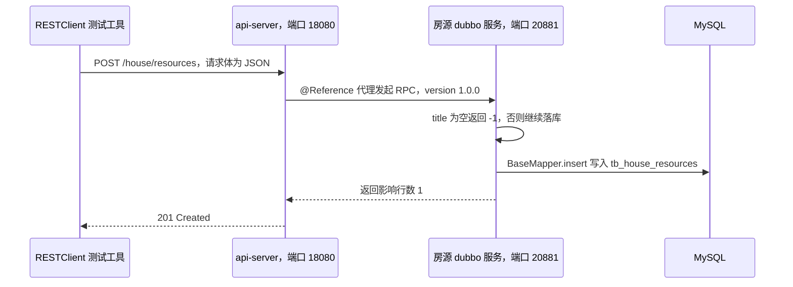

# 新增房源的 RESTful 门面：POST 接口、201 语义与全链路验证

dubbo 服务已经在注册中心待命，但浏览器和前端系统说不了 dubbo 协议。api-server 就是那扇 HTTP 门：把 `POST /house/resources` 的 JSON 请求翻译成对 dubbo 服务的调用，再按 RESTful 语义把状态码还给调用方。这一课把门面与消费者配起来，用工具把从 HTTP 到数据库的整条链路打穿。

## 先给结论

- api-server 在 dubbo 架构里是消费者：pom 里依赖 web starter 与 interface 模块，后者提供实体与接口定义。
- 消费端注入 dubbo 服务用 `@Reference(version = "1.0.0")`，它生成远程代理；`@Autowired` 在本地容器里找不到这个接口的实现。
- Controller 用 `@PostMapping` 接收 POST，`@RequestBody` 把 JSON 反序列化成实体，返回 `ResponseEntity`：成功 201 Created，异常 500。
- 消费端配置只要四样：应用名、18080 端口、dubbo 应用名、注册中心地址，角色是 consumer。
- 验证分两步：GET 探路接口确认 web 通路，RESTClient 发 JSON 走全链路，响应 201 且数据库多一条记录。

## 一、消费者身份：pom 里就看得出来

api-server 挂在 `haoke-manage` 父工程下，依赖清单直接暴露了角色：

```xml
<dependencies>
    <!-- 对外提供 RESTful 接口，HTTP 能力必须有 -->
    <dependency>
        <groupId>org.springframework.boot</groupId>
        <artifactId>spring-boot-starter-web</artifactId>
    </dependency>
    <!-- dubbo 消费的前提：依赖服务接口定义模块 -->
    <dependency>
        <groupId>com.haoke.manage</groupId>
        <artifactId>haoke-manage-dubbo-server-house-resources-interface</artifactId>
        <version>1.0-SNAPSHOT</version>
    </dependency>
</dependencies>
```

dubbo 的调用按接口代理进行，编译期就需要接口与实体的类型信息，这些全在 interface 模块里。少了这条依赖，`ApiHouseResourcesService` 与 `HouseResources` 连编译都过不去；实现类不需要也拿不到，它只存在于提供方机器上，这正是接口与实现分家的隔离。

## 二、消费端 Service：@Reference 拿远程代理

在 api-server 的 service 包里写一个 Spring Service，把 dubbo 调用包成自家方法：

```java
package com.haoke.manage.dubbo.api.service;

import com.alibaba.dubbo.config.annotation.Reference;
import com.haoke.manage.dubbo.server.api.ApiHouseResourcesService;
import com.haoke.manage.dubbo.server.pojo.HouseResources;
import org.springframework.stereotype.Service;

@Service
public class HouseResourcesService {

    @Reference(version = "1.0.0")
    private ApiHouseResourcesService apiHouseResourcesService;

    public boolean save(HouseResources houseResources) {
        int result = this.apiHouseResourcesService.saveHouseResources(houseResources);
        return result == 1;
    }
}
```

注意这里的 `@Service` 换回了 Spring 的注解：api-server 是消费方，不再对外暴露 dubbo 服务。`@Reference` 是 dubbo 的注解：容器启动时它去注册中心订阅 `ApiHouseResourcesService` 的 1.0.0 版本，拿到提供者地址列表后生成远程代理注入字段，调用看起来是本地调用，实际发生了网络传输。version 必须与提供方对上，否则订阅不到服务。把 int 归并成 boolean 是门面层的善意：消费链路只关心成与不成，-1 与 0 在这里合并为 false。

## 三、Controller：POST 接 JSON，状态码说人话

```java
package com.haoke.manage.dubbo.api.controller;

import com.haoke.manage.dubbo.api.service.HouseResourcesService;
import com.haoke.manage.dubbo.server.pojo.HouseResources;
import org.springframework.beans.factory.annotation.Autowired;
import org.springframework.http.HttpStatus;
import org.springframework.http.ResponseEntity;
import org.springframework.web.bind.annotation.*;

@Controller
@RequestMapping("house/resources")
public class HouseResourcesController {

    @Autowired
    private HouseResourcesService houseResourcesService;

    /**
     * 新增房源
     */
    @PostMapping
    public ResponseEntity<Void> save(@RequestBody HouseResources houseResources) {
        try {
            boolean bool = this.houseResourcesService.save(houseResources);
            if (bool) {
                // 创建成功，按 RESTful 语义返回 201
                return ResponseEntity.status(HttpStatus.CREATED).build();
            }
        } catch (Exception e) {
            e.printStackTrace();
        }
        return ResponseEntity.status(HttpStatus.INTERNAL_SERVER_ERROR).build();
    }

    // 测试用：GET 探路，验证容器与路由是否就绪
    @GetMapping
    @ResponseBody
    public ResponseEntity<String> get() {
        return ResponseEntity.ok("ok");
    }
}
```

三个点值得展开。`@RequestBody` 让 Spring 从请求体读 JSON，经 Jackson 反序列化成 `HouseResources`，前提是请求头带 `Content-Type: application/json`。返回值用 `ResponseEntity` 而不是裸对象，因为它连状态码一起掌控：创建成功按 RESTful 语义回 201 Created，失败或异常回 500，不再一律 200。GET 探路接口与业务无关，是一条不打数据库的通路，先 GET 到 ok 说明容器、路由、依赖装配都正常，之后再测 POST 出问题就能把框架因素排除掉。

整条请求链路画出来是这样：



图上最关键的一跳是 W 到 P：Controller 与 dubbo 服务分属两个进程，`@Reference` 代理把一次方法调用变成一次网络往返，201 是整条链路走通后的终点。

## 四、消费端配置与工具验证

api-server 的 `application.properties` 比提供方简单，它不开 dubbo 协议端口，只需要能找到注册中心：

```properties
# Spring Boot 应用名
spring.application.name = haoke-manage-api-server

# 内置 Tomcat 端口，注意是 18080 不是 8080
server.port = 18080

# dubbo 消费者应用名
dubbo.application.name = dubbo-consumer-house-resources

# 注册中心：消费端靠它发现服务
dubbo.registry.address = zookeeper://127.0.0.1:2181
dubbo.registry.client = zkclient
```

启动类是标准 web 启动，`SpringApplication.run` 一行即可，与提供方的非 web 启动正好相反。两个工程都启动后，先用浏览器或 curl 打探路接口：

```bash
curl http://127.0.0.1:18080/house/resources
# 返回 ok，说明 web 通路就绪
```

POST 接口带请求体，浏览器地址栏无能为力，用 RESTClient 这类 HTTP 调试工具发请求（Postman 或 `curl -d` 同理）：URL 同上，方法切 POST，请求头加 `Content-Type: application/json`，请求体取课件里的测试数据（字段有精简）：

```json
{
  "title": "东方曼哈顿 3室2厅 16000",
  "estateId": "1005",
  "buildingNum": "2",
  "buildingUnit": "1",
  "rent": "16000",
  "rentMethod": "1",
  "paymentMethod": "1",
  "coveredArea": "120",
  "useArea": "100",
  "orientation": "南",
  "floor": "3/20"
}
```

发送后响应 201，查数据库，`tb_house_resources` 里多出标题为「东方曼哈顿 3室2厅 16000」的记录。至此整条链路有了实证：HTTP 进 api-server，经 dubbo 调房源服务，校验后落库 MySQL，每一环都跑过了真数据。

## 常见误区

- **消费端把 @Reference 写成 @Autowired。** 本地容器里没有 `ApiHouseResourcesService` 类型的 bean，实现类在提供方机器上，启动直接报注入失败；跨进程调用必须走 `@Reference`。
- **POST 接口漏了 @RequestBody。** Spring 会按查询参数或表单取值，JSON 请求体一个字段都映射不上，落库的是全 null 的实体，问题藏得更深。
- **创建成功也回 200 空响应。** RESTful 语义里 POST 创建资源对应 201 Created，前端靠状态码判断结果，一律 200 会把失败掩盖在「成功」里。
- **JSON 字段名照感觉写。** 字段名与实体属性对不上时 Jackson 静默忽略，对应属性就是 null，发送前对照实体逐一核对。

## 面试可能被问到的问题

1. 面试官追问：「@Reference 和 @Autowired 的本质区别？」
   答：@Autowired 在本地 Spring 容器里按类型找 bean 注入；@Reference 是 dubbo 的注解，它去注册中心订阅服务、拿到提供者列表后生成远程代理注入，方法调用会被翻译成网络请求。一个是本地装配，一个是远程引用。

2. 面试官追问：「@RequestBody 的工作机制是什么？」
   答：Spring MVC 通过 HttpMessageConverter 处理请求体。标注 @RequestBody 后，框架按请求头的 Content-Type 选择转换器，application/json 走 Jackson 转换器把 JSON 反序列化为目标对象；类型不匹配或 JSON 非法会在进方法前就报 400。

3. 面试官追问：「POST 创建资源为什么返回 201 而不是 200？」
   答：RESTful 对状态码有语义约定，200 表示请求处理成功，201 特指资源创建成功并可附带新资源地址。状态码是接口的通用语言，语义准确能减少前端与网关的特判逻辑。

4. 面试官追问：「api-server 里为什么还要包一层 Service，Controller 直接调 dubbo 接口不行吗？」
   答：功能上行，工程上不好。Service 层承担 dubbo 结果到前端语义的转换（如 -1、0、1 归并为布尔值）、聚合多个服务、异常翻译，Controller 只管协议与状态码。多个接口复用同一组合调用时，这层就是复用点。

5. 面试官追问：「dubbo 消费端调用一个接口，背后发生了什么？」
   答：启动时按 @Reference 的接口与版本订阅注册中心，缓存提供者地址列表；调用时代理按负载均衡选一个地址，把方法名、参数类型与实参序列化后经 Netty 发出，提供方调用真实实现，结果原路返回，失败按集群容错策略重试或报错。

6. 面试官追问：「POST JSON 接口命令行怎么测？」
   答：`curl -X POST -H "Content-Type: application/json" -d '{"title":"东方曼哈顿"}' http://127.0.0.1:18080/house/resources`，配 `-i` 看响应状态码验证 201。要固化成回归手段，可以写 Spring Boot 的 TestRestTemplate 或 MockMvc 集成测试。

## 配套资料

- 本教学日资料包未收录源码（`materials/code/03/day04-服务的具体实现以及MybatisPlus的入门/` 下仅存清单文件），Controller、Service 与配置为按本课画面写法补全的可运行示例，包名与工程名已改为中性命名，测试 JSON 取自课件数据并有精简。
- 接口模块与消费方分离的工程结构可对照：`materials/code/10/nacos-discovery-RESTful服务发现与Dubbo服务发现/`（`nacos-restful-consumer` 的消费端分层，`service1-api` 与 `service1-server` 的接口与实现分离）。
