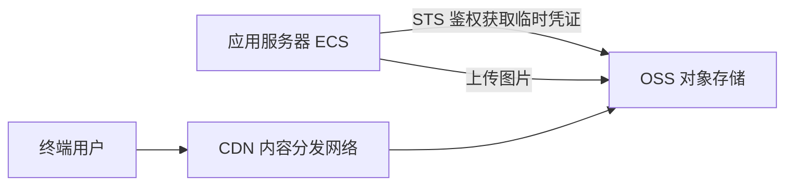
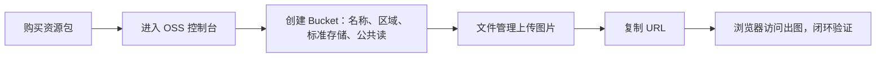

# 开通并跑通阿里云 OSS：Bucket、Endpoint、AccessKey 与第一次上传下载

方案分析把云对象存储排在了第一顺位，接下来就是真金白银的实操环节。动手前有一组概念必须先掰清楚：Bucket、Endpoint、AccessKey。很多人在控制台把上传点完就退出来，等到写代码对接 SDK 时才发现这三个词各自的角色根本没分清，密钥怎么填、域名怎么拼、权限为什么这么选，全都含糊着。

## 先给结论

- OSS（Object Storage Service）是对象存储服务：海量、安全、低成本、高可靠，容量与处理能力弹性扩展，联网就能通过 RESTful API 与 SDK 存取数据。
- 三要素各司其职：Bucket 是存数据的「桶」，Endpoint 是区域访问域名，AccessKey 是调用 API 的身份凭证，泄露即灾难。
- 读写权限选公共读：图片要被浏览器无认证访问，写操作仍须鉴权；公共读写绝对不选。
- 计费两端不对称：上行流量免费，外网访问产生的下行流量收费；学习用最小资源包组合约 65 元。
- 控制台即可完成验证闭环：创建 Bucket、上传文件、复制 URL、浏览器直接打开图片。

## 一、OSS 是什么：把「对象存储」拆开看

官方定义一句话：对象存储 OSS 是海量、安全、低成本、高可靠的云存储服务。这四个形容词背后有实打实的指标支撑，数据可靠性官方标称 99.9999999999%，十二个 9，无限逼近百分百；存储容量与处理能力弹性扩展，用多少开多少。接入方式是 RESTful API 配合各语言 SDK，只要联网，任何地方都能对数据做存储与访问。

官网主页把卖点归为易用性、高可用、强安全、低成本四项，往下是多档存储类型，按访问频率分层计费：

| 存储类型 | 单价（元/GB/月） | 适合的数据 |
|---|---|---|
| 标准型 | 0.12 | 高频访问，如网站图片 |
| 低频访问型 | 0.06 | 月度级别才碰一次的数据 |
| 归档型 | 0.033 | 基本不读、只留底的冷数据 |

同一份数据放哪一档，成本能差出数倍，这也是「低成本」的具体来源。行业案例里最能说明问题的是多媒体数据存储架构：



应用侧上传走 STS 鉴权拿临时凭证再写 OSS；终端用户看图走 CDN 缓存加速，回源才到 OSS。上传与访问两条路分得很开，这张图也是后面做图片功能时的参照系。视频平台、卫视、门户博客、下载站都在用同类架构，说明这套东西在公网图片场景里是成熟到无须犹豫的选择。

## 二、开通与购买：上行免费、下行收费

使用 OSS 要先购买资源包，这里有一个新手最容易栽的计费认知：上传图片不收流量费，外网访问图片才产生下行流量费。资源包于是分两种：

**存储包。** 按容量与时长买，学习场景选最低规格：40GB、半年，折后约 5 元，地域选全国通用即可。

**下行流量包。** 外网流出流量按这个包扣，最低规格约 60 元。

两包合计约 65 元，就是本课实操的全部投入。购买入口在官网的资源包页面，账号支持淘宝授权登录，没有账号也不用专门注册。对这 65 元敏感的话，方案分析里留了后路：本地存储方案零额外费用，效果对照着学也一样成立。

## 三、控制台初体验：创建 Bucket 与公共读的取舍

购买完成后进入控制台。OSS 管理控制台的概览页给出存储量、外网流量、请求次数三类统计；左侧的基础配置区有域名设置、事件通知、跨区域复制等项；数据处理区提供了图片水印、裁剪，视频点播转码，日志分析这些能力。上一课分析方案时说过，分布式文件系统的水印、压缩要自己实现，在云上这些全是产品自带项，方案对比里「免维护」三个字就落在这一页。

真正要动手的是创建 Bucket。Bucket 直译是水桶：要往 OSS 存数据，数据是水，得先有个盛水的容器，这个容器就是 Bucket，一个项目可以建多个。创建对话框里要定四件事：

**名称。** 全局唯一，本项目取 `haoke-image` 这类业务语义名，一眼能看出用途。

**区域。** 决定数据落在哪个机房，本课选华北 2（北京）；资源包全国通用，区域可以按就近原则任选。

**存储类型。** 选标准存储，图片是高频访问数据。

**读写权限。** 这是关键决策。图片要被浏览器直接打开，意味着读取不能要求登录认证，于是选公共读（public-read）；但写必须鉴权，否则任何人都可能改掉或删掉桶里的文件。公共读写不设为默认的理由就在这里。控制台也会当场弹出风险提示：公共读权限可以不通过身份验证直接读取 Bucket 中的数据，存在安全风险，建议选择私有。学习环境取公共读换便利，生产环境更稳妥的做法是私有加签名 URL，这一点后面对接代码时再展开。

## 四、URL 怎么拼：Bucket 名加 Endpoint

Bucket 建好，详情页会给出它的访问域名。OSS 里每个文件的地址遵循固定拼接规则：

```text
https://<BucketName>.<Endpoint>/<ObjectKey>
https://haoke-image.oss-cn-beijing.aliyuncs.com/pic/room-01.jpg
```

前半段是 Bucket 名，中间的 `oss-cn-beijing.aliyuncs.com` 是北京区域的 Endpoint，路径部分是上传时的对象名。三级信息拼在一起，就构成了这张图在全球范围内的唯一地址。区域建错或换区域，Endpoint 跟着变，所有已发布的 URL 都会失效，这就是「区域一旦确定不要轻易动」的原因。

## 五、AccessKey 与第一次 SDK 上传

控制台是人的入口，程序要走 API 就需要 AccessKey：一对凭证，`AccessKeyId` 标识身份，`AccessKeySecret` 用作签名，两者配合才能调用 OSS 的接口。它相当于这套存储的门禁卡加密码，控制台右上角的头像菜单里可以创建。安全惯例有两条：密钥绝不写进代码库与客户端；生产环境用 RAM 子账号的密钥并只授予所需权限，主账号密钥留作管理。演示用的密钥一律打码：

```java
// 按主流写法补全的可运行示例：SDK 上传的第一步
// 依赖：com.aliyun.oss:aliyun-sdk-oss（示例取 3.17.4 版本）
String endpoint = "https://oss-cn-beijing.aliyuncs.com";
String accessKeyId = "LTAI5tExAmple12345678";        // 打码示例，真实密钥不入代码库
String accessKeySecret = "AmpleSecretKey1234567890"; // 打码示例
String bucketName = "haoke-image";

OSS ossClient = new OSSClientBuilder().build(endpoint, accessKeyId, accessKeySecret);
// 对象名 pic/room-01.jpg 同时决定了文件在桶内的目录层级
ossClient.putObject(bucketName, "pic/room-01.jpg", new File("/data/pic/room-01.jpg"));
ossClient.shutdown();
```

`putObject` 执行完，图片就到了 OSS 里，对象名与 URL 规则对上，访问地址随之确定。完整的图片服务对接在下一课展开，这里先把这条最小链路跑通。

## 六、验证闭环：从上传到浏览器出图

不写代码也能先验证一遍。Bucket 详情页有文件管理入口，网页版可以直接上传：选当前目录或指定目录，挑一张图片确认，进度条走完列表里就出现了这个文件。点预览能直接看图，点复制 URL 拿到地址，贴进浏览器地址栏回车，图片原样呈现。命令行同样可以确认：

```bash
curl -I https://haoke-image.oss-cn-beijing.aliyuncs.com/pic/room-01.jpg
# HTTP/1.1 200 OK   Content-Type: image/jpeg
```

状态 200 加图片类型响应头，说明公网任何客户端都能读到这张图，公共读生效，存储与访问的闭环就完成了。



流程里每一步都对应控制台上的一个具体动作，卡住了就按图回退一格重试。

## 常见误区

- **AccessKey 写死进代码并提交仓库。** 拿到密钥的人就能读写整个 Bucket，泄露是最高级别事故；密钥放配置中心或环境变量，代码里只留打码占位，生产用 RAM 子账号做最小授权。
- **权限图省事选公共读写。** 任何人不仅能读还能改删数据，等于把存储桶开放给全网；正确姿势是公共读加鉴权写入，更稳妥的是私有加签名 URL。
- **只按存储容量算费用。** 图片是读多写少的数据，外网访问的下行流量费往往超过存储费，上行免费不代表用图免费，预算按下行流量估。
- **把 Bucket 名当完整地址用。** Bucket 名只是 URL 的第一段，缺了 Endpoint 与对象名什么也访问不到；同时注意外网 Endpoint 与同区域 ECS 专有网络 Endpoint 是两个域名，跨网用错会多花流量钱。

## 面试可能被问到的问题

1. 面试官追问：「什么是对象存储？和文件系统、块存储有什么区别？」
   答：对象存储以对象为单位，每个对象是数据加元数据加唯一 key，通过 RESTful API 读写，天然面向海量非结构化数据，容量弹性、多副本冗余由服务端负责；文件系统按目录树组织适合挂载共享，块存储按磁盘块挂给单机当硬盘。图片、视频这类公网读写的大文件首选对象存储。

2. 面试官追问：「Bucket、Endpoint、AccessKey 分别是什么角色？」
   答：Bucket 是存储容器，命名全局唯一，权限与区域都挂在它身上；Endpoint 是区域访问域名，决定了 URL 的拼接与机房位置；AccessKey 是 API 调用凭证，Id 标识身份、Secret 用于签名。三者合起来回答了「存进哪个桶、从哪个域名访问、凭什么身份操作」三个问题。

3. 面试官追问：「Bucket 权限为什么选公共读而不是私有？」
   答：项目图片要被前端与浏览器直接展示，读取不能要求认证，公共读满足这一点；写操作涉及数据安全必须鉴权，公共读写会把增删改暴露给任何人。生产上更安全的组合是私有加签名 URL，链接带时效签名，过期失效，既能控制访问又能防盗链。

4. 面试官追问：「OSS 的费用主要由哪些部分构成？」
   答：存储费按容量与存储类型单价计，标准、低频、归档分层定价；流量费主要来自外网下行流出，上行免费；另有请求次数费用。图片场景读多写少，下行流量是大头，选资源包与 CDN 回源策略能明显压低成本。

5. 面试官追问：「前端直传 OSS 和服务端中转上传怎么选？」
   答：服务端中转链路简单、鉴权集中，但图片流量全部穿过应用服务器，占带宽占内存；前端直传让浏览器直连 OSS，服务端只签发凭证，性能好得多，代价是要引入 STS 临时凭证或后端签名来保证安全。小流量学习中转即可，生产图片场景优先直传。

6. 面试官追问：「官方说可靠性十二个 9，靠什么实现？」
   答：靠多副本冗余与跨设备的故障域隔离，数据写入时分散存放在不同机器与机柜上，任何单点损坏都会触发副本自动恢复，恢复期间仍有其他副本提供服务。使用方无须理解细节，按规范读写就能继承这份可靠性。

## 配套资料

- 本教学日资料包未收录源码（`materials/code/03/day05-阿里云OSS以及GraphQL入门/` 下仅存清单文件），SDK 依赖与上传代码为按主流写法补全的可运行示例，密钥均为打码占位，Bucket 名与域名按本课拼接规则示例化。
- 同类第三方对象存储的接入全过程可对照：`materials/docs/10/七牛云对象存储使用指南.md`（开通、密钥、SDK 上传的步骤与 OSS 一一对应）。
- 文件能力独立成微服务的部署与设计可对照：`materials/docs/10/文件服务部署指南.md`。
