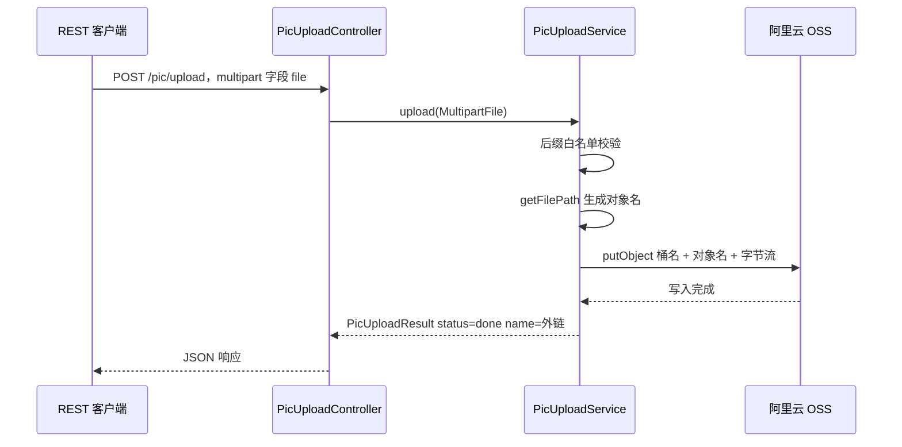

# 图片上传接口闭环：Controller 收文件、Service 传 OSS、按组件要求回 JSON

上一课把 OSSClient 装进了容器，这一课把它用起来：对外暴露一个图片上传接口，前端或 REST 工具 POST 一张图，服务端校验、上传、返回地址。接口本身不难，真正的关键在返回值：前端的 Upload 组件对响应结构有自己的约定，JSON 少一个字段或多一个字段，页面表现就不对。先把约定好的数据结构定下来，代码才写得下去。

## 先给结论

- 接口形态：POST `/pic/upload`，multipart 表单的字段名是 `file`，Controller 用 `@RequestParam` 加 MultipartFile 接收。
- 分层清晰：Controller 只做接收与返回，PicUploadService 负责后缀校验与 putObject，两者之间用 PicUploadResult 传递结果。
- PicUploadResult 的 uid、name、status、url 四个字段照 Ant Design Upload 组件对文件对象的要求定义，status 取值 uploading、done、error、removed。
- 后缀用白名单校验：bmp、jpg、jpeg、gif、png，匹配用 endsWithIgnoreCase，`.JPG` 也能放行。
- 对象名按 images/年/月日/时间戳.后缀 生成；上传成功后 name 直接放完整外链（urlPrefix 拼对象名），前端拿到就能预览。

## 一、Controller：只做搬运工

```java
package com.haoke.manage.dubbo.api.controller;

import com.haoke.manage.dubbo.api.service.PicUploadService;
import com.haoke.manage.dubbo.api.vo.PicUploadResult;
import org.springframework.beans.factory.annotation.Autowired;
import org.springframework.stereotype.Controller;
import org.springframework.web.bind.annotation.PostMapping;
import org.springframework.web.bind.annotation.RequestMapping;
import org.springframework.web.bind.annotation.RequestParam;
import org.springframework.web.bind.annotation.ResponseBody;
import org.springframework.web.multipart.MultipartFile;

@Controller
@RequestMapping("pic/upload")
public class PicUploadController {

    @Autowired
    private PicUploadService picUploadService;

    @PostMapping
    @ResponseBody
    public PicUploadResult upload(@RequestParam("file") MultipartFile uploadFile) {
        // Controller 不碰上传细节，收下文件转手给 Service
        return this.picUploadService.upload(uploadFile);
    }
}
```

三个细节值得停一下：类上的 `@RequestMapping("pic/upload")` 与方法上的 `@PostMapping` 组合出 POST `/pic/upload` 这一条路径；`@ResponseBody` 让返回对象序列化成 JSON，而不是去找视图；参数里的 `@RequestParam("file")` 把 multipart 表单中名为 `file` 的部分绑到 MultipartFile 上，这个名字前端发请求时必须一致。

## 二、返回对象：照组件文档抄结构

Upload 组件的文档对上传完成后的文件对象有明确结构：uid、name、status 等字段，其中 status 有 uploading（上传中）、done（成功）、error（失败）、removed（已删除）四个状态；另有一个控制下载行为的 linkProps 属性，业务里用不到可以省略。照此定义返回对象：

```java
package com.haoke.manage.dubbo.api.vo;

import lombok.Data;

@Data
public class PicUploadResult {

    // 组件要求的唯一标识，用时间戳即可
    private String uid;
    // 文件名；本课直接放完整外链，组件拿它预览
    private String name;
    // uploading / done / error / removed
    private String status;
    // 图片地址，预览与回显用
    private String url;
}
```

`@Data` 生成 getter/setter，Service 里 setStatus、setName 一路顺手。

## 三、Service：校验、命名、putObject

```java
package com.haoke.manage.dubbo.api.service;

import com.aliyun.oss.OSS;
import com.haoke.manage.dubbo.api.config.AliyunConfig;
import com.haoke.manage.dubbo.api.vo.PicUploadResult;
import org.apache.commons.lang3.StringUtils;
import org.joda.time.DateTime;
import org.springframework.beans.factory.annotation.Autowired;
import org.springframework.stereotype.Service;
import org.springframework.web.multipart.MultipartFile;

import java.io.ByteArrayInputStream;
import java.io.IOException;

@Service
public class PicUploadService {

    // 允许上传的图片后缀白名单
    private static final String[] IMAGE_TYPE = new String[]{"bmp", "jpg", "jpeg", "gif", "png"};

    @Autowired
    private OSS ossClient;             // 上一课注册的 Bean，按 SDK 接口类型注入
    @Autowired
    private AliyunConfig aliyunConfig; // 取 bucketName 与 urlPrefix

    public PicUploadResult upload(MultipartFile uploadFile) {
        PicUploadResult fileUploadResult = new PicUploadResult();
        // 对后缀名做白名单校验
        boolean isLegal = false;
        for (String type : IMAGE_TYPE) {
            if (StringUtils.endsWithIgnoreCase(uploadFile.getOriginalFilename(), type)) {
                isLegal = true;
                break;
            }
        }
        if (!isLegal) {
            // 不在白名单里，标记 error 后直接返回，前端按状态渲染
            fileUploadResult.setStatus("error");
            return fileUploadResult;
        }
        try {
            // 生成对象名：images/年/月日/时间戳.后缀
            String fileName = uploadFile.getOriginalFilename();
            String filePath = getFilePath(fileName);
            // byte 数组形态上传：内容装进流交给 SDK
            this.ossClient.putObject(aliyunConfig.getBucketName(), filePath,
                    new ByteArrayInputStream(uploadFile.getBytes()));
            // 上传成功：name 放完整外链，前端直接可用
            fileUploadResult.setStatus("done");
            fileUploadResult.setName(aliyunConfig.getUrlPrefix() + filePath);
            fileUploadResult.setUid(String.valueOf(System.currentTimeMillis()));
        } catch (IOException e) {
            fileUploadResult.setStatus("error");
        }
        return fileUploadResult;
    }

    private String getFilePath(String sourceFileName) {
        DateTime dateTime = new DateTime();
        // 日期做目录、时间戳做文件名；画面转写的日期段有缺损，按讲解口径补全为 年/月日
        return "images/" + dateTime.toString("yyyy") + "/" + dateTime.toString("MMdd")
                + "/" + System.currentTimeMillis()
                + "." + StringUtils.substringAfterLast(sourceFileName, ".");
    }
}
```

方法体按「校验、命名、上传、回填」四段读：白名单不通过立即以 error 退出，一个字节都不上传；`endsWithIgnoreCase` 同时兜住 jpg 与 JPG；`getFilePath` 用 joda-time 拼出日期目录，时间戳保证同一目录基本不重名，后缀从原始文件名里截出来；putObject 的第一个参数是桶名，从配置读，第二个是对象名，第三个是内容流。成功分支里 name 拼上 urlPrefix，返回的就是浏览器可直接打开的地址。

同一毫秒内两个请求理论上会撞名，本课用时间戳已经够用，下一篇的本地实现会再加随机数，两种写法可以对照。

## 四、补两项配置就能跑

Service 用到了 bucketName 与 urlPrefix，上一课的 AliyunConfig 已预留字段，配置文件补两行：

```properties
# 追加在 aliyun.properties 末尾
aliyun.bucketName=haoke-image
aliyun.urlPrefix=https://haoke-image.oss-cn-beijing.aliyuncs.com/
```

urlPrefix 就是上一课讲过的 URL 拼接规则的前半段：Bucket 名加 Endpoint。它必须以斜杠结尾，后面直接拼对象名才是合法地址。

## 五、测试：两个必须对齐的点

api-server 依赖 dubbo 服务，先启动 dubbo-server 再启动 api-server。用 REST 客户端工具发请求（Postman、Advanced REST Client 均可）：

```bash
# POST http://127.0.0.1:18080/pic/upload
# Body 选 form-data，键名 file，类型选 File，值选一张图片
# 请求类型保持 multipart/form-data
```

响应回来是一段 JSON：

```json
{
  "uid": "1545201123456",
  "name": "https://haoke-image.oss-cn-beijing.aliyuncs.com/images/2018/1220/1545201123456.jpg",
  "status": "done",
  "url": null
}
```

把 name 贴进浏览器能出图，控制台的文件管理里出现 images/2018/1220 这样的日期目录，闭环完成。测试失败时按顺序检查两处：表单字段名是否与 `@RequestParam("file")` 一致，提交类型是否是 multipart/form-data，这两处错一个，服务端都拿不到文件。另一个真实踩过的坑是配置文件名拼写：aliyun 少写一个字母，启动即报错，改回就能跑。

整条链路：



图里 status=done 与 name 外链是前端唯一关心的两样东西，任何一环出错都要落到 error 状态上返回，让组件有机会渲染失败样式。

## 常见误区

- **字段名对不上。** 客户端把表单键写成 myfile，服务端参数是 file，MultipartFile 注入失败，直接 400 或空指针；名字以 Controller 的 `@RequestParam` 为准。
- **请求类型选错。** 用 `x-www-form-urlencoded` 或 GET 发上传，multipart 解析根本不发生，拿到的永远是 null；上传请求必须是 multipart/form-data。
- **name 返回相对路径。** 只回 images/2018/... 不拼域名，前端预览空白；组件不会替你补域名，返回什么用什么。
- **白名单漏了 jpeg 或大小写。** 手机拍摄的常见 `.JPG`，用 endsWithIgnoreCase 匹配，并把 jpeg 单列，jpg 与 jpeg 并不是一个后缀。

## 面试可能被问到的问题

1. 面试官追问：「MultipartFile 的底层是什么？」
   答：Spring MVC 依靠 multipart 解析器处理 multipart/form-data 请求，上传内容先落到容器配置的临时目录（小文件可能在内存），MultipartFile 是它的句柄。transferTo 直接搬运临时文件，getBytes 或 getInputStream 则读取内容，请求结束后临时文件按策略清理。

2. 面试官追问：「为什么 Controller 不直接调用 OSSClient？」
   答：上传是业务能力，校验规则、命名策略、存储目标都可能变化，收在 Service 里 Controller 才薄；其他模块要复用上传时注入 Service 即可，不必每个 Controller 重复这段逻辑。

3. 面试官追问：「对象名为什么要带日期目录和时间戳？」
   答：日期目录让文件按天归档，排查与批量清理都按目录定位，也避免单目录对象过多；时间戳防覆盖，同毫秒重名的概率可以忽略。生产上还会加业务前缀（如商品 id）建立业务与文件的对应关系。

4. 面试官追问：「上传接口的返回结构怎么设计？」
   答：与前端组件约定优先。Ant Design Upload 约定文件对象含 uid、name、status 等字段，status 表达 uploading、done、error 的状态机；后端返回体照此对齐，name 直接给可访问外链，前端零加工即可预览。

5. 面试官追问：「byte 数组上传和流上传怎么选？」
   答：byte 数组代码最短，但内容全量进内存，几百 KB 的图片没问题，几百 MB 的视频会直接撑爆堆；流式按块读取传输，内存占用恒定，大文件用流或分片上传。

## 配套资料

- 本教学日资料包未收录源码（`materials/code/03/day05-阿里云OSS以及GraphQL入门/` 下仅存清单文件），Controller、Service、VO 与配置片段为按本课画面写法补全的示例，对象名的日期段与扩展名前的点号为按讲解口径整理。
- 云上传工具类的同类真实实现可对照：`materials/code/02/day09 图片上传及Jasper/图片上传及Jasper/资源/后端工具代码/QiniuUploadUtil.java`（byte 数组上传、拼接外链返回的同一套路）。
- 前端如何消费本课返回结构，可见 `materials/code/03/day07-完善前端功能以及WebSocket入门/day07-完善前端功能以及WebSocket入门/资料/EditResource.js` 里对 `v.response.name` 的读取。
