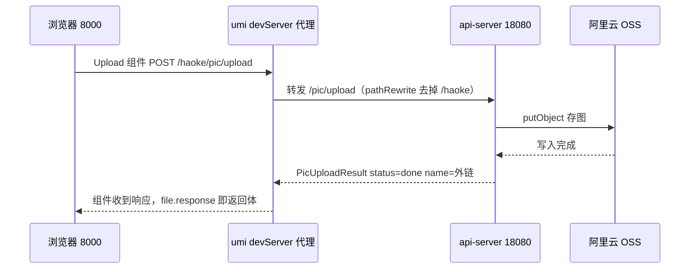

# Upload 组件接上后端：action 走代理、外链收进 Set、表单提交拼 pic

后端接口、云存储、本地存储都就绪了，页面上的 Upload 组件还在原地：action 指向的是脚手架默认地址，上传根本到不了 18080。整合要做三件事：让组件的请求经 devServer 代理落到后端；上传完成后从组件事件里取出外链；提交表单时把这些外链拼进 pic 字段一起入库。任何一环断了，页面看起来一切正常，数据库里 pic 字段却是空的。

## 先给结论

- Upload 组件的 action 写 `/haoke/pic/upload`：`/haoke` 是给 devServer 代理看的标记，pathRewrite 转发时去掉，真实命中 18080 的 `/pic/upload`。
- 上传与表单提交是两步：图片先经组件传到 OSS，点提交时才把外链集合塞进 pic 字段随表单一起走。
- 组件的 onChange 把 fileList 交给父页面，父页面用 Set 收集 `v.response.name`（服务端返回的外链）与 `v.url`（编辑回显的已有图），Set 顺带去重。
- Set 转逗号分隔字符串一行完成：`[...this.state.pics].join(',')`，与数据库 pic 字段的存储格式对齐。
- 联调验证三看：Network 里上传请求 200、提交负载里 pic 是两个逗号分隔的 URL、`tb_house_resources` 新记录的 pic 能逐个打开。

## 一、action 写给代理看

整合表单时已经在 `config/config.js` 里配好了代理，`/haoke` 前缀的请求转发到 18080 并重写掉前缀，图片上传直接复用这套配置，组件只改一个 action：

```jsx
<Upload
  action="/haoke/pic/upload"
  listType="picture-card"
  fileList={fileList}
  onPreview={this.handlePreview}
  onChange={this.handleChange}
>
  {fileList.length >= 5 ? null : uploadButton}
</Upload>
```

组件默认的 action 是脚手架自己的示例地址，指过去当然是 404。写 `/haoke/pic/upload` 而不是 `http://127.0.0.1:18080/pic/upload`，原因与整合表单时相同：页面在 8000 端口，直写 18080 就是跨域，浏览器直接拦下；走代理则浏览器全程只见同源请求。链路如下：



链路上组件拿到的 file.response 就是 Service 返回的 PicUploadResult，后面取地址全从它开始。联调时还会遇到一个与代码无关的拦截：OSS 控制台此前如果开过防盗链的 Referer 白名单，本地页面的预览请求会被拒掉，图传上去了却看不到。学习环境把这个源头限制关掉，或把本地地址加进白名单即可。

## 二、上传完成后，从 fileList 里取什么

组件每次变化都会触发 handleChange，把最新的 fileList 交给父页面：

```javascript
handleChange = ({ fileList }) => {
  this.setState({ fileList });
  // 把组件内的文件列表同步给父页面
  this.props.handleFileList(this.state.fileList);
}
```

父页面负责从每个文件对象里抠出地址。刚上传的图片，服务端返回体挂在 `v.response` 上，本课返回体的 name 就是外链；编辑场景回显的已有图片没有 response，地址直接挂在 `v.url` 上。onChange 会被触发多次，同一张图会重复进来，用 Set 收集天然去重：

```javascript
handleFileList = (obj) => {
  let pics = new Set();
  obj.forEach((v, k) => {
    if (v.response) {
      // 刚上传完成：response 是后端返回的 PicUploadResult，name 即外链
      pics.add(v.response.name);
    }
    if (v.url) {
      // 回显的已有图片：地址直接挂在 url 上
      pics.add(v.url);
    }
  });
  this.setState({ pics });
}
```

两个 if 不是重复：response 只在上传完成后存在，url 只在回显或组件补全后存在，两类来源一起收，编辑页与新增页才能共用这一个组件。

## 三、提交时把 Set 拼成 pic 字段

state 里预留了 `pics: []`，表单校验通过后把它并进提交值：

```javascript
this.props.form.validateFields((err, values) => {
  if (!err) {
    // Set 没有 join 方法，先展开成数组再连接
    values.pic = [...this.state.pics].join(',');
    this.props.dispatch({
      type: 'house/submitHouseForm',
      payload: values,
    });
  }
});
```

`[...set]` 是扩展运算符，把 Set 展开成数组，数组才有 join；数据库 pic 字段存的就是逗号分隔的多个 URL，格式在这里对齐。这个小技巧值得单独记住：集合转分隔字符串，展开加 join 两步完成。

## 四、联调验证：三处都对上才算通

页面上传两张图，楼盘、标题、租金等表单填一组合法值，点提交后逐处确认：

- Network 面板：提交请求的 payload 里出现 pic 字段，值是两个逗号分隔的完整 URL。
- 数据库：`tb_house_resources` 多出一条记录，pic 字段内容与 payload 一致。
- 逐个打开 pic 里的 URL，两张图都能呈现，说明外链与存储都成立。

三处对上，新增房源功能连同图片上传就算完整落地。回头看这条链：组件把文件交给代理，代理交给后端，后端交给 OSS，外链原路回到组件，最终进表单入库，每一跳的地址与数据形态都在前面的课程里铺好了路。

## 常见误区

- **action 直接写后端地址。** `http://127.0.0.1:18080/pic/upload` 会被浏览器按跨域拦截，开发期必须走 `/haoke` 代理前缀，让请求看起来发往 8000。
- **onChange 一触发就读 response。** 上传进行中 response 是 undefined，直接取 name 会报错；先判 `if (v.response)` 再取值。
- **忘了把 pics 并进提交值。** 上传成功、预览正常，但提交时没写 `values.pic = ...`，数据库 pic 字段为空，症状隐蔽，往往到列表页看不到图才发现。
- **把防盗链当成上传失败。** 图片上传 200 但预览 403，是 OSS 的 Referer 白名单挡了本地来源，调整白名单或关闭该限制，与上传代码无关。

## 面试可能被问到的问题

1. 面试官追问：「为什么图片先上传，而不是和表单一起提交？」
   答：文件与表单解耦。图片在选定时就传完并拿到外链，表单提交时只剩小体积 JSON；某张图失败可以单独重传，不影响其他字段；后端接口也不用再处理 multipart，职责更干净。代价是多一次请求往返，体验由组件的并行上传弥补。

2. 面试官追问：「v.response 与 v.url 分别是什么？」
   答：response 是本次上传请求的响应体，本课即后端返回的 PicUploadResult，name 字段是外链；url 是文件对象的访问地址，编辑场景回显已有图片时只有它。两类来源都要收集，新增与编辑才能共用组件。

3. 面试官追问：「Set 在这里除了去重还有什么作用？」
   答：收集语义明确，同一地址重复触发 onChange 不会累积；提交前一次性展开成数组拼接，中间态不需要关心顺序与重复。相比在数组里手动 includes 判断，Set 的写法更短也更不容易漏。

4. 面试官追问：「生产环境没有 devServer 代理，action 应该怎么写？」
   答：常见三种：前后端同域部署，action 写相对路径；网关统一路由，前端只认网关地址；后端开 CORS 响应头允许跨域。图片量大的场景还有第四种：前端直传对象存储，后端只签发临时凭证，上传流量不经过应用服务器。

5. 面试官追问：「pic 字段存逗号分隔的 URL 合理吗？」
   答：简单直接，一条记录一次读取，演示与小规模场景够用；但它违反第一范式，删除单张图要改整串字符串，URL 一旦换域名要全量刷数据。规范做法是独立图片表关联业务 id，按规模权衡。

## 配套资料

- 本教学日资料包未收录源码（`materials/code/03/day05-阿里云OSS以及GraphQL入门/` 下仅存清单文件），Upload 组件、handleFileList 与提交片段为按本课画面写法补全的示例。
- 同构逻辑的真实工程代码（后续教学日资料包）：`materials/code/03/day07-完善前端功能以及WebSocket入门/day07-完善前端功能以及WebSocket入门/资料/EditResource.js`，其中 handleFileList 收集 `v.response.name` 与 `v.url`、提交前 `[...this.state.pics].join(',')`，与本课逻辑完全一致。
- 代理配置的完整推导见同系列成稿 `0066-前后端整合开发之新增房源.md`。
