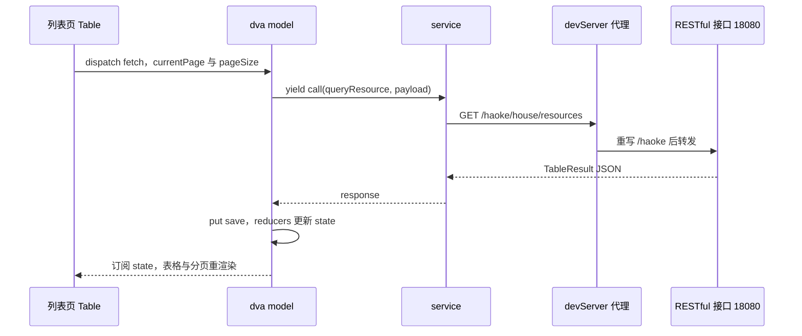

# 列表页接上真实接口：dva 数据流、render 拼字段与图片预览弹窗

后端的分页接口已经能按页返回数据，但管理后台的列表页还是脚手架自带的示例页：请求打不到自己的接口，列也不是房源的列，图片字段显示成一串 URL。整合要做三件事：把数据请求的地址换成真实接口、把表格列按房源业务重排、把图片列做成可点开的预览。任何一处断了，页面都会显得「有数据但不对劲」。

## 先给结论

- 请求地址写在 service 里：`/haoke/house/resources?${stringify(params)}`，`/haoke` 前缀是给 devServer 代理看的标记，转发时被重写掉。
- dva model 固定四步：Table 触发 dispatch，effect 调 service 的 `queryResource`，响应 put 给 reducers，state 更新后表格与分页自动重渲染。
- 楼栋一列对应数据库三个字段，`dataIndex` 只能取一个字段，拼装逻辑必须写进 `render`，从 `record` 上取全量。
- 图片列不渲染 URL 文本，`render` 换成自定义组件 `ShowPics`：无图时按钮禁用，有图点开 `Modal.info`，里面放 `Carousel` 走马灯自动轮播。
- `pic` 字段是逗号分隔的 URL 串，预览组件里 `split(',')` 逐张渲染，与图片上传时入库的格式对齐。

## 一、改请求地址：service 与 model 各动一处

前端工程的请求都从 service 层发出。房源列表对应的 service 文件改成自己的接口地址：

```javascript
import request from '@/utils/request';
import { stringify } from 'qs';

// 列表查询：/haoke 前缀给代理看，转发时被重写掉
export async function queryResource(params) {
  return request(`/haoke/house/resources?${stringify(params)}`);
}
```

`qs` 的 `stringify` 把参数对象拼成 query string：`{ currentPage: 1, pageSize: 2 }` 变成 `currentPage=1&pageSize=2`，正好对上后端 `@RequestParam` 约定的参数名。地址写成相对路径而不是 `http://127.0.0.1:18080/...`，因为页面跑在 8000 端口，直写后端地址就是跨域；带 `/haoke` 前缀的请求会被 devServer 代理转发到 18080，前缀转发前重写掉，这套配置在整合新增房源时已经建好。

model 层把 service 接进 dva 的数据流：

```javascript
import { queryResource } from '@/services/houseResource';

export default {
  namespace: 'house_resource',

  state: {
    data: {
      list: [],
      pagination: {},
    },
  },

  effects: {
    *fetch({ payload }, { call, put }) {
      const response = yield call(queryResource, payload);
      yield put({
        type: 'save',
        payload: response,
      });
    },
  },

  reducers: {
    save(state, action) {
      return {
        ...state,
        data: action.payload,
      };
    },
  },
};
```

`state.data` 的形状就是后端 `TableResult` 的形状：`list` 装数据，`pagination` 装分页信息。effect 里 `yield call(queryResource, payload)` 发出请求，拿到响应后 `put` 给 reducers 落进 state。表格订阅这个 state，数据一到自动重渲染，页码切换时组件再 dispatch 一次 `house_resource/fetch` 带上新页码，循环往复：



图中转发那一步是联调时最常出错的环节：请求没到后端，先看 Network 面板确认走了 8000 的同源地址，再看代理配置的 `target` 与 `pathRewrite`。

## 二、重排列：一列对一字段，拼装交给 render

列表页要展示的是房源业务的字段：房源编号、房源信息、图、楼栋、支付方式、户型、面积、楼层。`columns` 按这个顺序重写，普通列只要 `title` 加 `dataIndex` 就够，难点在两处。

楼栋在数据库里是三个字段：几栋、几单元、几号分列存储，而页面上它是一个格子。`dataIndex` 只能指定一个取值字段，拼装必须交给 `render`：

```jsx
const columns = [
  {
    title: '房源编号',
    dataIndex: 'id',
  },
  {
    title: '房源信息',
    dataIndex: 'title',
  },
  {
    title: '图',
    dataIndex: 'pic',
    render: (text, record, index) => {
      return <ShowPics pics={text}/>;
    },
  },
  {
    title: '楼栋',
    render: (text, record, index) => {
      // 三个字段拼进一个单元格
      return record.buildingFloorNum + '栋' + record.buildingNum + '单元' + record.buildingUnit + '号';
    },
  },
  // 支付方式、户型、面积、楼层等列按 dataIndex 直取，不再赘述
];
```

`render` 的三个参数有明确分工：`text` 是 `dataIndex` 指定字段的值，`record` 是整行数据，`index` 是行号。楼栋列没配 `dataIndex`，`text` 为空，靠 `record` 拿到三个字段拼接。`render` 改变的只是显示，行数据本身不动，排序与取值不受影响。

## 三、图片列：禁用态、弹窗与走马灯

`pic` 字段存的是逗号分隔的 URL 串，直接渲染出来是一行网址文本，没法看。做法是 `render` 里换成 `ShowPics` 组件，把字段值当属性传进去：

```jsx
import React from 'react';
import { Button, Carousel, Modal } from 'antd';

class ShowPics extends React.Component {

  constructor(props) {
    super(props);
    // 有图才允许点开预览，无图时按钮置灰
    this.state = {
      btnDisabled: this.props.pics ? false : true,
    };
  }

  info = () => {
    Modal.info({
      title: '',
      width: '800px',
      okText: 'ok',
      content: (
        <div style={{ width: 650, height: 400, lineHeight: '400px', textAlign: 'center' }}>
          <Carousel autoplay={true}>
            {this.props.pics.split(',').map((value, index) => {
              return (
                <div key={index}>
                  
                </div>
              );
            })}
          </Carousel>
        </div>
      ),
      onOk() {},
    });
  };

  render() {
    return (
      <Button
        disabled={this.state.btnDisabled}
        shape="circle"
        icon="picture"
        onClick={this.info}
      />
    );
  }
}

export default ShowPics;
```

组件里有三个设计点值得看：

**第一，禁用态在构造器里定死。** `btnDisabled` 取决于传入的 `pics` 有没有值：有图为 false，按钮可点；无图为 true，按钮置灰且点不出弹窗。列表里既有带图的房源也有没传图的，同一列要同时容得下两种状态，靠组件自己判断而不是页面写两个分支。

**第二，弹窗选 `Modal.info` 而不是确认框。** `info` 生成的对话框只有确认按钮，适合纯展示；`confirm` 带确认与取消的回调，用在需要用户决策的场景。这里只是看图，`info` 语义最贴。

**第三，弹窗内容是走马灯。** `Carousel` 开 `autoplay` 后图片自动轮播，切片的来源是 `this.props.pics.split(',')`：逗号拆出每个 URL，`map` 成一帧帧 `img`。上传房源时把多张图的外链用逗号拼进 `pic` 字段，预览时按同一个分隔符拆开，两端格式就此对上。

效果上，有图的行显示一个可点的圆形图标按钮，点开是 800 像素宽的弹窗，图片在里面自动切换；无图的行按钮置灰，点不动。

## 常见误区

- **service 里写后端完整地址**：`http://127.0.0.1:18080/house/resources` 看似直连更快，实际浏览器同源策略直接拦下，请求根本发不出去。开发期永远走 `/haoke` 前缀加代理，前缀只是路由标记，不是后端路由的一部分。
- **无图数据也执行 `split`**：`pics` 为 null 时组件里先 `split` 会直接抛类型错误；更隐蔽的是空字符串，`''.split(',')` 得到 `['']`，轮播里渲染出一个空 `img`。禁用按钮挡住入口，是对无图数据的正确处理方式。
- **给楼栋列配 `dataIndex` 期望自动拼**：一个 `dataIndex` 只能取一个字段，三字段合一必须靠 `render` 手工拼。列显示异常时先检查是「取值错了」还是「取到了但显示逻辑没写」。
- **dispatch 的 type 写错命名空间**：type 必须是 `house_resource/fetch`，命名空间与 effect 名都来自 model 定义。写成别的名字不会报错，请求就是发不出去，这种静默失败比异常更难排查。

## 面试可能被问到的问题

1. 面试官追问：「dva 的数据流完整走一遍？」
   答：组件 dispatch 一个带 type 的 action，dva 按命名空间路由到 model 的 effect；异步逻辑在 effect 里用 call 调 service 请求，响应再用 put 派发给 reducers；reducer 是纯函数，返回新 state 后所有订阅的组件自动重渲染。列表场景里 state.data 直接对齐后端的 list 加 pagination 结构。

2. 面试官追问：「Table 列的 render 函数参数有哪些，分别什么用？」
   答：三个参数：text 是 dataIndex 指定字段的值，record 是整行数据对象，index 是行下标。只显示单字段时 text 够用；一格要聚多字段或换成自定义组件时，靠 record 拿全量数据，返回任意 React 节点即可。

3. 面试官追问：「Modal.info 和 Modal.confirm 怎么选？」
   答：info 只有确认按钮，面向纯展示，比如图片预览、结果通知；confirm 提供确认与取消及对应回调，面向需要用户决策的场景。选错不影响功能，但交互语义会误导用户，展示型弹窗用 confirm 会让用户下意识找「取消」。

4. 面试官追问：「逗号分隔存图片 URL 的方案有什么问题？」
   答：写入与拆开都简单，一条记录一次读取，演示场景够用；但它把多个值塞进一个字段，违反第一范式，删除单张图要改整串字符串，URL 换域名要全量刷数据，也没法给单张图记元信息。规范化做法是独立图片表按业务 id 关联，规模上来后是必选项。

5. 面试官追问：「组件的 disabled 状态在 constructor 里初始化，props 后来变了怎么办？」
   答：constructor 只在组件创建时执行一次，之后 props 变化不会重新初始化 state。列表数据整体刷新时组件通常随 key 重建，问题被掩盖；若同一组件实例会接到不同 pics，就要用 getDerivedStateFromProps 响应变化，或干脆在 render 里用 props 直接计算，不落 state。

6. 面试官追问：「qs 的 stringify 在这里解决什么问题？」
   答：把 JS 对象序列化成 URL 的 query string，并处理数组的重复参数、中文与特殊字符的编码转义。手拼字符串容易漏 encodeURIComponent，参数一多也难维护；它与后端 Spring MVC 的参数绑定天然对应，对象键名即参数名。

## 配套资料

- 本教学日资料包未收录源码（`materials/code/03/day05-阿里云OSS以及GraphQL入门/` 下仅存清单文件），service、model、columns 与 ShowPics 组件为按本课画面写法补全的示例，工程体系为 Ant Design Pro（umi 与 dva）。
- 同一房源管理前端工程的真实文件可对照：`materials/code/03/day07-完善前端功能以及WebSocket入门/day07-完善前端功能以及WebSocket入门/资料/EditResource.js`（`@connect` 接 model、dispatch 提交表单、pics 集合转逗号字符串的既有惯例）。
- 反向代理与跨域的完整推导见同系列成稿 `0066-前后端整合开发之新增房源.md`；后端 GET 接口与 `TableResult` 结构见 `0076-实现房源列表的RESTful接口的开发.md`。
