# GraphQL入门之完整合辑：从 REST 痛点、规范语法到 graphql-java 编码实战

## 先给结论

- 本系列围绕 GraphQL 入门展开，共十一篇：前五篇立概念与规范，后六篇落到 graphql-java 的编码实战，覆盖从「为什么需要它」到「写出带参数、带嵌套的查询服务」的完整路径。
- 概念篇先立动机：RESTful 有过度获取与不足获取两块固有痛点；GraphQL 以单一端点、按需字段、一次聚合作为回应，并递出按需索取、一次查询多个数据、API 演进无需划分版本三张名片。
- 规范篇讲查询语法四件套：字段、参数、别名、片段，请求与响应同构是贯穿始终的主线；Schema 与类型规范给出五种标量、枚举、接口以及非空与列表的位置学。
- 实现篇认准 Java 阵营的 graphql-java：三个核心对象 GraphQLSchema、DataFetcher、GraphQL 分别回答有什么数据、数据从哪来、谁来执行。
- 工程搭建只有一条依赖坐标，重点在 Maven 仓库配置：第三方仓库进 profile 的 repositories，不要碰 mirrors 的劫持机制；当年的 bintray 仓库已停止服务，新工程直接用中央仓库。
- 编码主线是从里往外搭 Builder：对象类型、字段、根查询类型、GraphQLSchema、GraphQL 执行器；参数用 GraphQLArgument 声明，取参靠 DataFetchingEnvironment。
- SDL 先行是工程上更常见的路线：SchemaParser 与 SchemaGenerator 合成可执行 Schema，取数逻辑仍在 RuntimeWiring 里按类型名和字段名对上。
- 对象嵌套的关键认知：GraphQL 不做关联查询，嵌套字段的数据必须由取数器备好；嵌套层级一深就要防 N 加 1 问题，生产环境配合 DataLoader 做批量取数。
- 查询端三条铁律：字段名大小写敏感，嵌套字段用大括号不用圆括号，没绑取数器的字段返回 null 且不报任何错误。
- 学习顺序建议照篇序走：概念与规范是地基，直接跳进编码会在类型系统与取数器上反复碰壁。
- 全系列的通用心法：Schema 是静态契约，DataFetcher 是动态取数，两者分开理解，GraphQL 的绝大多数疑惑都能就地解开。

## 第1部分：GraphQL 是什么：给 API 用的查询语言，先看清它想治 REST 的哪块痛

房源的新增、列表在 RESTful 这条路上已经走顺了，按理该一头扎进前端整合。动手之前课程插进来一个新角色：GraphQL。它和 RESTful 干的是同一件事，都是做接口的，但思路不一样；近年流行度持续走高，前端系统与后端交互也多了一条可选的路。先把概念立住，下一课才谈得上动手开发 GraphQL 服务。

### 一、先看 REST 的两块痛

假设一个页面要展示用户资料和他最近的订单明细。按 RESTful 的习惯拆资源，前端大概要这样连发几次请求（示例）：

```http
GET /api/users/1
GET /api/users/1/orders?page=1&size=10
GET /api/orders/9527/items
```

痛感出在两头：

**第一，过度获取。** 页面上只想显示用户的名字和头像，`GET /api/users/1` 却把整个用户对象全量返回，注册时间、绑定手机、积分明细全在响应里躺着。字段是后端定死的，前端要的不多不少只能靠后端为新页面再开接口，接口数量随着页面数量膨胀。

**第二，不足获取。** 一个接口给不全一屏要用的数据，页面只能串行打多次请求：先拿用户，再拿订单列表，再拿订单明细。三次往返都走完，页面才渲染得出来，网络慢的时候延迟是叠加的。

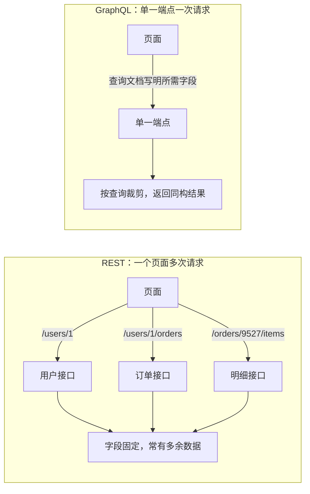

左边是 REST 的常态：资源拆得越细，页面要发的请求越多，每个接口的字段却由后端一手包办。右边是 GraphQL 的主张：一个端点，一张查询文档，字段由前端按需声明。图里两侧的对比就是这门技术的全部动机。

### 二、GraphQL 的定义：一门查询语言，一套规范

GraphQL 由 Facebook 创造。Facebook 移动应用从 2012 年就开始用它，规范在 2015 年开放给社区，此后逐步成为多语言、多团队采用的技术，Twitter、GitHub、Pinterest、Airbnb、Shopify 等产品都在使用者名单上。

定义上有两个「不是」要说清：

**它不是常规意义上的搜索语言。** 名字里的「查询」容易让人联想到 SQL，但 GraphQL 不直接作用于数据库，既不指定存储引擎也不绑定某类数据源，它运行在类型系统之上，服务端把数据以类型的方式描述出来，查询按类型取数。它是前后端之间数据查询方式的一套规范，地位与 RESTful 平行。

**它也不只做查询。** 最初的设计动机确实是查询，后来规范扩展出变更数据的操作，读多写少的场景下查询仍是使用频率最高的一面。这门课后续开发 GraphQL 服务时会落到具体的操作类型上。

学习资源方面它对中文读者相当友好：官网有中文版，规范的中文站点把语言、类型系统等章节完整译出。规范目录覆盖查询文档、操作、选择集、字段、参数、别名、片段、变量、指令，类型系统一章又细分标量、对象、接口、联合、枚举、输入对象、列表、非空，内容体量不小。课程的做法是先立规范、挑重点讲，理解了它想解决什么，再上手具体实现。

### 三、查询长什么样：请求与结果同构

官网给的经典示例最能说明它的气质。客户端发出一份查询文档：

```graphql
{
  hero {
    name
    height
  }
}
```

服务端返回的 JSON 与查询的结构一模一样，只是把字段填上了值：

```json
{
  "hero": {
    "name": "Luke Skywalker",
    "height": 1.72
  }
}
```

三个特性都藏在这组对照里：

**第一，按需取字段。** 查询里只写了 `name` 和 `height`，响应里就只有这两项，一个多余的字段都没有。过度获取在这个机制下自然消失，字段主权从后端移到了发起查询的一侧。

**第二，请求与结果同构。** 看到查询文档就能预测响应的形状，因为响应就是按查询裁出来的。前端写页面时先想清楚要什么字段，把查询写完，数据结构的谜题就解完了，不需要翻接口文档核对响应。

**第三，沿引用深入。** 字段可以继续往下钻，比如角色对象上还有朋友列表：

```graphql
{
  hero {
    name
    friends {
      name
    }
  }
}
```

一次请求顺着对象引用把角色和朋友一起拿回来，REST 里要拆多次请求的数据，这里一份查询文档全部覆盖，慢速网络下的表现因此明显更好。

### 四、官方给的卖点与社区的成色

官网首页列出的几个卖点，正好逐条对应前面的痛点：请求所需的数据不多不少，杜绝冗余；获取多个资源只用一个请求，往返次数从多次压到一次；所有 API 由一套完整易读的类型描述驱动，接口自身就是文档；依托类型系统还能构建强大的开发者工具，查询补全、文档浏览、调试都在工具里完成。

社区与生态也已成形：入门教程、各语言的服务端实现与客户端库、资源合集都有现成的整理，公开的 GraphQL API 也有汇总列表可查。要注意各语言的实现并非官方出品，规范开放后由社区按规范实现，选型时认准主流库即可。

把 REST 与 GraphQL 摆在一起评价比较客观：RESTful 是成熟稳定的接口规范，生态与工具链齐全，简单场景下没有任何问题；GraphQL 在字段灵活性与请求合并上更进一步，代价是服务端要建类型系统与解析器，学习与改造成本更高。两者不是取代关系，按团队与业务选择，本课程选择在后续的前端整合中落地 GraphQL 服务。

## 第2部分：RESTful 用了这么久，它身上这两个毛病得掰开看清楚

用户详情页只显示一个名字，`GET /user/1001` 却把整条用户记录全量吐了回来；页面还要展示身份证号，用户表和证照表分开存储，前端只能再发一次请求。接口写得没毛病，测试也都通过，可带宽和多出来的那次往返是实打实花掉的。在把 GraphQL 请进来之前，得先把 RESTful 的这两个问题讲透，才知道新工具到底治什么。

### 一、熟悉的 RESTful：资源加动词

RESTful 是做 API 通信时最常用的一套规范，用 URL 定位资源，用 HTTP 方法表达对资源的操作。对 `user` 这份数据做增删改查，写法大致是：

```http
GET    http://127.0.0.1/user/1    # 查询
POST   http://127.0.0.1/user      # 新增
PUT    http://127.0.0.1/user      # 更新
DELETE http://127.0.0.1/user      # 删除
```

查询用户时带上编号发 `GET` 请求，服务端响应一段 JSON：

```http
GET http://127.0.0.1/user/1001
```

响应大概长这样：

```json
{
  "id": 1001,
  "name": "张三",
  "age": 20,
  "address": "北京市"
}
```

请求 1001，返回 1001 这个用户的数据，看起来严丝合缝，没有问题。问题恰恰藏在「没问题」这三个字里。

### 二、问题一：过度获取，带宽白花

换个更真实的场景：页面上只想确认编号 1001 的用户叫不叫张三，需要的其实只有一个 `name` 字段。可服务端做响应时，把这条记录的所有字段都带了回来，`id`、`age`、`address` 一个不落。

**浪费发生在服务端到客户端的传输环节。** 字段多了，响应体就大，占的是带宽；客户端拿到后还得解析、丢弃用不上的部分。单条记录感觉不明显，列表页一次 50 个用户、每个用户几十个字段时，浪费被成倍放大。

**根子在于字段的决定权在服务端。** 接口返回什么字段是开发接口时就定死的，请求方没有任何挑选的余地。想要一个「只返回名字」的接口？可以，再写一个。于是接口数量跟着页面的口味不断膨胀，每个页面都可能催生一个定制版接口。

### 三、问题二：不足获取，一个需求多次请求

反过来的场景同样常见：需求是查用户以及他的身份证号。底层存储时，用户和证照是两张表分开存的，`user` 一张、`card` 一张，对应到 RESTful 就是两个资源、两个接口。

```http
GET http://127.0.0.1/user/1001
```

用户信息拿到了，可需求还没完成，得再发一次请求查证照：

```http
GET http://127.0.0.1/card/8888
```

```json
{
  "id": 8888,
  "name": "张三",
  "cardNumber": "9999999999999999",
  "address": "北京市"
}
```

一个需求、两次请求才凑齐。前端等第一次响应回来才能发第二次，延迟是叠加的，聚合数据的代码也堆在前端。更糟的推演是：如果一屏数据要 10 类信息，是不是就要发起 10 次请求才能完成？资源拆得越细，这个数字越大。

整个过程画出来是这样的：

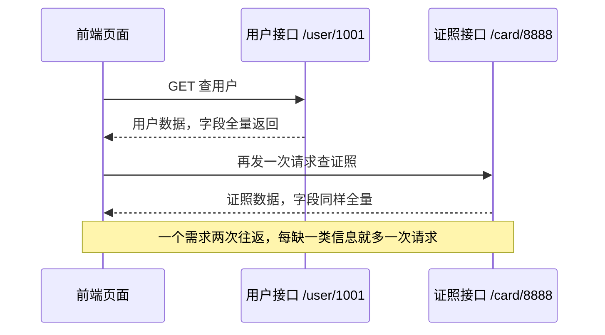

两个问题在同一条时序里同时出现：每次响应都塞满了用不上的字段（过度获取），凑齐一屏数据却要来回多次（不足获取）。

### 四、挑毛病的目的：给 GraphQL 铺路

把话说公道：RESTful 并没有不好，它是成熟稳定的接口规范，上面这两个问题是在使用过程中确实存在的，仅在特定场景下让人难受。分析问题是为了引出解法。

GraphQL 由 Facebook 创造，是一门用于描述复杂数据模型的查询语言，定位是前后端数据查询方式的一套规范，和 RESTful 平级。它对上面两个痛点的回应恰好各占一句：

**按需索取。** 请求里写明要哪几个字段，服务端就只返回这几个字段，响应结构和请求结构保持一致，过度获取从此失去生存空间。

**一次请求聚合多个资源。** 用户和他的证照、朋友，可以在一份查询文档里一起声明，服务端一次响应全部返回，多次往返合并成一次。

这两个能力具体长什么样、语法怎么写，后面的课依次展开。先记住问题本身，再看解法，每一步都知道为什么。

## 第3部分：按需索取、一次拿全、免版本升级：GraphQL 递出的三张名片

上一课给 RESTful 挑出了两个毛病：字段全量返回的过度获取，一个需求多次请求的不足获取。GraphQL 声称能治这两块痛，口说无凭，得看它具体怎么做到。官方文档把它的能力归纳成几条卖点，逐条对照痛点看过去，就能明白它在设计思想上先进在哪里。

### 一、按需索取：要一个还一个

官网首页有一段动态演示：上半个框是客户端的请求，下半个框是服务端的响应，请求里有一个字段，响应就回一个字段；请求里添到两个，响应就回两个。这句演示背后的话是：请求你需要的数据，不多不少。

落到具体例子，只要角色的名字：

```graphql
{
  hero {
    name
  }
}
```

响应里就只有名字，一个多余的字段都没有：

```json
{
  "data": {
    "hero": {
      "name": "R2-D2"
    }
  }
}
```

想要多知道出场剧集，就在请求里多写一个字段：

```graphql
{
  hero {
    name
    appearsIn
  }
}
```

响应随之多出一项，结构依然和请求对齐：

```json
{
  "data": {
    "hero": {
      "name": "R2-D2",
      "appearsIn": [
        "NEWHOPE",
        "EMPIRE",
        "JEDI"
      ]
    }
  }
}
```

上一课「只要名字却返回整条记录」的过度获取，在这个机制下自然消失：字段决定权从服务端移交给了发起请求的一方。

### 二、一次查询多个数据：多次往返并成一次

按需索取解决的是「要多了」，还有一个问题是「要不齐」。查询角色信息时顺便要他的朋友列表，一份查询就能写完：

```graphql
{
  hero {
    name
    id
    appearsIn
    friends {
      id
    }
  }
}
```

服务端的响应里，`friends` 数组连同每一项的 `id` 一起返回：

```json
{
  "data": {
    "hero": {
      "name": "R2-D2",
      "id": "2001",
      "appearsIn": [
        "NEWHOPE",
        "EMPIRE",
        "JEDI"
      ],
      "friends": [
        {
          "id": "1000"
        }
      ]
    }
  }
}
```

换成 RESTful，这就是两个接口、两次请求：先查角色，拿到结果后再拿他的朋友。GraphQL 在一份查询文档里沿着对象引用往下钻，多次往返合并成一次。官网首页那句「获取多个资源，只用一个请求」配的动画，讲的就是这件事。

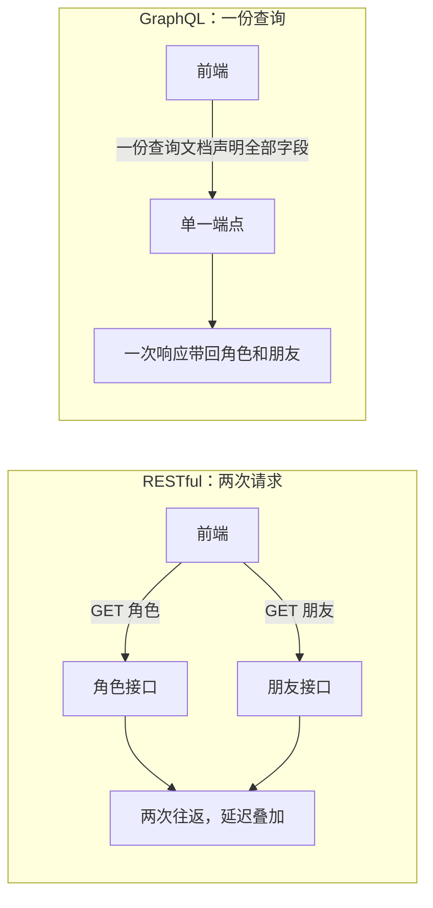

左边两次请求、两次等待，右边一次请求、一次拿全。数据关系越复杂，这个差距越明显。

### 三、API 演进无需划分版本：客户端不用跟着升级

第三张名片解决的是另一个长期痛点。RESTful 接口升级字段时，常见做法是开 `/v1`、`/v2` 两套路径并行维护，等客户端都迁完才能下线旧版。GraphQL 的思路不同，看一组类型定义的变化。最初的 `Film` 类型有四个字段：

```graphql
type Film {
  title: String
  episode: Int
  releaseDate: String
  openingCrawl: String
}
```

随着时间推移，需要补充导演信息，加上 `director` 字段：

```graphql
type Film {
  title: String
  episode: Int
  releaseDate: String
  openingCrawl: String
  director: String
}
```

老客户端完全不用动。它的查询里没有 `director`，响应里就不会有这个字段，返回什么由客户端的查询参数决定，新字段对它是透明的。反过来要淘汰一个字段，也不必立刻删除，规范提供了 `@deprecated` 标记，把字段标注成废弃状态，老查询还能继续用，新文档不再推荐它。字段的新增与废弃都在类型定义里渐进推进，版本号这个概念被弱化掉了。

### 四、三个卖点踩在同一块地基上

回头想想，响应为什么能精确到字段、能一次带全多个资源、能随类型演进保持兼容？因为这一切都运行在类型系统之上。角色的类型长这样：

```graphql
type Character {
  name: String
  friends: [Character]
  homeWorld: Planet
  species: Species
}
```

客户端能要的字段，必须先在类型里声明过：`friends` 指回 `Character` 自己，`homeWorld` 指向 `Planet`，沿着这些声明才能一次钻取多层引用。类型是契约也是文档，按需索取、一次聚合、平滑演进都是这套契约的自然结果。

## 第4部分：读懂一份 GraphQL 查询文档：字段、参数、别名、片段四个语法件

前两课解决了「GraphQL 是什么、好在哪」，真要动手写查询，还差一层语法。GraphQL 定义了一整套规范来描述查询的语法结构，官方文档的「查询和变更」章节覆盖全部内容，体量不小。入门阶段抓四个必须会用的点就够了：字段、参数、别名、片段，剩下的用到再查。

### 一、先立住一个前提：规范与实现是两层

GraphQL 发布的是一整套语言规范，用来定义查询语法的样子，本身不含任何可运行的代码，需要各种语言按规范各自实现服务端。这个前提决定了学它的姿势：语法和类型规范是通用的，跟具体实现无关；等真正搭服务时，才轮到某个语言的某个库出场。查询相关的规范都在官方文档的「查询和变更」一节，本课挑入门必须的四件套。

### 二、字段：响应和请求同构

发起查询时构造的结构里，已经写明了预期结果长什么样：

```graphql
{
  hero {
    name
    id
  }
}
```

服务端返回的数据和请求的结构基本一致，只是填上了值：

```json
{
  "data": {
    "hero": {
      "name": "R2-D2",
      "id": "2001"
    }
  }
}
```

请求里有 `name` 和 `id`，响应里就只有这两项，这个特性叫结构一致。它的价值在于：写查询的人非常清楚自己要什么、会得到什么，接口文档的作用被查询文档本身替代了。按需索取就是靠「响应跟着请求的字段走」落地的，字段是整个查询语法里最小的积木，字段下面还能继续嵌套子字段，嵌套多深由数据关系决定。

### 三、参数：小括号里的名值对

查询离不开条件，GraphQL 的参数语法是 `(参数名: 参数值)`，跟在字段名后面：

```graphql
{
  user(id: 1000) {
    name
    age
  }
}
```

`id` 是参数名，`1000` 是参数值，服务端按这个条件查出对应用户，返回的依然只有 `name` 和 `age` 两个字段，结构与请求保持一致。参数可以传多个，标量、枚举都能做参数值。参数解决「查哪条」，字段解决「要哪几列」，两者配合就是一次完整的取数。

### 四、别名：一次查两个同类对象

场景来了：同一次查询里想拿两个 `hero`，一个出自 `EMPIRE` 阵营、一个出自 `JEDI` 阵营。不做任何处理的话，响应的同一层 JSON 里会出现两个 `hero` 键，同名键在 JSON 语法里不合法，这条查询直接就没法写。别名就是为此准备的，语法是 `别名: 字段`：

```graphql
{
  empireHero: hero(episode: EMPIRE) {
    name
  }
  jediHero: hero(episode: JEDI) {
    name
  }
}
```

响应里出现的是别名，不是字段原名：

```json
{
  "data": {
    "empireHero": {
      "name": "Luke Skywalker"
    },
    "jediHero": {
      "name": "R2-D2"
    }
  }
}
```

两次查询同一字段、参数不同，靠别名把结果区分开，前端取数时也直接用别名做键。

### 五、片段：公共字段集抽出来复用

别名那组查询如果还要取一堆字段，两边写得完全一样就太啰嗦了：

```graphql
{
  leftComparison: hero(episode: EMPIRE) {
    ...comparisonFields
  }
  rightComparison: hero(episode: JEDI) {
    ...comparisonFields
  }
}

fragment comparisonFields on Character {
  name
  appearsIn
  friends {
    name
  }
}
```

`fragment comparisonFields on Character` 定义了一个字段集合，声明它依附在 `Character` 类型上；两处查询用 `...comparisonFields` 把它原地展开，效果等同于把字段抄一遍。字段集改一处，所有展开点同步生效。用过 MyBatis 的话会觉得眼熟：`<sql>` 定义、`<include>` 引用的 SQL 片段，表达的是同一个意思，都是把重复的片段收敛成一处定义。

四个语法件在一份查询文档里的位置可以这样看：

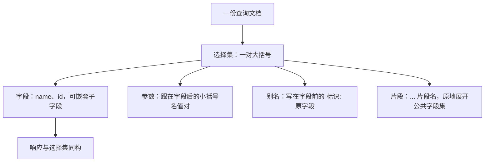

选择集里每写一行，响应里就多一个对应的位置，字段、参数、别名、片段都是在往这张同构的图上做文章。

### 六、四件套之外还有哪些

官方「查询和变更」章节里，除了讲过的字段、参数、别名、片段，还有操作名称、变量、指令、变更（mutation）、内嵌片段等条目。它们不是没用，而是入门阶段暂时用不着：操作名称和变量在真实项目里几乎必用，指令用于按条件包含或跳过字段，变更负责写操作。等课程进入开发 GraphQL 服务的环节，用到哪块就补哪块，现在留个索引即可。

## 第5部分：Schema 与类型规范：把服务端的数据形状先写下来

查询语法学完了，客户端知道「怎么要」了，还差另一半：服务端到底「有什么」。这个答案写在 GraphQL 的 Schema 里。以课程里熟悉的用户场景来说，`User` 对象有哪些字段、`User` 和 `Card` 之间是什么关系，全都要在 Schema 中定义清楚。这一课把 Schema 的结构和类型规范过完，本教学日的 GraphQL 规范部分也就收束了。

### 一、Schema：服务端的数据形状

Schema 定义的是服务端的数据结构。用一段 SDL（Schema 定义语言）把用户查询写全，就是这样的三段式：

```graphql
schema {          # 定义查询
  query: UserQuery
}
type UserQuery {  # 定义查询的类型
  user(id: ID): User    # 指定对象以及参数类型
}
type User {       # 定义对象
  id: ID!         # ! 表示该属性是非空项
  name: String
  age: Int
}
```

三段各管一层：`schema` 声明这个服务的查询入口是 `UserQuery`；`UserQuery` 定义能执行哪些查询，`user` 接收一个 `ID` 类型的 `id` 参数，返回一个 `User` 对象；`User` 定义对象本身的形状，有 `id`、`name`、`age` 三个字段，冒号后面写的是各自的类型。

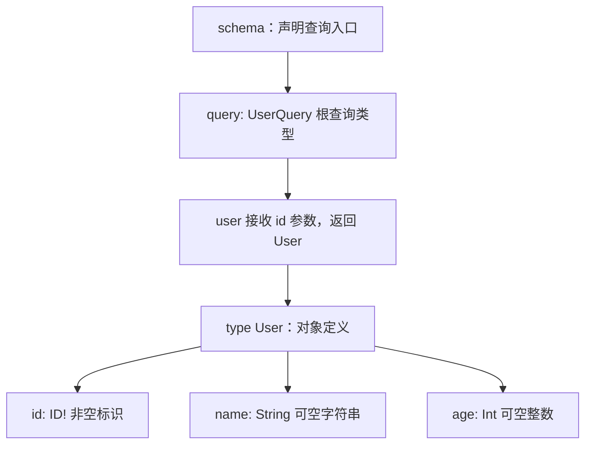

客户端查询里写的每一个字段，都必须能沿着这张图找到出处：从根查询入口进，落在某个对象类型的字段上。上一课说的「字段必须在类型里声明过」，声明的位置就是这里。

### 二、五种标量类型：规范给的起点

规范默认定义了 5 种标量类型，字段类型的底座就是它们：

| 类型 | 含义 |
|---|---|
| `Int` | 有符号 32 位整数 |
| `Float` | 有符号双精度浮点值 |
| `String` | UTF-8 字符序列 |
| `Boolean` | `true` 或者 `false` |
| `ID` | 唯一标识符，通常用于重新获取对象，或者作为缓存中的键 |

`ID` 值得多说一句：它和 `Int`、`String` 的差别不在存储而在语义，它表示唯一标识，规范上序列化成字符串，客户端不应假设它是数字。

只有 5 种标量显然撑不起真实业务，规范本身支持自定义标量，各语言实现时也都会做扩充。Java 的 GraphQL 实现里就新增了 `Long`、`Byte` 这类类型来对齐 Java 的基本类型体系。这里再次撞上贯穿本教学日的那个区分：5 种标量是规范层的说法，`Long`、`Byte` 是具体实现层的补充，两层别混。

### 三、枚举：把取值圈在范围内

枚举类型把字段的值限制在一组固定选项里：

```graphql
enum Episode {   # 定义枚举
  NEWHOPE
  EMPIRE
  JEDI
}
type Human {
  id: ID!
  name: String!
  appearsIn: [Episode]!   # 使用枚举类型
  homePlanet: String
}
```

`appearsIn` 的取值只能是 `NEWHOPE`、`EMPIRE`、`JEDI` 之一，传别的值在校验阶段就被拒掉。这和 Java 里枚举的作用非常相似：把合法值收敛成可枚举的集合，非法值进不了系统。

### 四、接口：规定必须携带的字段

GraphQL 也有接口（`interface`）。接口是一个抽象类型，声明一组必须存在的字段，实现它的对象类型必须把这组字段全部带上，之后还可以扩充自己的字段：

```graphql
interface Character {   # 定义接口
  id: ID!
  name: String!
  friends: [Character]
  appearsIn: [Episode]!
}
# 实现接口
type Human implements Character {
  id: ID!
  name: String!
  friends: [Character]
  appearsIn: [Episode]!
  starships: [Starship]
  totalCredits: Int
}
type Droid implements Character {
  id: ID!
  name: String!
  friends: [Character]
  appearsIn: [Episode]!
  primaryFunction: String
}
```

`Human` 和 `Droid` 都实现了 `Character`，四个接口字段一个不能少，各自再补充私有字段：人类有星舰和信用点，机器人有主要功能。查询 `Character` 类型时拿到的是公共字段，需要具体类型的专属字段时再做类型判断。玩法和 Java 的接口实现几乎一致：接口定契约，实现类带契约字段并自由扩展。

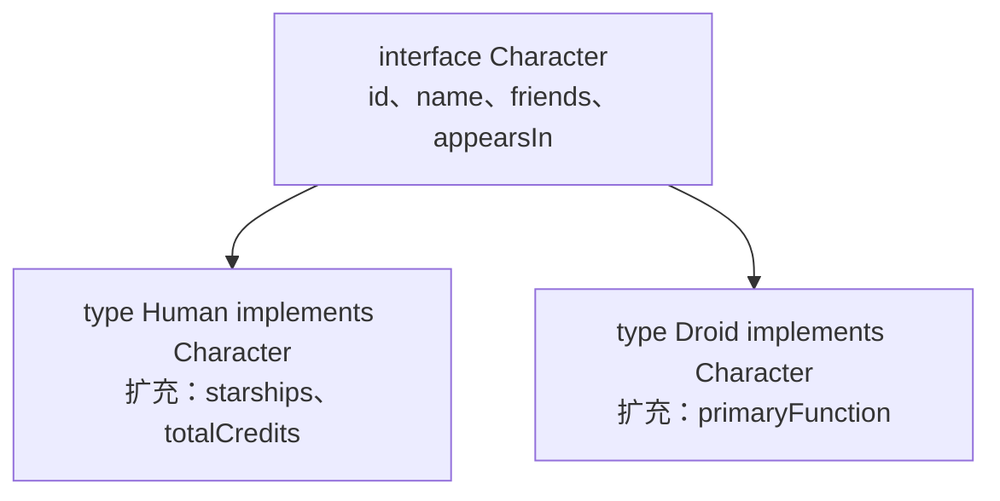

### 五、非空与列表：`!` 和 `[ ]` 的位置学

字段类型上还能叠加两个修饰。感叹号 `!` 表示非空：`name: String` 可以返回空，`name: String!` 则保证一定有值，课程示例里 `id: ID!` 的注释已经点明「`!` 表示该属性是非空项」。方括号 `[ ]` 表示列表：`friends: [Character]` 是角色列表。两者组合时位置决定语义，`[Episode]!` 是「列表本身非空」，`[Episode!]!` 是「列表非空且每个元素也非空」。另外规范还允许为字段和变量定义默认值，写法是在类型后接 `= 默认值`，比如查询变量 `$page: Int = 1`，这是示例补充说明，本课画面未展开。

### 六、day05 的 GraphQL 规范段到这里收束

把本教学日的 GraphQL 线索连起来：先从 RESTful 的过度获取与不足获取引出动机，再用三个卖点看 GraphQL 如何作答，接着过了查询语法四件套，这一课补齐 Schema 与类型。规范层面到此闭环：查询怎么写、服务端怎么声明，两张图都对上了。落地的最后一步是选一种语言的实现搭起真正的服务，那是下一教学日的事；动实现之前先把规范吃透，正是这门课刻意安排的顺序。

## 第6部分：GraphQL 落到 Java 世界：graphql-java 项目与它的三个核心对象

前面几节把 GraphQL 的查询语言和类型系统讲清楚了，但它终究只是一份规范：规定「能怎么查」，却不管「谁来执行」。真正落到一个 Java 工程里，需要有人把查询字符串解析成语法树、按 Schema 校验合法性、再逐字段取数组装结果。这件事由谁来做、该引入哪个坐标、入门文档去哪看，就是本节要解决的问题。

### 规范和实现是两回事

GraphQL 官网列着一排语言图标，JS、Java、Python、Go、C# 等，每个图标背后对应一份实现。这层关系和 JDBC 很像：JDBC 只定义接口与契约，真正干活的是各家数据库驱动。GraphQL 最早的参考实现由设计它的团队用 JavaScript 完成，Java 这一份并不是官方亲自写的，而是第三方团队的成果，因为做得足够好，被官方列入推荐名单。

**第一，认准 graphql-java 这个名字。** 在 Java 项目里做 GraphQL 服务端，首选 `graphql-java`。Java 圈还有其他实现，学习阶段不必分散精力，官方推荐哪个就用哪个。

**第二，分清两个官网。** `graphql.org` 是 GraphQL 规范的官网，`www.graphql-java.com` 才是 Java 实现的官网。查文档时走错地方，看到的 API 和用法完全对不上。

### graphql-java 项目速览

项目情况可以概括成三点：

- 开源协议 MIT，代码在 `github.com/graphql-java/graphql-java`，可以 clone 到本地对照学习，社区活跃度和 star 数在同类项目里都拿得出手。
- 文档质量在开源项目里属于上乘，Getting started、Schema、Execution、Data fetching 几个板块把入门到进阶的路径铺得很清楚，而且文档里直接给了完整可运行的示例代码，照着敲就能入门。
- 依赖坐标 `com.graphql-java:graphql-java`，官方文档同时给出 Gradle 和 Maven 两种引入写法，课程使用 11.0 版本。

```xml
<dependency>
    <groupId>com.graphql-java</groupId>
    <artifactId>graphql-java</artifactId>
    <version>11.0</version>
</dependency>
```

注意这份坐标只包含引擎本身，JSON 序列化、Web 服务这些事它都不管，需要什么再额外配。

### 三个核心对象：先建立全局观

用 graphql-java 写服务端，示例再复杂，骨架永远是三个对象：

- `GraphQLSchema`：类型系统的载体，描述这个服务里有哪些类型、每个字段什么类型，根上至少要挂一个查询入口。
- `DataFetcher`：每个字段背后的取数逻辑。执行到某个字段时，引擎调用该字段绑定的 DataFetcher 拿数据，数据可能来自内存、数据库或下游服务。
- `GraphQL`：执行引擎，把 Schema 和查询字符串接起来，`execute()` 一次返回一个 `ExecutionResult`。


这张图讲的是一次查询在 graphql-java 内部的完整旅程。关键路径在取数那一步：Schema 决定「可以查什么」，DataFetcher 决定「数据真的从哪来」，两者在字段级别对上号，查询才算成立。

### 官方 hello world 走读：SDL 先行路线

官方文档的入门示例很短，课件截图停在构建 Schema 那一行，下面补全执行与输出部分，凑成完整可运行版：

```java
import graphql.ExecutionResult;
import graphql.GraphQL;
import graphql.schema.GraphQLSchema;
import graphql.schema.StaticDataFetcher;
import graphql.schema.idl.RuntimeWiring;
import graphql.schema.idl.SchemaGenerator;
import graphql.schema.idl.SchemaParser;
import graphql.schema.idl.TypeDefinitionRegistry;

import static graphql.schema.idl.RuntimeWiring.newRuntimeWiring;

public class HelloWorld {
    public static void main(String[] args) {
        // 用字符串写 Schema 定义，即 SDL 先行
        String schema = "type Query { hello: String }";

        SchemaParser schemaParser = new SchemaParser();
        TypeDefinitionRegistry typeDefinitionRegistry = schemaParser.parse(schema);

        RuntimeWiring runtimeWiring = newRuntimeWiring()
                .type("Query", builder -> builder.dataFetcher("hello", new StaticDataFetcher("Hello World")))
                .build();

        SchemaGenerator schemaGenerator = new SchemaGenerator();
        GraphQLSchema graphQLSchema = schemaGenerator.makeExecutableSchema(typeDefinitionRegistry, runtimeWiring);

        GraphQL graphQL = GraphQL.newGraphQL(graphQLSchema).build();
        ExecutionResult result = graphQL.execute("{hello}");

        System.out.println(result.getData());
        // 输出 {hello=Hello World}
    }
}
```

三类对象在这段代码里各就各位：`SchemaParser` 把 SDL 字符串解析成 `TypeDefinitionRegistry`（类型注册表）；`RuntimeWiring` 声明哪个类型的哪个字段由哪个 DataFetcher 提供；`SchemaGenerator.makeExecutableSchema()` 把类型定义和取数逻辑合成为可执行的 `GraphQLSchema`。`StaticDataFetcher` 是最简单的一档实现，无论谁来查都返回同一个值，适合入门演示。

### 另一条路：代码先行

hello world 走的是 SDL 先行：先写字符串形式的 Schema，再把取数逻辑接上去。graphql-java 也允许完全不写 SDL，直接用 `GraphQLObjectType.newObject()`、`GraphQLFieldDefinition.newFieldDefinition()` 这组 Builder 在 Java 代码里把类型一个个搭出来。入门阶段代码先行更容易看清每个 API 的作用，本阶段接下来几节用的就是这种方式；真实工程里 SDL 先行更常见，Schema 文件可以独立评审，也能直接生成文档。

## 第7部分：搭建 graphql-java 练手工程：Maven 依赖、仓库配置与 User 实体

引了依赖却一直飘红、jar 死活下载不下来，是搭 graphql-java 工程时最常见的开场。问题不在依赖坐标本身，而在它当年的发布渠道，以及 Maven 配置里那句「好心」的 mirror。这一节把工程从零搭起来，把仓库配置的原理讲透，最后备好一个贯穿整个入门系列的 User 实体。

### 建工程，引依赖

工程按普通 Maven 流程创建，坐标用中性命名：GroupId 取 `com.example.graphql`，ArtifactId 取 `graphql-java-demo`。pom 内容非常薄：

```xml
<?xml version="1.0" encoding="UTF-8"?>
<project xmlns="http://maven.apache.org/POM/4.0.0"
         xmlns:xsi="http://www.w3.org/2001/XMLSchema-instance"
         xsi:schemaLocation="http://maven.apache.org/POM/4.0.0 http://maven.apache.org/xsd/maven-4.0.0.xsd">
    <modelVersion>4.0.0</modelVersion>

    <groupId>com.example.graphql</groupId>
    <artifactId>graphql-java-demo</artifactId>
    <version>1.0-SNAPSHOT</version>

    <dependencies>
        <dependency>
            <groupId>com.graphql-java</groupId>
            <artifactId>graphql-java</artifactId>
            <version>11.0</version>
        </dependency>
    </dependencies>
</project>
```

pom 写完让 IDEA 重新导入，右下角弹出 Enable Auto-Import 提示时点开，之后每次改 pom 都会自动同步依赖。

目录结构按用途分两个包：`com.example.graphql.vo` 放实体对象，`com.example.graphql.demo` 放后续的演示类。后面三节的查询代码全部落在这两个包里，层次简单但职责清楚。

### 为什么 jar 下载不下来：mirror 的劫持机制

课程录制的年代，graphql-java 的发布包托管在一个叫 bintray 的第三方仓库上，中央仓库检索不到，只写依赖必然失败。而多数人的 `settings.xml` 里都配过国内镜像，镜像通常长这样：

```xml
<mirror>
    <id>aliyunmaven</id>
    <mirrorOf>*</mirrorOf>
    <name>阿里云公共仓库</name>
    <url>https://maven.aliyun.com/repository/public</url>
</mirror>
```

问题出在 `<mirrorOf>*</mirrorOf>`。mirror 的语义是：凡是发往被匹配仓库的请求，一律改道到镜像。mirrorOf 写成 `*` 之后，不管再往配置里塞多少第三方仓库，请求统统被镜像截走，镜像上没有的包就永远拉不到。这就是「明明配了仓库却毫无效果」的根因。

正确姿势是把第三方仓库放进 `<profiles>`，与本地私服按优先级排好顺序，再用 `<activeProfiles>` 激活。课程里的完整配置是私服在前、第三方仓库在后：

```xml
<profiles>
    <!-- 本地私服优先，其次才轮到第三方仓库 -->
    <profile>
        <id>nexus</id>
        <repositories>
            <repository>
                <id>nexus</id>
                <url>http://127.0.0.1:8888/nexus/content/groups/public/</url>
                <releases><enabled>true</enabled></releases>
                <snapshots><enabled>true</enabled></snapshots>
            </repository>
        </repositories>
    </profile>
    <profile>
        <id>bintray</id>
        <repositories>
            <repository>
                <id>bintray</id>
                <url>http://dl.bintray.com/andimarek/graphql-java</url>
                <releases><enabled>true</enabled></releases>
                <snapshots><enabled>false</enabled></snapshots>
            </repository>
        </repositories>
    </profile>
</profiles>

<activeProfiles>
    <activeProfile>nexus</activeProfile>
    <activeProfile>bintray</activeProfile>
</activeProfiles>
```

两个细节值得留意：profile 里除了 `<repositories>` 还可以配 `<pluginRepositories>`，Maven 插件同样要从仓库拉取，两边保持一致才不会出现「依赖能下、插件下不了」的尴尬；`<releases>` 和 `<snapshots>` 的开关分别控制正式版与快照版的下载许可，第三方仓库通常只开 releases。

完整的拉包路径画出来是这样：

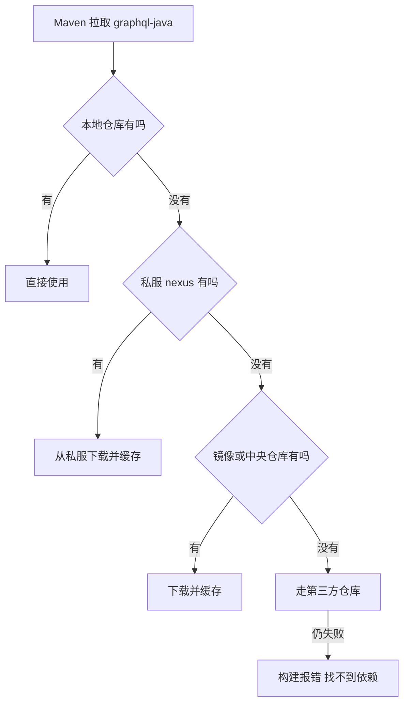

关键分支在镜像那一级：mirror 一旦把 `mirrorOf` 开成全量，中间各级仓库的分支就永远走不到。所以镜像和第三方仓库在配置上互斥，只能选 profile 这条路。

补一句现状：graphql-java 的正式版本如今已发布在 Maven 中央仓库，bintray 仓库也在 2021 年停止服务，上面那个 bintray 地址今天照抄只会失效。新工程直接引中央仓库的坐标即可。这段配置的真正价值在于通用规律：包不在中央仓库时，用 profile 挂仓库并在 activeProfiles 激活，而不是去动 mirrors。

### 准备 User 实体

后面两节的查询服务都以 `User` 为目标对象。在 `com.example.graphql.vo` 包下建实体类，提供无参和全参两个构造方法（按本课写法补全的示例）：

```java
package com.example.graphql.vo;

public class User {
    private Long id;
    private String name;
    private Integer age;

    public User() {
    }

    public User(Long id, String name, Integer age) {
        this.id = id;
        this.name = name;
        this.age = age;
    }

    public Long getId() { return id; }
    public void setId(Long id) { this.id = id; }
    public String getName() { return name; }
    public void setName(String name) { this.name = name; }
    public Integer getAge() { return age; }
    public void setAge(Integer age) { this.age = age; }
}
```

无参构造给反射和后续框架留门，全参构造在演示里可以直接 new 出带数据的对象。字段类型刻意选了 `Long` 和 `Integer`，与后面 Schema 里声明的 `Long`、`Int` 标量一一对应，避免取数时类型对不上。

到这里工程骨架就绪：pom 就位、依赖可下载、实体可用，下一节开始写第一个查询服务。

## 第8部分：第一个 graphql-java 查询服务：一层层 Builder 搭出 Schema 再执行

查询字符串 `{user{id,name}}` 写起来只要一行，但它要被执行，背后必须有一整套对象就位：`GraphQL` 需要 `GraphQLSchema`，Schema 需要根查询类型，根类型需要字段定义，字段定义又需要目标对象的类型描述。第一次写这段代码，最容易卡在「现在还缺什么」。这一节按 IDE 报错的推进顺序，把这套对象从里到外搭完整，跑通第一个支持按需返回的查询服务。

### 目标是什么

先用 Schema 定义语言把要实现的东西写清楚，后面每写一段 Java 代码都回来看一眼它的等价物：

```graphql
# 根查询类型声明
schema {
  query: UserQuery
}

# 定义查询的类型，user 字段返回 User 对象
type UserQuery {
  user: User
}

# 定义对象，! 表示该属性非空
type User {
  id: Long!
  name: String
  age: Int
}
```

这段 SDL 就是服务端的「菜单」：入口字段叫 `user`，返回一个 `User`，`User` 上挂 id、name、age 三个字段。客户端要哪几个字段，就在查询里点名哪几个。

### 从里往外搭：把 execute 的参数补齐

在 IDE 里从最终目标倒着写最顺：先写 `graphQL.execute(query)`，编译器提示缺 `GraphQLSchema`，写 Schema 又提示缺根查询类型，一层层补齐。最终版完整代码如下（`com.example.graphql.demo` 包，示例按本课写法补全）：

```java
package com.example.graphql.demo;

import com.example.graphql.vo.User;
import graphql.ExecutionResult;
import graphql.GraphQL;
import graphql.Scalars;
import graphql.schema.GraphQLFieldDefinition;
import graphql.schema.GraphQLObjectType;
import graphql.schema.GraphQLSchema;
import graphql.schema.StaticDataFetcher;

public class GraphQLDemo {
    public static void main(String[] args) {
        // type User { id: Long! name: String age: Int }
        GraphQLObjectType userObjectType = GraphQLObjectType.newObject()
                .name("User")
                .field(GraphQLFieldDefinition.newFieldDefinition().name("id").type(Scalars.GraphQLLong).build())
                .field(GraphQLFieldDefinition.newFieldDefinition().name("name").type(Scalars.GraphQLString).build())
                .field(GraphQLFieldDefinition.newFieldDefinition().name("age").type(Scalars.GraphQLInt).build())
                .build();

        // type UserQuery { user: User }
        GraphQLFieldDefinition userFieldDefinition = GraphQLFieldDefinition.newFieldDefinition()
                .name("user")
                .type(userObjectType)
                .dataFetcher(new StaticDataFetcher(new User(1L, "张三", 20)))
                .build();

        GraphQLObjectType userQueryObjectType = GraphQLObjectType.newObject()
                .name("UserQuery")
                .field(userFieldDefinition)
                .build();

        // schema { query: UserQuery }
        GraphQLSchema graphQLSchema = GraphQLSchema.newSchema()
                .query(userQueryObjectType)
                .build();

        GraphQL graphQL = GraphQL.newGraphQL(graphQLSchema).build();

        String query = "{user{id,name,age}}";
        ExecutionResult result = graphQL.execute(query);
        System.out.println("query: " + query);
        System.out.println(result.getErrors());
        System.out.println(result.getData());
        System.out.println(result.toSpecification());
    }
}
```

逐层拆开看，每一段 Builder 都对应 SDL 里的一行：

- **`GraphQLObjectType.newObject().name("User")`** 定义对象类型，等价于 `type User`，三个字段用 `Scalars` 里的标量类型逐一声明，Long、String、Int 都有现成的。
- **`GraphQLFieldDefinition.newFieldDefinition().name("user").type(userObjectType)`** 定义入口字段，等价于 `user: User`，返回类型就是刚定义的对象类型。
- **`newObject().name("UserQuery").field(userFieldDefinition)`** 把字段挂到根查询类型上，等价于 `type UserQuery { user: User }`。
- **`GraphQLSchema.newSchema().query(userQueryObjectType)`** 把根类型装进 Schema，等价于 `schema { query: UserQuery }`。
- **`GraphQL.newGraphQL(graphQLSchema).build()`** 生成执行器，`execute()` 才是真正干活的入口。

整条构建链画出来是这样：

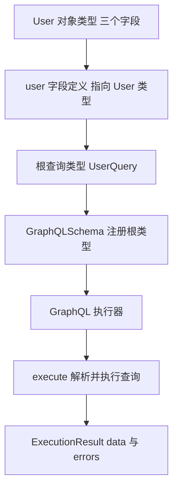

关键路径在 A 到 C：graphql-java 没有任何魔法，SDL 里一行 `user: User` 被拆成了三个 Builder 调用。看清这层对应关系，再复杂的类型定义也能按图索骥。

### 第一次运行的两个坎

**第一，字段名大小写对不上。** 最初把查询写成 `{User{id,name}}`，执行后 errors 里给出提示：`UserQuery` 类型上没有 `User` 这个字段。原因就是定义时 `.name("user")` 注册的是小写，查询却用了大写。GraphQL 的字段名区分大小写，两边必须完全一致，改成 `{user{id,name}}` 才能通过校验。

**第二，校验过了，data 却是 null。** 这是因为最初那版代码只完成了「定义」，没有告诉引擎数据从哪来。字段定义上必须绑一个 `DataFetcher`，最终版里的 `.dataFetcher(new StaticDataFetcher(new User(1L, "张三", 20)))` 就是补上的那一行。这个坑很隐蔽：不报错，只是 data 为 null。

跑通之后顺手验证按需返回：查询写 `{user{id,name,age}}` 返回三个字段，只写 `{user{id}}` 就只返回 id 一个字段。引擎按查询里的选择集裁剪结果，客户端点名要几个字段就给几个，这正是 GraphQL 的核心卖点。

### 标准输出：toSpecification

`getData()` 拿到的只是结果树，规范对响应结构另有要求：外层是一个对象，正常时包含 `data` 键，查询失败时换成 `errors` 键，两者不并存。`result.toSpecification()` 输出的就是这个标准结构：

```java
ExecutionResult result = graphQL.execute("{user{id,name,age}}");
// 正常时输出 {data={user={id=1, name=张三, age=20}}}
// 出错时输出 {errors=[...]}
System.out.println(result.toSpecification());
```

后续做 Web 服务时，把 `toSpecification()` 的结果序列化成 JSON 直接返回，就是规范的响应格式。讲义里把这些步骤拆成了 `createUserDefinition`、`createGraphqlSchema` 等独立方法，与一整段写完没有任何本质区别，只是代码组织形式不同。

## 第9部分：给 GraphQL 查询加上参数：GraphQLArgument 声明入参，DataFetchingEnvironment 取参

上一节的查询无论怎么执行都返回同一个 User，因为数据被 `StaticDataFetcher` 写死了。按 id 查用户是任何系统都绕不开的形态，REST 里对应 `/users/1` 这种路径参数，GraphQL 里则要三处配合：Schema 上声明参数、取数器里取参数、查询语句里传参数，三处的名字和类型必须严丝合缝。这一节把这条链完整打通。

### 给 user 字段声明 id 参数

参数和字段名、返回类型一样，都属于字段定义的一部分，用 `.argument()` 声明：

```java
/**
 * type UserQuery { user(id: Long): User }
 */
GraphQLFieldDefinition userFieldDefinition = GraphQLFieldDefinition.newFieldDefinition()
        .name("user")
        .type(userObjectType)
        .argument(GraphQLArgument.newArgument().name("id").type(Scalars.GraphQLLong).build())
        .dataFetcher(userDataFetcher)
        .build();
```

这段声明翻译回 SDL 就是 `user(id: Long): User`：入参名叫 `id`，类型是 `Long` 标量。声明只负责让 Schema 认识这个参数，真正消费参数的是 `DataFetcher`，两边靠参数名 `id` 对应。`GraphQLArgument` 还支持 `defaultValue`，给参数配上默认值后，客户端不传参时取数器拿到的是默认值而不是 null，适合可选过滤条件这类场景。

### dataFetcher 换成会取参的 lambda

`StaticDataFetcher` 无视一切参数，必须换掉。用 lambda 实现 `DataFetcher` 接口，入参 `DataFetchingEnvironment` 是引擎传给每个字段取数器的上下文对象（示例按本课写法补全，真实项目在此处查数据库）：

```java
// todo 模拟实现：实际应在此处根据 id 查询数据库
DataFetcher<User> userDataFetcher = environment -> {
    Long id = environment.getArgument("id");
    // 拿传入的 id 拼模拟数据，验证参数确实流通到了取数层
    return new User(id, "张三" + id, 20 + id.intValue());
};
```

`getArgument("id")` 返回 `Long`，正好传进 `User` 的全参构造。`DataFetchingEnvironment` 是引擎在每个字段执行时创建的上下文对象，除了取参数，还能拿到当前字段名、父对象、全局 Context 等信息，这里只用它最常用的取参能力。lambda 本质是匿名内部类的语法糖，JDK 8 以下编译不过，建工程后要把 Project Structure 里的 Language level 设成 `8 - Lambda, type annotations etc.`，否则连编译这一关都过不去。

### 查询端传参与运行验证

参数从查询语句一路流到取数器，链路如下：

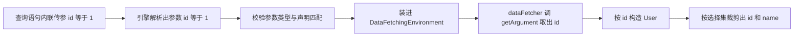

关键路径在 D 到 E 两步：参数从语句流入取数器，唯一的桥梁就是 `getArgument("id")` 里的这个名字。三种查询的运行结果把整条链验证了一遍：

- `{user{id,name,age}}` 不带参数：执行后 data 为 null，errors 里有取数失败的描述，因为取数器拿到的 id 是 null，逻辑没法工作。
- `{user(id:1){id,name}}`：返回 `id=1`、`name=张三1`，模拟数据随参数变化。
- `{user(id:100){id,name}}`：返回 `id=100`、`name=张三100`，同时按需返回依然生效，只要两个字段就只给两个字段。

传参还有另一种形态：变量。把参数值从语句里抽出来单独传，语句保持不变，客户端复用同一条语句查不同 id 时特别有用（graphql-java 主流写法，示例补全）：

```java
Map<String, Object> variables = new HashMap<>();
variables.put("id", 1L);

ExecutionInput input = ExecutionInput.newExecutionInput()
        .query("query getUser($id: Long) { user(id: $id) { id name } }")
        .variables(variables)
        .build();

ExecutionResult result = graphQL.execute(input);
```

语句里的 `$id` 是变量占位符，值随 `variables` 传入，执行效果与内联 `{user(id:1){...}}` 完全一致。

### 静态导入让样板更薄

`newObject()`、`newFieldDefinition()`、`newArgument()` 这类静态方法在 Builder 链里反复出现，本课最后把它们改成了静态导入：

```java
import static graphql.schema.GraphQLObjectType.newObject;
import static graphql.schema.GraphQLFieldDefinition.newFieldDefinition;
import static graphql.schema.GraphQLArgument.newArgument;
```

导入之后直接写 `newObject().name("User")...`，少一长串类名前缀，官方文档的示例也是这种写法。读别人代码时看到 `newObject()` 的裸调用，往静态导入上想就对了。

## 第10部分：把类型定义搬进 .graphqls 文件：用 SDL 构建 Schema

上一个 demo 里，一个只有三个字段的 `User` 类型就写了一整条 Builder 链：`newObject()` 定义对象、
`newFieldDefinition()` 定义字段、`newArgument()` 声明参数，再把它们逐层挂到根查询类型上。业务对象一多，
这种「定义代码」会比业务代码还长。graphql-java 提供了第二种构建方式：把类型定义写成一份
SDL（Schema Definition Language）文件，运行时读进来解析生成 Schema，官方也更推荐这种方式。

### SDL 文件：把「菜单」从代码里挪出去

在 `src/main/resources` 下新建 `user.graphqls`，内容就是前面几节反复出现的那份类型定义：

```graphql
schema {
    query: UserQuery
}

type UserQuery {
    user(id: Long): User
}

type User {
    id: Long!
    name: String
    age: Int
}
```

**第一，`schema` 块声明查询入口。** 它告诉引擎：客户端的查询从 `UserQuery` 这个类型开始。这一块不能省，
因为 graphql-java 在没有 schema 定义时默认找名为 `Query` 的根类型，而这里的根类型叫 `UserQuery`，
不声明就直接构建失败。

**第二，其余部分与之前手写的注释逐行对应。** `user(id: Long): User` 翻译成编程式就是
`newFieldDefinition().name("user").argument(...).type(userObjectType)` 那一长串。文件里写一行，
代码里省一行，这正是 SDL 的价值。

建议在 IDE 里装一个 GraphQL 插件，`.graphqls` 文件会有语法高亮和补全；不装也没关系，
它本质上就是一个文本文件，用任何编辑器都能编辑。

### 骨架不变，缺的只是那个 Schema

先把执行段搭出来，这段与编程式 demo 完全一致：

```java
public class GraphQLSDLDemo {

    public static void main(String[] args) throws IOException {
        // Schema 先置 null，下面几步把它换成 SDL 生成的
        GraphQL graphQL = GraphQL.newGraphQL(null).build();
        String query = "{user(id:100){id,name}}";
        ExecutionResult result = graphQL.execute(query);
        System.out.println("query:" + query);
        System.out.println(result.toSpecification());
    }
}
```

真正要解决的只有一件事：`newGraphQL(null)` 里的 null，换成由 SDL 文件构建出来的 `GraphQLSchema`。
`new SchemaGenerator().makeExecutableSchema()` 需要两个参数，点进去看签名一目了然：
一个是 `TypeDefinitionRegistry`（类型定义注册表，静态契约），一个是 `RuntimeWiring`（运行时装配，动态取数）。

### 两个参数逐个解决：先解析文件，再绑定取数

**第一，读文件、解析出类型注册表。** 读文件需要 commons-io 依赖：

```xml
<dependency>
    <groupId>commons-io</groupId>
    <artifactId>commons-io</artifactId>
    <version>2.6</version>
</dependency>
```

然后用类加载器从 classpath 取资源，交给 `SchemaParser` 解析：

```java
String fileName = "user.graphqls";
// 类加载器会到 resources 目录下找这个文件
String fileContent = IOUtils.toString(
        GraphQLSDLDemo.class.getClassLoader().getResource(fileName), "UTF-8");
// 解析 SDL 文本，得到类型定义注册表
TypeDefinitionRegistry typeRegistry = new SchemaParser().parse(fileContent);
```

`getResource` 走的是 classpath 查找，`src/main/resources` 下的文件编译后都在 classpath 里，
所以换个部署环境这段代码也不用改。

**第二，用 `RuntimeWiring` 绑定取数器。** SDL 声明了 `UserQuery` 上有个 `user` 字段，但没说数据从哪来，
这半边要在 Java 里补上：

```java
RuntimeWiring wiring = RuntimeWiring.newRuntimeWiring()
        // 第一个参数必须与 SDL 里的查询类型名一致
        .type("UserQuery", builder -> builder.dataFetcher("user", environment -> {
            Long id = environment.getArgument("id");
            return new User(id, "张三" + id, 20 + id.intValue());
        }))
        .build();
```

两个参数的分工值得记住：注册表回答「系统里有哪些类型」，wiring 回答「每个字段的数据从哪来」。
往后加一个业务对象，SDL 文件里补一个 type，wiring 里补一段 dataFetcher，两边按名字挂钩，
编程式那种层层嵌套的构建代码不再膨胀。这也是一条协作分割线：接口契约改文件，取数实现改代码，各改各的。

**第三，合成 Schema、包执行器。** 两份材料齐了，交给 `SchemaGenerator` 拼装：

```java
// 静态契约 + 动态取数，合成可执行 Schema
GraphQLSchema graphQLSchema = new SchemaGenerator().makeExecutableSchema(typeRegistry, wiring);
GraphQL graphQL = GraphQL.newGraphQL(graphQLSchema).build();
String query = "{user(id:100){id,name}}";
ExecutionResult result = graphQL.execute(query);
System.out.println("query:" + query);
System.out.println(result.toSpecification());
```

执行后输出 `{data={user={id=100, name=张三100}}}`。把查询改成 `{user(id:100){id,name,age}}`，
`age=120` 照样能取到：Schema 是按文件生成的，但按需裁剪、参数传递这些执行期的能力和编程式完全一样。

### 与编程式对比：换来的是什么

两种方式的产物都是 `GraphQLSchema`，差别在维护成本：

| 维度 | Java API 编程式 | SDL 文件式 |
|---|---|---|
| 类型定义位置 | Java 代码里一层层 Builder | `.graphqls` 文件 |
| 改一个类型 | 改代码重新编译 | 改文件即可 |
| 取数逻辑 | 字段定义上直接绑 | `RuntimeWiring` 统一绑定 |
| 官方态度 | 可用 | 推荐 |

整条构建链画出来是这样：

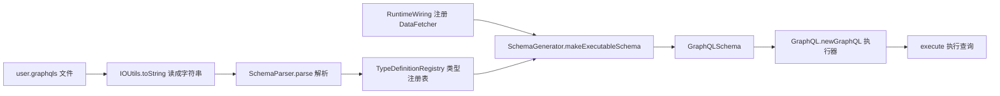

关键路径在 D 和 E 汇合到 F：`makeExecutableSchema` 这个方法名里的 executable 是点睛之笔，
单独的注册表只是「说明书」，单独的 wiring 只是「零件」，两份合在一起才是一个能跑的服务。

## 第11部分：User 里装一个 Card：GraphQL 对象嵌套与取数链路

前面几个 demo 里的 `User` 始终是孤零零一个对象，而真实业务里对象之间都有关系。拿最常见的场景做实验：
一个用户只有一个身份证号，`User` 与 `Card` 是一对一。把这种关系放进 GraphQL 服务，实体、SDL、取数三层
都要动，而且有一个反直觉的真相在等着：Schema 里声明了关系，查询时那个字段照样是 null。

### 实体层：一对一关系落到字段上

先建 `Card` 类，字段是身份证号和所属用户 id：

```java
package com.example.graphql.vo;

public class Card {
    private String cardNumber;
    private Long userId;

    public Card() {
    }

    public Card(String cardNumber, Long userId) {
        this.cardNumber = cardNumber;
        this.userId = userId;
    }

    // getter/setter 省略
}
```

再给 `User` 加关联字段。注意构造方法：原来的三参构造还有别的代码在用，新增四参版本而不是覆盖，
无参构造也要保留：

```java
public class User {
    private Long id;
    private String name;
    private Integer age;
    private Card card;

    public User() {
    }

    public User(Long id, String name, Integer age) {
        this.id = id;
        this.name = name;
        this.age = age;
    }

    public User(Long id, String name, Integer age, Card card) {
        this.id = id;
        this.name = name;
        this.age = age;
        this.card = card;
    }

    // getter/setter 省略
}
```

到这里只是 Java 对象层面有了关系，GraphQL 引擎对此一无所知。

### Schema 层：type Card 挂进 user.graphqls

SDL 里照实体补一个 `type Card`，再在 `User` 上加 `card` 字段，类型写成 `Card`，关系就声明完了：

```graphql
schema {
    query: UserQuery
}

type UserQuery {
    user(id: Long): User
}

type User {
    id: Long!
    name: String
    age: Int
    card: Card
}

type Card {
    cardNumber: String
    userId: Long
}
```

查询端可以一层层点下去：`{user(id:100){id,name,age,card{cardNumber,userId}}}`。子选择集用大括号，
这和 REST 拼字段参数的习惯完全不同，语法写错在校验阶段就会被拦下来。

### 第一次运行：null 和报错把真相暴露出来

跑 `{user(id:100){id,name,age,card{cardNumber,userId}}}`，第一版代码大概率连运行都过不了：
改造 `User` 时动了构造方法，取数器里还在调旧签名，编译期就报构造函数缺失。把三参、四参、无参
构造都补齐，程序能跑了，结果却是：

```text
{data={user={id=100, name=张三100, age=120, card=null}}}
```

**card 是 null。** 这一步最值得停下来想清楚：SDL 里明明声明了 `card: Card`，为什么查不出来？
因为 Schema 只是一份静态契约，它规定「User 上有一个 card 字段，类型是 Card」，但从不负责把这个字段的
值变出来。取数逻辑与类型定义是两件事，关系声明得再漂亮，没人给数据就是 null。

### 在取数器里把 Card 备好

修复方式与顶层字段一样：让数据在 Java 里真实存在。改造 `RuntimeWiring`，构造 User 的同时把 Card
一起带上（示例按本课写法补全，真实项目在此处调 Service 查库）：

```java
RuntimeWiring wiring = RuntimeWiring.newRuntimeWiring()
        .type("UserQuery", builder -> builder.dataFetcher("user", environment -> {
            Long id = environment.getArgument("id");
            // 关联数据必须自己准备，GraphQL 引擎不会替你做关联查询
            Card card = new Card("123456789", id);
            return new User(id, "张三" + id, 20 + id.intValue(), card);
        }))
        .build();
```

再跑一遍同样的查询，输出：

```text
{data={user={id=100, name=张三100, age=120, card={cardNumber=123456789, userId=100}}}}
```

按需裁剪依然生效：只查 `{user(id:100){id,name,card{cardNumber}}}` 就只返回身份证号；
把 card 子选择集整个去掉，查询退回普通的 User 查询，与改造前完全一致。

### 执行链路：嵌套字段是怎么被取出来的

把一次嵌套查询的执行过程画出来：

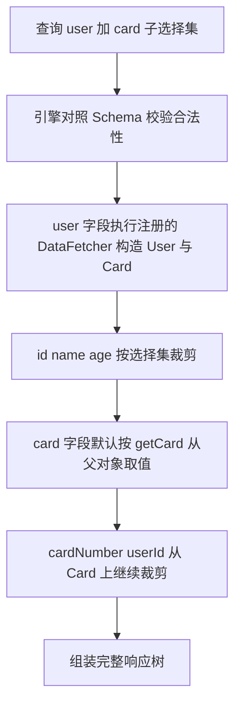

关键在 E 这一步：没有为 `card` 字段显式注册 DataFetcher 时，graphql-java 的默认行为是拿父对象上的
属性值（属性名与字段名对应），所以只要 `User.getCard()` 返回了对象，嵌套字段自然有数据。
这也解释了为什么实体上必须写 getter：默认取数器靠它工作。

对照 REST 看这次改造的价值：同样的「用户加身份证」数据，REST 客户端要请求 `/user/1` 拿用户，
再请求 `/user/1/card` 拿身份证，两次往返两个接口；GraphQL 一条查询一次往返，字段还随选随裁。
数据没变少，变少的是请求次数和交互成本。

## 常见误区

- **把 GraphQL 当成 SQL 或图数据库的查询语言**：SQL 面向数据库，Cypher、Gremlin 面向图数据库，GraphQL 面向 API，运行在服务端的类型系统之上，背后接 MySQL、MongoDB 还是第三方接口都无所谓。

- **以为学了查询就等于学完**：查询只是规范的一半，操作类型里还有变更数据的部分；类型系统、变量、指令、片段都是动手前要建立的概念，直接上手写接口容易只学到语法皮毛。

- **认为 GraphQL 会立刻取代 RESTful**：REST 依旧是优秀且主流的接口规范，GraphQL 的类型系统、解析器与工具链都要投入成本，小项目硬上反而负担更重。它是多一个选项，不是一纸判决。

- **以为服务端必须按查询原样实现每个字段**：查询裁剪发生在服务端执行层，按查询中出现的字段逐个解析取值，没出现的字段根本不查库。前端的字段主权不意味着后端失控，类型系统保证了什么能查、什么不能查。

- **把过度获取归咎于接口设计水平**：字段固定是 RESTful 资源模型的固有特征，不是哪个人写接口不上心。只要字段由服务端统一决定，这个问题就会存在。

- **以为给每个页面定制接口就能解决**：页面想要什么就开一个精简版接口，接口数量随页面膨胀，后端维护成本失控，这是典型的用堆接口掩盖模型问题。

- **以为聚合接口能根治不足获取**：后端把多个资源拼进一个大接口确实能减少请求次数，但每个页面一个聚合接口，字段组合稍有不同就得再开一个，最终又回到接口爆炸。

- **以为 RESTful 要被淘汰了**：本课分析问题不等于宣判死刑，简单场景下 RESTful 依旧是最优解，GraphQL 是在字段灵活性和请求合并上多给出一个选项。

- **以为响应字段可以随意索取**：字段必须在服务端的类型定义里声明过，查询里写一个不存在的字段，校验阶段直接报错，不是返回空值。自由是「在类型系统范围内自由」。

- **以为不要版本号就永远不会破坏兼容**：新增字段天然兼容，但删除字段、修改字段含义依然会伤到老查询，正规做法是用 `@deprecated` 渐进废弃，给使用方迁移时间。

- **以为一次查询拿全就没有服务端代价**：响应合并了，服务端取数压力还在，嵌套查询处理不好会退化成数据库的 N 加 1 查询，实现层需要做批量取数设计。

- **把三个卖点当成相互独立的技巧**：它们是同一套类型系统的三种表现，脱离类型系统单独模仿任何一条都做不成。

- **以为别名只是「换个好看的显示名」**：别名的本职是解决同层键名冲突，没有别名，一次查询两个同类对象在语法上就不成立；同时它也让前端取数的键名与业务语义对齐。

- **以为参数只能传一个**：参数是名值对列表，可以写多个，逗号或空格分隔，`user(id: 1000, status: ACTIVE)` 这样的写法完全合法。

- **片段当字符串拼接用**：片段必须定义在某个类型上（`on Character`），只能在类型匹配的位置展开，它是带类型约束的字段集合，不是随处可贴的文本块。

- **把查询文档当 URL 拼参数**：REST 的习惯是往查询字符串里塞条件，GraphQL 的习惯是把条件写成小括号参数、把需求写成选择集，结构化的文档才是它的正文。

- **把 `Int` 直接当 Java 的整型家族用**：规范的 `Int` 只有 32 位，超过 `Integer` 范围的数值（如雪花算法 ID）要用 `ID` 类型或实现层扩充的 `Long`，硬塞 `Int` 会溢出。

- **以为 `ID` 一定是整数**：`ID` 会被序列化成字符串，语义是唯一标识符，不是数值类型，拿它做算术本身就是设计错误。

- **忽略 `!` 的位置差异**：`[Episode]`、`[Episode]!`、`[Episode!]!` 是三个不同的类型，列表可空性、元素可空性分别由方括号内外控制，写错一个位置，空指针就从运行期挪到了意想不到的路径上。

- **把 SDL 当成某门编程语言**：SDL 只是接口定义语言，描述数据形状，没有逻辑；执行靠各语言的实现库把 Schema 与解析器接起来，只有 Schema 什么也跑不起来。

- **把 graphql-java 当成 HTTP 框架。** 引入依赖后就等浏览器访问接口，永远不会发生。它只是执行引擎，对外服务要么自己写 Controller 接收查询语句再调 `execute()`，要么引入配好 Web 层的整合方案。

- **文档看错站。** 在 GraphQL 规范官网里找 Java API，或者在 graphql-java 官网里找规范定义，两边内容都对不上。规范看 `graphql.org`，Java 用法看 `graphql-java.com`。

- **把 StaticDataFetcher 当成常规取数方式。** 它只适合演示，生产里字段取数要自己实现 DataFetcher，去调用 Service 或数据库。

- **把第三方仓库配进 `<mirrors>`。** mirror 会劫持匹配仓库的全部请求，镜像上没有的包永远拉不到；第三方仓库只能配在 profile 的 `<repositories>` 里。

- **配了 profile 忘了激活。** `<profile>` 只是声明，不在 `<activeProfiles>` 里点名，等于没配，症状依旧是下载失败。

- **今天还去配 bintray。** 该仓库已停止服务，照抄旧地址只会失败，直接用中央仓库的坐标。

- **实体字段类型随手写。** id 写成 `int` 而后面 Schema 声明 `Long`，拼数据时类型对不上，排查起来很绕；实体类型要提前和 Schema 标量对齐。

- **查询里的字段名大小写随意写。** 注册 `user` 却查 `User` 会直接进 errors，报错信息里会写清哪个类型上没有哪个字段，对着提示改就好。

- **以为搭完 Schema 就能查出数据。** Schema 只描述形状，没绑 DataFetcher 的字段一律返回 null，而且不报任何错误。

- **把 getData() 的返回当最终响应。** 它只是结果树，对外输出应当用 `toSpecification()`，否则客户端拿不到统一的 errors 错误通道。

- **Builder 链里漏掉 `.build()`。** 嵌套链一长就容易漏内层那一把，编译期表现为类型不匹配，写的时候每层链尾都检查一遍。

- **取参名与声明名对不上。** 声明时 `.name("id")`，取参却写 `getArgument("Id")`，拿到 null，随后拼数据就抛空指针。参数名是两边唯一的约定，必须逐字符一致。

- **编译级别低于 Java 8。** lambda 直接编译失败，报的不是业务错误而是语法错误，容易误判成依赖问题；IDEA 的 Language level 和编译器设置都要检查。

- **把必填约束寄托在代码判断上。** 参数未声明非空时客户端可以不传，`getArgument` 返回 null。要强制必填应把类型包成 `new GraphQLNonNull(Scalars.GraphQLLong)`，SDL 写作 `id: Long!`，缺参在校验阶段就被拒绝。

- **字面量类型不匹配。** 写成 `{user(id:"1"){...}}`，把字符串传给 `Long` 参数，类型转换失败进 errors。数字参数不要加引号。

- **`RuntimeWiring` 里的类型名写错。** `.type("User", ...)` 或 `.type("Query", ...)` 都对不上 SDL 里的
  `UserQuery`，生成 Schema 时直接抛 SchemaProblem；类型名和字段名必须与文件逐字符一致。

- **文件放错位置或后缀随手起。** 必须放在 classpath 能找到的地方（约定放 `src/main/resources`），
  用 `getResource` 读取；写成 `D:/xxx/user.graphqls` 这种绝对路径，换个环境就崩。

- **漏掉 commons-io 依赖。** `IOUtils` 编译不过时容易误判成代码写错，先确认依赖真的引入了。

- **子选择集写成圆括号。** `card(cardNumber,userId)` 是语法错误，嵌套字段必须用大括号
  `card{cardNumber,userId}`，引擎在校验阶段直接拒绝。

- **改造实体时把旧构造方法覆盖掉。** 其他代码还依赖三参构造，一删全炸；加新构造、留无参构造，才是安全姿势。

- **嵌套层级深就放心往深写。** 每层嵌套都会触发对应字段的取数逻辑，写不好会出现一次查询打一百次
  数据库的 N+1 问题，生产环境要配合 DataLoader 做批量取数。

## 面试可能被问到的问题

1. 面试官追问：「GraphQL 和 RESTful 的核心区别是什么？」
   答：REST 按资源拆分多个端点，响应字段由服务端固定，一屏数据常要多次请求；GraphQL 收拢为单一端点，字段由客户端在查询文档里按需声明，服务端按声明执行并返回同构结果。一个把数据形状的决定权给服务端，一个交给客户端。

2. 面试官追问：「什么是过度获取和不足获取？」
   答：过度获取指接口返回的字段多于页面实际需要的，带宽与解析都白白消耗；不足获取指单个接口给不齐一屏数据，前端被迫发多次请求拼装。GraphQL 用按需字段解决前者，用一次请求沿引用深入解决后者。

3. 面试官追问：「单一端点下服务端怎么区分客户端要什么？」
   答：端点收到的请求体是一份查询文档，文档里写明操作类型与字段选择集，服务端依据类型系统解析文档、逐字段执行解析器。多个操作可以靠操作名区分，路由的概念从 URL 层移到了文档内部。

4. 面试官追问：「类型系统在 GraphQL 里起什么作用？」
   答：它既是契约也是文档。服务端用类型描述能提供的数据，客户端的查询在执行前就经过校验，字段写错直接报错而不是返回 undefined；配合工具还能自动获得补全与文档浏览。接口演进时新增字段不影响老查询，兼容性由类型系统兜底。

5. 面试官追问：「GraphQL 是 Facebook 提出的吗，为什么开放规范？」
   答：是。Facebook 移动应用从 2012 年开始在内部使用 GraphQL 解决移动端的取数效率问题，2015 年将规范公开，随后社区推出各语言实现。开放规范让它在 Facebook 之外的产品与团队里扩散，GitHub、Twitter、Airbnb 等都是公开的使用者。

6. 面试官追问：「项目里要引入 GraphQL，你会评估哪些成本？」
   答：服务端要搭建 schema 与每个字段的解析器，N 加 1 查询问题需要批量取数手段配合；团队要接受一套新的思维与工具链；缓存策略与 REST 的 URL 缓存不同，需要重新设计。收益端则是字段按需、请求合并与接口即文档，数据关系复杂、终端多样的业务更划算。

7. 面试官追问：「RESTful 有哪些公认的不足？」
   答：主要有两点。一是过度获取，响应字段由服务端固定，客户端只想要部分字段也必须全量接收，浪费带宽；二是不足获取，数据分散在多个资源时，一个需求要发多次请求才能凑齐，延迟叠加、前端聚合逻辑复杂。

8. 面试官追问：「过度获取的危害具体体现在哪里？」
   答：最直接的是服务端到客户端的传输带宽浪费，响应体越大传输越慢；其次客户端要解析并丢弃无用字段；在移动端弱网环境下，这些冗余会被成倍放大。列表类接口因为数据量大，受害最明显。

9. 面试官追问：「为什么不直接在后端把接口合并起来解决多次请求的问题？」
   答：聚合接口能减少往返次数，但它是按页面定制的一次性方案，不同页面的字段组合不同，就得开不同的聚合接口，接口数量失控且复用性差。GraphQL 把聚合的权力交给查询文档，客户端在一份文档里声明所有需要的资源，服务端按声明返回，不再需要为每个页面单独开发聚合接口。

10. 面试官追问：「既然有这些问题，为什么 RESTful 依然是主流？」
   答：RESTful 语义清晰、生态成熟、缓存友好，绝大多数简单增删改查场景下它的成本最低。上述问题集中在字段需求多样、数据关系复杂的场景，这时候 GraphQL 的按需索取和一次聚合才有明显优势。两者是互补选项，不是替代关系。

11. 面试官追问：「GraphQL 怎么针对性地解决这两个问题？」
   答：针对过度获取，它让响应结构与请求结构同构，查询里写几个字段就返回几个字段；针对不足获取，它把多个资源的取数合并进一份查询文档，服务端沿对象引用一次性返回。两个能力都建立在服务端的类型系统之上。

12. 面试官追问：「GraphQL 的按需索取是怎么实现的？」
   答：客户端在查询文档里显式声明所需字段，服务端按声明逐字段执行解析器，只对查询中出现的字段取数，响应结构与查询结构同构。字段没有在查询里出现，服务端根本不会去查它，从机制上杜绝了过度获取。

13. 面试官追问：「一次查询多个数据，和后端做一个大而全的聚合接口有什么区别？」
   答：聚合接口的字段组合是服务端定死的，页面需求一变就要改接口或新开接口；GraphQL 的查询文档由客户端自由组合字段，嵌套层级也随文档走，一份类型系统支撑所有页面的组合方式，服务端不用为每种组合维护接口。

14. 面试官追问：「为什么说 GraphQL 的 API 演进无需划分版本？」
   答：响应内容由客户端的查询决定，服务端新增字段不影响老查询的返回结果；废弃字段用 `@deprecated` 标记后可以长期共存，逐步引导迁移。整个过程没有破坏性变更，版本号并行维护的负担就不存在了。

15. 面试官追问：「GraphQL 官方总结的核心优势有哪几条？」
   答：请求所需的数据不多不少，杜绝冗余；获取多个资源只用一个请求；所有数据由一套完整且易读的类型描述驱动，接口自身就是文档；依托类型系统可以构建强大的开发者工具，如查询补全与调试。

16. 面试官追问：「GraphQL 查询的响应为什么能和请求结构保持一致？」
   答：规范要求请求的选择集就是预期结果的结构，服务端按选择集逐字段执行并组装响应，两边同构。写查询时看到什么字段，响应里就有什么字段，接口文档的作用被查询本身承担了。

17. 面试官追问：「别名的使用场景是什么，不用会怎样？」
   答：一次查询里要对同一个字段发起多次请求、参数不同时使用。不使用别名，响应同一层的 JSON 会出现重复键，违反 JSON 语法，查询无法成立。别名写在字段前面，响应中直接以别名作为键名。

18. 面试官追问：「片段和直接复制粘贴字段相比，好处在哪里？」
   答：片段把公共字段集收敛到一处定义，用 `...片段名` 在多个查询位置展开，修改字段集只改一处；片段还带类型约束（`on Character`），只能在匹配类型上展开，有校验保障。它和 MyBatis 的 SQL 片段是同一种复用思路。

19. 面试官追问：「GraphQL 的参数和 REST 的查询参数有什么不同？」
   答：REST 的参数散落在 URL 和查询字符串里，表达力受限于 URL 设计；GraphQL 的参数以名值对写在字段后面，类型由 Schema 约束，查询执行前就做类型校验，参数错误在请求阶段即报错，不会带病执行。

20. 面试官追问：「GraphQL 规范里还有哪些查询相关的能力是入门后要补的？」
   答：操作名称用于区分一份文档里的多个操作，变量让参数可以动态传入而不必拼在文档里，指令按条件包含或跳过字段，变更（mutation）负责写操作，内嵌片段支持在片段内部继续使用片段。这些都写在官方「查询和变更」章节，按需查阅。

21. 面试官追问：「GraphQL 的 Schema 里定义了什么？」
   答：定义服务端的数据结构，包括有哪些对象类型、每个对象有哪些字段及字段类型、对象之间的关联关系，以及查询入口（`Query`）和变更入口（`mutation`）。它是服务端对外的数据契约，客户端查询的合法性由它校验。

22. 面试官追问：「GraphQL 规范默认提供哪几种标量类型？」
   答：五种：`Int` 有符号 32 位整数，`Float` 有符号双精度浮点，`String` UTF-8 字符序列，`Boolean` 布尔值，`ID` 唯一标识符，常用于重新获取对象或做缓存键。规范支持自定义标量，Java 实现一般会补充 `Long`、`Byte` 等。

23. 面试官追问：「`ID` 类型和 `String` 有什么区别？」
   答：语义上的区别。`ID` 表示唯一标识符，用于定位对象或做缓存键，序列化为字符串，客户端不应解析它的内部结构；`String` 就是一般的文本。用 `ID` 表达了「这个字段是主键式的标识」这一设计意图，也给了实现优化空间。

24. 面试官追问：「GraphQL 的接口和 Java 的接口像在哪？」
   答：都定义一组必须满足的成员。GraphQL 接口声明必须存在的字段，实现类型用 `implements` 承接后必须包含全部接口字段，并可以扩充自己的字段，例如 `Human` 和 `Droid` 都实现 `Character` 又各自携带专属字段。区别是 GraphQL 接口约束的是数据字段而非方法行为。

25. 面试官追问：「`String`、`String!`、`[String!]!` 分别是什么意思？」
   答：`String` 可空字符串；`String!` 非空字符串，服务端保证返回值存在；`[String!]!` 是非空列表且列表内每个元素都非空。感叹号紧跟类型约束元素，跟在方括号后约束列表本身，位置不同语义完全不同。

26. 面试官追问：「学完规范为什么还不能直接开发 GraphQL 服务？」
   答：规范只定义了语法和类型系统，没有可运行的代码。真正提供服务要选择一门语言的实现库，把 Schema 映射到具体的解析器并接入数据源，还要处理嵌套查询的取数效率。规范是设计图，实现才是施工，课程把规范放在实现之前讲，是为了动手时每一步都知道在做什么。

27. 面试官追问：「GraphQL 在 Java 生态里用什么实现？」
   答：主流是 graphql-java，它不是 GraphQL 官方直接维护的实现，而是第三方团队开发、被官方推荐的项目，Maven 坐标 com.graphql-java:graphql-java，MIT 协议开源，另有少量其他实现可作为补充了解。

28. 面试官追问：「GraphQLSchema、DataFetcher、GraphQL 三者是什么关系？」
   答：GraphQLSchema 描述类型系统，回答能查什么；DataFetcher 绑定在每个字段上，回答数据从哪来；GraphQL 是执行引擎，解析执行查询，把各字段 DataFetcher 的产出组装成 ExecutionResult。三者缺一不可。

29. 面试官追问：「graphql-java 能直接对外提供 HTTP 接口吗？」
   答：不能，它只负责解析、校验和执行查询。要对外服务需要自己加一层 Web 壳，比如写 Controller 接收查询语句和变量后调用 execute，或者引入 Spring 生态的整合方案。

30. 面试官追问：「构建 Schema 有哪两种方式，怎么选？」
   答：SDL 先行是先用 Schema 定义语言写文件或字符串，经 SchemaParser 解析后配合 RuntimeWiring 生成可执行 Schema；代码先行是直接用 Builder API 逐个构建对象类型与字段。前者利于文档化和前后端协作，后者调试直观，工程里常常混合使用。

31. 面试官追问：「ExecutionResult 里有什么？」
   答：核心是 data 和 errors 两部分，data 是按查询选择集组装的结果树，errors 是校验与执行过程中的错误列表。规范要求响应里必须有 data 键，出错时同时给出 errors，toSpecification 方法输出的就是这种标准结构。

32. 面试官追问：「Maven 的 mirror 和 repository 有什么区别？」
   答：repository 是仓库本身，Maven 会按顺序尝试从本地仓库和各 repository 拉取构件；mirror 是某个仓库的替身，请求不发到原仓库而是改道镜像。mirrorOf 写成 * 时接管所有仓库请求，会让其余 repository 配置失效。

33. 面试官追问：「依赖下载失败，你的排查思路是什么？」
   答：先核对坐标与版本是否写对；再看本地仓库有没有 .lastUpdated 残留文件，有就删掉重下；然后检查 settings.xml 的 mirror 是否拦截了目标仓库，必要时把仓库挪进 profile 并在 activeProfiles 激活；最后确认私服或镜像上确实存在该构件。

34. 面试官追问：「settings.xml 里的 profile 和 pom 里的 profile 有什么不同？」
   答：settings.xml 的 profile 描述本机环境相关内容，典型是仓库地址，作用于当前用户的所有工程；pom 里的 profile 随工程走，能控制依赖与插件，按构建条件触发。仓库类配置应放 settings.xml，避免污染工程文件。

35. 面试官追问：「为什么公司里一般都搭 Maven 私服？」
   答：私服充当中央仓库的缓存和内部构件的发布点，加速下载、节省外网带宽，也能托管不便公开的第三方包。配置时把私服排在前面，中央仓库没有的包才有机会从私服或后续第三方仓库获取。

36. 面试官追问：「用 graphql-java 从代码构建一个可执行的查询服务，需要哪几步？」
   答：先用 GraphQLObjectType.newObject 定义业务对象类型与各字段标量类型；再用 GraphQLFieldDefinition 定义查询入口字段并绑定 DataFetcher；把入口字段挂到根查询类型上；用 GraphQLSchema.newSchema().query 设置根类型生成 Schema；最后 GraphQL.newGraphQL 包成执行器，调 execute 执行查询字符串。

37. 面试官追问：「Schema 定义和 DataFetcher 分别负责什么？」
   答：Schema 是静态契约，声明有哪些类型和字段，负责在执行前校验查询合法性；DataFetcher 是动态取数逻辑，负责在执行期真正产出数据。两者在字段级别绑定，缺前者查询过不了校验，缺后者查出来是 null。

38. 面试官追问：「查询里写了不存在的字段会怎样？」
   答：执行前的校验阶段就会失败，ExecutionResult 的 errors 里给出具体哪个类型上不存在该字段，不会触发任何 DataFetcher。错误前置且信息精确，是 GraphQL 相比 REST 的一个工程优势。

39. 面试官追问：「GraphQL 的按需返回是怎么实现的？」
   答：客户端查询语句里带有字段选择集，引擎解析后只对选择集内的字段执行取数和组装，未点名的字段既不取数也不出现在响应里。相比 REST 固定返回整个资源对象，传输量与后端开销都随选择集伸缩。

40. 面试官追问：「ExecutionResult 的标准响应结构是什么？」
   答：规范要求外层是一个对象，正常时包含 data 键，值为按选择集组装的结果树；出错时包含 errors 键，值为错误列表。toSpecification 方法输出的就是该结构，可直接序列化为 JSON 返回给客户端。

41. 面试官追问：「DataFetchingEnvironment 能拿到哪些信息？」
   答：除了 getArgument 取参数，还能拿到当前字段名、父类型、执行上下文 Context、字段选择集以及 DataLoader 环境等。批量场景里配合 DataLoader 解决 N+1 查询问题，也要靠这个上下文对象。

42. 面试官追问：「怎么声明一个必填参数？」
   答：把参数类型包上 GraphQLNonNull，例如 new GraphQLNonNull(Scalars.GraphQLLong)，SDL 写作 id: Long!。这样缺参在查询校验阶段就被拒绝，不会等到取数器里才发现 null。

43. 面试官追问：「内联参数和变量 variables 该用哪种？」
   答：调试和简单场景用内联字面量；生产客户端应使用变量，语句固定、参数值动态传入，同一条语句可以被缓存复用，也避免字符串拼接带来的注入风险。服务端用 ExecutionInput 的 variables 接收。

44. 面试官追问：「lambda 版 DataFetcher 和实现接口的独立类各适合什么场景？」
   答：一两行的小逻辑用 lambda 最紧凑；逻辑复杂、需要依赖注入或要单独做单元测试的字段，建议抽成独立类实现 DataFetcher 接口，便于复用和管理。两者最终都注册到字段定义上，没有本质区别。

45. 面试官追问：「`makeExecutableSchema` 的两个参数分别承担什么职责？」
   答：`TypeDefinitionRegistry` 是 SchemaParser 解析 SDL 文件得到静态类型契约，声明有哪些类型、字段和参数；`RuntimeWiring` 是运行时装配，把每个类型的字段绑到具体的 DataFetcher 上。生成器把两者合成可执行的GraphQLSchema，前者管校验，后者管取数。

46. 面试官追问：「SDL 方式和 Java API 方式怎么选？」
   答：类型少、教学或原型场景用编程式直观；生产项目类型众多，用 SDL 文件把契约独立出来，修改类型不用动取数代码，也方便与前端共享接口文档，官方推荐 SDL。

47. 面试官追问：「`.graphqls` 文件里的 `schema { query: UserQuery }` 能省略吗？」
   答：当且仅当根查询类型名为默认的 Query 时可以省略，引擎会按约定找 Query 类型。本例根类型叫UserQuery，必须显式声明，否则 Schema 生成阶段就报找不到查询类型。

48. 面试官追问：「SDL 文件放在哪里、怎么读最稳妥？」
   答：放在 `src/main/resources` 下随 jar 一起打包，运行时通过 `getClassLoader().getResource` 从classpath 读取，配合 commons-io 的 IOUtils 转字符串。不要用文件系统绝对路径，否则换环境即失效。

49. 面试官追问：「多个 SDL 文件的类型定义能合并吗？」
   答：可以。TypeDefinitionRegistry 支持合并，多次调用 parse 后用 merge 把注册表拼起来，大型项目常按业务域拆成多个 `.graphqls` 文件再统一加载。

50. 面试官追问：「GraphQL 的对象嵌套是怎么执行的？」
   答：查询被解析成一棵字段树，引擎沿树逐字段执行：顶层字段跑注册的 DataFetcher，嵌套字段在没有显式注册时走默认的属性取数器，从父对象上按字段名读属性。所以嵌套数据要么提前装进父对象，要么为该字段单独注册取数器。

51. 面试官追问：「GraphQL 会自动做关联查询吗？」
   答：不会。它只负责按 Schema 校验并裁剪形状，关联数据完全由取数逻辑自己实现，该调 Service 调 Service，该查缓存查缓存。Schema 声明关系与数据来源是解耦的。

52. 面试官追问：「一对多关系在 SDL 里怎么表达？」
   答：字段类型写成列表，例如 `type User { cards: [Card] }`，Java 实体对应 `List<Card>`，取数器返回集合即可，查询端照常在子选择集里点名要的字段。

53. 面试官追问：「嵌套查询的 N+1 问题是什么，怎么解？」
   答：列表场景下每个元素的嵌套字段各触发一次取数，一次查询放大成 N 次数据源访问。解法是用 DataLoader 把同一批字段的取数请求合并、批量查库再分发，graphql-java 原生支持。

54. 面试官追问：「和 REST 下聚合接口比，GraphQL 嵌套好在哪里？」
   答：REST 的聚合要么后端为每种页面写死一个聚合接口，要么客户端多次请求自己拼；GraphQL 由客户端在一条查询里按需声明层级和字段，后端一套 Schema 支撑多种页面，接口数量不随页面增长。

## 配套资料

- 本教学日资料包未收录源码与讲义（`materials/code/03/day05-阿里云OSS以及GraphQL入门/` 下仅存清单文件，`materials/docs/03/` 无本日讲义），本课内容为概念篇：GraphQL 查询与响应示例取自本课画面所引的 GraphQL 官网，REST 对照片段为按常规写法补全的示例。

- GraphQL 服务端的具体开发（schema、解析器、服务搭建）见本章后续教学日的成稿，动手前先过一遍这篇概念课的类型系统与查询要点。

- 本教学日资料包未收录源码与讲义（`materials/code/03/day05-阿里云OSS以及GraphQL入门/` 下仅存清单文件，`materials/docs/03/` 无本日讲义），文中的 RESTful 请求与响应示例为按本课画面写法补全的示例，GraphQL 的定义引自本课画面所引的 GraphQL 官方规范中文站。

- RESTful 与 GraphQL 的总体对比见上一篇成稿，本课的两个问题在后两篇成稿（GraphQL 的三个卖点、查询规范）中逐条给出解法。

- 本教学日资料包未收录源码与讲义（`materials/code/03/day05-阿里云OSS以及GraphQL入门/` 下仅存清单文件，`materials/docs/03/` 无本日讲义），文中的查询与响应示例、`Film` 与 `Character` 类型定义均取自本课画面所引的 GraphQL 官网与规范中文站，为按本课写法补全的示例。

- 按需索取与一次聚合对应的查询语法细节，见下一篇成稿「GraphQL 查询的规范」；类型系统的完整规范见下一篇后的 Schema 与类型一课。

- 本教学日资料包未收录源码与讲义（`materials/code/03/day05-阿里云OSS以及GraphQL入门/` 下仅存清单文件，`materials/docs/03/` 无本日讲义），文中示例取自本课画面所引的 GraphQL 官网「查询和变更」章节（`graphql.cn/learn/queries/`），为按本课写法补全的示例。

- 参数与别名的实战用法会在后续「开发 GraphQL 服务」教学日的成稿中落地，本课先建立语法认知。

- 本教学日资料包未收录源码与讲义（`materials/code/03/day05-阿里云OSS以及GraphQL入门/` 下仅存清单文件，`materials/docs/03/` 无本日讲义），文中的 Schema、枚举与接口示例取自本课画面所引的 GraphQL 官网「Schema 和类型」章节，为按本课写法补全的示例；变量默认值一句为规范内容的补充示例。

- Schema 与解析器的具体落地见下一教学日「开发 GraphQL 服务」的成稿，本课的规范是那节课的语法前提。

- 本课资料包未提供源码工程（`materials/code/03/day05-阿里云OSS以及GraphQL入门/` 解压后无代码文件），文中 hello world 为按本课写法补全的官网入门示例。

- 后续 GraphQL 服务实战使用的项目数据库脚本在 `materials/code/03/day06-开发GraphQL服务以及前台系统搭建/day06-开发GraphQL服务以及前台系统搭建/资料/myhome.sql`。

- 本课资料包未提供源码工程（`materials/code/03/day05-阿里云OSS以及GraphQL入门/` 解压后无代码文件），pom、`settings.xml` 片段与 `User` 实体均为按本课写法补全的示例。

- 本课资料包未提供源码工程（`materials/code/03/day05-阿里云OSS以及GraphQL入门/` 解压后无代码文件），`GraphQLDemo` 为按本课写法补全的可运行示例。

- 本课资料包未提供源码工程（`materials/code/03/day05-阿里云OSS以及GraphQL入门/` 解压后无代码文件），示例为按本课写法补全的可运行版本。

- 本课资料包未提供源码工程（`materials/code/03/day05-阿里云OSS以及GraphQL入门/` 解压后无代码文件），
  `GraphQLSDLDemo` 与 `user.graphqls` 为按本课写法补全的可运行示例。

- 本课资料包未提供源码工程（`materials/code/03/day05-阿里云OSS以及GraphQL入门/` 解压后无代码文件），
  `User`、`Card` 与 SDL 文件为按本课写法补全的可运行示例。
