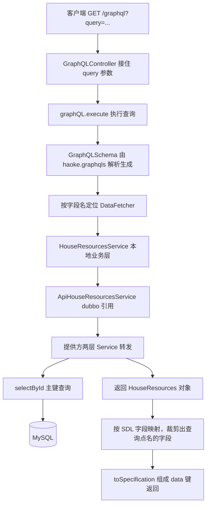

# 把房源查询 GraphQL 化：haoke.graphqls、GraphQLProvider 与贯穿 Dubbo 的取数链

按 id 查房源的 Dubbo 服务已经就位，但浏览器和前端发不了 dubbo 调用，中间还缺一层能把 HTTP 请求翻译成查询、再按需返回字段的门面。这一篇就把这层搭出来：一份 SDL 契约文件、一个接收查询语句的 Controller、一个负责装配的 Provider，底下的数据照旧走 Dubbo，一层不动。

## 先给结论

- api 工程加两个依赖：`com.graphql-java:graphql-java:11.0` 提供 GraphQL 引擎，dubbo 接口模块提供 `ApiHouseResourcesService` 契约。
- SDL 文件 `haoke.graphqls` 放在 `src/main/resources`：根查询类型 `HaokeQuery` 上声明 `HouseResources(id: Long): HouseResources`，`HouseResources` 类型的字段清单照着 pojo 抄。
- 对外入口是 Controller：`GET /graphql`，用 `@RequestParam("query")` 接住查询语句，`graphQL.execute(query).toSpecification()` 返回标准结构的 Map。
- `GraphQLProvider` 承担装配：`@PostConstruct` 里读文件、`SchemaParser` 解析、`RuntimeWiring` 绑定取数器、`SchemaGenerator` 生成 Schema、`GraphQL.newGraphQL` 包出执行器，`@Bean` 再交给容器。
- 取数器里不直接持有 dubbo 引用，而是调本工程的 `HouseResourcesService`，由它转发到 dubbo 服务，保持门面与远程调用的边界。

## 一、依赖与 SDL：先把契约立起来

api 工程的 pom 在原有 `spring-boot-starter-web` 之上加两个依赖：

```xml
<dependencies>
    <!--springboot的web支持-->
    <dependency>
        <groupId>org.springframework.boot</groupId>
        <artifactId>spring-boot-starter-web</artifactId>
    </dependency>
    <!--graphql-java 引擎-->
    <dependency>
        <groupId>com.graphql-java</groupId>
        <artifactId>graphql-java</artifactId>
        <version>11.0</version>
    </dependency>
    <!--dubbo 接口模块，提供 ApiHouseResourcesService 契约-->
    <dependency>
        <groupId>com.haoke.manage</groupId>
        <artifactId>house-resources-dubbo-interface</artifactId>
        <version>1.0-SNAPSHOT</version>
    </dependency>
</dependencies>
```

依赖就位后写 SDL 文件。把入门篇练习用的 `user.graphqls` 复制一份改名 `haoke.graphqls`，放进 `src/main/resources`，类型全部换成房源业务：

```graphql
schema {
    query: HaokeQuery
}

type HaokeQuery {
    HouseResources(id: Long) : HouseResources
}

type HouseResources {
    id: Long
    title: String
    estateId: Long
    buildingNum: String
    buildingUnit: String
    buildingFloorNum: String
    rent: Int
    rentMethod: Int
    paymentMethod: Int
    houseType: String
    coveredArea: String
    useArea: String
    floor: String
    orientation: Int
    decoration: Int
    facilities: String
    ptc: String
    houseDesc: String
    contact: String
    mobile: String
    time: Int
    propertyCost: String
}
```

这份文件不是凭空写的，每个字段都对应 `HouseResources` pojo 里的同名属性：`title` 标题、`rent` 租金、`houseType` 户型、`coveredArea` 建筑面积、`contact` 联系人、`mobile` 手机号，一套下来正好是房源详情页要展示的内容。SDL 里只声明「有哪些字段、什么类型」，数据从哪来 SDL 不管，那是接下来 Java 侧的事。

## 二、Controller：把查询语句接进来

对外暴露的入口是一个再普通不过的 Controller：

```java
@Controller
@RequestMapping("/graphql")
public class GraphQLController {

    @Autowired
    private GraphQL graphQL;

    /**
     * 实现 GraphQL 的查询
     */
    @GetMapping
    @ResponseBody
    public Map<String, Object> query(@RequestParam("query") String query) {
        return this.graphQL.execute(query).toSpecification();
    }
}
```

类上的 `@RequestMapping("/graphql")` 定了路径，方法上的 `@GetMapping` 限定 GET 请求，两个注解拼出完整地址 `GET /graphql`。参数只有一个 `query`，它是客户端传来的查询语句字符串，形如 `{ HouseResources(id:1){id,title} }`。`@ResponseBody` 让 Map 直接序列化成 JSON 写进响应体。

真正干活的只有一行：`execute(query)` 把查询语句交给 GraphQL 引擎执行，返回 `ExecutionResult`；`toSpecification()` 把它转成 GraphQL 规范要求的标准响应结构，正常时只有 `data` 键，出错时多一个 `errors` 键。Controller 到此为止，它既不知道 Schema 怎么来的，也不知道数据怎么取的，`graphQL` 这个对象是注入进来的，装配逻辑全在 Provider 里。

## 三、Provider：装配出 GraphQL 对象

新建 graphql 包，第一个类就叫 `GraphQLProvider`。它要完成两件事：把 `GraphQL` 对象载入 Spring 容器，并且完成初始化：

```java
// 实现的功能：将 GraphQL 对象载入到 Spring 容器，并且完成 GraphQL 对象的初始化
@Component
public class GraphQLProvider {

    @Autowired
    private HouseResourcesService houseResourcesService;

    private GraphQL graphQL;

    @PostConstruct
    public void init() throws FileNotFoundException {
        File file = ResourceUtils.getFile("classpath:haoke.graphqls");
        this.graphQL = GraphQL.newGraphQL(buildGraphQLSchema(file)).build();
    }

    @Bean
    public GraphQL graphQL() {
        return this.graphQL;
    }

    private GraphQLSchema buildGraphQLSchema(File file) {
        // 解析 SDL 文件，得到类型定义注册表
        TypeDefinitionRegistry typeRegistry = new SchemaParser().parse(file);
        // 静态契约 + 动态取数，合成可执行 Schema
        return new SchemaGenerator().makeExecutableSchema(typeRegistry, buildWiring());
    }

    private RuntimeWiring buildWiring() {
        return RuntimeWiring.newRuntimeWiring()
                .type("HaokeQuery", builder ->
                        builder.dataFetcher("HouseResources", environment -> {
                            Long id = environment.getArgument("id");
                            return this.houseResourcesService.queryHouseResourcesById(id);
                        })
                ).build();
    }
}
```

装配链在入门篇已经手写过一遍，这里只是搬进 Spring：`ResourceUtils.getFile` 从 classpath 拿到 SDL 文件；`SchemaParser` 解析出 `TypeDefinitionRegistry`；`buildWiring` 告诉引擎 `HaokeQuery` 上的 `HouseResources` 字段用哪个取数器；`SchemaGenerator` 把静态契约和动态取数合成 `GraphQLSchema`；最后 `GraphQL.newGraphQL(schema).build()` 包出执行器。

两个注解的配合值得单独说：**`@PostConstruct` 保证装配时机。** 它标注的 `init` 在这个 bean 初始化完成后立即执行，Spring 容器一启动，`GraphQL` 对象就已经在字段里备好。**`@Bean` 负责交出对象。** 方法返回字段里那个初始化好的 `graphQL`，容器把它注册成一个 bean，Controller 里的 `@Autowired` 才有东西可注。字段先置 null、初始化后填充、`@Bean` 方法再取值，顺序由 `@PostConstruct` 兜住。

`buildWiring` 里的取数器目前返回 `this.houseResourcesService.queryHouseResourcesById(id)`，`environment.getArgument("id")` 拿到的就是查询语句里 `id:1` 传进来的值。

## 四、把数据从 Dubbo 拉过来

Provider 注入的 `HouseResourcesService` 是 api 工程本地的业务接口，它原先只有新增和列表方法，单条查询还没实现，补上：

```java
@Override
public HouseResources queryHouseResourcesById(Long id) {
    // 调用 dubbo 中的服务进行查询数据
    return this.apiHouseResourcesService.queryHouseResourcesById(id);
}
```

`apiHouseResourcesService` 是接口模块里 `ApiHouseResourcesService` 的 dubbo 引用，由 dubbo 与 Spring Boot 整合后注入，调用它会经注册中心找到提供方，走一次远程调用，拿到上一篇写好的那条主键查询链的结果。本地的 `HouseResourcesService` 看似多绕了一圈，作用是把「数据从 dubbo 来」这件事封在业务层，GraphQL 的取数器只面向本地接口编程，将来加缓存、加裁剪都在这一层做，不动取数器。

整条请求链从头到尾画出来：



关键的两处衔接：D 是静态契约，`haoke.graphqls` 里的类型决定查询能写什么字段；E 是动态绑定，`RuntimeWiring` 里的字段名决定谁来取数。两者靠 `HouseResources` 这个名字对上，SDL 换名或取数器换名，任何一边对不上，查询当场报错而不是悄悄出错数据。

复盘一下实现过程，一共四步：写 `haoke.graphqls` 定契约；写 Controller 接查询语句并调用 `execute`；写 Provider 把 `GraphQL` 对象装进容器并完成初始化；在取数器里通过本地 Service 调 dubbo 拿数据。接口就此打通，下一篇用图形化客户端把整条链验证一遍。

## 常见误区

- **`RuntimeWiring` 里的类型名与 SDL 对不上。** `.type("HaokeQuery", ...)` 必须与文件里 `type HaokeQuery` 逐字符一致，写成 `Haokequery` 或 `Query`，`SchemaGenerator` 合成 Schema 时直接抛 `SchemaProblem`，应用起不来。
- **以为字段对不上会报错。** DataFetcher 返回的 `HouseResources` 对象如果某个属性与 SDL 字段名对不上，该字段在响应里就是 null，整个过程无任何报错。联调时发现某字段永远是 null，先对 POJO 属性名和 SDL 字段名。
- **`ResourceUtils.getFile` 只在开发期可靠。** 它要求 classpath 资源以文件形式存在于文件系统，IDE 里跑没问题；打成 fat jar 后资源在 jar 包内部，不再是文件，`getFile` 抛 `FileNotFoundException`。要用类加载器读流再转字符串，入门篇的 `IOUtils.toString` 写法在 jar 环境下依然成立。
- **漏掉 `@Bean` 或 `@PostConstruct`。** 没有前者，Controller 注入 `GraphQL` 时容器里没有这个 bean，启动直接失败；没有后者，`@Bean` 方法返回的是一直没被赋值的 null 字段，运行到查询才报空指针。两个注解缺一不可。

## 面试可能被问到的问题

1. 面试官追问：「GraphQLProvider 里 @PostConstruct 和 @Bean 为什么要配合着用？」
   答：@PostConstruct 保证在 bean 初始化完成时立刻执行装配逻辑，把 GraphQL 对象构建好放进字段；@Bean 声明的方法在容器需要该类型 bean 时被调用，返回字段里已初始化好的对象。分开写让「什么时候初始化」和「对象怎么暴露」各归其位，避免在 @Bean 方法里做重量级初始化导致依赖注入时机混乱。

2. 面试官追问：「toSpecification() 返回的结构长什么样，为什么要转这一道？」
   答：它返回 Map，正常时是 data 键装查询结果，出错时附 errors 键装错误列表，这是 GraphQL 规范要求的标准响应结构。直接返回 ExecutionResult 会把 graphql-java 的内部对象泄漏给客户端，转成规范结构后前端按固定格式解析，不绑定任何服务端实现。

3. 面试官追问：「DataFetcher 返回的是 POJO，GraphQL 怎么知道每个字段取什么值？」
   答：graphql-java 按字段名做属性映射，SDL 里的 title 会去结果对象上找 getTitle()。名字对不上该字段为 null 而不报错。需要自定义取值逻辑时，可以为对象类型逐字段绑定 DataFetcher，默认的 PropertyDataFetcher 覆盖了绝大多数按名取值的场景。

4. 面试官追问：「为什么取数器调本地 Service，而不是直接调 dubbo 引用？」
   答：本地 Service 是业务边界，缓存、数据裁剪、空值处理这类横切逻辑都收在这一层；取数器只面向本地接口编程，不感知数据来自远程还是本地。直接注入 dubbo 引用会让 GraphQL 层与远程调用细节耦合，将来换数据源或多服务聚合时改动面大。

5. 面试官追问：「用 GET /graphql?query=... 暴露查询有什么隐患？」
   答：查询语句全在 URL 上，会进访问日志、代理日志，长度也受 URL 限制；更关键的是任何客户端都能发任意查询，深度嵌套或大字段的查询可能拖垮服务。生产环境通常改 POST 携带查询与变量，配合深度与复杂度限制、白名单或持久化查询；课程用 GET 是为了测试直观，看一眼 Network 面板就能看清请求结构。

## 配套资料

- 本教学日资料包仅含前台系统库脚本：`materials/code/03/day06-开发GraphQL服务以及前台系统搭建/day06-开发GraphQL服务以及前台系统搭建/资料/myhome.sql`（前台系统数据域，房源查询走后端服务库，两者不混）。
- 本课无后端源码包，pom 片段、`haoke.graphqls`、Controller 与 Provider 为按本课画面写法补全的可运行示例，包名沿用同系列成稿的中性命名；graphql-java 依赖坐标与 `0084-GraphQL入门之工程搭建.md` 一致。
- SDL 的解析、装配三件套（`SchemaParser`、`RuntimeWiring`、`SchemaGenerator`）在 `0087-GraphQL入门之通过SDL构建Schema.md` 有逐行拆解。
