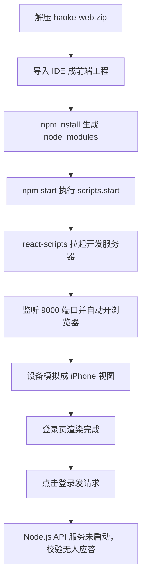

# 前台系统接手：React 移动端工程的解包、依赖安装与 9000 端口启动

项目采用前后端分离开发，前台系统由前端团队独立完成，现在整个工程交付到后端团队手上。后端接手的第一道坎不是写接口，而是把别人的前端工程原样跑起来：不知道用什么技术栈、不知道怎么装依赖、不知道启动后访问哪个端口，任何一环卡住，后续的前后端整合开发就无从谈起。这一篇把前台系统完整跑起来，并解释为什么登录按钮此刻是「点不动」的。

## 先给结论

- 前台系统是 React 配合 Semantic UI 组件库实现的移动端 Web 应用，后期目标是打包成 App 发布，属于全终端产品布局的移动端入口。
- 搭建三步：解压前端工程包到与后端工程并列的目录；`npm install` 安装依赖；`npm start` 启动开发服务器。
- 依赖不随压缩包分发，`node_modules` 目录要靠 `npm install` 现场生成；下载慢可以配置国内 npm 镜像源。
- 启动后监听 9000 端口并自动打开浏览器，显示的是登录页；想看移动端效果，用 Chrome 开发者工具的设备模拟切到 iPhone 6/7/8 视图。
- 登录此刻必然失败：前端团队没有做 mock，而是用 Node.js 写了一个真正的服务端做登录校验，那个 API 工程还没启动，下一课就搭它。

## 一、先认清这个前台系统是什么

技术栈一句话说清：React 框架加 Semantic UI 组件库。页面形态是移动端 Web 展现，也就是说它是给手机浏览器看的页面，不是 PC 后台。为什么坚持用 Web 而不是直接开发原生 App？看项目定位：产品规划是全终端覆盖，Web、App 都要支持。先把 Web 端做出来，后期通过打包工具把这套 Web 页面装进 App 壳里发布，一套前端代码吃下两个终端，这是移动端 Web 方案最大的吸引力。

页面内容从上到下依次是：首页的轮播广告、一排功能入口按钮（查看二手房、新房、租房、地图找房等）、资讯信息、问答模块。这些内容后面都要靠后端接口喂数据，此时先把壳跑起来。

工程结构也确认一下：解压后的工程与后端工程（dubbo 服务、GraphQL 服务等模块）并列放置，命名 `haoke-web`，属于整个项目的前端部分。用 IDE 以工程方式导入，能看到它就是一个以 React 为主的标准前端项目。

## 二、三步把它搭起来

**第一步，解压工程包。** 资料里找到 `haoke-web.zip`，解压到与前几篇建好的后端工程平级的目录下，形成 `haoke-web` 目录，然后导入 IDE。

**第二步，`npm install` 安装依赖。** 打开工程根目录的 `package.json`，这是 npm 世界的「pom 文件」，声明了工程名和全部依赖：

```json
{
  "name": "myhome",
  "version": "0.1.0",
  "private": true,
  "dependencies": {
    "react": "^16.3.2",
    "react-dom": "^16.3.2",
    "react-scripts": "1.1.4",
    "react-router-dom": "^4.3.1",
    "axios": "^0.18.0",
    "antd-mobile": "^2.1.10",
    "semantic-ui-css": "^2.3.2",
    "semantic-ui-react": "^0.81.2",
    "echarts": "^4.1.0",
    "echarts-for-react": "^2.0.13",
    "iscroll": "^5.2.0",
    "iscroll-luo": "^1.2.3",
    "nuka-carousel": "^4.2.3",
    "react-image-gallery": "^0.8.12",
    "react-responsive-carousel": "^3.1.41",
    "react-touch-loader": "^1.1.4",
    "react-avatar-editor": "^11.0.4"
  }
}
```

依赖清单能读出不少信息：`react` 与 `react-dom` 是框架本体；`semantic-ui-react` 负责页面组件；`react-router-dom` 做前端路由；`axios` 发 HTTP 请求，后文分析数据加载时会再遇到它；`echarts-for-react`、几种轮播组件和 `react-touch-loader`（上拉加载）都是移动端页面的常用件。这个工程没有用 yarn 之类的额外工具管理，直接用 npm。

在工程根目录打开终端执行：

```bash
npm install
```

npm 读取 `package.json`，把所有依赖连同它们的传递依赖下载进工程的 `node_modules` 目录，装完这个目录才有内容。过程末尾可能出现一些 WARN 警告，比如某些可选依赖声明了仅支持 macOS 平台，当前是 Windows 就跳过安装，这类警告不影响使用，先忽略。如果下载速度慢到难以接受，配置国内镜像源再装（把 registry 指向国内 npm 镜像），速度会明显改善。

**第三步，`npm start` 启动。** `start` 对应 `package.json` 里 `scripts` 段定义的 start 命令，底层执行的是 `react-scripts start`（`scripts` 段为 create-react-app 约定结构，讲义截图未完整展示，此处为按本课写法补全）：

```json
"scripts": {
  "start": "react-scripts start",
  "build": "react-scripts build"
}
```

`react-scripts` 封装了整套开发期构建：webpack 打包、语法转换、热更新、静态资源服务，全在其中。工程把端口定在 9000（react-scripts 默认 3000，通过 `PORT` 环境变量或 `.env` 配置调整，示例按本课写法补全），如果本机 9000 已被占用，改这个配置即可。执行：

```bash
npm start
```

终端刷出编译日志后自动弹出浏览器窗口。

## 三、启动验证与移动端模拟

浏览器访问 `http://localhost:9000/`，此时看到的登录页大概率「不对劲」：整个页面铺满宽屏，完全不像手机页面。这不是页面写错了，而是浏览器以 PC 视口在渲染。按 F12 打开 Chrome 开发者工具，点击设备模拟按钮（切换设备工具栏），选择 iPhone 6/7/8，缩放调到 100%，页面立刻变成手机视图。后续开发这个前台系统时，始终开着设备模拟工作，所见即真实手机上的效果。

手机视图下出现的是登录页，输入用户名密码点击登录，没有任何反应。回想一下登录的本质：前端把用户名密码发给后端校验，校验通过才放行进入首页。此刻后端在哪？前端团队做开发时并没有采用传统 mock 的方式糊一堆假数据，而是用 Node.js 亲手写了一个服务端，登录校验、首页数据都由它提供。这个 Node 服务端同样由前端团队交付给了我们，但它还没有启动。所以登录点不动不是 bug，是依赖的服务缺席。

整条搭建与启动链路如下：



图的终点 J 是接下来要做的事：把前端团队交付的 API 工程跑起来。前台系统真正「搭建完成」的定义是两件套同时在线，前端 9000 端口出页面，Node 服务出数据。

## 常见误区

- **以为解压完就能启动。** 压缩包里没有 `node_modules`，依赖从不随包分发（体积巨大且跨平台不兼容），任何拿到工程的人都要先 `npm install` 再启动，报「找不到命令或模块」时先查这一步。
- **宽屏下页面布局「散架」就改代码。** 前台系统是移动端 Web，PC 全屏视口下本来就不是它的目标形态，动手改样式之前先开设备模拟，用手机视口确认问题是否存在。
- **9000 端口被占用时换浏览器重试。** 端口冲突是工程配置问题，去改 `PORT` 相关配置而不是反复刷新；报错信息里通常会写明端口被哪个进程占着。
- **把登录失败当成前端 bug 排查半天。** 登录校验依赖 Node API 服务，服务没起，前端怎么改都不会有反应。前端页面正常渲染、后端接口缺席，这类「页面活着但点不动」的症状，先确认依赖服务是否在线。

## 面试可能被问到的问题

1. 面试官追问：「npm install 和 npm start 分别做了什么？」
   答：install 读取 package.json，把声明的依赖及其传递依赖解析版本后下载进 node_modules，并生成锁文件固定依赖树；start 执行 scripts 里定义的 start 命令，本工程对应 react-scripts start，拉起开发服务器完成编译与热更新监听。前者管依赖安装，后者管运行。

2. 面试官追问：「react-scripts 是什么，为什么不自己配 webpack？」
   答：它是脚手架把构建链封装后的统一入口，webpack、babel、dev server、ESLint 的配置全部内置并按约定隐藏，项目只保留 package.json 与源码。好处是新工程零配置即可开发，坏处是定制构建要弹出（eject）配置自行维护，中小项目通常不值得。

3. 面试官追问：「为什么选择移动端 Web 而不是直接做原生 App？」
   答：Web 端开发效率高、无需发版审核、迭代即时生效；配合打包工具套上原生壳后又能以 App 形态分发，一套代码覆盖浏览器与应用商店两个渠道。代价是性能与原生体验有差距，对房源列表、资讯展示这类内容型页面完全够用。

4. 面试官追问：「前端为什么不用 mock 数据而要真写一个 Node 服务？」
   答：mock 只能返回写死的静态数据，登录校验这种带状态、要读库的逻辑 mock 不了。Node 服务能真正处理请求、查数据库、返回带业务含义的响应，前端联调体验接近真实后端；同时它的接口地址与响应结构就是后端团队要对接的契约，参考价值远高于 mock。

5. 面试官追问：「拿到陌生前端工程，你的排查启动顺序是什么？」
   答：先看 package.json：name 与 scripts 了解怎么启动，dependencies 了解技术栈；再看 README 或讲义的启动步骤；然后 npm install，失败先查网络与镜像源；npm start 后重点看终端报错与监听端口，最后浏览器验证页面形态，需要移动端视图就开设备模拟。

## 配套资料

- 本教学日资料包仅收录数据库脚本：`materials/code/03/day06-开发GraphQL服务以及前台系统搭建/day06-开发GraphQL服务以及前台系统搭建/资料/myhome.sql`（前台系统数据域，供下一课的 Node API 工程使用）。
- 前端工程包（`haoke-web.zip`）未随当前资料目录提供，工程目录结构与 `package.json` 依赖清单为按本课画面抄录，`scripts` 段与端口配置为按 create-react-app 惯例补全的示例。
