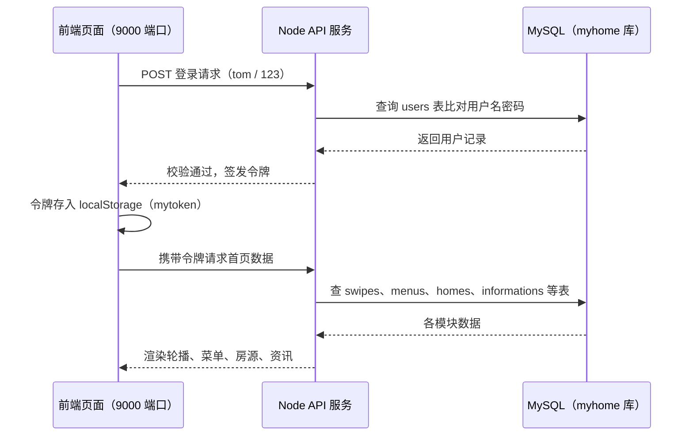

# 把 Node.js 演示服务跑起来：myhome 数据库、config-dev 配置与登录联调

上一篇登录按钮点不动的原因已经定位：前台系统的登录校验和首页数据都由前端团队自建的 Node.js 服务端提供，而它还没启动。这一课把这个 API 工程完整搭起来：建库导脚本、改开发环境配置、按它约定的命令启动，最后用资料库里的真实账号登录成功，让前台系统整个活过来。同时要想清楚一件事：这个服务是演示品，跑它不是为了让它上岗，而是为了看清前端到底需要什么地址、什么数据结构。

## 先给结论

- API 工程解压为 `haoke-web-api`，与前端工程并列；技术栈是 Node.js 的 Koa 2 全家桶，通过 `mysql` 驱动直连数据库。
- 数据库必须先建：创建名为 `myhome`、编码 utf8 的库，执行 `myhome.sql`，得到 10 张表和初始化数据，登录账号 tom、密码 123 就在 `users` 表里。
- 启动命令是 `npm run dev` 而不是 `npm start`，`scripts` 里没有定义 start；`dev` 脚本用 `cross-env` 设置环境变量 `NODE_ENV=config-dev` 后再执行 `node app.js`。
- 环境变量决定了读哪个配置文件：改数据库连接就改 `config/config-dev.js` 的 `db` 段，host、端口、用户名、密码、库名要与自己的 MySQL 环境完全一致。
- `test`、`pro` 两套配置不必动：到了后端开发阶段，测试和生产环境的数据服务理应由真正的后端提供，这个 Node 服务只服务于前端团队的开发期。

## 一、认识 API 工程：一个 demo 化的 Koa 服务

解压资料里的 `haoke-web-api.zip` 到 `haoke-web-api` 目录（与 `haoke-web` 并列），导入工具后先看 `package.json`，它交代了工程身份与全部依赖：

```json
{
  "name": "myapi",
  "main": "index.js",
  "scripts": {
    "test": "cross-env NODE_ENV=config-test node app.js",
    "dev": "cross-env NODE_ENV=config-dev node app.js",
    "pro": "cross-env NODE_ENV=config-pro node app.js"
  },
  "dependencies": {
    "koa": "2.5.0",
    "koa-router": "7.4.0",
    "koa-bodyparser": "4.2.0",
    "koa-static": "4.0.5",
    "koa-multer": "1.0.2",
    "koa-jwt": "3.3.1",
    "koa-logger": "3.2.0",
    "koa-mount": "3.0.0",
    "koa2-cors": "2.0.5",
    "jsonwebtoken": "8.2.1",
    "joi": "13.2.0",
    "mysql": "2.16.0",
    "busboy": "0.2.14"
  }
}
```

依赖清单把这个服务的轮廓画了出来：`koa` 加 `koa-router` 提供路由骨架，`koa-bodyparser` 解析请求体，`koa-static` 托管静态资源，`koa-multer` 与 `busboy` 处理文件上传，`koa2-cors` 放开跨域（前端 9000 端口调它，跨域不可避免），`jsonwebtoken` 与 `koa-jwt` 负责登录令牌的签发与校验，`joi` 做参数校验，`mysql` 驱动负责数据库访问。一个登录加数据查询的小型服务端所需的零件都在了。

给它的定位再敲一次黑板：**这是前端团队为了 demo 化开发搭的服务端，不能直接用于生产。** 它的价值有两个：让前端页面在开发期有真实可调的接口；给后端团队提供一份现成的参照，请求地址长什么样、响应结构怎么组织，都明明白白跑在那里。等真正的后端服务就位，它就功成身退。

## 二、建库导脚本：myhome 数据库

这个服务要读写数据库，先把库准备好。在 MySQL 客户端里新建数据库，名字定为 `myhome`，编码选 utf8，然后用资料包里的 `myhome.sql` 初始化。脚本会建出 10 张表：

| 表名 | 内容 |
|---|---|
| `users` | 用户，登录账号所在，tom 的密码是 123 |
| `swipes` | 首页轮播广告图路径 |
| `menus` | 首页功能菜单（二手房、新房、租房、海外等） |
| `homes` | 房源，二手房、租房列表的数据源 |
| `informations` | 资讯与头条内容 |
| `questions` / `answers` | 问答模块的问题与回答 |
| `chatinfos` | 微聊的聊天消息 |
| `homeimgs` | 房源图片 |
| `map` | 地图找房的坐标点 |

这张表清单值得多看两眼：前台系统每个功能模块都对应这里的表，后面几篇做前后端整合时，后端要替换的就是这些表背后的数据服务。执行脚本后确认数据就位，比如 `users` 表里能查到 tom，轮播表里有 `public/1.png` 这样的图片路径记录。

## 三、改配置：环境变量决定读哪份配置

工程的配置放在 `config` 目录下，分成 `config-dev`、`config-test`、`config-pro` 三份，分别对应 `scripts` 里的三个命令。以 `dev` 为例拆开看这条命令：

```bash
cross-env NODE_ENV=config-dev node app.js
```

`cross-env` 是一个跨平台设置环境变量的小工具：Windows 的命令行里直接写 `NODE_ENV=xxx node app.js` 是无效语法，`cross-env` 保证这条命令在 Windows、macOS、Linux 下行为一致。它设置 `NODE_ENV=config-dev` 之后启动 `app.js`，服务启动时读取这个环境变量，据此加载 `config-dev` 配置文件。所以跑 `dev` 就改 `config-dev`，对应关系就这么直接。

`config-dev` 里需要动的只有数据库段（其余如模块路径等保持默认）：

```js
// config/config-dev.js 的 db 段，示例为按本课画面结构补全
module.exports = {
    // ...
    db: {
        host: '127.0.0.1',   // 数据库地址，改成自己的环境
        port: 3306,
        type: 'mysql',
        user: 'root',
        password: 'root',
        database: 'myhome'
    }
};
```

五个关键值与自己的 MySQL 环境完全一致才算配好：host 是数据库所在主机，课程里用的是讲师内网地址，本地练习就写 `127.0.0.1`；端口默认 3306；用户名与密码按自己的实例填；`database` 必须是刚才建的 `myhome`。改完 `config-test`、`config-pro` 要不要也改一遍？不必。这两套配置服务于测试与生产部署，而当前处于后端开发阶段，那些环境的数据服务将由真正的后端提供，Node 服务只在开发期陪前端跑一程。

## 四、启动与登录验证

先装依赖再启动，两条命令：

```bash
npm install
npm run dev
```

注意第二条是 `npm run dev`，不是 `npm start`。`scripts` 里定义的是 `test`、`dev`、`pro` 三个自定义脚本，没有 start，想当然敲 `npm start` 会得到一个「缺少脚本」的报错。`npm run <名字>` 的含义是执行 scripts 里对应名字的命令，`dev` 对应的就是上面那条 cross-env 启动命令。

服务起来后回到浏览器，访问前端的 9000 端口，在登录页输入 tom 与 123，点击登录，跳转成功。首页内容应声而出：轮播广告可以左右滑动，下面是问答数据、二手房与租房的房源卡片，再往下是资讯、微聊、个人中心等功能菜单和搜索框。前端工程与 Node 服务端就此打通，整个前台系统第一次完整地跑了起来。

登录这一下背后发生了什么，画成时序图：



图里令牌存进 localStorage 这一步，是下一篇分析数据加载流程时请求头里 `mytoken` 的来源，登录链路与数据链路在这里接上了头。

## 常见误区

- **敲成 `npm start` 然后排查半天。** 这个工程没有定义 start 脚本，启动入口是 `npm run dev`。拿到任何 Node 工程先看 `scripts` 段再敲命令，是比记忆更可靠的习惯。
- **host 照抄讲师的地址。** 配置里的内网 IP 是讲师自己机器的数据库地址，抄过来只能收获连接超时。host、账号、密码、库名四项永远按自己的环境填。
- **跳过建库直接启动服务。** 没有建库、没执行脚本就启动，页面能打开但登录必然失败，服务端报的是数据库访问错误。库、表、初始数据三样齐了才谈得上联调。
- **把 `test`、`pro` 配置也顺手改了。** 这两套配置对应测试与生产部署，现阶段没有部署动作，改了也没有验证途径。理解 dev 命令与环境变量的对应关系比机械地全改一遍重要得多。

## 面试可能被问到的问题

1. 面试官追问：「cross-env 解决的是什么问题？」
   答：跨平台设置环境变量。类 Unix 系统可以在命令前用 `KEY=value` 的写法传环境变量，Windows 的 cmd 不支持这种语法，同一份脚本在 Windows 上就会失效。cross-env 以 npm 依赖的形式提供统一写法，保证脚本在各平台行为一致，团队协作的项目几乎必备。

2. 面试官追问：「这种按 NODE_ENV 加载不同配置文件的做法，思路是什么？」
   答：一份代码多套环境，配置外置。启动时用环境变量声明当前环境，程序据此加载对应的配置文件，开发、测试、生产各自维护数据库地址、密钥等差异项，代码零改动切换环境。更成熟的演进方向是配置中心，但文件分环境加载是理解这套思想的最小模型。

3. 面试官追问：「这个 Node 服务为什么不能直接上生产？」
   答：它是为前端 demo 开发搭的：直连单库、没有考虑水平扩展与高可用，安全与运维配套（日志监控、限流、鉴权强度）也不完整。它的使命是提供与真实后端同构的接口参照，生产环境应由后端团队的服务体系接管。

4. 面试官追问：「Koa 的 koa-static 起什么作用？这个服务为什么需要它？」
   答：koa-static 把指定目录作为静态资源根对外服务，请求路径直接映射到文件，用于图片、样式这类无需动态处理的资源。本服务同时承担图片访问（比如轮播图的 public 路径），静态资源与动态接口共用一个端口，前端只需记一个服务地址。

5. 面试官追问：「登录后的令牌为什么要存 localStorage，请求时怎么用上？」
   答：HTTP 请求本身无状态，登录成功后服务端签发令牌，前端把它存进 localStorage 持久保存；之后每次请求在拦截器里把它塞进请求头的 Authorization 字段，服务端校验令牌识别身份，省去重复登录。下一篇的数据流分析里能看到 `mytoken` 在请求拦截器中的用法。

## 配套资料

- 数据库脚本（本课核心资料）：`materials/code/03/day06-开发GraphQL服务以及前台系统搭建/day06-开发GraphQL服务以及前台系统搭建/资料/myhome.sql`（含 10 张表结构与 users、swipes、menus、homes 等初始化数据，登录账号 tom 的记录即出自此脚本）。
- API 工程包（`haoke-web-api.zip`）未随当前资料目录提供，`package.json` 依赖清单与 `scripts` 为按本课画面抄录，`config-dev.js` 的 `db` 段为按画面结构补全的可运行示例。
