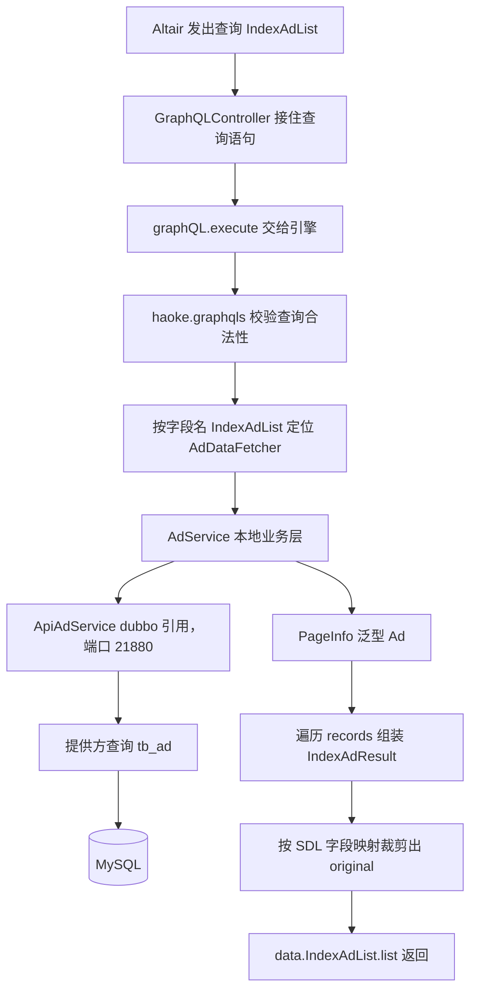

# 广告查询的 GraphQL 接口：先给数据结构瘦身，再用一个 DataFetcher 接上 Dubbo

REST 那套 `data` 加 `meta` 的包装在 GraphQL 里显得笨重：GraphQL 响应本身就有 `data` 与 `errors` 两个标准通道，轮播组件要的又只是一个图片地址集合。这一课把广告查询搬进 GraphQL，重点不在接口本身多难写，而在「契约跟着消费方的真实需求走」：前端只要一张图列表，SDL 就只声明一张图列表，多余包装一层都不给。

## 先给结论

- 数据结构瘦身的依据是前端组件的真实需求：轮播组件只需要一个集合，GraphQL 协议自带 `data` 与 `errors` 通道，`meta` 包装纯属冗余，契约定成 `IndexAdResult { list: [IndexAdResultData] }`。
- SDL 改三处：`HaokeQuery` 加一条无参数的 `IndexAdList` 查询，新增 `IndexAdResult` 与 `IndexAdResultData` 两个类型，文件仍是 `resources` 下的 `haoke.graphqls`。
- `AdDataFetcher` 实现 `MyDataFetcher` 接口，`fieldName()` 返回 `IndexAdList`，打上 `@Component` 交给容器，`GraphQLProvider` 集合注入后自动注册，Provider 一行不用改。
- 取数复用现成的 dubbo 链路：`AdService.queryAdList(1, 1, 3)` 拿 `PageInfo`，遍历 `records` 把 `url` 装进 `IndexAdResultData` 的 `original` 字段。
- graphql-java 按 SDL 字段名从返回对象上取值，名字对不上的字段安静地变 null 而不报错，所以查询名、实现类、查询语句三方的拼写必须逐字符一致。

## 一、结构为什么这样定：让契约向组件需求看齐

REST 版接口为了对齐演示环境的响应习惯，包了 `data` 与 `meta` 两层，真正有效的值只有三个：状态码、消息、图片地址。搬到 GraphQL 后情况变了：响应的 `data` 键由协议规定，出错另有 `errors` 键兜底，`meta` 承担的职责已经被协议接管。再看消费方，前端轮播组件的入参就是一个图片对象数组，别无他求。

两边一对齐，契约自然瘦下来：外层一个对象，里面挂一个 `list`，集合元素只带 `original` 一个字段。瘦身后前端拿数据只剩一条直路，`响应.data.IndexAdList.list`，不用再绕开用不上的包装。

## 二、SDL：三段契约一次写完

打开 api-server 工程 `src/main/resources` 下的 `haoke.graphqls`，在已有的房源类型上追加广告契约：

```graphql
schema {
    query: HaokeQuery
}

type HaokeQuery {
    HouseResources(id: Long): HouseResources
    HouseResourcesList(page: Int, pageSize: Int): TableResult
    IndexAdList: IndexAdResult
}

type IndexAdResult {
    list: [IndexAdResultData]
}

type IndexAdResultData {
    original: String
}
```

三段各管一件事。`HaokeQuery` 里新增的 `IndexAdList` 是查询入口，没有参数、返回 `IndexAdResult`，首页轮播不筛不分页，参数栏为空是合理的。`IndexAdResult` 是轮播结果的容器，唯一的字段 `list` 是 `IndexAdResultData` 的集合。`IndexAdResultData` 只声明 `original: String`，对应轮播组件认的那个原图地址键。SDL 只描述「有什么、什么类型」，数据从哪来、怎么取，是接下来 Java 侧的事。

## 三、两个 VO 与取数器：逻辑各归其位

先按契约建两个 pojo。与房源那批类混放会让 vo 包越来越臃肿，这里单独开一个 `ad` 包安置：

```java
package com.haoke.manage.dubbo.api.vo.ad;

import lombok.AllArgsConstructor;
import lombok.Data;
import lombok.NoArgsConstructor;

@Data
@AllArgsConstructor
@NoArgsConstructor
public class IndexAdResultData {

    /** 轮播组件约定的原图地址键 */
    private String original;
}
```

```java
package com.haoke.manage.dubbo.api.vo.ad;

import lombok.Data;

import java.io.Serializable;
import java.util.List;

@Data
public class IndexAdResult implements Serializable {

    private static final long serialVersionUID = 1L;

    private List<IndexAdResultData> list;
}
```

`@AllArgsConstructor` 让 `IndexAdResultData` 可以一行构造完成，取数器里会用到。然后是新查询的灵魂，`AdDataFetcher`：

```java
package com.haoke.manage.dubbo.api.graphql;

import com.haoke.manage.dubbo.api.service.AdService;
import com.haoke.manage.dubbo.api.vo.ad.IndexAdResult;
import com.haoke.manage.dubbo.api.vo.ad.IndexAdResultData;
import com.haoke.manage.dubbo.server.pojo.Ad;
import com.haoke.manage.dubbo.server.vo.PageInfo;
import graphql.schema.DataFetchingEnvironment;
import org.springframework.beans.factory.annotation.Autowired;
import org.springframework.stereotype.Component;

import java.util.ArrayList;
import java.util.List;

@Component
public class AdDataFetcher implements MyDataFetcher {

    @Autowired
    private AdService adService;

    @Override
    public String fieldName() {
        return "IndexAdList";
    }

    @Override
    public Object dataFetcher(DataFetchingEnvironment environment) {
        // 首页轮播：类型 1，取第 1 页的 3 条，与 REST 版口径一致
        PageInfo<Ad> adPageInfo = this.adService.queryAdList(1, 1, 3);

        List<IndexAdResultData> list = new ArrayList<>();
        for (Ad ad : adPageInfo.getRecords()) {
            list.add(new IndexAdResultData(ad.getUrl()));
        }
        return new IndexAdResult(list);
    }
}
```

这段代码站在前面两课的地基上。`MyDataFetcher` 是重构 `GraphQLProvider` 时立下的接口，`fieldName()` 声明自己服务哪个查询字段，`dataFetcher()` 承载取数逻辑；`@Component` 一打，Spring 扫描入容器，Provider 启动时集合注入所有实现类并按 `fieldName` 逐个注册，本次没有碰过 Provider 一行代码。取数路径也与 REST 版同源：`AdService` 内部是 dubbo 的 `@Reference` 引用，参数固定为类型 1、第 1 页、3 条，`PageInfo` 拿到后遍历 `records`，把 `Ad` 的 `url` 装进 `original`，最后包成 `IndexAdResult` 返回。

`dataFetcher` 的入参 `DataFetchingEnvironment` 在这里没用上，无参数查询确实无参可取；但它仍是必要的形参，等查询带参数时，`environment.getArgument("xxx")` 就从它这里拿值。

## 四、Altair 里验一遍

重启 api-server，到 Altair 客户端里配置好 `http://127.0.0.1:18080/graphql`，按契约拼查询发出去：

```graphql
query {
    IndexAdList {
        list {
            original
        }
    }
}
```

返回与期望严丝合缝：

```json
{
  "data": {
    "IndexAdList": {
      "list": [
        { "original": "http://127.0.0.1:8086/public/1.png" },
        { "original": "http://127.0.0.1:8086/public/2.png" },
        { "original": "http://127.0.0.1:8086/public/3.png" }
      ]
    }
  }
}
```

整条链路串起来看：



关键锚点是 E 那一格：引擎靠字符串 `IndexAdList` 把 SDL 声明、取数器注册、客户端查询三方钉在一起，任何一边拼写或大小写不一致，查询当场报错或者安静地吐 null。

## 常见误区

- **字段名三方对不齐。** SDL 写 `IndexAdList`，`fieldName()` 返回 `indexAdList`，Provider 注册挂在后者上，真实字段无人取数，响应里该键为 null 且无异常。字段名是契约锚点，大小写敏感，改名必须 SDL、实现类、客户端查询三处同步。
- **给 GraphQL 响应再包一层 `data` 加 `meta`。** 习惯性把 REST 封装带过来，结果前端要写两层 data 才能取到值。GraphQL 的 `data` 与 `errors` 已由协议提供，业务侧只需要定义业务形状。
- **返回 `PageInfo` 或 `Ad` 实体糊弄了事。** SDL 里没声明的字段不会出现在响应中，看似无害；但 `list` 的元素类型对不上 `IndexAdResultData` 时，`original` 这个关键键取不到值，轮播图空白。返回对象的形状要与 SDL 声明同构。
- **实现类忘打 `@Component`。** 类写得再完整，不在容器里就进不了 Provider 的集合注入，症状同样是字段为 null。新增查询后不生效，先查注解再查拼写。

## 面试可能被问到的问题

1. 面试官追问：「graphql-java 是怎么把 DataFetcher 返回的对象变成响应 JSON 的？」
   答：引擎按 SDL 字段名做属性映射，默认的 PropertyDataFetcher 会去返回对象上找与字段同名的属性或 getter，比如 list 字段找 getList()。名字对得上的进入响应，对不上的安静地输出 null，不抛异常。所以 VO 与 SDL 保持同构是硬要求，异构映射要靠显式绑定字段级 DataFetcher。

2. 面试官追问：「新增一个 GraphQL 查询，按你们的架构要动几处代码？」
   答：两处。SDL 里加一行字段声明，再写一个实现 MyDataFetcher 的取数类并打上 @Component。Provider 的装配、Controller 的入口、引擎的初始化全部不动，因为 Provider 是集合注入所有实现类再统一注册的，这正是当初把取数逻辑从 buildWiring 里抽出来的收益。

3. 面试官追问：「DataFetchingEnvironment 里除了参数还能拿到什么？」
   答：它是本次取数的现场上下文，能拿到查询参数、当前字段的定义与类型、父级对象、执行上下文里的全局数据（比如登录态）、请求的变量与字段选择集。做鉴权、分页参数默认值、字段级缓存这类逻辑时都从它入手。

4. 面试官追问：「首页轮播这种无参数查询，dataFetcher 方法还要不要处理 environment？」
   答：形参必须保留，因为这是接口与引擎约定的签名；只是方法体里不需要 getArgument，参数为空的查询没有可取的入参。口径参数如类型与条数在服务端写死，这也算一种契约：轮播位就是取第 1 页 3 条，谁调用都一样，真要放开分页时再在 SDL 上声明参数。

5. 面试官追问：「GraphQL 的错误处理与 REST 有什么不同？」
   答：REST 靠状态码加错误体表达失败；GraphQL 的 HTTP 层往往是 200，业务与执行错误统一收进响应的 errors 数组，data 里照常返回成功解析的部分。取数器抛出的异常会被引擎捕获转成 error 项，这为统一异常翻译留了切入口，可以在公共层把异常转成带 message 的错误结构。

## 配套资料

- 前台演示库脚本（本教学日唯一随包资料，响应示例中的图片地址与 `swipes` 表三条初始数据同源）：
  `materials/code/03/day06-开发GraphQL服务以及前台系统搭建/day06-开发GraphQL服务以及前台系统搭建/资料/myhome.sql`
- day06 教学资料包未收录后端源码，`haoke.graphqls` 增量、两个 VO 与 `AdDataFetcher` 为按本课画面写法补全的可运行示例，包名沿用同系列成稿的中性命名。
- `MyDataFetcher` 接口与 Provider 集合注册的设计见同系列成稿 `0094-优化改进GraphQLProvider实现逻辑.md`，REST 版广告接口与 dubbo 链路见 `0102-轮播广告实现之查询广告服务的实现(RESTful接口).md` 与 `0101-轮播广告实现之实现查询的dubbo服务.md`。
