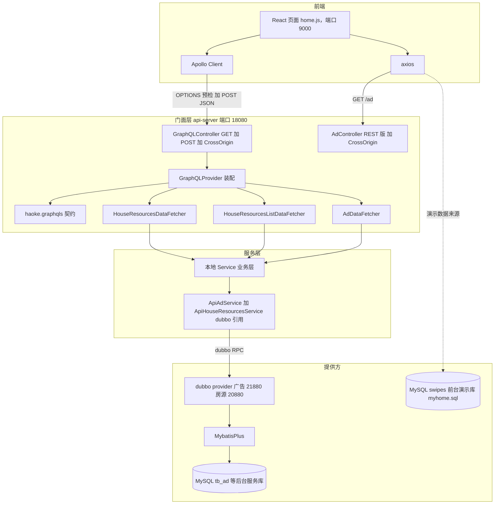

# GraphQL 全链路收束：一条广告数据从 MySQL 到轮播组件的完整旅程

day06 的主线只有一句话：把 GraphQL 从服务端到客户端整条链路打通。到本课为止，系统里已经并存两套对外服务，RESTful 与 GraphQL 都能被前端成功调用；广告数据既可以从 `GET /ad` 拿到，也可以从 `POST /graphql` 按需取回。把这一天拆开复盘，服务端四步、客户端三步，中间夹着数据契约与跨域两个横切问题，收束清楚，后面的房源详情、地图找房才有地基可踩。

## 先给结论

- 服务端骨架三件套已经定型：`haoke.graphqls` 定契约、`GraphQLProvider` 做装配、`MyDataFetcher` 体系管取数，新增查询的成本收敛为「SDL 一行加一个实现类」。
- 查询的取数链不另起炉灶：DataFetcher 调本地 Service，本地 Service 走 dubbo 引用，底下的提供方与 MybatisPlus 原样复用。
- 数据契约跟着消费方走：同一个轮播广告，REST 版门面输出 `data` 加 `meta`，GraphQL 版门面输出 `IndexAdResult` 加 `list`，两个形状各自对齐各自的客户端。
- 客户端用 Apollo Client：建 client、`gql` 定查询、`client.query` 发请求三步成型；服务端相应补上 POST 入口与 `@CrossOrigin`。
- 数据域要分清：后台服务库的广告表与前台演示库 `myhome.sql` 的 `swipes` 表是两回事，读代码别混。

## 一、服务端这条线：从 Dubbo 服务到 GraphQL 门面

本教学日之前，按 id 查房源与查房源列表两条 dubbo 服务已经就位，GraphQL 门面也随之跑通并完成了一次关键重构。把这条线上的关键动作按依赖顺序排开：

**第一，契约先行。** `haoke.graphqls` 放在 `resources` 下，根查询类型 `HaokeQuery` 上依次声明了 `HouseResources(id: Long)`、`HouseResourcesList(page, pageSize)` 与本日新增的 `IndexAdList`，每种返回值都有对应类型定义。SDL 是三方对齐的锚点，客户端能查什么、服务端取什么，都由它说了算。

**第二，装配一次成型。** `GraphQLProvider` 在 `@PostConstruct` 里读文件、`SchemaParser` 解析出类型注册表、`RuntimeWiring` 绑定取数器、`SchemaGenerator` 合成可执行 Schema、`GraphQL.newGraphQL` 包出执行器，`@Bean` 交给容器，`GraphQLController` 注入使用。

**第三，取数逻辑可插拔。** 重构后的 `buildWiring` 只剩遍历注册：

```java
private RuntimeWiring buildWiring() {
    return RuntimeWiring.newRuntimeWiring()
            .type("HaokeQuery", builder -> {
                this.myDataFetchers.forEach(myDataFetcher -> {
                    builder.dataFetcher(myDataFetcher.fieldName(),
                            environment -> myDataFetcher.dataFetcher(environment));
                });
                return builder;
            }).build();
}
```

每个查询写一个实现类：`HouseResourcesDataFetcher` 拿参数查单条，`AdDataFetcher` 写死轮播口径组装 `IndexAdResult`，全部实现 `MyDataFetcher` 并打 `@Component`，Spring 集合注入后自动注册。新增查询从此不动 Provider。

**第四，入口双协议。** `GraphQLController` 现在同时挂 GET 与 POST：GET 用 `@RequestParam` 接查询语句，POST 用 Jackson 从 JSON 请求体里解出 `query` 字符串，两条路汇到同一个 `graphQL.execute`。双协议是被 Apollo Client 逼出来的，它的查询固定走 POST。

底下的一层没变过：dubbo 提供方、注册中心、MybatisPlus、MySQL，GraphQL 门面只是把 HTTP 世界翻译成 dubbo 调用，翻译完就退场。

## 二、客户端这条线：Apollo Client 三步接上

前端的接入比服务端还短。装依赖、建 client、定查询，`home.js` 里轮播的 Promise 从 axios 换成 `client.query`：

```javascript
import ApolloClient from 'apollo-boost';
import gql from 'graphql-tag';

const client = new ApolloClient({
    uri: 'http://127.0.0.1:18080/graphql',
});

const GET_INDEX_ADS = gql`
    query {
        IndexAdList {
            list {
                original
            }
        }
    }
`;

let swipe = new Promise((resolve, reject) => {
    client.query({ query: GET_INDEX_ADS }).then(result => {
        resolve(result.data.IndexAdList.list);
    });
});
```

取值路径 `result.data.IndexAdList.list` 与服务端 SDL 的形状逐层对应，Promise 输出的集合形状与原来 axios 版本一致，页面其余代码零改动。官方还提供 `<Query>` 组件式封装，把 loading、error、data 直接交给渲染，原理与编码式相同，属于同一套能力的更优雅外壳。测试侧的 Altair 客户端贯穿始终，每加一个查询先在它里面验货，再回前端接线。

## 三、一张图收束全章



图里两条实线请求通道对应两套服务：axios 打 `GET /ad` 走 REST 门面，Apollo Client 走 OPTIONS 预检加 POST 的 GraphQL 通道，两者在门面层分叉、在 dubbo 层汇合。虚线是数据源头提醒：前台演示库 `myhome.sql` 的 `swipes` 表给的是页面初始演示数据，后台链路查的是自己的广告表，两个库不互相掺和。

关键路径两处值得再看一眼：门面层的 `@CrossOrigin` 出现在两个 Controller 上，跨域是按入口逐个放行的，漏一个就红一个；`GraphQLProvider` 与 SDL 之间是静态契约与动态装配的合流点，字段名在 SDL、DataFetcher、客户端查询三处必须逐字符一致。

## 四、两套服务并存，什么时候用哪个

RESTful 没有被 GraphQL 取代，也不需要被取代。这套系统里 REST 版接口继续承担演示数据、简单查询这类场景，语义清晰、HTTP 语义完备、缓存机制现成；GraphQL 版接口的价值在字段裁剪与聚合：轮播只要 `original` 一个字段，多余数据零传输，将来一个页面要同时拼广告、房源摘要、城市列表，一条查询就能聚合多个服务的数据，不用发三个 REST 请求再自己拼。选型的判断标准始终是消费方的真实需求：字段需求简单固定的接口用 REST，字段需求多变、聚合多的场景交给 GraphQL。

数据契约的设计原则也在这一天两次得到验证：REST 版的 `WebResult` 用三个字段加两个手工 getter 糊出 `data` 加 `meta` 的嵌套，GraphQL 版的 `IndexAdResult` 只剩一个 `list`。契约不是服务端的审美，是消费方的需求。

## 常见误区

- **把前台演示库与后台服务库混为一谈。** `myhome.sql` 里的 `swipes` 表服务于前台演示环境，后台 GraphQL 链路查的是服务库的广告表，字段、端口、工程都不同。联调时数据对不上，先确认自己在查哪个库。
- **以为加了 `@CrossOrigin` 跨域就全通。** 注解按 Controller 生效，`/ad` 与 `/graphql` 是两扇门；放行了域还要匹配方法，Apollo 的 POST 查询要求服务端有 `@PostMapping`，缺一道都是 403。
- **把 GraphQL 当成要全量替换 REST 的方案。** 两套服务并存是常态，按接口的字段需求与聚合需求选型，推倒重来的改造成本远高于收益。
- **字段名改动只改一处。** SDL、DataFetcher 的 `fieldName()`、客户端查询语句是三方契约，大小写敏感，改任何一边都要三处同步，否则就是安静的 null。

## 面试可能被问到的问题

1. 面试官追问：「你们项目里 GraphQL 和 RESTful 怎么共存，网关层怎么路由？」
   答：按路径区分，REST 接口走业务路径，GraphQL 统一收敛在 `/graphql` 一个入口，由 Controller 把查询语句交给引擎执行。两者共享同一层 dubbo 服务与鉴权体系，前端按场景选通道：字段固定、缓存友好的用 REST，字段多变、需要聚合的用 GraphQL。

2. 面试官追问：「graphql-java 从 SDL 到可执行查询的完整流程说一下？」
   答：SchemaParser 把 SDL 文件解析成 TypeDefinitionRegistry，这是静态类型契约；RuntimeWiring 声明每个查询字段对应的 DataFetcher，这是动态取数逻辑；SchemaGenerator 把两者合成 GraphQLSchema；GraphQL.newGraphQL(schema).build() 生成执行器，execute 时引擎先校验查询合法，再按字段名路由到取数器，最后按 SDL 字段映射裁剪结果。

3. 面试官追问：「DataFetcher 的注册方式为什么设计成接口加集合注入？」
   答：把「新增查询」的成本压到最低。每个查询一个实现类，@Component 进容器，Provider 集合注入所有实现类后按 fieldName 遍历注册，Provider 与具体业务彻底解耦。这是策略模式加注册表的组合，符合对扩展开放、对修改关闭，代价是注册关系分散到各个实现类，排查时要顺着接口找。

4. 面试官追问：「GraphQL 的响应里 HTTP 状态码通常是 200，错误怎么表达？」
   答：GraphQL 规范用 errors 数组表达错误，data 里返回成功解析的部分，部分失败不影响整体响应结构。取数器抛出的异常会被引擎捕获转成 error 项。这与 REST 的状态码语义不同，监控与告警要按 errors 与自定义错误码设计，不能只盯 HTTP 层。

5. 面试官追问：「跨域预检请求是每个请求都发吗，怎么减少预检？」
   答：只有非简单请求触发预检，简单请求直接发送。减少预检的办法包括让请求落在简单请求白名单内、服务端设置 Access-Control-Max-Age 让浏览器缓存预检结果、把多个接口收敛到同一来源下用反向代理消除跨域。理解预检的触发条件比背配置项更重要。

## 配套资料

- 前台演示库脚本（本教学日唯一随包资料，`swipes` 轮播表 DDL 与三条初始数据，另有 `homes`、`menus` 等演示表）：
  `materials/code/03/day06-开发GraphQL服务以及前台系统搭建/day06-开发GraphQL服务以及前台系统搭建/资料/myhome.sql`
- day06 教学资料包未收录前后端源码，文中代码为按本课画面写法补全的可运行示例，包名沿用同系列成稿的中性命名。
- 本章成稿链路：dubbo 服务 `0091-实现根据id查询房源数据的dubbo服务.md`、GraphQL 门面 `0092-实现根据id查询房源数据的GraphQL服务.md`、取数器重构 `0094-优化改进GraphQLProvider实现逻辑.md`、房源列表 GraphQL `0095-实现查询房源列表的GraphQL接口服务.md`、前台系统 `0096-前台系统之工程搭建以及启动服务.md` 至 `0098-前台系统之了解功能模块以及分析数据加载流程.md`、轮播广告 `0099-轮播广告实现之分析数据结构以及表结构.md` 至 `0102-轮播广告实现之查询广告服务的实现(RESTful接口).md`、整合与客户端 `0103-轮播广告实现之前后端整合测试.md`、`0104-编写广告查询的GraphQL接口服务.md`、`0105-使用Apollo Client与后端GraphQL进行通信实现广告查询功能.md`。
