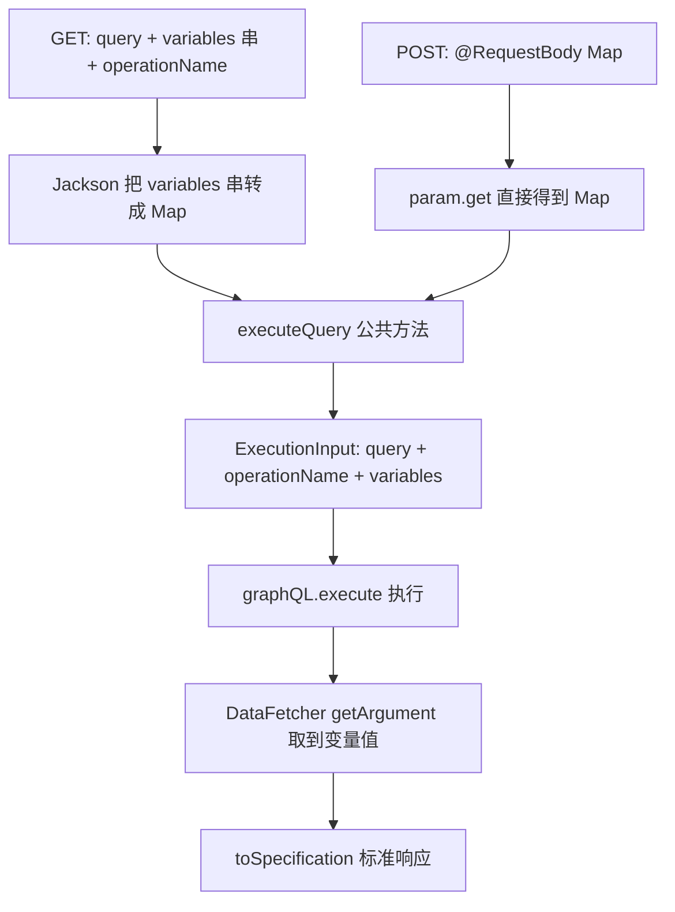

# 服务端接住 GraphQL 变量：ExecutionInput、Jackson 反序列化与 GET/POST 双通道兼容

上一课的客户端已经把 `variables` 塞进了请求体，可服务端的 Controller 还是那行 `graphQL.execute(query)`，只认查询字符串，变量发过来也没人接，带变量的查询依旧拿不到数据。这一课改造 `GraphQLController` 的 GET、POST 两个入口，让变量真正进入执行流程，同时保证老的不带变量的查询一个都不能坏。

## 先给结论

- GET 与 POST 的入口都要增加 `variables`、`operationName` 两个参数，且 `required = false`：`query` 每次请求必有，变量不一定有。
- 点开 `execute(query)` 的源码会发现它最终把入参封装成 `ExecutionInput` 再执行；改造就是显式构造这个对象，三要素是 `query`、`operationName`、`variables`。
- `variables` 需要的类型是 `Map`：GET 通道里它是 JSON 字符串，要用 Jackson 反序列化；POST 通道里 `@RequestBody Map` 反序列化后它本来就是 Map，再当字符串转必然报错。
- GET 与 POST 的执行逻辑收敛到一个公共方法，两个入口只做参数搬运。
- 改完必须回归「不带变量」的旧查询：空 Map、null 都要能兼容，旧功能不能因为支持变量而挂掉。

## 一、两条通道里，变量分别长什么样

同一个端点 `/graphql`，GET 与 POST 携带变量的方式不同。GET 把所有内容平铺在查询串上，点开 Network 面板能看到地址后面跟着一串：

```bash
GET http://127.0.0.1:18080/graphql?query=query%20hk($id:%20Long)...&variables={"id":8}&operationName=hk
```

`query`、`variables`、`operationName` 三个请求参数并排出现。POST 则把整包内容放进请求体：

```json
{
  "query": "query hk($id: Long) { HouseResources(id: $id) { id title estateId buildingUnit buildingFloorNum mobile useArea pic } }",
  "variables": {
    "id": 8
  }
}
```

改造前的 Controller 长这样，GET 只接 `query`，POST 把请求体整体交给 `execute`：

```java
@GetMapping
public Map<String, Object> query(@RequestParam("query") String query) {
    return this.graphQL.execute(query).toSpecification();
}

@PostMapping
@ResponseBody
public Map<String, Object> postQuery(@RequestBody String json) {
    return this.graphQL.execute(json).toSpecification();
}
```

两条通道都要动，但动的姿势不一样，这正是后面的分水岭。

## 二、ExecutionInput：execute 背后的真正入参

顺着 `execute(query)` 点进 graphql-java 的源码，会发现这个便捷重载并没有什么魔法：它把查询字符串装进一个 `ExecutionInput` 对象再执行。`ExecutionInput` 的属性不少，关键的是三个：`query` 查询语句、`operationName` 操作名、`variables` 变量集合，其中 `variables` 的类型是 `Map`。

既然如此，与其依赖便捷重载，不如自己把这三个值填全，显式构造执行输入：

```java
ExecutionInput executionInput = ExecutionInput.newExecutionInput()
        .query(query)
        .operationName(operationName)
        .variables(variables)
        .build();
return this.graphQL.execute(executionInput).toSpecification();
```

`operationName` 就是上一课客户端里 `query hk(...)` 的那个 `hk`，客户端传什么就透传什么；`variables` 则是 `{"id": 8}` 解析出来的 Map。变量值进入 `ExecutionInput` 后，graphql-java 在执行时会把它解析成根查询字段的参数，取数器那边一行代码都不用改：之前写的 `environment.getArgument("id")` 拿到的就是变量传进来的 8，继续往 Dubbo 服务透传查询房源。取参链路在这端接上了头。

## 三、GET 通道：JSON 串变 Map

GET 的 `variables` 是 URL 参数，拿到手必然是个字符串，而 `ExecutionInput` 要的是 Map，中间要过一道 Jackson 反序列化。GET 方法完整改造如下：

```java
private static final ObjectMapper MAPPER = new ObjectMapper();

@GetMapping
public Map<String, Object> query(@RequestParam("query") String query,
                                 @RequestParam(value = "variables", required = false) String variables,
                                 @RequestParam(value = "operationName", required = false) String operationName) {
    try {
        // variables 是 JSON 串，反序列化成 Map<String, Object>
        Map<String, Object> variablesMap = MAPPER.readValue(variables,
                MAPPER.getTypeFactory().constructMapType(HashMap.class, String.class, Object.class));
        return this.executeQuery(query, operationName, variablesMap);
    } catch (Exception e) {
        e.printStackTrace();
    }
    return null;
}
```

两个注解细节决定这个接口的健壮性。**`required = false` 是刻意的。** `query` 是每次请求都有的参数，保持必填；`variables` 和 `operationName` 只有带变量的新式请求才携带，声明为可选，否则老查询打过来直接 400。**反序列化的目标类型要借类型工厂构造。** `MAPPER.getTypeFactory().constructMapType(HashMap.class, String.class, Object.class)` 造出的 MapType 描述了「键是 String、值是 Object 的 HashMap」，泛型擦除之下这是告诉 Jackson 目标结构的标准做法。反序列化可能抛异常，用 try-catch 兜住，失败就按错误路径返回。

## 四、POST 通道：拿到的本来就是 Map

POST 的第一版改造走了弯路：`@RequestBody String json` 拿到整段请求体，于是想当然地把里面的 `variables` 也当成字符串再反序列化一次。断点跟进去才发现，Spring MVC 已经把请求体 JSON 反序列化成了 Map，`param.get("variables")` 取出来的是 `LinkedHashMap`，强转 `String` 当场抛 `ClassCastException`，报错直说「它本身就是一个 Map 类型，不能再转成字符串」。

想通这一层，POST 方法反而更简单，连 Jackson 都用不上了：

```java
@PostMapping
@ResponseBody
public Map<String, Object> postQuery(@RequestBody Map<String, Object> param) {
    String query = (String) param.get("query");
    Map variables = (Map) param.get("variables");
    String operationName = (String) param.get("operationName");
    return this.executeQuery(query, operationName, variables);
}
```

`@RequestBody Map<String, Object> param` 一步到位，三个 `get` 加三个强转就是全部工作。同一份数据在两条通道里的形态不同：GET 里是三层包裹（URL 参数、JSON 串、Map），POST 里 Jackson 已经剥掉了一层，剩下的 Map 直接可用。

## 五、收敛与回归：有变量、无变量都要能查

两条通道的执行部分完全相同，抽成一个公共方法，入口只管备料：

```java
private Map<String, Object> executeQuery(String query, String operationName, Map<String, Object> variables) {
    ExecutionInput executionInput = ExecutionInput.newExecutionInput()
            .query(query)
            .operationName(operationName)
            .variables(variables)
            .build();
    return this.graphQL.execute(executionInput).toSpecification();
}
```



图里 C 与 D 是两条通道唯一的分叉点，之后完全合流，以后加新参数（比如超时、请求头透传）只需动公共方法一处。

测试分三轮。第一轮带变量：GET 与 POST 各发一次 `query hk($id: Long)` 配 `{"id": 8}`，断点确认 `query` 是查询串、`variables` 反序列化成 Map、`operationName` 是 `hk`，返回 id 为 8 的房源数据。第二轮故意把客户端变量声明留在 `Int`，服务端在 `errors` 里报类型不匹配，与 Schema 期望的 `Long` 对不上，把客户端改成 `Long` 后通过。第三轮回归旧查询：删掉变量声明，`id` 直接写死 8，variables 不传，POST 通道里 `param.get("variables")` 拿到的是空 Map，`operationName` 是 null，查询照常返回数据；GET 通道同样无恙。三轮全绿，才算「兼容了有变量与没变量两种形态」。

## 常见误区

- **把 `variables` 的 `@RequestParam` 写成必填。** 默认 `required = true`，老的不带变量的查询一来就 400。可选项一律显式声明 `required = false`。
- **POST 里把 variables 当字符串再反序列化。** `@RequestBody Map` 之下嵌套对象已是 Map，再走一遍 `readValue` 轻则空指针，强转 String 则直接 `ClassCastException`。
- **只测带变量的新请求。** 旧查询、空 variables、缺 operationName 这些形态必须逐个回归，公共方法对 null 与空 Map 的容忍度要亲手验证。
- **以为变量生效要改取数器。** `environment.getArgument("id")` 对静态参数与变量一视同仁，参数解析是 graphql-java 在执行层完成的，DataFetcher 无感知。

## 面试可能被问到的问题

1. 面试官追问：「`ExecutionInput` 和直接传 query 字符串的 `execute` 重载有什么区别？」
   答：字符串重载内部也是封装成 `ExecutionInput` 再执行，只是只填了 query。显式构造可以带上 `operationName` 与 `variables`，还支持往上下文里放对象供 DataFetcher 使用，功能更完整，带变量的请求必须走这个入口。
2. 面试官追问：「GET 和 POST 两种方式传 GraphQL 请求，服务端处理的差异在哪？」
   答：GET 的 query、variables、operationName 都是 URL 参数，variables 到手是字符串，要自行反序列化成 Map；POST 的请求体由 `@RequestBody` 反序列化成 Map，嵌套的 variables 直接就是 Map。两者在执行层没有差异，差异只在参数提取。
3. 面试官追问：「为什么 variables 在 graphql-java 里设计成 Map 而不是强类型对象？」
   答：变量集是动态结构，同一个端点要承接任意 Schema、任意操作的请求，编译期无法确定字段集合。Map 配合 `constructMapType` 的反序列化最通用；类型安全性交给 Schema 校验层在运行期保证，这正是 GraphQL「强类型在契约层、动态在传输层」的分层思想。
4. 面试官追问：「operationName 什么时候有用？」
   答：一份请求文档里放多个具名操作时，靠它指定执行哪个；不传时 graphql-java 执行文档里唯一的操作，多个操作又不指名会直接报错。它同时方便日志追踪与客户端按名字缓存查询。
5. 面试官追问：「接口同时兼容新旧两种请求形态，改造时最该注意什么？」
   答：新参数全部设为可选，公共逻辑对 null 与空集合做兜底，并且把旧形态的请求列成回归用例逐个跑。接口升级最怕「支持了新特性、弄坏了老调用方」，兼容性验证要与新功能验证同权重。

## 配套资料

- 本教学日资料包：`materials/code/03/day07-完善前端功能以及WebSocket入门/day07-完善前端功能以及WebSocket入门/资料/`，其中 `MyResponseBodyAdvice.java` 的导入语句可佐证 api 工程中存在 `GraphQLController`，该类完整源码未随包提供，文中 Controller 与公共方法为按本课画面写法补全的可运行示例，包名沿用本系列成稿的中性命名。
- 取数器 `environment.getArgument("id")` 的原始实现见已成稿的 `0092-实现根据id查询房源数据的GraphQL服务.md`，变量到参后与之无缝衔接。
