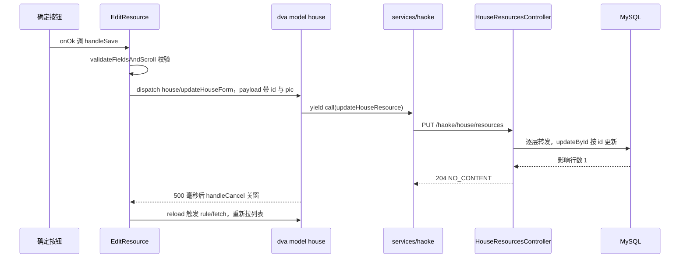

# 编辑保存的最后一公里：dispatch、dva model 与 PUT 落库后的列表刷新

弹窗能弹、数据能显，点「确定」还什么都不会发生：`onOk` 指向的 `handleSave` 还是空壳，模型层与请求层也没有更新这条线。这一课把保存动作从按钮接到数据库，再让列表在提交后自动刷新，顺路记两次联调排障：断点死活不进、提示成功数据却没变。

## 先给结论

- `handleSave` 三步走：`validateFieldsAndScroll` 校验表单，通过后给 `values` 补 `pic` 与 `id` 两个字段，再 `dispatch` 到 `house/updateHouseForm`。
- `id` 来自 `record`，是后端 `updateById` 的更新条件，前端不补这个字段，整次提交等于白点。
- 图片不提交就不覆盖：`pics` 这个 `Set` 为空时跳过拼接，`values.pic` 保持 `undefined`，配合后端忽略空字段的更新策略，原图原样保留。
- 请求层在 `services/haoke.js` 加 `updateHouseResource`，与新增共用地址 `/haoke/house/resources`，方法换成 PUT。
- 提交后 500 毫秒定时器做两件事：关弹窗、调 `reload`；`reload` 是列表页传进来的刷新方法，重新拉一遍列表。

## 一、handleSave：校验、拼装、分发

`Modal` 的 `onOk` 调的就是它，资料包里的 `EditResource.js` 原件如下：

```javascript
handleSave = () => {
  const { dispatch, form, record } = this.props;
  form.validateFieldsAndScroll((err, values) => {
    if (!err) {
      if(this.state.pics.size > 0){
        values.pic = [...this.state.pics].join(',');
      }
      values.id = record.id;

      dispatch({
        type: 'house/updateHouseForm',
        payload: values,
      });
      setTimeout(()=>{
        this.handleCancel();
        this.props.reload();
      },500)
    }
  });
};
```

拆开看三段。**第一段是校验。** `validateFieldsAndScroll` 逐项执行上一课挂在字段上的 `rules`，不合法的字段自动滚动到位并标红，回调里的 `err` 不为空就直接返回，`values` 一行都不往后送。**第二段是拼装。** 图片集合用 `[...this.state.pics].join(',')` 把 `Set` 展开成逗号串塞进 `values.pic`，注意外层的 `if`：用户没动过图片时 `Set` 是空的，跳过赋值，`values.pic` 保持 `undefined`。这正是部分更新语义的配合动作，后端 MyBatis-Plus 的 `updateById` 对空字段不出现在 `SET` 子句里，原图原样保留；只要用户增删过一张图，整串新值就整体覆盖。`values.id = record.id` 则是硬性要求，更新条件全靠主键。**第三段是分发与善后。** `dispatch` 把数据送进 dva model，500 毫秒定时器里关掉弹窗并调 `this.props.reload()`。

## 二、reload 从哪来：列表页递进来的刷新方法

`reload` 不在 `EditResource` 组件里，是列表页 `Resource.js` 自己的方法，经操作列的 JSX 传进来：

```javascript
reload () {
  const { dispatch } = this.props;
  dispatch({
    type: 'rule/fetch',
  });
}
```

`rule/fetch` 是脚手架里现成的列表拉取 effect，页面 `componentDidMount` 里首次加载数据调的也是它。提交后复用同一个入口，列表回到最新状态。传递时 `bind(this)` 把列表页的 `this` 焊死在方法上，操作列里的写法是 `<EditResource record={record} reload={this.reload.bind(this)}/>`，子组件拿到手就能直接调。若不绑定，方法进了子组件后 `this.props` 是别人的，`dispatch` 取不到，刷新静默失效。

## 三、model 与 service：updateHouseForm 落成 PUT

dva 的流程上一条线在新增房源时已经跑通过，更新照方抓药加一条平行线。`House.js` 模型的 `effects` 里，紧挨着 `submitHouseForm` 补 `updateHouseForm`：

```javascript
import { message } from 'antd';
import { addHouseResource, updateHouseResource } from '@/services/haoke';

export default {
  namespace: 'house',
  state: {},
  effects: {
    *submitHouseForm({ payload }, { call }) {
      yield call(addHouseResource, payload);
      message.success('提交成功');
    },
    *updateHouseForm({ payload }, { call }) {
      yield call(updateHouseResource, payload);
      message.success('提交成功');
    },
  },
};
```

effect 里 `yield call(updateHouseResource, payload)` 把参数原样递给 service 层，等请求返回后弹「提交成功」。`services/haoke.js` 里加请求函数，与新增共用同一个地址，方法换成 PUT：

```javascript
export async function updateHouseResource (params) {
  return request('/haoke/house/resources', {
    method: 'PUT',
    body: params
  });
}
```

`/haoke` 前缀经代理网关落到 api 工程的 `/house/resources`，也就是上一课写好的 `@PutMapping` 入口。到这里，从按钮到数据库的整条链路闭环：



## 四、联调实录：断点不进与数据不动

代码齐了就开始测，第一次点「确定」就熄火：请求没出现在 Network 面板，api 工程 Controller 里打好的断点纹丝不动，控制台报的是 `updateHouseForm` 相关的错误。逐层核对 `dispatch` 的 type、model 的 `namespace` 与 effect 键名，拼写全对。问题的真相是新增了 model 与 service 文件后，前端开发服务没有重启，dva 的模型注册发生在编译期，热更新救不了新挂载的文件。把前端开发服务与 api 服务双双重启，再点「编辑」，租金改成 3000、加一张图、点「确定」，断点应声命中，断点里的 `HouseResources` 对象 id 为 1，标题、图片串齐全，数据完整到达服务端。

放行断点后还有第二段小插曲：页面弹了「提交成功」，刷新列表却发现租金没变。这次代码本身没毛病，是服务重启过程中的中间状态把结果搅了，等服务就绪后重新提交，列表变成 3000，数据库里同步确认。图片的增删也验了一遍：从三张删成两张，列表里那张图跟着消失；再加一张，新地址落库。判断这次更新链路是否真正打通，标准始终是三个：断点进没进、数据库变没变、刷新后的列表对不对，页面提示只作参考。

## 常见误区

- **改了 model 或 service 不重启前端服务。** dva 模型在编译期注册，热更新覆盖不到新增文件，`dispatch` 找不到 effect 时页面不白屏也不报红，只有控制台一条提示，极易误判成代码写错。
- **漏掉 `values.id = record.id`。** 表单字段里没有 id，校验回调的 `values` 天然不带它，后端 `updateById` 匹配不到行，接口返回失败，数据库却毫无动静。
- **用户没动图片也强行拼 `values.pic`。** 拼出空串会把图片字段整体覆盖掉，老图全没。空 `Set` 时跳过赋值，让后端按部分更新跳过这一列。
- **以页面提示为成功依据。** `message.success` 弹出只说明请求流程走完，最终以响应状态码与数据库为准，「提示成功但数据没变」先查库、再查后端断点，而不是回头乱改前端。

## 面试可能被问到的问题

1. 面试官追问：「dva 里 dispatch 到 effect 之后发生了什么？」
   答：dispatch 把 action 交给 dva 运行时，按 `namespace/effect` 定位到对应生成器，effect 通过 `call` 调用异步函数（本例是 service 的请求函数），用 `put` 分发 reducer 改 state。本例更新结果不需要沉淀进页面 state，所以只有 `call` 与一条成功提示，没有 reducer 参与。
2. 面试官追问：「提交后为什么用 `setTimeout` 500 毫秒关窗，有什么隐患？」
   答：目的等请求发完再关窗并刷新列表。隐患是它靠猜时间：请求快于 500 毫秒窗口多等，慢于 500 毫秒弹窗提前关闭、用户误以为没提交。更稳的做法是让 dispatch 返回的 promise 链式处理，在 then 里关窗刷新，时序完全跟随请求。
3. 面试官追问：「图片集合用 `Set` 而不是数组，图什么？」
   答：新旧图片来源有两条线，上传新图来自服务端响应，老图来自回显的 `url`，两条线可能交叠。`Set` 在收集阶段自动去重，避免同一张图在串里出现两次；提交时 `[...set].join(',')` 一步转成存储格式。
4. 面试官追问：「前端把 id 放进提交体，怎么防止用户篡改改到别人的数据？」
   答：前端传 id 只是便利，真正防线在服务端：登录态关联的权限校验，校验当前用户对这条房源是否有写权限，越权直接拒绝。资源归属校验永远以服务端持有的身份与数据为准，前端参数只当输入。
5. 面试官追问：「提交接口怎么判断成功，前端和后端各看什么？」
   答：后端看影响行数是否等于 1 并回 204，异常回 500；前端看状态码，非 2xx 时请求工具抛错，effect 里的 success 提示不会弹出。严谨一点还应把「提示成功」与「业务成功」分开处理，比如列表刷新失败时回滚提示，避免用户看着「提交成功」却在旧数据上继续编辑。
6. 面试官追问：「为什么更新和新增共用同一个地址 `/haoke/house/resources`？」
   答：RESTful 的资源模型里两者操作的是同一份资源，地址相同、动词不同，POST 创建、PUT 更新，路由与代码组织都更收敛。代价是排查问题时不能只看 URL，要结合请求方法与状态码一起读 Network 面板。

## 配套资料

- `handleSave`、`pics` 状态与弹窗逻辑原件：`materials/code/03/day07-完善前端功能以及WebSocket入门/day07-完善前端功能以及WebSocket入门/资料/EditResource.js`，文中提交代码即出自该文件。
- dva 模型 `house/updateHouseForm` 与 `services/haoke.js` 的 `updateHouseResource` 无源码包，为按本课讲义画面写法补全的可运行示例；新增房源的对应流程已成稿于 `0066-前后端整合开发之新增房源.md`，两条线完全平行。
