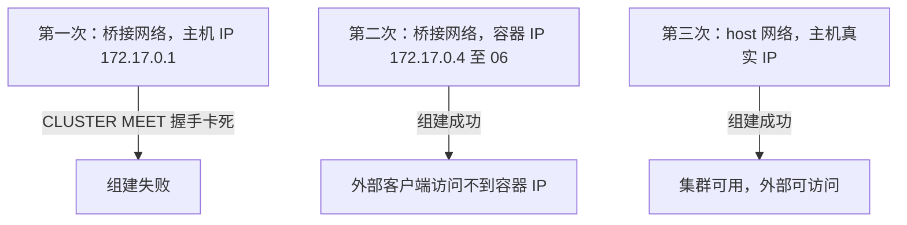

# 通过 Docker 搭建 Redis 集群：三种地址写法的三次尝试与 host 网络解法

服务端缓存方案已经定下来要写 Redis，而单机 Redis 既是单点故障源，也有容量上限，集群要提前搭好。课程在这一节用 Docker 在一台机器上拉起三个 Redis 节点，过程中接连撞上两个奇怪的问题：用主机 IP 组建集群握手握不通，换成容器 IP 组建成功后外部程序又够不着。两个问题合起来指向同一个根源，Docker 的默认网络模式。

## 先给结论

- 默认桥接网络下用主机 IP `172.17.0.1` 组建集群，节点间握手卡在 `Waiting for the cluster to join` 不动；但用 `redis-cli -h 172.17.0.1 -p 6380` 逐个测试，每个节点都访问得到。课程现场未查明原因，直接换路。
- 换成容器 IP `172.17.0.4` 到 `172.17.0.6` 能组建成功，`set` 经重定向也能读写；但集群广播出去的地址是容器内部 IP，外部客户端（比如 Jedis 程序）根本访问不到，这个集群对外不可用。
- 两种地址的矛盾由 Docker 的 host 网络模式化解：容器与宿主机共享网络与端口，不再需要 `-p` 映射，节点直接以 `--port 6379、6380、6381` 起在宿主机上，用主机真实 IP 组建一次成功。
- 组建命令是 `redis-cli --cluster create 三个节点 --cluster-replicas 0`，`--cluster-replicas 0` 表示没有副本，三个节点全是 master。
- 版本差异记一笔：Redis 3 及之前组建集群要靠 Ruby 脚本，Redis 4 与 5 直接用 `redis-cli` 即可。

## 第1部分：通过 Docker 搭建 Redis 集群

### 拉镜像、建容器、启动

镜像用 `redis:5.0.2`，三个节点各建一个容器，数据目录分开挂载：

```bash
# 拉取镜像
docker pull redis:5.0.2

# 创建容器
docker create --name redis-node01 -v /data/redis-data/node01:/data -p 6379:6379 redis:5.0.2 --cluster-enabled yes --cluster-config-file nodes-node-01.conf
docker create --name redis-node02 -v /data/redis-data/node02:/data -p 6380:6379 redis:5.0.2 --cluster-enabled yes --cluster-config-file nodes-node-02.conf
docker create --name redis-node03 -v /data/redis-data/node03:/data -p 6381:6379 redis:5.0.2 --cluster-enabled yes --cluster-config-file nodes-node-03.conf

# 启动容器
docker start redis-node01 redis-node02 redis-node03

# 进入 redis-node01 进行操作
docker exec -it redis-node01 /bin/bash
```

三个参数决定节点身份：`--cluster-enabled yes` 打开集群模式；`--cluster-config-file` 指定集群配置文件名，三个节点必须各用各的；`-p` 做端口映射，容器内部统一暴露 6379，宿主机上分别对应 6379、6380、6381。数据卷挂到容器的 `/data`，Redis 镜像默认把数据写在那里。

容器起来只是三个独立服务，集群还没影子。组建集群的命令要在任一节点容器内执行。

### 第一次尝试：主机 IP，握手卡死

集群要组建，得告诉每个节点其他成员的地址。第一次自然想到用主机地址，`172.17.0.1` 是 Docker 在宿主机上网卡 `docker0` 的 IP，也就是主机在容器视角的地址：

```bash
redis-cli --cluster create 172.17.0.1:6379 172.17.0.1:6380 172.17.0.1:6381 --cluster-replicas 0
```

命令执行后输出正常：三个节点完成哈希槽分配（每个 master 分到 5461 个插槽），确认 `yes` 后开始发送 `CLUSTER MEET` 消息加入集群，然后卡在 `Waiting for the cluster to join` 不再前进。

奇怪的地方在于连通性明明没问题。在容器内逐个测试：

```bash
redis-cli -h 172.17.0.1 -p 6380 ping
# PONG
redis-cli -h 172.17.0.1 -p 6381 ping
# PONG
```

容器内部通过主机 IP 加端口完全能访问到另外两个 Redis 服务，组建集群时却握不上手。原因是课程现场没有找到的，这个悬念留到第二部分由 host 网络一并解决。

### 第二次尝试：容器 IP，组成了却用不了

既然主机 IP 不行，换每个容器自己的 IP 试试。先清干净重来：停掉并删除三个容器，删掉数据目录，重新创建容器并启动，再查地址：

```bash
# 查看各容器的 IP
docker inspect redis-node01    # 172.17.0.4
docker inspect redis-node02    # 172.17.0.5
docker inspect redis-node03    # 172.17.0.6

# 删除容器
docker stop redis-node01 redis-node02 redis-node03
docker rm redis-node01 redis-node02 redis-node03
rm -rf /data/redis-data
```

重建后进入 redis-node01，用容器 IP 组建集群。这次与上次的区别只有一个：地址从「主机 IP 加主机端口」换成「各容器 IP 加统一的 6379」，容器对外暴露的端口本来就是 6379，变的只是 IP：

```bash
redis-cli --cluster create 172.17.0.4:6379 172.17.0.5:6379 172.17.0.6:6379 --cluster-replicas 0
```

输入 `yes` 后握手顺利，集群组建成功。验证读写：

```bash
redis-cli -c
127.0.0.1:6379> set abc 123
-> Redirected to slot [7638] located at 172.17.0.5:6379
OK
127.0.0.1:6379> get abc
"123"
```

`-c` 开启重定向跟随，`set abc 123` 被重定向到 172.17.0.5 执行，`get` 也能原样取回，集群功能正常。再看集群全貌：

```bash
127.0.0.1:6379> cluster nodes
# 每个节点的容器 IP、角色与插槽段一目了然
```

但隐患就藏在 `cluster nodes` 的输出里：集群成员互认用的全是 `172.17.0.x` 这种容器内部 IP。设想集群已经上线，一个 Jedis 客户端程序连进集群，向任一节点询问槽位分布，节点返回的地址全是容器 IP。部署应用的机器与跑 Redis 的机器大概率不在同一台宿主机上，容器 IP 在外面根本不可达，这个集群对它而言等于不存在。

把主机真实 IP（比如 `172.16.55.185`）填进组建命令行不行？也不行。客户端程序从外部访问主机 IP 没问题，但组建集群时的节点握手发生在容器之间，容器内部访问不了那个外部 IP，组建同样会失败。三个方案摆在一起，处境相当纠结：主机 IP（`172.17.0.1`）从外可达却组不了集群，容器 IP 能组成集群却从外不可达，真实主机 IP 两侧都不讨好。



## 第2部分：通过 Docker 搭建 Redis 集群（解决 IP 地址的问题）

### 四种 Docker 网络类型

解铃还得看 Docker 的网络模型。Docker 提供四种网络类型：

| 类型 | 含义 | 使用场景 |
|---|---|---|
| none | 不给容器配网络 | 极少使用 |
| container | 容器直接连接另一个容器的网络 | 用得较少，未来可能废弃 |
| host | 与宿主机共享网络，IP 与端口都共享 | 本课的解法 |
| bridge | 桥接模式，Docker 的默认类型 | 默认方式，本课前两次尝试用的就是它 |

问题正出在默认的 bridge：容器有自己的网络命名空间，有自己的 IP，集群成员互认时广播出去的就是这个容器 IP，外部世界到不了。host 模式把容器「拍扁」进宿主机的网络里，容器没有独立网络命名空间，直接共享宿主机的 IP 与端口，可以把容器看作宿主机上直接安装的一个服务。代价是容器直接暴露在宿主机的网络中，能访问宿主机就能访问容器，存在安全隐患，当前这个问题只能靠它解决。

### host 模式重建容器

host 模式下创建容器的命令变化有两处：加 `--net host`；去掉 `-p` 端口映射，改成用 `--port` 直接指定容器内 Redis 的端口。既然共享宿主机网络，容器端口就是宿主机端口，映射已经没有意义：

```bash
# 停止并删除旧容器，清理数据目录后重建
docker create --name redis-node01 --net host -v /data/redis-data/node01:/data redis:5.0.2 --cluster-enabled yes --cluster-config-file nodes-node-01.conf --port 6379
docker create --name redis-node02 --net host -v /data/redis-data/node02:/data redis:5.0.2 --cluster-enabled yes --cluster-config-file nodes-node-02.conf --port 6380
docker create --name redis-node03 --net host -v /data/redis-data/node03:/data redis:5.0.2 --cluster-enabled yes --cluster-config-file nodes-node-03.conf --port 6381

# 启动容器
docker start redis-node01 redis-node02 redis-node03

# 进入 redis-node01
docker exec -it redis-node01 /bin/bash
```

### 主机 IP 一次组建成功

进入容器后，用主机真实 IP `172.16.55.185` 组建集群。此时 6379、6380、6381 既是宿主机上的端口，也是容器内 Redis 的端口，地址不再有两套：

```bash
redis-cli --cluster create 172.16.55.185:6379 172.16.55.185:6380 172.16.55.185:6381 --cluster-replicas 0
```

槽位分配、`yes` 确认、`CLUSTER MEET` 握手一气呵成，组建成功。用 `cluster nodes` 查看，成员地址全部是主机 IP；对外暴露这组 IP 后，外部应用必然能访问到每一个服务，前面纠结的矛盾就此化解。照例做读写验证：

```bash
redis-cli -c
127.0.0.1:6379> set abc 123
OK
127.0.0.1:6379> get abc
"123"
```

重定向、写入、读取全部正常，集群搭建完成。回顾三次尝试：bridge 网络下无论用主机 IP 还是容器 IP 都有一侧不通，host 网络让容器与宿主机共用一套地址，节点广播出去的地址外部恰好可达，这正是它能成为 Docker 环境下组建 Redis 集群标准做法的原因。

## 常见误区

- **以为 `-p 6380:6379` 映射后集群也能用。** 端口映射只作用于客户端进出的连接，集群成员互认时广播的是自己的网络地址，bridge 网络下广播出去的是容器 IP，外部照样到不了。集群场景要么用 host 网络，要么在容器层显式声明对外通告地址。
- **组建集群忘了带 `--cluster-replicas` 参数。** 不带参数时默认按无副本处理，命令容易直接报错或行为与预期不符；`--cluster-replicas 0` 明确写出三个节点全是 master，意图更清晰。
- **三个节点共用同一个 `--cluster-config-file` 文件名。** 集群配置文件记录节点身份与槽位信息，重名会互相覆盖，节点身份错乱。每个节点必须独享一个文件名。
- **把 Redis 3 的 Ruby 脚本经验照搬到 5.0。** 3.x 组建集群依赖 `redis-trib.rb`，还要装 Ruby 环境；4 与 5 已经内置到 `redis-cli --cluster` 子命令，环境需求少得多，资料要与版本对齐。

## 面试可能被问到的问题

1. 面试官追问：「为什么 Docker 里组建 Redis 集群要用 host 网络？」
   答：集群成员互认时会把各自的地址广播给其他节点，客户端也会拿到这些地址做路由。bridge 网络下广播的是容器内部 IP，宿主机外部不可达；host 网络让容器直接共享宿主机的 IP 与端口，广播出去的地址外部天然可达，组建与使用两侧都通。

2. 面试官追问：「host 网络模式有什么代价？」
   答：容器没有独立网络命名空间，直接暴露在宿主机网络里，端口冲突要自己避免，能访问宿主机就能访问容器，隔离性变差。本课为了解决集群地址问题接受这个代价，安全要求高的环境要用 overlay 等方案并配置节点通告地址。

3. 面试官追问：「`--cluster-replicas 0` 是什么意思，生产上该设多少？」
   答：表示每个主节点配几个从节点，0 即无副本，三个节点全是 master。生产环境至少设 1，保证每个主有从，主节点宕机时由从节点顶上；设 1 时节点总数要为 3 的倍数。

4. 面试官追问：「组建集群卡在 Waiting for the cluster to join，可能有哪些原因？」
   答：节点间握手需要双向可达，常见原因包括节点地址写错（写成了外部不可达或内部不可达的 IP）、总线端口（业务端口加 10000）被防火墙挡住、节点未开启 cluster 模式、集群配置文件混用导致身份错乱。排查思路是先逐个 `ping` 端口确认连通，再核对 `cluster nodes` 里的地址。

5. 面试官追问：「Redis 5 的 `redis-cli --cluster create` 与旧版 Ruby 脚本有什么区别？」
   答：功能等价，都是完成槽位分配、节点握手与主从指派；5.0 把集群管理集成进 redis-cli 的 cluster 子命令，去掉了 Ruby 依赖，还提供 check、reshard、add-node 等运维子命令，旧脚本在 5.0 之后不再维护。

## 配套资料

- 本课无配套源码包：`materials/code/03/day07-完善前端功能以及WebSocket入门/day07-完善前端功能以及WebSocket入门/资料/` 目录收录的是缓存方案相关代码（`RedisCacheInterceptor.java`、`MyResponseBodyAdvice.java`、`MyServletRequestWrapper.java`、`RequestReplaceFilter.java` 等），不含集群搭建脚本。
- 拉镜像、建容器、组建集群、`cluster nodes` 与 set/get 验证命令抄录自本课讲义画面与终端实录；第二次尝试前的删容器、清数据目录命令取自讲义画面；`docker inspect` 查 IP 与三次尝试的失败现象按本课讲解整理。
