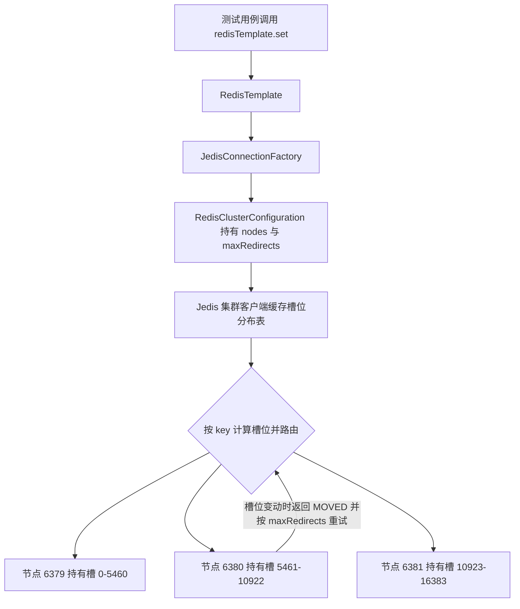

# Spring Boot 接入 Redis 集群：把命令行验证变成程序验证

前面用 Docker 把三主节点的 Redis Cluster 组建了起来，`redis-cli` 里 `set`、`get`、`CLUSTER NODES` 都能走通。但集群终究是给业务程序用的，命令行通过只证明集群自身健康，程序这一侧还有三个独立的问题要过：客户端能不能识别集群拓扑、能不能按槽路由命令、收到 MOVED 重定向能不能自动跟随。这一节把 Spring Boot 工程真正连上 172.16.55.185 的三节点集群，循环写入 100 条数据再读回来，完成程序视角的最终验证。

## 先给结论

- 依赖两件套：`spring-boot-starter-data-redis` 提供 Spring Data Redis，`jedis` 提供集群客户端；课程工程显式使用 Jedis，不引 Jedis 时 Spring Boot 2.x 默认的 Lettuce 连接集群同样可行。
- 配置文件写 `spring.redis.cluster.nodes` 与 `spring.redis.cluster.max-redirects`，但这两个配置不会自动生效，必须自己写配置类去绑定。
- 配置类分两层：`ClusterConfigurationProperties` 用 `@ConfigurationProperties` 读属性，`RedisClusterConfig` 据此构建 `RedisClusterConfiguration`、`JedisConnectionFactory` 与 `RedisTemplate`。
- `max-redirects` 设为 5：命令被发到不持有对应槽的节点时，客户端会收到 MOVED 重定向，这个值限制最多自动跟随几次。
- 测试循环写入 `key_0` 到 `key_99` 再全部读出，最后用 `redis-cli` 登录不同端口节点，确认数据按槽散落在各节点上。

## 一、命令行通过不等于程序通过

Redis Cluster 把 16384 个槽（slot）分给各个主节点，key 经过 CRC16 算法对 16384 取模，落进某个槽，再由槽找到持有它的节点。本课集群的槽位划分是：6379 节点持有 0～5460，6380 节点持有 5461～10922，6381 节点持有 10923～16383。

命令行验证只能证明集群搭建本身没问题。程序接入时，Spring Data Redis 会用连接工厂创建出集群客户端，客户端启动时向节点询问槽位分布表并缓存，之后每条命令先在本地算槽、再路由到对应节点。一旦某个节点的槽位发生迁移而客户端缓存还是旧表，命令就会收到 MOVED 响应，客户端要凭 `max-redirects` 允许的次数去重试新地址。这一整套行为只有在真实代码里跑一遍才算数。



这张图是程序侧的完整链路：从 `RedisTemplate` 一路下探到 Jedis 集群客户端，槽路由和 MOVED 重试都发生在最下面一层，上层业务代码对此完全无感。

## 二、依赖与配置文件

pom 中引入四个坐标，其中 `commons-io` 是给后面的缓存拦截器读请求体用的，这里一并引入：

```xml
<dependency>
    <groupId>org.springframework.boot</groupId>
    <artifactId>spring-boot-starter-data-redis</artifactId>
</dependency>
<dependency>
    <groupId>redis.clients</groupId>
    <artifactId>jedis</artifactId>
    <version>2.9.0</version>
</dependency>
<dependency>
    <groupId>org.apache.commons</groupId>
    <artifactId>commons-lang3</artifactId>
    <version>3.10.0</version>
</dependency>
<dependency>
    <groupId>org.apache.commons</groupId>
    <artifactId>commons-io</artifactId>
    <version>2.6</version>
</dependency>
```

`application.properties` 里追加集群配置：

```properties
# redis集群配置
spring.redis.jedis.pool.max-wait = 5000
spring.redis.jedis.pool.max-idle = 100
spring.redis.jedis.pool.min-idle = 10
spring.redis.timeout = 10
spring.redis.cluster.nodes = 172.16.55.185:6379,172.16.55.185:6380,172.16.55.185:6381
spring.redis.cluster.max-redirects=5
```

`nodes` 只要写任意几个节点即可，客户端会通过它们把整个集群的拓扑问出来，这里把三个主节点全列上了。连接池三参数与 `timeout` 是常规调优项，按环境调整。

## 三、两个配置类：把 properties 变成连接工厂

**第一，属性绑定类。** `spring.redis.cluster` 前缀下的配置不会自动映射到任何现成对象，要自己声明一个类来接：

```java
package com.example.haoke.dubbo.api.config;

import lombok.Data;
import org.springframework.boot.context.properties.ConfigurationProperties;
import org.springframework.stereotype.Component;
import java.util.List;

@Component
@ConfigurationProperties(prefix = "spring.redis.cluster")
@Data
public class ClusterConfigurationProperties {
    private List<String> nodes;
    private Integer maxRedirects;
}
```

`nodes` 对应逗号分隔的节点列表，`maxRedirects` 对应最大重定向次数，`@Data` 免去手写 getter 和 setter。

**第二，集群配置类。** 用绑定好的属性构建连接工厂和模板：

```java
package com.example.haoke.dubbo.api.config;

import org.springframework.beans.factory.annotation.Autowired;
import org.springframework.context.annotation.Bean;
import org.springframework.context.annotation.Configuration;
import org.springframework.data.redis.connection.RedisClusterConfiguration;
import org.springframework.data.redis.connection.RedisConnectionFactory;
import org.springframework.data.redis.connection.jedis.JedisConnectionFactory;
import org.springframework.data.redis.core.RedisTemplate;
import org.springframework.data.redis.serializer.StringRedisSerializer;

@Configuration
public class RedisClusterConfig {

    @Autowired
    private ClusterConfigurationProperties clusterProperties;

    @Bean
    public RedisConnectionFactory connectionFactory() {
        RedisClusterConfiguration configuration = new RedisClusterConfiguration();
        configuration.setNodes(clusterProperties.getNodes());
        configuration.setMaxRedirects(clusterProperties.getMaxRedirects());
        return new JedisConnectionFactory(configuration);
    }

    @Bean
    public RedisTemplate<String, String> redisTemplate(RedisConnectionFactory redisConnectionFactory) {
        RedisTemplate<String, String> redisTemplate = new RedisTemplate<>();
        redisTemplate.setConnectionFactory(redisConnectionFactory);
        redisTemplate.setKeySerializer(new StringRedisSerializer());
        redisTemplate.setValueSerializer(new StringRedisSerializer());
        redisTemplate.afterPropertiesSet();
        return redisTemplate;
    }
}
```

这里有个容易看漏的点：实例化的必须是 `JedisConnectionFactory`，它是 `RedisConnectionFactory` 接口在 Jedis 客户端下的实现，直接 new 接口是编译不过的。把集群配置对象传进去，连接工厂就具备了集群拓扑与重定向语义。`RedisTemplate` 的 key 与 value 都换成 `StringRedisSerializer`，否则默认的 JDK 序列化会在 key 前面加一串二进制头，`redis-cli` 里 `keys` 命令就看不到写入的数据了。

## 四、测试用例：100 条数据验证槽路由

在 `src/test` 下新建测试类，注入容器里的 `RedisTemplate`，写 100 条、读 100 条：

```java
package com.example.haoke.dubbo.api;

import org.junit.Test;
import org.junit.runner.RunWith;
import org.springframework.beans.factory.annotation.Autowired;
import org.springframework.boot.test.context.SpringBootTest;
import org.springframework.data.redis.core.RedisTemplate;
import org.springframework.test.context.junit4.SpringRunner;

@RunWith(SpringRunner.class)
@SpringBootTest
public class TestRedis {

    @Autowired
    private RedisTemplate<String, String> redisTemplate;

    @Test
    public void testSave() {
        for (int i = 0; i < 100; i++) {
            this.redisTemplate.opsForValue().set("key_" + i, "value_" + i);
        }
        for (String key : this.redisTemplate.keys("key_*")) {
            String value = this.redisTemplate.opsForValue().get(key);
            System.out.println(value);
        }
    }
}
```

跑起来后控制台依次打印出 100 条 value，说明写入与读取全部成功。再登录集群用命令验证数据分布：

```bash
redis-cli
127.0.0.1:6379> CLUSTER NODES
# 三个 master 分别 connected，槽段 0-5460 / 5461-10922 / 10923-16383
127.0.0.1:6379> keys key_*
# 只能看到落在 0-5460 槽段内的部分 key
redis-cli -p 6380
172.16.55.185:6380> get key_58
"value_58"
```

100 条数据没有堆在一个节点上，而是按 key 的槽位散落到三个 master；在 6380 节点上直接 `get key_58` 也能拿到值。写入、读取、分布三项都对上了，程序接入集群宣告完成。删除操作用同一批 key 循环 `delete` 即可，能写能读的前提下删除不会出问题。

## 常见误区

- **以为写完 `spring.redis.cluster.*` 就能直接用。** Spring Boot 自动配置确实认这些 key，但课程工程自定义了连接工厂，属性绑定类和配置类一个都不能少，否则 `RedisTemplate` 拿到的还是单机语义的连接。
- **连接工厂 new 错类。** `RedisConnectionFactory` 是接口，能实例化的是 `JedisConnectionFactory`（Jedis 方案）或 `LettuceConnectionFactory`（Lettuce 方案），选哪个取决于引了哪个客户端。
- **不设 `StringRedisSerializer`。** 默认序列化会让 key 带上二进制前缀，程序里读写自洽，一旦用 `redis-cli` 排查就全对不上号。
- **把 `max-redirects` 当可有可无。** 集群扩缩容迁移槽位期间，客户端缓存旧表是常态，重定向次数太小会让本可自愈的请求直接报错。

## 面试可能被问到的问题

1. 面试官追问：「Redis Cluster 是怎么定位一个 key 的？」
   答：对 key 做 CRC16 计算后对 16384 取模得到槽号，每个主节点负责一段连续槽区间。客户端缓存「槽到节点」的分布表，本地算完槽直接把命令发往对应节点，不经过任何中间代理层。

2. 面试官追问：「MOVED 和 ASK 重定向有什么区别？」
   答：MOVED 表示槽已经整体迁走，客户端应更新本地槽表并把后续请求发往新节点；ASK 表示槽正在迁移中，本次请求带上 ASKING 标记去目标节点执行一次，但不更新槽表。前者是永久性指引，后者是临时性引导。

3. 面试官追问：「`spring.redis.cluster.max-redirects` 是干什么的？」
   答：限制客户端单次命令最多跟随几次 MOVED 重定向。设 5 意味着最多辗转 5 次找到正确节点，超过就抛异常，防止拓扑异常时请求被无限转发。

4. 面试官追问：「Spring Data Redis 里 Jedis 和 Lettuce 怎么选？」
   答：Jedis 是同步阻塞客户端，连接实例不是线程安全的，需要连接池支撑并发；Lettuce 基于 Netty，异步非阻塞，同一个连接可以被多线程安全共享。Spring Boot 2.x 默认用 Lettuce，课程工程为了和 Jedis 连接池参数配套显式换成了 Jedis。

5. 面试官追问：「为什么自定义 `RedisTemplate` 要设置 `StringRedisSerializer`？」
   答：`RedisTemplate` 默认用 JDK 序列化，key 和 value 都带序列化头字节，可读性差且与 `redis-cli` 排查、其他语言客户端互不兼容。换成 `StringRedisSerializer` 后存的就是纯字符串，配合 `StringRedisTemplate` 也是同样的效果。

6. 面试官追问：「集群模式下 `keys pattern` 这种命令的行为和单机一样吗？」
   答：不完全一样。`KEYS` 本身是节点级命令，Spring Data Redis 的集群连接会遍历各主节点分别执行再合并结果，数据量大时开销显著，生产环境应使用 `SCAN` 游标遍历代替。

## 配套资料

- 本课示例中的 `ClusterConfigurationProperties`、`RedisClusterConfig`、`TestRedis` 来自课程讲义画面，工程源码包未单独收录，文中版本按课程写法补全为可运行形式（包名已改为中性 `com.example.haoke`）。
- day07 资料包真实源码（下一节起的缓存方案会用到）：
  `materials/code/03/day07-完善前端功能以及WebSocket入门/day07-完善前端功能以及WebSocket入门/资料/RedisCacheInterceptor.java`
