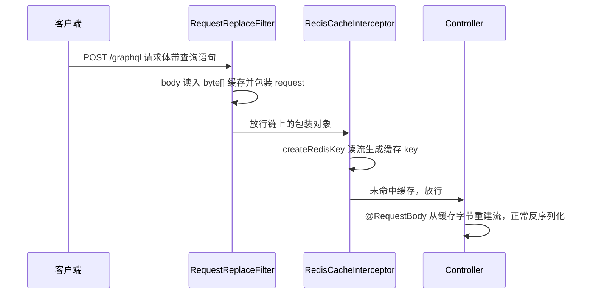

# 拦截器读过请求体，Controller 就拿不到数据：把流变成可重复读

给 GraphQL 查询加缓存的路上有个绕不开的坑：POST 方式的 `/graphql` 请求，查询语句在请求体里，拦截器为了生成缓存 key 读了一次 `request.getInputStream()`，等请求走到 Controller，`@RequestBody` 反序列化时流里已经空空如也，查询直接失败。这是 Servlet 开发里很经典的问题：请求体的输入流只能读一次。解决它的思路是把 request 重新包装一层，让「读流」变成「读缓存」，课程资料里给出了完整的包装类与过滤器实现，本节把它讲透。

## 先给结论

- 输入流只能读一次是 Servlet 规范使然：流是网络连接上的字节序列，读完指针就到尾部，没有自动缓冲。
- 解法是自定义 `MyServletRequestWrapper` 继承 `HttpServletRequestWrapper`，构造时把 body 一次性读进 `byte[]`，再重写 `getInputStream` 与 `getReader`，每次都从这份字节缓存重建流。
- 包装要靠过滤器完成：`RequestReplaceFilter` 继承 `OncePerRequestFilter`，发现 request 不是包装类就包一层再放行。
- `OncePerRequestFilter` 的价值是保证过滤器在一次请求里只执行一次，避免内部跳转（如 forward）导致重复包装。
- 全链路验证通过：拦截器读流拿到参数，Controller 的 `@RequestBody` 依然能拿到完整数据。

## 一、问题出在哪一步

先看出问题的现场。Controller 侧是一个标准的 GraphQL 入口：

```java
@PostMapping
@ResponseBody
public Map<String, Object> postQuery(@RequestBody Map<String, Object> param) {
    try {
        String query = (String) param.get("query");
        Map variables = (Map) param.get("variables");
        String operationName = (String) param.get("operationName");
        return this.executeQuery(query, operationName, variables);
    } catch (Exception e) {
        e.printStackTrace();
    }
    Map<String, Object> error = new HashMap<>();
    error.put("status", 500);
    return error;
}
```

拦截器侧，缓存 key 由「URI + 请求参数」做 MD5 拼出来：

```java
public static String createRedisKey(HttpServletRequest request) throws Exception {
    String paramStr = request.getRequestURI();
    Map<String, String[]> parameterMap = request.getParameterMap();
    if (parameterMap.isEmpty()) {
        // POST 请求参数在请求体里，只能从输入流读
        paramStr += IOUtils.toString(request.getInputStream(), "UTF-8");
    } else {
        paramStr += mapper.writeValueAsString(request.getParameterMap());
    }
    String redisKey = "WEB_DATA_" + DigestUtils.md5Hex(paramStr);
    return redisKey;
}
```

`/graphql` 是 POST 且参数在 body 里，`parameterMap` 为空，走的是 `IOUtils.toString(request.getInputStream())`。这一读，流就到了末尾。随后 `@RequestBody` 由 `HttpMessageConverter` 处理，它同样要从 `request.getInputStream()` 里拿 JSON，读到的是空内容，反序列化失败，查询报错。根因就一句话：**同一个请求体的字节流，框架层面没有提供「重读」能力。**

## 二、包装类：把流换成可重复读的字节缓存

资料里的 `MyServletRequestWrapper` 思路很直接：构造时把 body 读成字节数组存起来，之后所有对流器的调用都从这份缓存出发。核心部分如下（内部类完整实现见资料文件）：

```java
public class MyServletRequestWrapper extends HttpServletRequestWrapper {

    private final byte[] body;

    public MyServletRequestWrapper(HttpServletRequest request) throws IOException {
        super(request);
        // 构造时把请求体一次性读入内存，之后反复使用
        body = IOUtils.toByteArray(super.getInputStream());
    }

    @Override
    public BufferedReader getReader() throws IOException {
        return new BufferedReader(new InputStreamReader(getInputStream()));
    }

    @Override
    public ServletInputStream getInputStream() throws IOException {
        // 不再透传原始流，改为从缓存字节重建
        return new RequestBodyCachingInputStream(body);
    }

    private class RequestBodyCachingInputStream extends ServletInputStream {
        private int lastIndexRetrieved = -1;

        @Override
        public int read() throws IOException {
            if (isFinished()) {
                return -1;
            }
            int i = body[lastIndexRetrieved + 1];
            lastIndexRetrieved++;
            return i;
        }

        @Override
        public boolean isFinished() {
            return lastIndexRetrieved == body.length - 1;
        }

        @Override
        public int available() throws IOException {
            return body.length - lastIndexRetrieved - 1;
        }
    }
}
```

两个重写方法是关键：`getInputStream` 返回的不再是对底层 socket 流的引用，而是一个基于 `body` 字节数组的自定义 `ServletInputStream`，每次获取都是全新的读取起点；`getReader` 内部委托给 `getInputStream`，两条读取路径都指向同一份缓存，也就规避了容器规范里「getReader 与 getInputStream 互斥」的限制。

## 三、过滤器：在最早的时机完成替换

包装类有了，还得有人来做「把 request 换成包装对象」这件事，而且必须发生在任何组件读流之前，这个角色只能是过滤器（Filter 的执行先于拦截器和 Controller）：

```java
@Component
public class RequestReplaceFilter extends OncePerRequestFilter {

    @Override
    protected void doFilterInternal(HttpServletRequest request, HttpServletResponse response,
                                    FilterChain filterChain) throws ServletException, IOException {
        if (!(request instanceof MyServletRequestWrapper)) {
            // 不是包装对象就包一层，替换掉链上后续拿到的 request
            request = new MyServletRequestWrapper(request);
        }
        filterChain.doFilter(request, response);
    }
}
```

这里继承的是 `OncePerRequestFilter` 而不是直接实现 `Filter`。原因在于各 Servlet 容器对过滤器在内部跳转时的行为并不统一：forward 这类跳转，有的实现会再次执行过滤器，有的不会，规范没有强制。Spring 提供的 `OncePerRequestFilter` 统一了语义，保证一次请求从进入到结束，`doFilterInternal` 只执行一次，请求进入时包装一次，内部跳转不再重复包装。



时序图里能看到包装的收益：第 4 步拦截器把流「读坏了」，第 6 步 Controller 却照样拿到完整数据，因为两次读的都只是那份字节缓存的副本，原始流从头到尾只在构造包装对象时被消费了一次。

## 四、重启验证

重启服务，在拦截器和 Controller 里各打一个断点发请求。第一个断点处可以看到 request 对象的类型已经是 `MyServletRequestWrapper`，说明过滤器生效；单步放行进入 Controller，`param` 里是完整的 `query`、`variables`、`operationName`，查询正常返回数据。到这里，缓存方案里「读 body 生成 key」与「Controller 消费 body」的冲突彻底解决，命中与写缓存的逻辑也随之闭环。

## 常见误区

- **指望 `mark` 与 `reset` 复用流。** 普通 `InputStream` 有标记重读机制，但 Servlet 容器给的原始流不支持，调用 `markSupported` 会返回 false，这条路走不通，必须走包装。
- **只重写 `getInputStream`，漏掉 `getReader`。** `@RequestBody` 走的是输入流，问题被掩盖了，可只要哪个组件用 `getReader` 读 body，坑就原地复现，两个方法要成对重写。
- **对大请求体无差别包装。** 构造包装对象时会把整个 body 读进内存，文件上传、大报文场景下是实打实的内存压力，包装范围应只覆盖确实要读 body 的接口。
- **忘记 `@Component` 注册过滤器。** `OncePerRequestFilter` 不加注解或不用配置类注册，过滤器根本进不了过滤链，`instanceof` 永远判断的是原始 request。

## 面试可能被问到的问题

1. 面试官追问：「为什么 HttpServletRequest 的输入流只能读一次？」
   答：请求体是 TCP 连接上的字节流，容器按读到的进度向前推进指针，读完即到末尾，容器不为其做持久化缓冲。要在应用层复用，只能自己把内容读出来缓存，再提供新的流实现。

2. 面试官追问：「`HttpServletRequestWrapper` 的包装机制是什么设计模式？」
   答：装饰器模式。它实现 `HttpServletRequest` 接口并持有原始 request 的引用，默认行为全部透传，子类按需重写个别方法，替换链上的对象后对调用方完全透明。

3. 面试官追问：「为什么不直接实现 Filter，而要继承 `OncePerRequestFilter`？」
   答：因为不同容器对 forward、include 等内部跳转时过滤器是否重复执行的实现不一致。`OncePerRequestFilter` 通过请求属性标记已经处理过的方式，跨容器保证一次请求只执行一次过滤逻辑。

4. 面试官追问：「包装 request 之后，`getParameterMap` 还能拿到 POST 表单参数吗？」
   答：能。表单编码的 POST 会由容器在首次访问 `getParameterMap` 时解析 body 并缓存进参数表，包装类透传了这部分行为。需要注意解析顺序，若在参数解析前就读空了原始流，表单解析也会失败，包装类恰恰把这个问题一并解决了。

5. 面试官追问：「这个方案有什么代价，怎么规避？」
   答：代价是 body 全量驻留内存。规避方式包括只对特定 URI 注册过滤器、包装前校验 Content-Length 限制大小，以及超大文件场景改走流式处理，不做字节缓存。

## 配套资料

- 包装类：`materials/code/03/day07-完善前端功能以及WebSocket入门/day07-完善前端功能以及WebSocket入门/资料/MyServletRequestWrapper.java`（文中截取核心逻辑，内部类 `RequestBodyCachingInputStream` 的完整实现见该文件）
- 过滤器：`materials/code/03/day07-完善前端功能以及WebSocket入门/day07-完善前端功能以及WebSocket入门/资料/RequestReplaceFilter.java`
- 起因代码（拦截器读 body 生成缓存 key）：同目录 `RedisCacheInterceptor.java`；`GraphQLController` 的 `postQuery` 工程源码未收录，文中版本取自课程画面
