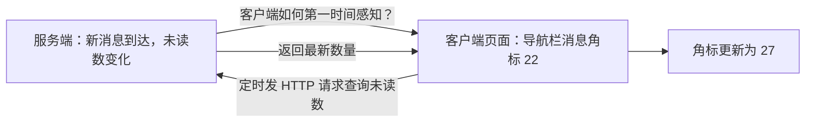
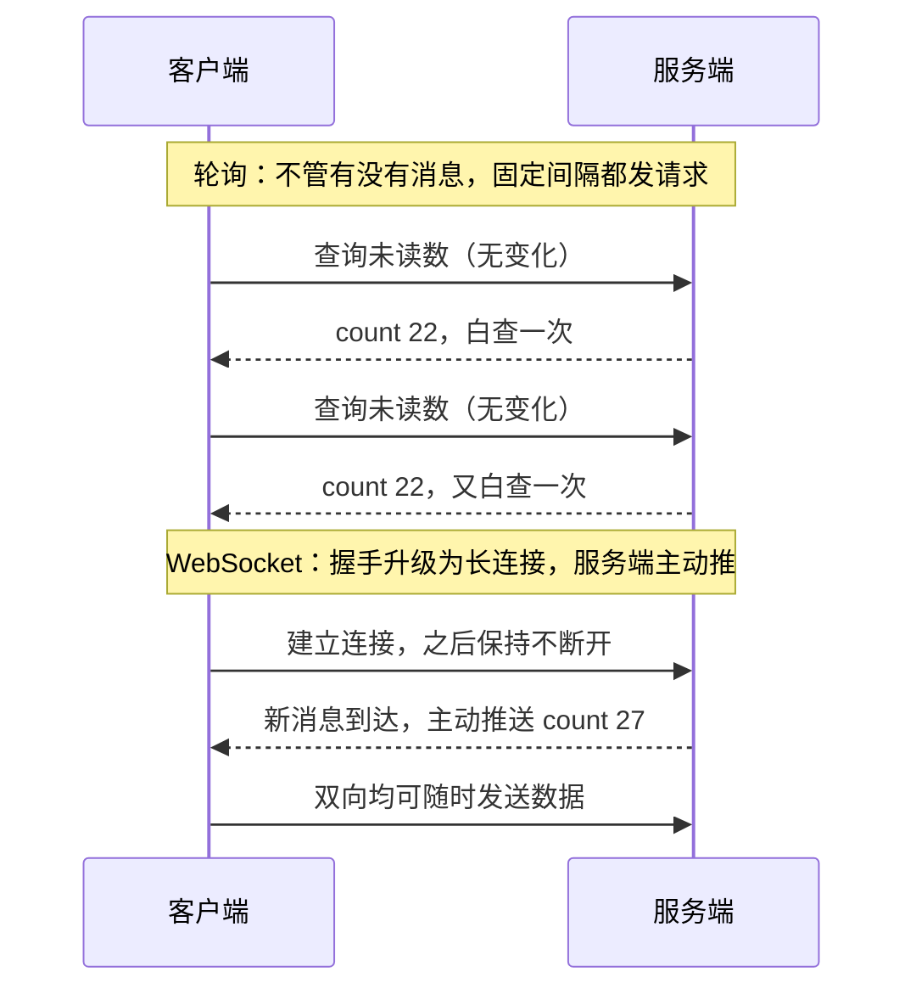

# 导航栏的消息数怎么实时变：从轮询的两个硬伤到 WebSocket

电商网站的会员中心里有个不起眼却很有代表性的部件：导航栏上的消息角标，平时显示「消息 22」，服务器一有新消息进来，数字要立刻变成 27。把需求抽象出来就是一句话：服务端状态发生变化时，客户端要在第一时间感知到。页面不会自己动，这个感知必须由某种通信机制来完成，选哪种机制，直接决定了这个功能是省电还是费电、是实时还是「准实时」。本节先把最直觉的轮询方案摆上台面，看清楚它的两条硬伤，再顺着问题引出真正的主角 WebSocket。

## 先给结论

- 需求本质是「服务端推送」：数据变化发生在服务端，感知却要从客户端发起，常规 HTTP 请求-响应模型天然不匹配。
- JS 轮询能用但有两条硬伤：间隔再短也存在时间差，只能算准实时；没有新消息时客户端依然每秒请求，全是无效流量。
- 长轮询与 SSE 是两个过渡方案：前者把请求挂住等数据，后者做服务端单向推送，各自缓解但不根治。
- WebSocket 在 HTTP 握手之后升级为全双工长连接，服务端可以主动推，是消息类功能的正解，课程后续就用它实现。
- 四种方案没有绝对优劣，选型看实时性要求、通信方向与连接成本。

## 一、需求拆解：服务端有变化，客户端要立刻知道

角标刷新这件事拆开看有三个角色：消息的产生在服务端（别人给你发了新私信），状态存在服务端（未读数加一），展示在客户端（角标数字变化）。客户端唯一的主动权是发起请求，于是所有方案都要回答同一个问题：客户端怎么知道「现在该问一次」还是「不用问」。

直觉做法是让客户端定时去问，这就是轮询。课程 PPT 给出的现象是这样的：



图的右边看似闭环了，但每一环都藏着成本：查询请求的频率、空结果的比例、角标更新的延迟，接下来逐一算账。

## 二、轮询方案：能跑通，但有两条硬伤

轮询的实现就是在页面里挂一个定时器，固定间隔发一次查询。示意如下（示例代码，按本课场景补全）：

```javascript
// 每 1 秒向服务端查询一次未读消息数
setInterval(async () => {
    const res = await fetch("/api/message/count");
    const data = await res.json();
    document.querySelector("#msg-badge").textContent = data.count;
}, 1000);
```

服务端对应一个查询接口（示例代码）：

```java
@GetMapping("/api/message/count")
public Map<String, Object> count() {
    // 每次轮询都会执行的真实查询，绝大多数结果没有变化
    Long unread = this.messageService.queryUnreadCount();
    Map<String, Object> result = new HashMap<>();
    result.put("count", unread);
    return result;
}
```

**硬伤一，延迟下限就是轮询间隔，只能叫准实时。** 消息在两次查询之间到达，就要等到下一个周期才能被看到。间隔设成 1 秒，平均延迟就是半秒，极端情况下整整 1 秒。把间隔缩到 100 毫秒确实更「实时」了，代价立刻变成硬伤二的十倍。实时性的本质要求是「变化发生的那一刻主动通知」，轮询的机制里根本没有这个动作。

**硬伤二，无效请求把流量线性放大。** 消息不是持续产生的，绝大多数轮询周期里未读数没有任何变化，请求照样发出、数据库照样查、响应照样返回。按 1 秒间隔估算，1 万个在线用户就是每秒 1 万次请求，其中九成以上返回的结果和上一次一模一样。这些请求没有产生任何价值，却实实在在地消耗着连接、CPU 和数据库资源。

## 三、两个过渡方案：缓解但不根治

业界的演进没有直接从轮询跳到 WebSocket，中间有两个值得认识的方案（对比部分为按本课写法补全的展开）。

**长轮询：把请求挂住，等出数据再返回。** 客户端发请求后，服务端不立刻答复，而是 hold 住连接，直到有新消息或超时才响应；客户端拿到结果后马上再发下一个。它消灭了「空结果」请求，延迟也逼近实时，但每次响应后仍要重新发起请求，连接反复建立，服务端要维护大量挂起的线程或异步上下文，本质依然是客户端拉。

**SSE：服务器单向流式推送。** `EventSource` 建立一条 HTTP 长连接，服务端持续往下游写事件，客户端被动接收。它天然适合「只有服务端到客户端这一个方向」的场景，实现轻量；局限也是单向，客户端要回传数据仍得另发请求。



时序图把关键差别压在两段对比里：轮询的每一次请求都由客户端发起，服务端永远被动；WebSocket 的连接建立一次后保持住，推送方向反转成服务端主动，数据产生的那一刻就能出发。

## 四、WebSocket：把通信方向翻转过来

WebSocket 的建立借道 HTTP：客户端发起带 `Upgrade: websocket` 头的特殊请求，服务端同意后返回 101 状态码，协议从 HTTP 切换为 WebSocket 帧，之后这条 TCP 连接变成全双工通道，两端随时都能发数据，直到一方关闭。

| 方案 | 通信方向 | 实时性 | 无效请求 | 连接成本 |
|---|---|---|---|---|
| 轮询 | 客户端拉 | 取决于间隔，准实时 | 大量存在 | 反复建连，开销大 |
| 长轮询 | 客户端拉 | 接近实时 | 基本没有 | 挂起连接，需异步支撑 |
| SSE | 服务端推单向 | 实时 | 没有 | 一条 HTTP 长连接 |
| WebSocket | 全双工 | 实时 | 没有 | 一条长连接，双向复用 |

对比表里 WebSocket 的优势一目了然：一次握手、一条连接、双向实时，无效请求为零。代价是实现复杂度上升，要处理连接状态管理、心跳保活、断线重连，集群环境下还要解决连接分散在多台服务器时的消息路由，这些正是后续课程要逐一展开的内容。对于消息角标、微聊、客服这类双向即时通讯场景，这笔复杂度是值得付的；而轮询也没有被完全淘汰，后台任务的进度条、容忍分钟级延迟的监控大盘，用它依然是最省事的选择。

## 常见误区

- **把准实时当成实时。** 轮询的延迟下限是轮询间隔，机制上不存在「变化即知」，对外宣传或设计文档里不能把它描述成实时方案。
- **用缩小间隔的方式追实时性。** 间隔从 1 秒缩到 100 毫秒，请求量放大十倍，延迟问题换成了容量问题，治标不治本。
- **长轮询和轮询混为一谈。** 长轮询的请求会挂住直到有数据，空请求被消灭了，但通信方向仍是客户端拉，与 WebSocket 的服务端推有本质区别。
- **以为 WebSocket 与 HTTP 无关。** 它的握手阶段就是一次带 Upgrade 头的 HTTP 请求，握手完成后才切换协议，部署时网关、代理对 Upgrade 头的支持是常见坑点。

## 面试可能被问到的问题

1. 面试官追问：「轮询、长轮询、SSE、WebSocket 各自适用什么场景？」
   答：轮询适合实时性要求低、实现要简单的场景，如任务进度条；长轮询适合只能用 HTTP 又要求接近实时的兼容场景，如老的 Web 消息提醒；SSE 适合服务端单向推送，如行情、日志流；WebSocket 适合双向实时通信，如聊天、协同编辑、消息角标。

2. 面试官追问：「长轮询是怎么实现的？」
   答：客户端发起请求后，服务端检查有无数据，没有就 hold 住请求（阻塞线程或挂起异步上下文），直到有新数据或超时才响应；客户端收到响应后立即发起下一轮。空响应被消灭，实时性逼近推送，但服务端要为每个挂起连接付出资源。

3. 面试官追问：「WebSocket 的握手过程是怎样的？」
   答：客户端发送带 `Connection: Upgrade` 与 `Upgrade: websocket` 头的 HTTP GET 请求，附上随机 key；服务端返回 101 Switching Protocols，并携带按约定算法计算的 Sec-WebSocket-Accept。此后同一 TCP 连接上的数据改用 WebSocket 帧格式，脱离 HTTP 语义。

4. 面试官追问：「SSE 和 WebSocket 怎么选？」
   答：只涉及服务端向客户端的单向推送且数据是文本事件，SSE 实现简单、走普通 HTTP、自带断线重连，优先考虑；需要客户端高频回传或二进制数据、全双工交互，就用 WebSocket。SSE 对 IE 等旧环境的兼容性也是选型时要核对的点。

5. 面试官追问：「长连接怎么判断还活着？」
   答：靠心跳。客户端或服务端周期性发送 ping 帧（或应用层心跳消息），对端回应 pong，若干周期未收到就判定连接失效并重建。心跳同时能刷新中间代理的空闲超时，防止连接被防火墙或网关掐断。

6. 面试官追问：「集群部署下 WebSocket 有什么额外问题？」
   答：用户连接分散在不同节点，A 节点上的服务端要推给连接在 B 节点的用户时，本机内存里找不到这条连接。需要引入中间层做消息路由，如用 Redis 发布订阅或消息队列广播到所有节点，各节点只负责推送给本地持有的连接。

## 配套资料

- 本课无配套源码包（方案分析课，无代码落地环节），文中轮询的前后端示例为按本课场景补全，WebSocket 实现在后续课程中展开
- 本节对应的真实课程资料目录：`materials/code/03/day07-完善前端功能以及WebSocket入门/`（day07 资料包内为缓存方案源码，与本节无直接代码关联）
