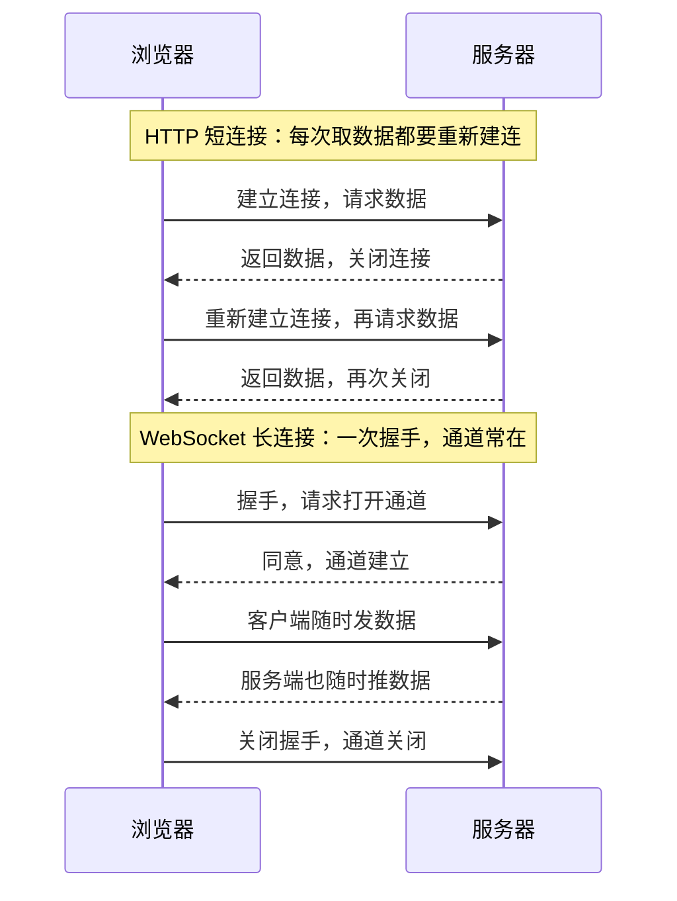

# 浏览器与服务器共用一条通道说话：WebSocket 协议到底特殊在哪

消息角标要实时刷新、聊天要即时收发，这类需求都指向同一个动作：服务端状态一变，客户端要立刻知道。轮询已经证明只能做到准实时，真正的出路是换一种通信模型，让浏览器和服务器之间保持一条两端随时都能说话的通道。这就是 WebSocket：HTML5 开始提供的新协议，现已被 W3C 认定为标准，主流浏览器都做了很好的支持，是做消息类功能绕不开的一课。

## 先给结论

- WebSocket 是 HTML5 新增的应用层协议，运行在单个 TCP 连接之上，实现浏览器与服务器的全双工通信。
- 它与 HTTP 不是对立关系：建立连接的握手要借助一次 HTTP 请求完成，升级成功后数据才脱离 HTTP 语义，改用 WebSocket 帧传输。
- 全双工指两个方向可以同时传输；对讲机那种「按住才能说、松开才能听」属于半双工。
- HTTP 是短连接，一次请求一次响应就关闭，下次请求重新建连；WebSocket 是长连接，一次握手后连接保持不断开，两端随时互发数据。
- 客户端支持情况上 caniuse 一查便知：IE 6 到 9 不支持，IE 10+、Chrome、新版 Firefox 都支持；服务器端 Tomcat 要 7.0.47 及以上版本才内置 WebSocket 实现。

## 一、全双工：通信方向上的三个等级

按通信方向与同时性，通信方式分三档。单工是只能一个方向传，听广播就是这样，听众永远说不上话；半双工是两个方向都能传，但同一时间只能有一个方向在传；全双工是两个方向同时传输，互不干扰。

| 方式 | 通信方向 | 同时性 | 生活例子 |
|---|---|---|---|
| 单工 | 单方向 | 不存在方向切换 | 广播、遥控器 |
| 半双工 | 双向 | 同一时刻只能一方说 | 对讲机 |
| 全双工 | 双向 | 双方同时说 | 打电话 |

对讲机是理解半双工最好的例子：按住按键发声时听不到对方，松开按键才能收听，一个信道被两个方向轮流复用。窄马路上两辆对向行驶的车也是半双工，路一次只放一辆车过，另一辆必须等。全双工则是双向车道，两边同时走互不挡路。WebSocket 实现的就是电话式的全双工：连接建立之后，浏览器可以随时发数据，服务器也可以随时发数据。

## 二、HTTP 短连接与 WebSocket 长连接

**HTTP 是短连接，一次交互就断。** 浏览器每一次想拿数据，都要走一遍完整的生命周期：建立连接、发请求、收响应、关闭连接，下次请求再从头来一遍。请求之间不保留任何通道，服务端也没有办法在浏览器没发请求的时候把数据递过去。

**WebSocket 是长连接，一次握手长期保持。** 浏览器与服务器握手一次，通道就建立并保持不断开，之后这条通道上双向都可以发数据，直到有一方主动关闭。



上半段里连接反复建立与关闭，服务端永远处于被动应答的位置；下半段通道建立之后，发送方向不再受限于谁先发起，消息推送需要的正是这种通信模型。

**握手借道 HTTP，升级之后就不再是 HTTP。** 浏览器发起的握手其实是一次特殊的 HTTP GET 请求，带上 Upgrade 头声明切换协议（报文为示例，按 RFC 6455 整理）：

```http
GET /websocket/1 HTTP/1.1
Host: 127.0.0.1:8082
Upgrade: websocket
Connection: Upgrade
Sec-WebSocket-Key: dGhlIHNhbXBsZSBub25jZQ==
Sec-WebSocket-Version: 13
```

服务器同意切换时返回 101 状态码，从这一刻起同一条 TCP 连接上的数据改用 WebSocket 帧格式，HTTP 的使命到此结束：

```http
HTTP/1.1 101 Switching Protocols
Upgrade: websocket
Connection: Upgrade
Sec-WebSocket-Accept: s3pPLMBiTxaQ9kYGzzhZRbK+xOo=
```

传输层始终是 TCP，WebSocket 只是在 TCP 之上约定的另一套应用层帧协议。浏览器里连接地址也对应换成 ws 与 wss 两种 scheme：`ws://` 是明文，`wss://` 走 TLS 加密，关系类似 http 与 https。

## 三、浏览器与服务器：两头都支持才跑得通

**客户端支持情况可以自己查。** caniuse.com 这个站点专门查询 Web 技术在各个浏览器里的支持情况，搜索 WebSocket 就能看到完整表格：IE 6 到 9 不支持，IE 10 起支持，Chrome 基本全支持，Firefox 低版本不支持、高版本支持。放到今天，主流浏览器对 WebSocket 的支持已经相当成熟，它是一个可以直接投入使用的成熟技术。

**服务器端的支持同样不可省。** 服务器这一端要提供 WebSocket 的实现，Tomcat 要 7.0.47 及以上版本才内置了这套能力（课程画面标注为 7.0.4+，以完整支持 JSR 356 的稳定版本为准）。客户端支持而服务器不支持，连接照样建立不起来，服务直接跑不通，选容器版本时要把这一条列为前置检查项。

## 常见误区

- **把 WebSocket 当成 HTTP 的替代品。** 它的握手阶段就是一次带 `Upgrade: websocket` 头的 HTTP 请求，升级完成才切换成帧传输；部署环境里的网关、代理必须放行 Upgrade 头，否则握手直接失败。
- **以为长连接就是 WebSocket。** HTTP 的 keep-alive 也复用 TCP 连接，但语义仍是请求加响应，服务端无法主动推数据；WebSocket 的长连接之上是全双工的消息通道，两者不是一回事。
- **只检查浏览器版本不看服务器版本。** Tomcat 7.0.47 以下没有内置 WebSocket 实现，客户端再新也连不上。
- **以为 WebSocket 发明了一种新的传输层协议。** 它的底层始终是 TCP，WebSocket 只是应用层协议，可靠传输、拥塞控制仍然由 TCP 负责。

## 面试可能被问到的问题

1. 面试官追问：「WebSocket 和 HTTP 是什么关系？」
   答：WebSocket 的握手是一次特殊的 HTTP 请求，带 Upgrade 头请求把协议切换为 websocket，服务器返回 101 后同一 TCP 连接改用 WebSocket 帧传输。所以它借 HTTP 完成建连，通信阶段却脱离 HTTP 语义，与 HTTP 的请求-响应模型是两种模型。

2. 面试官追问：「什么是全双工，和半双工的区别在哪里？」
   答：全双工允许两个方向同时传输，典型例子是打电话；半双工两个方向都能传但同一时刻只能一个方向传，典型例子是对讲机，按住说话时听不到对方。WebSocket 在一条 TCP 连接上实现全双工，两端都能随时主动发数据。

3. 面试官追问：「说说 WebSocket 的握手过程。」
   答：客户端发送带 `Connection: Upgrade` 与 `Upgrade: websocket` 头的 GET 请求，附上随机的 Sec-WebSocket-Key；服务器校验后返回 101 Switching Protocols，并携带按固定算法计算的 Sec-WebSocket-Accept；此后连接升级为 WebSocket 通道，直到关闭握手。

4. 面试官追问：「ws 和 wss 有什么区别？」
   答：ws 是明文传输的 WebSocket scheme，wss 在 TLS 之上运行 WebSocket，相当于 https 与 http 的关系。生产环境对外服务一般用 wss 配合证书保证链路安全，通常与 HTTPS 共用 443 端口。

5. 面试官追问：「HTTP 为什么做不到服务端主动推送？」
   答：HTTP/1.1 的语义是请求-响应，响应只能由请求触发，服务端没有向空闲连接写入业务数据的通道。要近似推送只能靠轮询、长轮询或 SSE 这类变通方案，真正双向主动推送需要升级为 WebSocket。

6. 面试官追问：「服务器端要用 WebSocket，要注意什么版本问题？」
   答：以 Tomcat 为例，7.0.47 及以上版本才内置了 JSR 356 的 WebSocket 实现，低版本容器上部署会直接失败。选型和部署清单里要把容器版本作为前置检查项。

## 配套资料

- 本课无配套源码包，文中握手报文为按 RFC 6455 与本课画面内容整理的示例
- 本阶段课程资料目录：`materials/code/03/day07-完善前端功能以及WebSocket入门/`（day07 资料包内为响应缓存方案源码，与本节协议概念无直接代码关联）
