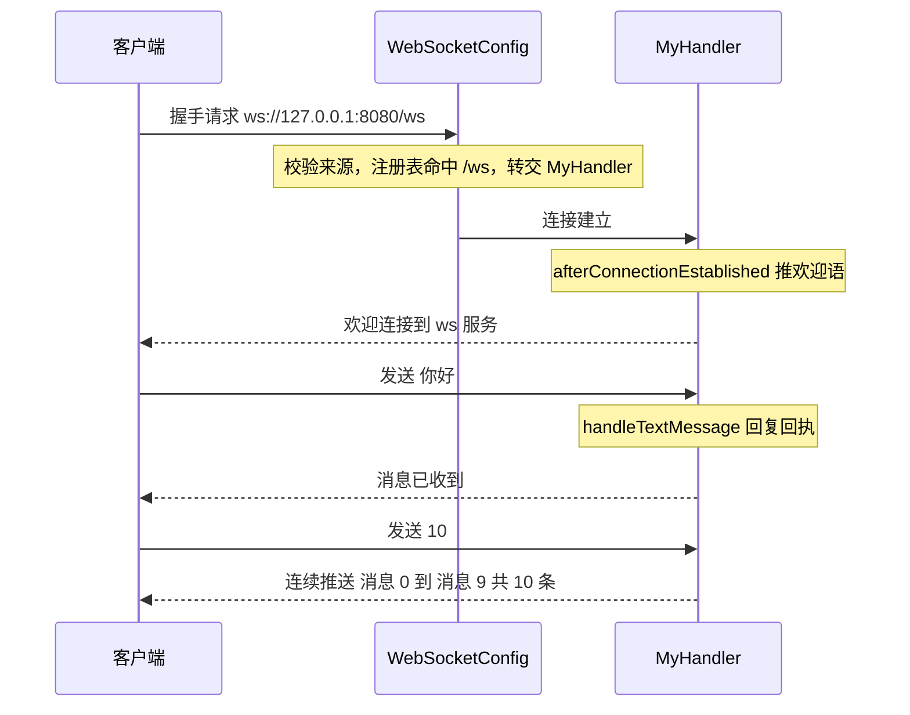

# Spring Boot 整合 WebSocket：从四个注解到一个 Handler

原生的 `javax.websocket` 注解式写法已经能跑通，但它游离在 Spring 容器之外：端点对象自己创建自己管理，业务 Bean 注入不进来，跨域、拦截都得自己搭。Spring 对 WebSocket 做了专门支持，把处理逻辑收编成一个 Handler 交给容器管理，在 Spring Boot 里整合只需要一个 starter、一个 Handler、一个配置类。

## 先给结论

- 依赖换成一个 `spring-boot-starter-websocket`；原先的 `javaee-api` 必须移除，Spring Boot 内嵌 Tomcat 已自带 WebSocket 实现，两套包并存会冲突。
- 业务逻辑写进继承 `TextWebSocketHandler` 的 Handler，重写 `afterConnectionEstablished`、`handleTextMessage`、`afterConnectionClosed` 三个方法，不再写注解。
- 配置类加 `@Configuration` 与 `@EnableWebSocket`，实现 `WebSocketConfigurer`，在 `registerWebSocketHandlers` 里把 Handler 绑定到 `/ws` 路径。
- 页面来源与 ws 地址不同源时握手会被拒，`registry.addHandler(...).setAllowedOrigins("*")` 放开跨域，生产环境应收紧为域名白名单。
- 与注解式相比最大的收益：Handler 本身是 Spring Bean，可以直接注入业务 Service。

## 一、依赖与启动方式的变化

pom 在原工程基础上改三处：加 `spring-boot-starter-parent` 父工程，把 `javaee-api` 注释掉，换成 `spring-boot-starter-websocket`（示例按课程画面与讲解整理，包名改为 `com.example`）：

```xml
<parent>
    <groupId>org.springframework.boot</groupId>
    <artifactId>spring-boot-starter-parent</artifactId>
    <version>2.1.0.RELEASE</version>
</parent>

<dependencies>
    <!-- javaee-api 要注释掉：内嵌 Tomcat 已带 WebSocket 实现，并存冲突 -->
    <dependency>
        <groupId>org.springframework.boot</groupId>
        <artifactId>spring-boot-starter-websocket</artifactId>
    </dependency>
</dependencies>
```

启动方式跟着变了：`tomcat7` 插件退役，工程由引导类的 main 方法拉起，内嵌 Tomcat 默认监听 8080：

```java
package com.example.websocket;

import org.springframework.boot.SpringApplication;
import org.springframework.boot.autoconfigure.SpringBootApplication;

@SpringBootApplication
public class MyApplication {

    public static void main(String[] args) {
        SpringApplication.run(MyApplication.class, args);
    }
}
```

## 二、两步走：Handler 管业务，Config 管注册

Handler 是所有业务逻辑的落点，继承 `TextWebSocketHandler` 后按需重写方法（演示代码按课程画面与讲解整理）：

```java
package com.example.websocket.spring;

import java.io.IOException;

import org.springframework.stereotype.Component;
import org.springframework.web.socket.CloseStatus;
import org.springframework.web.socket.TextMessage;
import org.springframework.web.socket.WebSocketSession;
import org.springframework.web.socket.handler.TextWebSocketHandler;

@Component
public class MyHandler extends TextWebSocketHandler {

    /** 连接建立后推一条欢迎消息 */
    @Override
    public void afterConnectionEstablished(WebSocketSession session) throws Exception {
        session.sendMessage(new TextMessage("欢迎连接到 ws 服务"));
    }

    /** 收到客户端文本消息时执行 */
    @Override
    public void handleTextMessage(WebSocketSession session, TextMessage message) throws IOException {
        System.out.println("获取到消息：" + message.getPayload());
        session.sendMessage(new TextMessage("消息已收到"));
        // 模拟公众号的关键字回复：收到 10 就连续推送 10 条
        if (message.getPayload().equals("10")) {
            for (int i = 0; i < 10; i++) {
                try {
                    Thread.sleep(100);
                } catch (InterruptedException e) {
                    e.printStackTrace();
                }
                session.sendMessage(new TextMessage("消息：" + i));
            }
        }
    }

    /** 连接关闭时执行 */
    @Override
    public void afterConnectionClosed(WebSocketSession session, CloseStatus status) throws Exception {
        System.out.println("断开连接！");
    }
}
```

`TextWebSocketHandler` 已实现了 `WebSocketHandler` 接口的全部方法，只重写关心的三个即可；要处理二进制消息时换 `BinaryWebSocketHandler` 或重写 `handleBinaryMessage`。类上的 `@Component` 把 Handler 交给容器：以后想把消息落库、想调业务服务，直接注入 Service 就行，这正是比注解式顺手的地方。`WebSocketSession` 代表一次连接会话，`message.getPayload()` 取消息内容。

配置类负责把 Handler 挂到路径上：

```java
package com.example.websocket.spring;

import org.springframework.beans.factory.annotation.Autowired;
import org.springframework.context.annotation.Configuration;
import org.springframework.web.socket.config.annotation.EnableWebSocket;
import org.springframework.web.socket.config.annotation.WebSocketConfigurer;
import org.springframework.web.socket.config.annotation.WebSocketHandlerRegistry;

@Configuration
@EnableWebSocket
public class WebSocketConfig implements WebSocketConfigurer {

    @Autowired
    private MyHandler myHandler;

    @Override
    public void registerWebSocketHandlers(WebSocketHandlerRegistry registry) {
        registry.addHandler(myHandler, "/ws").setAllowedOrigins("*");
    }
}
```

`@EnableWebSocket` 打开 WebSocket 支持，`registerWebSocketHandlers` 把 `/ws` 路径上的连接交给 `MyHandler` 处理。`setAllowedOrigins("*")` 是实际会踩的坑：握手本质上是一次 HTTP 请求，页面来源与 ws 地址不同源时，Spring 直接拒绝握手，连接建立失败；放开来源后才能连通。教学阶段用 `*` 放行所有来源，生产环境必须改成具体域名白名单。

## 三、验证与两种写法的取舍

启动引导类后，用客户端工具连 `ws://127.0.0.1:8080/ws`。第一次连接会失败，报错根源是跨域限制；加上 `setAllowedOrigins("*")` 重启后再连，通道顺利建立，依次收到欢迎语、回执与关键字推送：



发送「10」连收 10 条消息，模拟的是公众号关键字回复：服务端在同一条连接里连续多次 `sendMessage`，客户端的 `onmessage` 逐条触发。

两种写法摆在一起，取舍就清楚了：

| 维度 | 注解式（javax.websocket） | Spring 集成式（Handler） |
|---|---|---|
| 依赖 | `javaee-api` 加外置 Tomcat 插件 | `spring-boot-starter-websocket` |
| 写法 | 注解标在方法上 | 继承 Handler 重写方法 |
| 容器整合 | 端点对象独立创建，注入 Bean 麻烦 | Handler 是 Bean，注入 Service 直接用 |
| 跨域控制 | 无内建支持 | `setAllowedOrigins` 一行配置 |
| 会话身份 | `{uid}` 占位符加 `@PathParam` | 路径固定，身份靠握手拦截器传递 |

会话管理再往前一步：要「给某个用户主动推消息」，就得在连接建立时把 `WebSocketSession` 按用户标识存进 Map，关闭时移除，推送时按标识取出（示例按本课写法补全，多节点部署还需消息中间件做路由）。这个能力在后续做微聊即时通讯时会真正落地。

## 常见误区

- **保留 `javaee-api` 依赖。** 内嵌 Tomcat 已包含 WebSocket 实现，两套并存会出现类冲突，换 starter 后必须移除。
- **漏掉 `@EnableWebSocket`。** 配置类写了却不生效，连 `/ws` 直接 404，这个注解才是开启支持的开关。
- **不配 `setAllowedOrigins` 就联调前端。** 本地页面与 ws 地址不同源，握手被拒，报错常被误判成路径写错。
- **Handler 忘了交给容器。** 既没有 `@Component` 也没有 `@Bean` 声明，配置类注入时启动报错，找不到这个 Bean。
- **把长任务直接写进 `handleTextMessage`。** 示例里的 `Thread.sleep` 只为模拟耗时，真实业务里耗时处理应交给业务线程或异步接口，避免阻塞消息读取。

## 面试可能被问到的问题

1. 面试官追问：「Spring Boot 整合 WebSocket 需要哪几步？」
   答：引入 `spring-boot-starter-websocket`；写 Handler 继承 `TextWebSocketHandler`，重写连接建立、消息处理、连接关闭三个方法；写配置类加 `@EnableWebSocket` 并实现 `WebSocketConfigurer`，在注册方法里 `addHandler` 绑定路径并设置允许的来源；最后由引导类启动。

2. 面试官追问：「Handler 方式和 @ServerEndpoint 注解方式怎么选？」
   答：Spring 技术栈优先 Handler 方式，它本身是 Bean，能直接注入业务 Service，跨域与拦截器都有内建支持；注解式不依赖 Spring，适合小型或非 Spring 工程。两者的通信协议层完全相同，差别在工程整合能力。

3. 面试官追问：「WebSocket 的跨域问题怎么产生，怎么解决？」
   答：握手是一次 HTTP 请求，Spring 会按请求来源做校验，页面域名与 ws 地址不同源时握手被拒绝。解决方式是在注册 Handler 时调 `setAllowedOrigins` 指定白名单，开发期可用 `*` 放开，生产必须收紧为具体域名。

4. 面试官追问：「怎么给指定用户主动推送消息？」
   答：连接建立时把 WebSocketSession 按用户标识存入服务端 Map，用户身份可用握手拦截器从登录态带进会话；推送时按标识取出 session 调 sendMessage，关闭时移除。集群部署下连接分散在各节点，还要借助 Redis 发布订阅或消息队列把消息路由到持有连接的节点。

5. 面试官追问：「session.sendMessage 线程安全吗？」
   答：标准实现不保证并发写安全，多线程同时向同一 session 发消息可能产生帧交错或异常。业务上要避免多线程直写同一连接，Spring 提供了 `ConcurrentWebSocketSessionDecorator` 这类包装器做发送排队与超时控制。

## 配套资料

- 本课无配套源码包，文中 pom、Handler 与配置类为按本课画面与写法补全的可运行示例（包名已改为 `com.example`）
- 本阶段课程资料目录：`materials/code/03/day07-完善前端功能以及WebSocket入门/`（资料包内为响应缓存方案源码，与 WebSocket 无直接代码关联）
