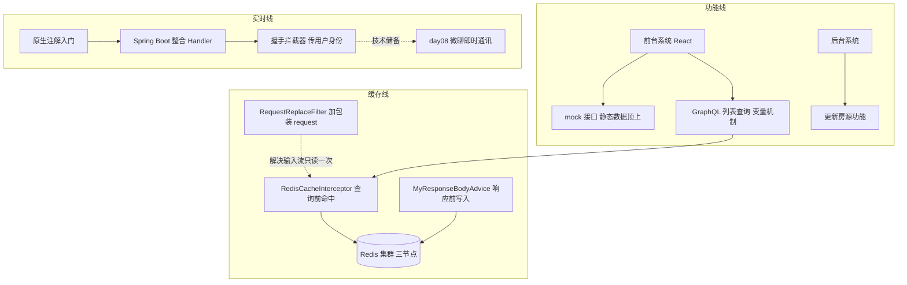

# day07 全章复盘：前端功能补齐、Redis 缓存与 WebSocket 打底的三条线

第七天的课跨度极大：前端系统要的数据要接管、房源查询要动态化、接口要扛住流量、微聊要的技术要提前备好，四件事搅在同一天讲完。学完单节课各自清楚，合上笔记再回想，三条线的因果与衔接就容易糊。这篇把 day07 拆成功能、缓存、实时三条线重新走一遍，代码以资料包真实源码为准，收束完直接衔接 day08 的微聊即时通讯。

## 先给结论

- 功能线两件事：mock 服务接管前端请求，摆脱对 Node.js 演示服务的依赖；GraphQL 变量机制让房源列表查询的参数动态化，客户端传值、服务端用 `ExecutionInput` 注入执行。
- 更新房源补齐后台「改」的一环，前端编辑弹窗 `EditResource.js` 与后端接口都是真实资料，改完即存。
- 缓存线三件套：Docker 搭 Redis 集群扛存储，拦截器在查询前做读命中，`ResponseBodyAdvice` 在响应前做写缓存；写缓存用拦截器做不到，这是换扩展点的原因。
- request 输入流只能读一次，拦截器算缓存键时读掉输入流，后面的 Controller 就拿不到请求体，用 Filter 替换包装类解决，这个方案是全章最值得带走的通用技巧。
- 实时线 WebSocket 走了三步：原生注解入门、Spring Boot 整合、握手拦截器传用户身份，全部为 day08 的微聊即时通讯做铺垫。

## 一、功能线：mock 顶上，GraphQL 变量补上动态查询

前端系统里菜单、资讯、问答这些请求，此前一直由前端团队用 Node.js 写的接口服务应答。mock 服务做的事就是让前端系统直接跟自己的后端对接：模拟数据集中放进 `mock-data.properties`，一个 Controller 按路径返回，请求地址一换，前端与后端的开发节奏就不再互相卡。

列表查询走的是 GraphQL 变量机制。此前的查询把 `id: 8` 写死在语句里，动态查询要求查询结构与参数值分离：语句里用 `$id` 占位并声明类型，变量值以 JSON 串随请求发送。服务端为了接住这套机制，GET 与 POST 两个入口都要处理变量（代码按课程画面整理）：

```java
@GetMapping
@ResponseBody
public Map<String, Object> query(@RequestParam("query") String query,
        @RequestParam(value = "variables", required = false) String variablesJson,
        @RequestParam(value = "operationName", required = false) String operationName) {
    // variablesJson 是 JSON 串，反序列化成 Map 后
    // 连同 query 一起交给 ExecutionInput 构造执行输入
}
```

`ExecutionInput` 是 graphql-java 的执行输入对象，把查询语句、变量、操作名打包成一次执行。变量到位后，房源列表查询接口顺势落地；后台系统的更新房源接口与前端编辑弹窗也随之打通，`EditResource.js` 里表单回填、图片墙收集、`values.id = record.id` 保证提交带主键，这些细节在更新房源系列篇里已逐行拆过。

## 二、缓存线：读命中靠拦截器，写缓存换 ResponseBodyAdvice

缓存的存储底座是 Redis 集群，用 Docker 三个容器拉起，一条命令组建（命令来自课程资料）：

```bash
docker create --name redis-node01 -v /data/redis-data/node01:/data -p 6379:6379 redis:5.0.2 --cluster-enabled yes --cluster-config-file nodes-node-01.conf
docker create --name redis-node02 -v /data/redis-data/node02:/data -p 6380:6379 redis:5.0.2 --cluster-enabled yes --cluster-config-file nodes-node-02.conf
docker create --name redis-node03 -v /data/redis-data/node03:/data -p 6381:6379 redis:5.0.2 --cluster-enabled yes --cluster-config-file nodes-node-03.conf
# 三节点启动后组建集群
redis-cli --cluster create 172.17.0.1:6379 172.17.0.1:6380 172.17.0.1:6381 --cluster-replicas 1
```

加缓存要回答两个问题：查询前怎么命中，返回前怎么写入。读命中用拦截器实现，资料包里的 `RedisCacheInterceptor` 是真实源码（包名已按写作规范改写为中性包名，下同）：

```java
@Component
public class RedisCacheInterceptor implements HandlerInterceptor {

    @Autowired
    private RedisTemplate<String, String> redisTemplate;

    @Override
    public boolean preHandle(HttpServletRequest request, HttpServletResponse response, Object handler)
            throws Exception {
        // OPTIONS 预检放行；非 GET 且非 /graphql 的写请求也放行（细节略）
        // 缓存键：md5(请求uri + 请求参数)
        String redisKey = createRedisKey(request);
        String data = this.redisTemplate.opsForValue().get(redisKey);
        if (StringUtils.isEmpty(data)) {
            return true;    // 未命中，放行到 Controller
        }
        response.setContentType("application/json; charset=utf-8");
        response.getWriter().write(data);
        return false;       // 命中，直接回写响应，不再进 Controller
    }
}
```

`preHandle` 返回 `false` 配合手动写出响应体，命中时请求根本到不了 Controller，这是拦截器做读缓存的关键。写缓存这边，拦截器就无能为力了：它工作在 Controller 之前，拿不到响应体。能拦到响应数据的扩展点是 `ResponseBodyAdvice`，资料包里的 `MyResponseBodyAdvice` 在 `beforeBodyWrite` 里复用同一个缓存键规则，把返回体序列化后写进 Redis，过期一小时：

```java
@ControllerAdvice
public class MyResponseBodyAdvice implements ResponseBodyAdvice {

    @Override
    public Object beforeBodyWrite(Object body, MethodParameter returnType, MediaType selectedContentType,
            Class selectedConverterType, ServerHttpRequest request, ServerHttpResponse response) {
        try {
            // 复用拦截器的缓存键规则，读写同一把 key
            String redisKey = RedisCacheInterceptor.createRedisKey(
                    ((ServletServerHttpRequest) request).getServletRequest());
            String redisValue = body instanceof String
                    ? (String) body : mapper.writeValueAsString(body);
            this.redisTemplate.opsForValue().set(redisKey, redisValue, Duration.ofHours(1));
        } catch (Exception e) {
            e.printStackTrace();
        }
        return body;
    }
}
```

这套组合跑起来后立刻撞上第三个坑：`createRedisKey` 里要读请求输入流，而 Servlet 的输入流只能读一次，拦截器读完，后面的 Controller 再读就是空的，`/graphql` 的 POST 请求直接报 400：

```json
{
  "status": 400,
  "error": "Bad Request",
  "message": "Required request body is missing",
  "path": "/graphql"
}
```

解法是让输入流可重复读。`MyServletRequestWrapper` 继承 `HttpServletRequestWrapper`，构造时把请求体缓存成字节数组，之后每次 `getInputStream` 都从这个数组重新包一层流；再由一个 Filter 在进入链条前完成替换：

```java
@Component
public class RequestReplaceFilter extends OncePerRequestFilter {

    @Override
    protected void doFilterInternal(HttpServletRequest request, HttpServletResponse response, FilterChain filterChain)
            throws ServletException, IOException {
        // 进入拦截器链之前，把 request 换成可重复读的包装类
        if (!(request instanceof MyServletRequestWrapper)) {
            request = new MyServletRequestWrapper(request);
        }
        filterChain.doFilter(request, response);
    }
}
```

拦截器读包装类的缓存副本，Controller 读的也是同一个副本，请求体从此随取随有。「读流前先缓存、Filter 里偷梁换柱」这个套路不限于缓存场景，任何要在拦截器里读请求体的需求都用得上。

## 三、实时线：WebSocket 三步走，为微聊铺路

实时通信这条线按难度递进走了三步。原生注解式用 `@ServerEndpoint` 声明端点，`@OnOpen`、`@OnMessage`、`@OnClose` 分别接管建连、收消息、断连，几行代码就能跑通全双工长连接，理解协议层足够了。Spring Boot 整合版换 `TextWebSocketHandler` 承载业务、`WebSocketConfigurer` 注册路径，Handler 成了容器里的 Bean，可以直接注入业务 Service，工程化程度上一台阶。握手拦截器再补一刀：连接建立之前校验身份、往 `attributes` 里放用户数据，Handler 从 `session.getAttributes()` 取回，匿名连接从此有了身份。

day07 学到这里，微聊即时通讯的「推」已经备齐：服务端有新消息，顺着长连接主动推给在线的客户端。还缺的是「存」与「路由」：聊天记录放哪里、多节点部署时连接分散在不同机器消息怎么送达，这两问分别由 day08 的 MongoDB 与分布式 WebSocket 方案接手。

## 四、全章一张图



图的读法：功能线里的 GraphQL 请求进入缓存线后被拦截器接管，命中直接返回，未命中穿透到业务层，响应回来前由通知类写回 Redis；包装 request 是横切在拦截器之前的保命机制，没有它读命中那条路在 POST 场景直接断掉。实时线独立成条，终点指向 day08 的微聊，这正是全章所有铺垫的去向。

## 常见误区

- **以为读命中和写缓存都能用拦截器做。** 拦截器站在 Controller 之前，写响应体它够不着；能拦到返回值的只有 `ResponseBodyAdvice`。一套缓存读写要配两个扩展点，缓存键规则必须共用同一份实现。
- **写了包装类却忘了注册 Filter。** `MyServletRequestWrapper` 自己不会生效，必须由 `RequestReplaceFilter` 在链条头部完成替换，少了这一步，POST 请求照样报 `Required request body is missing`。
- **以为缓存键够用了就不管写请求。** 键是 `md5(uri + 参数)`，天然只区分 GET 的参数维度；本课的拦截器显式放行非 GET 请求，只对 `/graphql` 的 POST 网开一面，写请求乱进缓存只会返回脏数据。
- **以为学完 WebSocket 就能做聊天。** 长连接只是传输层，聊天记录的存储、离线消息、多节点下的连接路由都还是空白，day08 的 MongoDB 与分布式方案就是来补这两块的。

## 面试可能被问到的问题

1. 面试官追问：「写缓存为什么换 ResponseBodyAdvice，拦截器到底差在哪？」
   答：拦截器在 Controller 执行之前工作，此时响应体还没产生，拿不到要缓存的数据。ResponseBodyAdvice 在消息转换器写出响应之前回调 beforeBodyWrite，返回值就在手里，序列化后写入 Redis 即可。两处必须共用同一套缓存键规则，否则写进去的读不出来。

2. 面试官追问：「request 的输入流为什么只能读一次，怎么解决？」
   答：Servlet 规范里请求体是流式读取，读完指针到底，再读只能得到空。解法是用 HttpServletRequestWrapper 包装原请求，构造时把流读进字节数组缓存起来，重写 getInputStream 和 getReader 让它们每次基于缓存数组新建流，再用 Filter 在进入业务前替换掉原 request，整个链条就能重复读。

3. 面试官追问：「读缓存的拦截器命中后怎么短路掉 Controller？」
   答：preHandle 里查到缓存数据后，直接把 JSON 写进 response 并返回 false。Spring MVC 看到 false 就不再执行 Controller 与视图渲染，响应完全由拦截器给出。注意手动写响应时要补上编码、Content-Type 与跨域响应头，否则前端解析会出问题。

4. 面试官追问：「GraphQL 的变量在服务端是怎么接的？」
   答：GET 入口用 RequestParam 接收 query、variables、operationName 三个参数，POST 入口从 JSON 请求体里解出同样三个字段；variables 的 JSON 串反序列化成 Map，和 query 一起交给 ExecutionInput 构造执行输入，graphQL.execute 执行后返回结果 Map。GET 与 POST 两条路汇入同一个执行入口。

5. 面试官追问：「day07 学的 WebSocket 在即时通讯里承担什么，还缺什么？」
   答：承担的是消息推送通道，服务端与在线客户端之间维持全双工长连接，新消息主动推、客户端实时收。还缺两块：消息的持久化存储，聊天记录量大且结构灵活，day08 用 MongoDB 解决；多节点部署时连接分散在不同实例，给非本机用户推消息需要节点间路由，要用分布式 WebSocket 方案解决。

## 配套资料

- 读缓存拦截器（真实源码）：`materials/code/03/day07-完善前端功能以及WebSocket入门/day07-完善前端功能以及WebSocket入门/资料/RedisCacheInterceptor.java`
- 写缓存通知类（真实源码）：`materials/code/03/day07-完善前端功能以及WebSocket入门/day07-完善前端功能以及WebSocket入门/资料/MyResponseBodyAdvice.java`
- 请求包装与替换（真实源码）：`materials/code/03/day07-完善前端功能以及WebSocket入门/day07-完善前端功能以及WebSocket入门/资料/MyServletRequestWrapper.java`、同目录 `RequestReplaceFilter.java`
- mock 数据与前端编辑组件：同目录 `mock-data.properties`、`EditResource.js`
- 资料源码中的机构包名已按写作规范统一改写为中性包名，类名与逻辑保持原样；WebSocket 相关源码不在资料包内，实时线部分为按课程画面整理的示例
