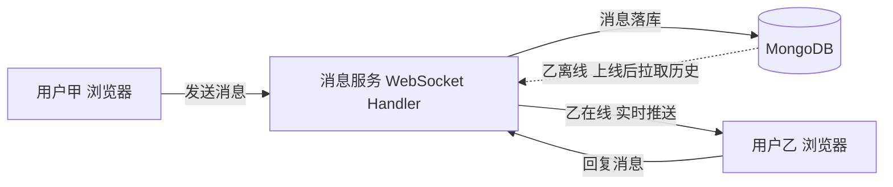

# 第八天开篇：微聊即时通讯动工，WebSocket 管推送，MongoDB 管聊天记录

首页底部那个「微聊」入口挂了很久，现在终于轮到它。上一阶段把 WebSocket 从协议讲到 Spring Boot 整合再到握手拦截器，推送通道的技术底子已经备齐；但聊天绝不是把消息推出去就完事：消息得存下来，对方离线还得等上线再取，服务一旦部署多个节点，连接散在各处，消息还要跨节点送。第八天的全部内容，就是围绕这条消息的完整旅程展开。

## 先给结论

- day08 的主线是搭建微聊系统、实现即时通讯：消息实时推送沿用 day07 的 WebSocket 长连接方案，聊天记录的存储选 MongoDB 而不是 MySQL。
- 存储换数据库不是标新立异：消息结构灵活多变、写入频繁、按会话拉取历史，文档型数据库天然对口，完整对比在 MongoDB 环节专门展开。
- 学习路径四段：MongoDB 入门、MongoDB 的 Java API、Spring Boot 整合 MongoDB（Spring Data MongoDB）、搭建微聊系统实现功能。
- 收尾处理分布式 WebSocket 问题：多节点部署下连接与消息不在同一台机器，这是即时通讯绕不开的架构题，课程会采用其中一种讨论成熟的方案落地。
- 已熟悉 MongoDB 的读者可以跳过前三段内容，直接进入微聊系统部分。

## 一、一条聊天消息的完整旅程

把微聊的需求拆到底，就是用户甲给用户乙发一条消息之后发生的事：



甲的消息顺着 WebSocket 长连接上行到服务端；服务端先做一件事，把消息存进 MongoDB，历史记录、离线补发都靠它；再看乙的状态，在线就直接顺着乙的长连接把消息推下去，不在线就留在库里等乙上线再取。整张图里「推」这一段的技术，长连接、握手拦截器传身份，day07 已经全部讲过；「存」这一段是全新的，也是 day08 前半程的主角。

一条消息存起来长什么样？大致是这样一份文档（结构为按微聊业务设想的示例，非课程画面原样）：

```json
{
  "fromUserId": 1001,
  "toUserId": 1002,
  "msgType": "TEXT",
  "content": "在吗，房子还在出租吗？",
  "sendTime": "2018-12-06 10:20:30"
}
```

注意它的字段是自由生长的：今天只有文本消息，明天加图片、语音、房源卡片引用，文档里加个字段就行，旧消息一个不用改。这种灵活性正是聊天记录选 MongoDB 的伏笔，答案在后两课揭晓。

## 二、四段学习路径：从能用起来到用得顺手

day08 前半程是三段 MongoDB 基础课，后半程是综合应用。

**第一段，MongoDB 入门。** 认识这个介于关系型与非关系型之间的文档数据库：文档模型、BSON 数据结构、横向扩展能力，再用 Docker 把服务装起来，目标是用起来。

**第二段，Java API。** 绕过一切封装，用 MongoDB 原生的 Java 驱动做增删改查。这一步看似多此一举，实则是给第三段打底：Spring Data 帮你省掉的那些样板代码，得先亲手写过一遍才知道省的是什么。

**第三段，Spring Boot 整合。** Spring 家族里有专门的项目 Spring Data MongoDB，把连接管理、对象映射、常用操作全部封装好，整合后业务代码里几乎看不到驱动细节。到这一步，MongoDB 在工程里的用法就与 MySQL 加 Mybatis 的地位对齐了。整合环节将引入的起步依赖是 `spring-boot-starter-data-mongodb`（版本交由 parent 管理）：

```xml
<dependency>
    <groupId>org.springframework.boot</groupId>
    <artifactId>spring-boot-starter-data-mongodb</artifactId>
</dependency>
```

**第四段，搭建微聊系统。** 把 WebSocket 推送与 MongoDB 存储接起来，实现完整的即时通讯功能：建连、收发、落库、历史查询，一气呵成。前三段每一环都为这一段服务。

## 三、分布式 WebSocket：单机思路要撞一次墙

微聊功能在单节点上跑通之后，问题才真正开始。服务做负载均衡部署两个节点，甲的长连接连在节点一，乙连在节点二，甲发给乙的消息落在节点一手里，而节点一上根本没有乙的连接，消息送不出去。day07 里「连接建立时把 session 按用户 id 存进本机 Map」的做法，在多节点下瞬间失效。

这就是分布式 WebSocket 问题：协议没有变，变的是部署形态。这个问题在社区里有大量探讨，解法也不止一种，比如把会话状态外置、节点间借助中间件转发消息等。课程会采用其中一种讨论成熟的方案，具体是哪种、为什么选它，讲到那个环节再展开。现在先把问题的现象与成因记牢，带着问题往后学，方案来了才知道它在解什么。

## 常见误区

- **以为会了 WebSocket 就等于会做即时通讯。** 长连接只解决传输，存储、离线消息、多节点路由是另外三块拼图，day08 一天要补的就是这三块。
- **以为聊天记录必须存 MySQL。** 数据选型看形态不看习惯：结构灵活、写入频繁、按会话查询的消息数据，文档型数据库更合适；事务与强关联的场景才轮到关系型主场。
- **以为分布式 WebSocket 是什么新协议。** 协议还是那个 WebSocket，变的只是服务从一台变成多台，会话与消息的归属成了问题，解法在架构层，不在协议层。
- **跳过基础直接抄微聊代码。** MongoDB 的文档模型不熟，联调一报错就无从下手；没接触过的话，前三段基础课值得按顺序走完。

## 面试可能被问到的问题

1. 面试官追问：「做一个即时通讯功能，核心技术点有哪几块？」
   答：传输层要一条服务端能主动推送的双向通道，通常用 WebSocket 长连接；存储层要落聊天记录并支持按会话查询，结构灵活时选文档型数据库；离线消息要在用户上线后补取；多节点部署时还要解决连接分散带来的跨节点消息路由。四块拼起来才是完整方案。

2. 面试官追问：「聊天记录为什么考虑 MongoDB 而不是 MySQL？」
   答：消息结构随业务演进变化频繁，文本、图片、自定义卡片字段不固定，关系型的定长表结构改起来代价高，文档模型加字段零成本；聊天写入量大、按会话查询的模式简单，文档库的写入吞吐与查询能力都匹配。强事务与复杂关联才是 MySQL 的主场。

3. 面试官追问：「服务部署多节点后，WebSocket 会出什么问题？」
   答：连接是节点本地的资源，用户甲连在节点一、乙连在节点二时，节点一没有乙的会话，直接推送失败。本质是会话状态与消息路由问题，常见思路包括把消息经消息中间件或 Redis 发布订阅广播到各节点、按用户与节点的映射做定向投递，方案各有取舍，要看消息量与一致性要求。

4. 面试官追问：「Spring Data MongoDB 和原生 MongoDB 驱动是什么关系？」
   答：Spring Data 在原生驱动之上做了工程化封装，负责连接管理、Java 对象与文档的映射、常用 CRUD 的模板方法与仓库接口。业务代码面向对象操作，底层仍是驱动与线协议。先用原生驱动练一遍，能看清封装省掉了什么，排查问题时也不会被封装层挡住。

## 配套资料

- day08 资料包当前未收录源码：`materials/code/03/day08-MongoDB入门以及实现微聊即时通讯功能/` 目录存在，但其解压清单 `_extracted.json` 记录解压文件数为 0，文中消息文档与依赖坐标均为按本课写法补全的示例
- WebSocket 前置知识成稿：博客同目录 0122 至 0127 各篇（方案分析、协议简介、原生入门、JS 客户端、Spring Boot 整合、握手拦截器）
