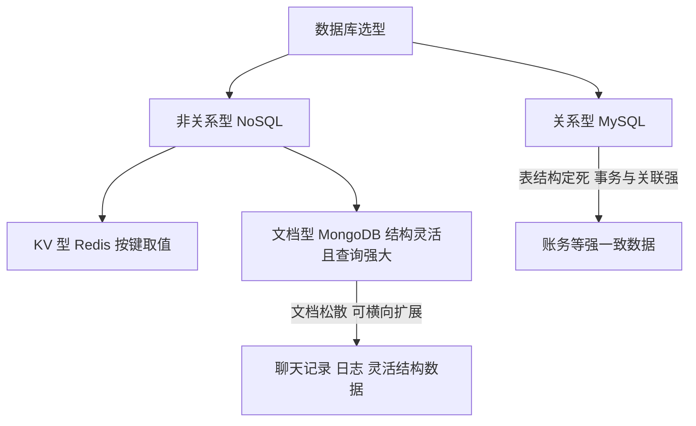
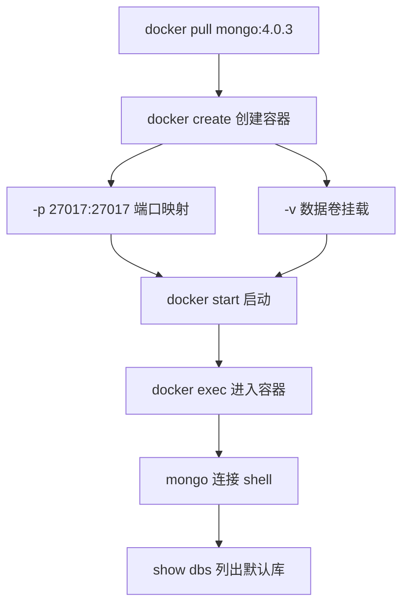
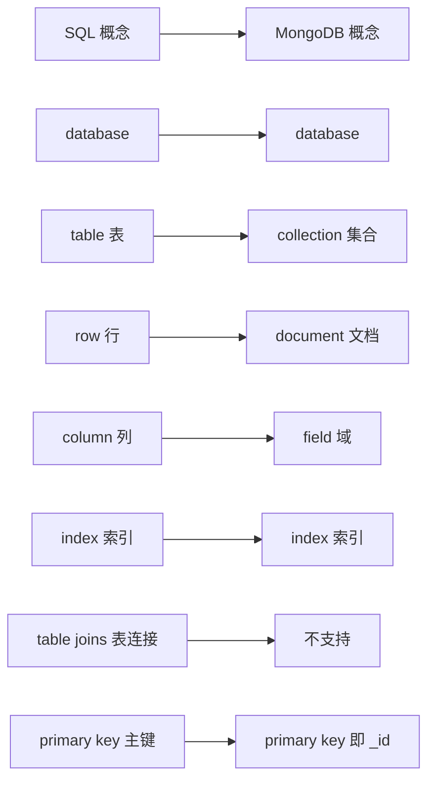
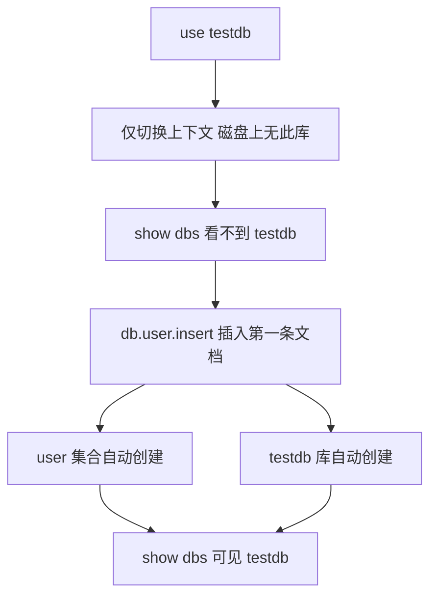
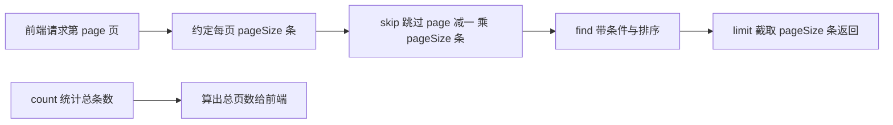
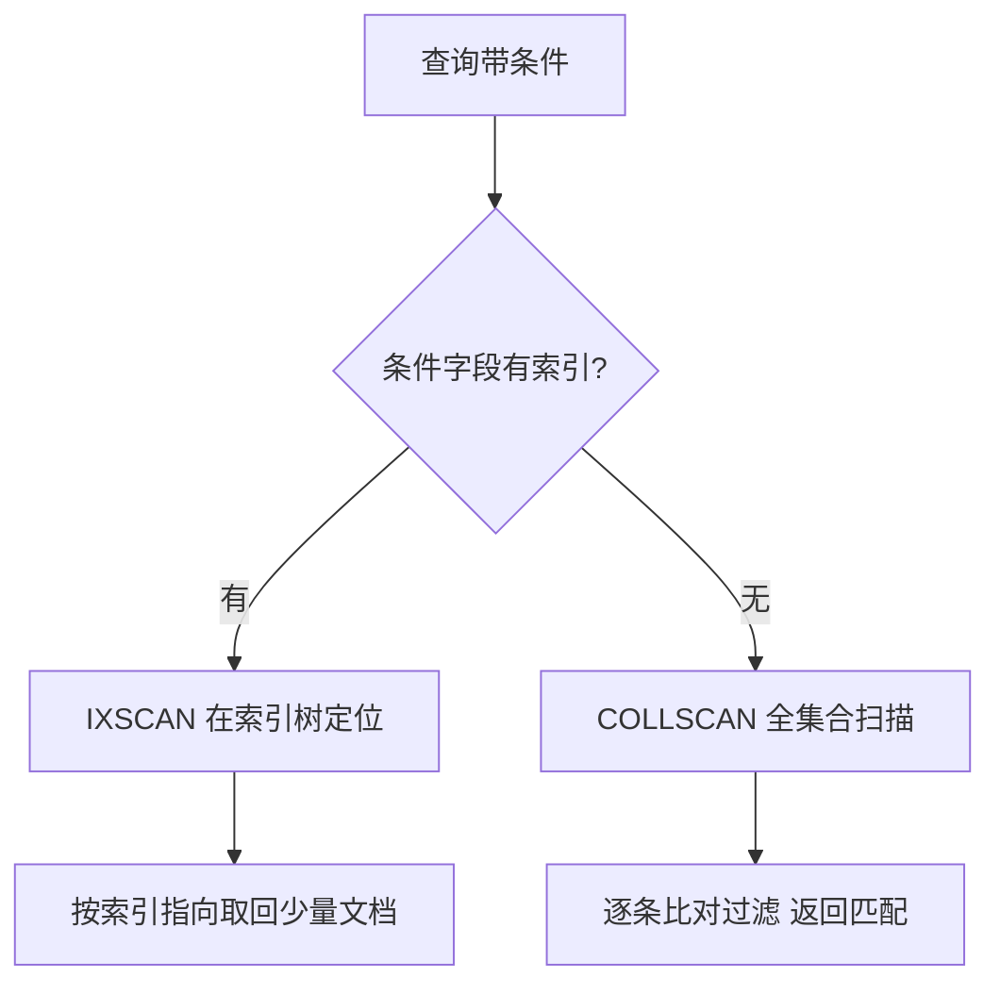
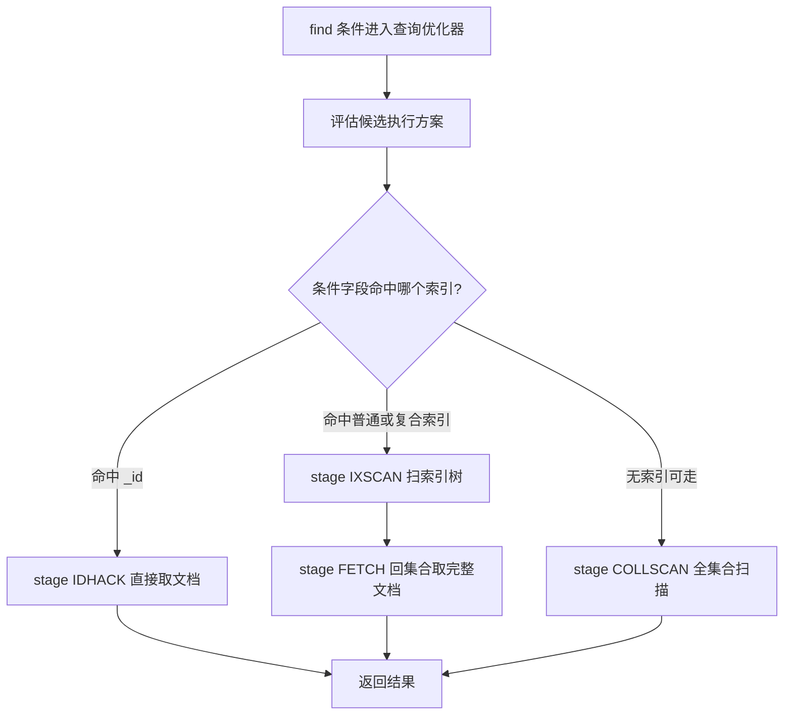
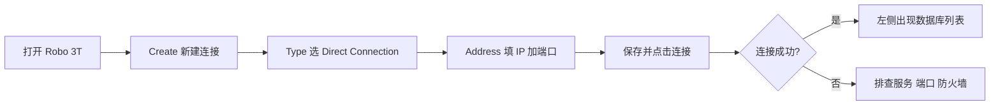
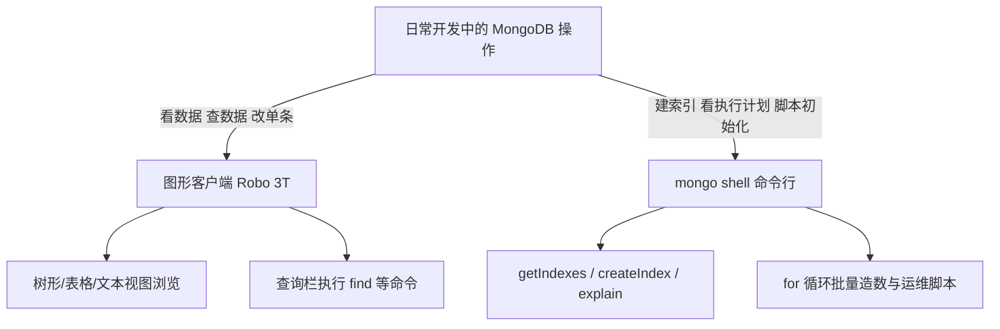

# MongoDB 入门系列合辑：文档模型、Docker 部署、CRUD、执行计划与图形客户端

## 先给结论

- 七篇内容按「是什么、装起来、概念对照、建库建表、增删改查、执行计划、图形客户端」推进，构成 MongoDB 入门的完整第一圈。
- MongoDB 是基于分布式文件存储的数据库，定位介于关系型与非关系型之间，是 NoSQL 里功能最丰富、最像关系数据库的那一个，横向扩展是它的最大优势。
- 数据结构松散，采用 BSON 格式，同一集合里的文档字段可以缺省、结构可以不同，这是它接得住聊天记录这类灵活数据的根本原因。
- 概念对照一句话：table 对 collection、row 对 document、column 对 field；不支持 join，跨集合关联靠内嵌文档或应用层组装；`_id` 自动生成且默认自带索引。
- Docker 安装四步：拉 mongo 镜像、create 建容器、start 启动、exec 进容器；`-p 27017:27017` 做端口映射，`-v` 挂数据卷防删容器丢数据，默认无账号密码是安全由内网环境兜底。
- 库和集合都是隐式创建：use 新库后插入第一条数据，库与集合同时出现；删集合 `drop()`，删库 `db.dropDatabase()`，没有后悔药。
- CRUD 一页通：update 必须带 `$set` 否则整条文档被替换，remove 记得 justOne 或改用 deleteOne/deleteMany，find 配 skip、limit、sort 完成分页与排序，索引 getIndexes、createIndex、dropIndex 三板斧。
- 建了索引不等于生效：explain 读 `winningPlan.stage`，COLLSCAN 是全集合扫描，IXSCAN 才是走索引，IDHACK 按 `_id` 直达最快，执行计划是分析任何查询性能的第一入口。
- 收尾交给图形客户端 Robo 3T：Direct Connection 加 IP:端口两项配置即可连上，查询栏依然写 shell 命令且字符串值要带引号；连不上时先查服务、端口映射与防火墙。

## 第1部分：MongoDB 入门：文档模型、BSON 与它凭什么接住聊天记录

微聊的聊天记录决定交给 MongoDB 存，这个决定不能拍脑袋。就算没用过 MongoDB，多半也听过它的名字，名声在外的它究竟特别在哪？把定位、数据结构、查询能力三件事拆开看清楚，再和 MySQL、Redis 摆在一起对比，选型的理由自然浮出来。这一课是纯概念课，但概念不牢，后面的 API 与整合课全是空中楼阁。

### 一、定位：分布式底座，跨在两类数据库中间

一句话定义里的每个词都有信息量。「分布式文件存储」意味着数据天然可拆可扩：一台机器磁盘不够，加一台；两台不够，加三台、加十台，数据分摊下去，存储容量随机器数线性增长。传统单机数据库扩容靠换更好的硬件，MongoDB 靠加节点，这正是它能存海量数据、也适合日志类与消息类业务的原因。底层由 C++ 编写，属于了解即可的背景知识。

它「介于关系型与非关系型之间」。关系型的代表是 MySQL 这类，先定表结构再插数据，靠 SQL 查询；非关系型统称 NoSQL，最常见的 Redis 是 KV 型，按 key 取 value，简单粗暴。MongoDB 站在两者中间：既有 NoSQL 的结构灵活、扩展容易，又有接近关系数据库的查询能力，两边优点各占一些。官网 `www.mongodb.com`，感兴趣可以自行翻阅。把三类数据库各自的站位画成一张图：



图里 MongoDB 独占文档型一支：往下承接 KV 型给不了的条件查询，横向借分布式拿到关系型给不了的扩展性，站位恰好落在微聊这类业务的需求区间。

### 二、BSON：JSON 的增强版

BSON 第一次听说没关系，JSON 一定熟：大括号套键值对，中括号装数组。BSON 就是在 JSON 的基础上增加了数据类型支持，看外形与 JSON 几乎一样。课程在编辑器里敲了两条文档，第一条是完整的用户信息（画面原样整理）：

```json
{
  "id": 1,
  "name": "zhangsan",
  "age": 20,
  "address": "上海市"
}
```

第二条换成李四，年龄这个数据拿不到，address 也不再是一个字符串，而是另一个对象：

```json
{
  "id": 2,
  "name": "李四",
  "address": {
    "id": 1001,
    "title": "北京市xxxxx"
  }
}
```

两条文档并排放着，三个看点：李四没有 age 字段，直接不写，不用占位；address 从字符串升级成了嵌套对象，里面有自己的 id 和 title；嵌套还能继续往下走，对象里再套对象，层层深入，关系数据库里要靠多张表外键关联才装得下的结构，一份文档一层就放下了。

### 三、松散结构对定长表：差在缺省与扩展

把这两条文档放进关系数据库的视角再看一次：它们相当于同一张表里的两行，但结构对不上，李四那行没有年龄值。MySQL 的表列一旦建好就定死了，每一行都必须按列填，没有值只能写 NULL 或默认值；MongoDB 的集合不管这些，每条文档自带结构，字段随写随有、随缺随省。逐项对比：

| 对比项 | MySQL 行 | MongoDB 文档 |
|---|---|---|
| 结构约束 | 先建表定列，行随表走 | 文档自带结构，随写随定 |
| 缺失字段 | 占位 NULL 或默认值 | 直接不写该字段 |
| 字段扩展 | 改表 DDL，全表受影响 | 加键即用，旧文档不受影响 |
| 嵌套结构 | 拆表外键关联 | 对象内嵌，可多层嵌套 |

聊天记录选 MongoDB 的伏笔就在这张表里：消息类型会不断变化，文本、图片、房源卡片引用，字段随业务长，文档模型加字段零成本，旧消息原样躺着的版本也不必迁移。

### 四、查询与索引：非关系的外表，关系型的心

NoSQL 常被质疑查询能力弱，这个印象来自 KV 型：Redis 只能按 key 取值，想按条件过滤、排序、统计，KV 模型帮不上忙。MongoDB 完全是另一回事，它最大的特点就是查询语言非常强大：语法有点类似面向对象的查询语言，条件、排序、投影都能表达，几乎可以实现关系数据库单表查询的绝大部分功能，而且还支持对数据建立索引。索引一建，查询性能大幅提升，这与 MySQL 里建索引的收益是同一个道理。

「非关系数据库当中功能最丰富、最像关系数据库的」这句定语，说的正是查询与索引这层能力。回到微聊场景验证一下：按会话查历史消息、按时间倒序、按用户过滤，这些需求 MongoDB 都能接住，聊天记录存它没有后顾之忧。

### 五、装起来：Docker 拉镜像

概念课的最后，把服务装出来。课程讲义给的安装路线是 Docker，第一步拉镜像（命令取自讲义「通过 docker 安装 MongoDB」小节）：

```bash
docker pull mongo:4.0.3
```

镜像到手，创建容器、映射端口、进容器用 shell 连上去敲几条命令，这一套留在下一课展开。装完之后你会发现，体验一个数据库的成本从来没有这么低过。

## 第2部分：用 Docker 装 MongoDB：镜像名、端口、数据卷与第一次连接

装 MongoDB 有两条路：去官网下 Windows、macOS、Linux 对应的安装包，或者用 Docker 拉镜像跑容器。前者每种系统的目录、环境变量、服务注册方式各不相同，卸载还容易留残留；后者一条命令拉镜像、一条命令起容器，删起来也干净。微聊项目一路装下来 MySQL、Redis 都是 Docker 部署，MongoDB 延续同一套路，镜像版本固定为 4.0.3。

目标很简单：容器跑起来，命令行连上去，`show dbs` 能列出库，安装即宣告完成，后面的增删改查全在这个容器里做。

### 一、拉镜像：名字叫 mongo

```bash
# 拉取镜像
docker pull mongo:4.0.3
```

版本号直接跟在镜像名后面。锁一个固定版本的好处是，讲义里每条命令的输出都能和自己的环境对上。要特别留意镜像名：Docker Hub 上的官方镜像叫 `mongo`，搜 `mongodb` 出来的是社区维护的镜像，并不相同。

### 二、创建并启动容器：-p 与 -v 各管一件事

```bash
# 创建容器
docker create --name mongodb -p 27017:27017 -v /data/mongodb/data/db mongo:4.0.3
# 启动容器
docker start mongodb
# 查看容器状态
docker ps
```

三个参数分工清楚。

**第一，`--name mongodb` 给容器起名。** 后续启动、进入、删除都靠这个名字定位。名字全局唯一，之前建过同名容器时 create 会直接报冲突，用 `docker rm mongodb` 删掉旧容器再创建即可。

**第二，`-p 27017:27017` 把容器端口映射到宿主机。** 冒号前是宿主机端口，冒号后是容器内 MongoDB 监听的默认端口 27017，与 MySQL 的 3306 一个概念。映射之后，宿主机上的程序连 `localhost:27017` 就等于连到了容器里的数据库。

**第三，`-v` 挂载数据卷。** 数据库容器最怕删容器连带丢数据，挂载的作用是让容器内写数据的位置落到宿主机磁盘：容器内部往该目录写，实际存到外面，容器删掉重建，数据原地不动。讲义命令里 `-v` 只跟了一个路径，由 Docker 自动创建匿名卷来承接；想把宿主机位置写得更明确，主流写法是冒号分隔两边：

```bash
-v /data/mongodb/data/db:/data/db
```

冒号后的 `/data/db` 是 MongoDB 容器里真正的数据目录，冒号前是宿主机位置，数据文件落在哪一眼可见。

`docker ps` 的输出里能看到 mongodb 容器带着端口映射处于运行状态，容器这一层就算就绪了。

### 三、进容器验证：mongo shell 与三个默认库

宿主机上并没有装 MongoDB 环境，也就没有客户端可用，操作直接进容器里做（单独装一个客户端也可以，没必要）：

```bash
# 进入容器
docker exec -it mongodb /bin/bash
# 使用 MongoDB 客户端连接本机服务
mongo
```

`mongo` 是 MongoDB 自带的命令行客户端，进去后直连本机数据库。提示符变成 `>`，连接就成功了。第一条值得记住的命令：

```bash
> show dbs
admin   0.000GB
config  0.000GB
local   0.000GB
```

这三个库都是 MongoDB 自带的系统库：admin 存用户与权限，config 记录配置信息，local 放复制集等本机数据。能正常列出它们，说明服务健康，安装验证完成。业务数据不要写进这三个库，后面会自建库。



两条支线在 create 一步合流：端口映射决定外面连不连得上，数据卷决定删容器后数据在不在，两者都齐，容器才算真正可用。

### 四、没让你输密码，这正常吗

整个连接过程没有出现用户名密码输入。这是默认行为：启动容器时没有配置认证，不设密码即可直连。听起来不安全，但这类 NoSQL 数据库大多如此，Redis 同样可以不设密码访问。

设计逻辑是：服务自身的安全交给外围环境保障。数据库部署在内网，由防火墙与网络隔离挡住外部访问；反过来说，主机一旦被攻破，数据库里那一层用户名密码也拦不住什么。MongoDB 本身支持用户名密码，并且有一整套完善的权限体系，后续课程会展开；学习阶段先用无认证模式，把精力放在命令本身。

## 第3部分：SQL 与 MongoDB 概念对照：表变集合，行变文档

从 MySQL 过来的人学 MongoDB，最先卡住的往往不是命令，而是术语：表改叫集合，一行数据改叫文档，列改叫域，连主键都自带一个 `_id`。术语对不上号，官方文档和命令示例看得一头雾水。把两边概念一一摆好对照，再拿一张传统表格和两份文档放在一起看转化，后面的 CRUD 课就顺畅了。

### 一、概念对照表

逐项对照，左边是 SQL 世界，右边是 MongoDB 世界：

| SQL 术语/概念 | MongoDB 术语/概念 | 解释/说明 |
|---|---|---|
| database | database | 数据库 |
| table | collection | 数据库表/集合 |
| row | document | 数据记录行/文档 |
| column | field | 数据字段/域 |
| index | index | 索引 |
| table joins | 不支持 | 表连接，MongoDB 不支持 |
| primary key | primary key | 主键，MongoDB 自动将 _id 字段设置为主键 |

用大白话串一遍：**集合是装文档的容器**，对应 MySQL 的表，但里面每条记录自带结构，不像表那样受列定义约束。**文档是数据的基本单位**，一行数据就是一个文档，结构类似 JSON。**域是文档里的一个键值对**，对应列，只是它没有统一的列定义，各文档各自声明。**索引两边同义**，都是为加速查询而生，后面索引一课会动手建。把映射画成图：



图里只有两处不是一一照搬：表连接在 MongoDB 这边断掉，主键在 MongoDB 这边自动落地成 `_id`。这两处正是后面两个小节的重点。

### 二、一张表如何变成两份文档

左边一张标准的表格，有行有列；右边是同样的数据存进 MongoDB 之后的样子，一条记录就是一份文档：

```json
{
  "_id": ObjectId("514a0b85d2a5247006000123"),
  "name": "25",
  "city": "Los Angeles",
  "email": "mark@abc.com",
  "user_name": "Mark Hanks"
}
```

```json
{
  "_id": ObjectId("514a0b85d2a5247006000124"),
  "age": 31,
  "city": "Dallas",
  "email": "richard@abc.com",
  "user_name": "Richard Peter"
}
```

两条文档摆在一起，三个看点：

**第一，结构不齐。** 第一条有 `name` 没有 `age`，第二条有 `age` 没有 `name`。放在 MySQL 里这就是同一张表的两行，列是定死的，缺值只能填 NULL；放在 MongoDB 里，各自缺的字段直接不写，文档之间互不牵制。

**第二，文档结构是 JSON 风格。** 大括号套键值对，这正是 BSON 的外形。上一课讲过 BSON 是 JSON 的增强版，多了日期、二进制等类型支持，这里直接见到了实物。

**第三，每条文档头顶都有一个 `_id`。** 它不是业务字段，是 MongoDB 自动生成的主键。

### 三、_id：自动到货的主键和索引

SQL 里建表要显式声明主键，插入时还得自己给值或配自增；MongoDB 把这件事包了：**primary key 概念保留，落地为 `_id` 字段，不指定就自动生成**。

自动生成的 `_id` 类型是 ObjectId，一个 12 字节的值，大致由时间戳、机器标识、进程 id 与计数器拼成，既保证唯一，又能从字面看出创建的大致时间，分布式环境下各节点生成也不会撞车。按主流实现补充一句背景：这个 12 字节的设计是为了在多机写入时无需协调就能产出全局唯一标识，比自增主键更适合横向扩展的存储。

还有一点现在记下，后面索引一课会验证：`_id` 默认就建好了索引。用 `getIndexes()` 查看任何集合，第一条永远是名为 `_id_` 的索引，删不掉也无需建。

### 四、没有 join，关联怎么办

对照表里 `table joins` 一行在 MongoDB 侧是空的，它不支持连接查询。以前靠一条 SQL 联表拿到的数据，在 MongoDB 里有两条主流替代路：

- **内嵌文档**：把关联数据直接嵌进主文档，比如订单文档里内嵌商品对象，一次查询全拿回来，读起来快，这是文档模型的主打用法。
- **应用层组装**：分两次查询，先查主文档，再按拿到的 id 查关联集合，在代码里拼装。灵活，代价是多一两次网络往返。

微聊的场景里，消息文档内嵌发送者的昵称、头像这类不常变的展示字段，就是内嵌思路的落地：宁可存两份，不让查询联表。

## 第4部分：MongoDB 建库不用建表：库与集合的隐式创建和删除

MySQL 里建库写 `CREATE DATABASE`，建表写一长串 `CREATE TABLE` 加字段类型；MongoDB 把这两步全省了。`use` 一个名字、插一条数据，库和集合同时就有了。省事的同时带来一个反直觉现象：`use` 了一个不存在的库，`show dbs` 里却看不到它，不少人以为命令失败了，其实是还没插入数据。这一课把库与集合的查看、切换、隐式创建、删除一次讲透。

### 一、层级不变：库、集合、文档

传统数据库的操作顺序是先建库、再建表、然后往表里插数据，MongoDB 沿用同一套心智模型：数据库 database，库里的表 collection，表里的行 document，概念对照上一课已经讲过。唯一的差别在创建时机：MySQL 的库和表必须先显式创建，MongoDB 的库和集合在使用中自动落地。

`show dbs` 列出的 admin、config、local 是系统自带的三个库，业务操作不建在它们上面，自建库来存放数据。随时可以用不带参数的 `db` 命令打印当前所在的库名，多个会话之间来回切换时先看一眼 `db` 再动手，是避免误操作最便宜的习惯。库名与集合名的书写也有讲究：区分大小写，不能包含空格与 `$`，业务库名按项目或模块取名，将来排查问题时一眼就能对上。

### 二、切换与隐式创建：插一条数据，库就出现了

先看切换。`use` 关键字选中一个数据库，后续的 CRUD 都发生在它上面：

```bash
# 查看所有的数据库
> show dbs
admin   0.000GB
config  0.000GB
local   0.000GB

# 通过 use 关键字切换数据库
> use admin
switched to db admin

# 切换到一个不存在的库也不报错
> use testdb
switched to db testdb

# 此时查看，testdb 并不存在
> show dbs
admin   0.000GB
config  0.000GB
local   0.000GB
```

`use testdb` 没有任何报错，`show dbs` 里却没有 testdb。原因很直接：**`use` 只是把当前会话的上下文切过去，MongoDB 还没有为它落任何东西**，磁盘上不存在这个库的影子。往里面插入第一条数据，库和集合才被真正创建：

```bash
# 插入数据（插入命令后面会详细讲）
> db.user.insert({id:1,name:"zhangsan"})
WriteResult({ "nInserted" : 1 })

# 再查看，testdb 出现了
> show dbs
admin   0.000GB
config  0.000GB
local   0.000GB
testdb  0.000GB
```

`db.user.insert(...)` 这条命令读作：向当前库的 user 集合插入一份文档。返回 `WriteResult({ "nInserted" : 1 })` 表示插入成功一条。注意这一条命令同时干了两件事：创建了 user 集合，也创建了 testdb 库。没有 `CREATE DATABASE`，没有 `CREATE TABLE`，插入即创建。整个过程的分界线画成图：



图的关键分叉在 insert：它之前的一切动作都不落盘，它之后库和集合一起出现。理解了这个时机，就不会再被「use 了一个空库却 show 不出来」困扰。

### 三、查看与删除集合

在 testdb 里查看自己建了哪些集合，两个命令等价：

```bash
# 查看当前库中的集合
> show tables
user
> show collections
user
```

`show tables` 更贴近 MySQL 的使用习惯，`show collections` 更贴 MongoDB 自己的术语，输出完全一样。删除集合用 `drop()` 方法：

```bash
# 删除集合
> db.user.drop()
true

# 再删一次，集合已经不存在
> db.user.drop()
false
```

返回值有明确语义：**成功删除返回 true；返回 false 表示这个集合本来就不存在**，没有发生任何删除。第二次执行返回 false，就是这个含义。

### 四、删除数据库：一条命令，没有后悔药

删库的命令是 `db.dropDatabase()`，它作用于**当前所在的库**，所以删之前必须先 `use` 到目标库：

```bash
# 先切换到要删除的数据库
> use testdb
switched to db testdb

# 删除数据库
> db.dropDatabase()
{ "dropped" : "testdb", "ok" : 1 }

# 确认结果
> show dbs
admin   0.000GB
config  0.000GB
local   0.000GB
```

返回 `{ "dropped" : "testdb", "ok" : 1 }`，testdb 连同里面的集合、文档一并消失。这条命令的执行方式值得单独强调：不像 MySQL 有 undo log、回收站式的兜底，MongoDB 删库即生效，没有确认弹窗，也没有内建的恢复机制。命令名长一点、`use` 那步别省，算是这门数据库留给操作者的天然缓冲。

## 第5部分：MongoDB 增删改查与索引一页通：insert、update、remove、find 与 createIndex

库里建好了，集合的概念也清楚了，接下来是真正天天要写的东西：增删改查，外加查询提速的索引。命令单个看都不难，坑几乎全藏在参数默认值里：update 不带 `$set` 会把整条文档覆盖掉，remove 默认删光所有匹配，投影写一个字段结果 `_id` 还是跟着出来。按新增、更新、删除、查询、索引五步走，命令可以直接复制进 mongo shell 里跑。

### 一、新增数据：insert 与 save

MongoDB 存储的文档结构是类似 JSON 的 BSON，全称 Binary JSON。插入语法：

```bash
# 方法：db.COLLECTION_NAME.insert(document)
> use testdb
switched to db testdb
> db.user.insert({id:1,name:"zhangsan",age:20})
WriteResult({ "nInserted" : 1 })
> db.user.save({id:2,name:"lisi",age:22})
WriteResult({ "nInserted" : 1 })
> db.user.find()
{ "_id" : ObjectId("5c0be790d49eaaa20d4140e3"), "id" : 1, "name" : "zhangsan", "age" : 20 }
{ "_id" : ObjectId("5c0be7a0d49eaaa20d4140e4"), "id" : 2, "name" : "lisi", "age" : 22 }
```

insert 与 save 两个方法都能插入，效果一致，日常更常用 insert。严格说 save 的本意是替换：不带 `_id` 时是插入，带了 `_id` 且文档已存在时是整条替换，用不好会悄悄覆盖数据。延伸一句：主流驱动与新版本 shell 里对应的是 `insertOne()` 与 `insertMany()`，分别是本课 insert 的单条版与批量版，语义相同（此为按本课写法补全的延伸说明）。

空文档也能插，这最能体现集合对字段零约束：

```bash
> db.user.insert({})
WriteResult({ "nInserted" : 1 })
```

find 出来这条记录只有一个 `_id` 字段，类型 ObjectId。没有任何业务字段的文档照样合法，但除了测试，别真的这么存数据。

### 二、更新数据：$set 是底线

```bash
db.collection.update(query, update, upsert, multi)
```

四个参数：query 是查询条件，类比 SQL update 语句 where 后面的部分；update 是更新内容，类比 set 后面的部分；upsert 可选，记录不存在时是否插入，默认 false；multi 可选，默认 false 只更新查到的第一条，true 则更新全部匹配；writeConcern 抛异常的级别，很少用到。

一次正常的更新长这样：

```bash
> db.user.update({id:1},{$set:{age:25}})
WriteResult({ "nMatched" : 1, "nUpserted" : 0, "nModified" : 1 })
> db.user.find()
{ "_id" : ObjectId("5c0be790d49eaaa20d4140e3"), "id" : 1, "name" : "zhangsan", "age" : 25 }
{ "_id" : ObjectId("5c0be7a0d49eaaa20d4140e4"), "id" : 2, "name" : "lisi", "age" : 22 }
```

返回值三个数字各有含义：nMatched 匹配到 1 条，nUpserted 没有触发插入，nModified 实际修改 1 条。zhangsan 的年龄变成了 25，其余字段原样保留，这就是 `$set` 的功劳。

**坑一，省掉 `$set` 就是整条替换。** 把 `$set` 拿掉再执行：

```bash
> db.user.update({id:1},{age:25})
```

结果文档里只剩 `id` 和 `age`，`name` 等字段全部消失。update 的第二个参数一旦不带操作符，就会被当作一份全新的文档去整体替换旧文档。**更新字段必须通过 `$set` 指定，这条底线不能破。**

**坑二，更新不存在的字段等于新增字段。** lisi 那条数据本来没有性别字段，直接 set 一个：

```bash
> db.user.update({id:2},{$set:{sex:1}})
WriteResult({ "nMatched" : 1, "nUpserted" : 0, "nModified" : 1 })
```

修改成功，再查时 lisi 多出了 `sex: 1`。反过来看这是个特性：要给存量数据补字段，一条 update 就能实现。

**upsert：数据不存在时帮你插一条。** 先更新一个不存在的 id：

```bash
> db.user.update({id:5},{$set:{age:25}})
WriteResult({ "nMatched" : 0, "nUpserted" : 0, "nModified" : 0 })
> db.user.update({id:5},{$set:{age:25}},true)
WriteResult({ "nMatched" : 0, "nUpserted" : 1, "nModified" : 0 })
```

默认行为下三个数字全是 0，什么都没发生；第三个参数设为 true 后，nUpserted 变成 1，一条只含 `id` 与 `age` 的新文档被插入。「存在则更新，不存在则插入」的 upsert 语义，就是靠这个参数表达的。

multi 补全多行更新的写法：`db.user.update({age:22},{$set:{age:23}},false,true)`，第四个参数 true 让所有匹配行一起改。新版 shell 与驱动里的 `updateOne()`/`updateMany()` 把这层意图写进了方法名，更不容易看漏（延伸说明，按本课写法补全）。

### 三、删除数据：remove 与 deleteOne、deleteMany

```bash
db.collection.remove(
  query,
  {
    justOne: <boolean>,
    writeConcern: <document>
  }
)
```

query 可选，是删除条件；justOne 可选，设为 true 或 1 时只删除一个文档，默认 false 会删除所有匹配；writeConcern 指定异常级别。换一批数据演示：

```bash
> db.user.insert({id:1,username:"zhangsan",age:20})
> db.user.insert({id:2,username:"lisi",age:21})
> db.user.insert({id:3,username:"wangwu",age:22})
> db.user.insert({id:4,username:"zhaoliu",age:22})
```

不带 justOne 时，删的是所有匹配：

```bash
> db.user.remove({age:25})
WriteResult({ "nRemoved" : 2 })   # 删除了 2 条数据
```

把 justOne 设为 true，只删匹配的第一条：

```bash
> db.user.remove({age:22},true)
WriteResult({ "nRemoved" : 1 })   # age 为 22 的有两条，只删了 1 条
```

清空集合时讲义写的是不带条件的 `remove()`，部分版本的 shell 会直接报错要求必须带查询条件，显式传空文档更稳：

```bash
> db.user.remove({})
```

官方为了让意图更清晰，推荐用 `deleteOne()` 与 `deleteMany()`：

```bash
> db.user.deleteOne({id:1})   # 删除匹配的第一条
> db.user.deleteMany({})      # 删除所有数据
```

`deleteOne` 对应 justOne 为 true 的 remove，`deleteMany` 对应默认的 remove，方法名自带语义，写业务代码优先用这对。

### 四、查询数据：find 的条件、投影、分页与排序

查询语法 `db.user.find([query], [fields])`：query 可选，用查询操作符指定条件；fields 可选，用投影指定返回哪些键，省略即返回全部字段。输出不够易读时链一个 `pretty()` 做格式化。常用比较操作符与 SQL 的对应：

| 功能 | 格式 | 类比 SQL |
|---|---|---|
| 等于 | `{<key>:<value>}` | where key = value |
| 小于 | `{<key>:{$lt:<value>}}` | where key < value |
| 小于等于 | `{<key>:{$lte:<value>}}` | where key <= value |
| 大于 | `{<key>:{$gt:<value>}}` | where key > value |
| 大于等于 | `{<key>:{$gte:<value>}}` | where key >= value |

把最常用的几类查询放在一起（沿用上一节的 4 条数据）：

```bash
> db.user.find()                                # 查询全部数据
> db.user.find({},{id:1,username:1})            # 只返回 id 与 username 字段
> db.user.find().count()                        # 统计条数
> db.user.find({id:1})                          # 等值查询
> db.user.find({age:{$lte:21}})                 # age 小于等于 21，返回 20 与 21 两条
> db.user.find({age:{$lte:21}, id:{$gte:2}})    # AND：age<=21 并且 id>=2
> db.user.find({$or:[{id:1},{id:2}]})           # OR：id=1 或者 id=2
```

**AND 与 OR 的组织方式是读别人代码的关键。** 同一个大括号里并列多对键值，默认就是 AND 关系，两个条件要同时满足；OR 必须把各条件装进 `$or` 数组，每个条件再各占一个大括号。比 SQL 罗嗦一点，结构却一目了然。

**投影里 `_id` 是常驻嘉宾。** 投影写 `{id:1,username:1}`，返回结果仍会带上 `_id`，它是主键、默认永远返回；不想看到它要显式写 `_id:0`。

**分页靠 skip 与 limit 组合。** skip 跳过几条，limit 取几条：

```bash
> db.user.find().skip(1).limit(2)   # 跳过 1 条数据，查询 2 条数据
```

页码换算的思路画出来：



按页大小 10 算，第 3 页就是 `skip(20).limit(10)`；总条数用 `count()` 取，配合算总页数。程序里这两个值都是计算出来的，别硬编码。

**排序用 sort，1 正序，-1 倒序：**

```bash
> db.user.find().sort({id:-1})   # 按 id 倒序
```

到这一步，条件、投影、分页、排序都齐了，单集合查询的日常需求已经覆盖。

### 五、索引：createIndex 三板斧与执行计划

索引的目的与 MySQL 完全一致：没有索引的查询要扫描整个集合，逐条比对，数据量大时效率很低；有了索引，按树结构直接定位，查询效率大幅提升。

先看一个集合天生就有的索引：

```bash
> db.user.getIndexes()
{
  "v" : 2,
  "key" : {
    "_id" : 1
  },
  "name" : "_id_",
  "ns" : "testdb.user"
}
```

这就是概念课说的 `_id` 自动主键索引。字段含义：v 是索引版本，key 是索引的字段与方向，name 是索引名，ns 是命名空间即库名加点集合名。

创建索引用 createIndex，给 age 建正序索引：

```bash
> db.user.createIndex({age:1})
{
  "createdCollectionAutomatically" : false,
  "numIndexesBefore" : 1,
  "numIndexesAfter" : 2,
  "ok" : 1
}
```

1 表示正序，-1 表示倒序。再执行 `getIndexes()` 能看到名为 `age_1` 的新索引，命名规则就是字段名加下划线加方向。删除按名字来：

```bash
> db.user.dropIndex("age_1")   # 按索引名删除
{ "nIndexesWas" : 2, "ok" : 1 }
> db.user.dropIndexes()        # 删除除 _id 之外的所有索引
```

多个字段可以合成一个复合索引：

```bash
> db.user.createIndex({"age":1, "id":-1})
```

得到名为 `age_1_id_-1` 的联合索引，age 正序、id 倒序，这里只是演示语法。索引本身占空间，`totalIndexSize()` 可以看当前集合全部索引的总大小，单位是字节。

**建了索引不等于查询一定走索引**，判断依据是执行计划：

```bash
> db.user.find({age:20}).explain()
```

看 winningPlan 里的 stage：出现 `IXSCAN` 说明走了索引，出现 `COLLSCAN` 说明在整集合扫描。课程把执行计划放在下一节专门展开，这里给出最简示例作为按本课写法补全的延伸。两类查询路径画成图：



图里两条路的分水岭是条件字段有没有索引，这也是为什么索引要建在经常作为查询条件的字段上。

## 第6部分：MongoDB 执行计划 explain：验证索引是否生效，定位查询慢在哪

索引建完，查询照跑，可它到底用没用上索引？肉眼是看不出来的。MySQL 里有 `EXPLAIN`，MongoDB 也有同样定位的手段：执行计划。在任意一条查询后面链一个 `explain()`，优化器就会把「这条查询我打算怎么执行」完整交出来，是走索引还是全集合扫描，一眼见分晓。

执行计划有两个用途：验证刚建的索引有没有被查询真正用上，以及作为查询语句的性能分析工具。这一节围绕 `testdb.user` 集合展开，先造数据，再看计划结构，最后用四组对照查询把常见的 stage 全部走一遍。

### 一、为什么建了索引还要看执行计划

前面一节把索引的创建、查看、删除都过了一遍，留下的问题是：怎么知道索引在查询时生效了？如果建了索引、查询却没用上，索引白占空间还拖慢写入，等于没建。

**索引用不用，是优化器说了算，不是开发者说了算。** MongoDB 收到查询后，查询优化器会评估所有可用的执行方案，挑出一个 `winningPlan`（胜出计划）来执行，剩下的放进 `rejectedPlans`（被否决的计划）。执行计划就是把这场内部的方案评选结果原样展示出来。这与 MySQL 的 `EXPLAIN` 定位完全一致：都不改数据，只回答「这条语句打算怎么跑」。

### 二、先造 1000 条测试数据

几条数据看不出扫描方式的差距，需要批量数据。手写一千行 insert 显然不现实，MongoDB 的 shell 内嵌 JavaScript 引擎，可以直接跑循环脚本。下面这段脚本按讲解思路补全（画面中脚本未完整展示，语义一致）：

```javascript
// MongoDB shell 内置 JS 引擎，直接用 for 循环批量插入 1000 条
for (var i = 1; i <= 1000; i++) {
    db.user.insert({
        id: 100 + i,
        username: "name_" + i,
        age: i % 50 + 20
    })
}
```

插入完成后查询验证：

```bash
> db.user.find()
# 先展示 20 条，输入 it 继续翻页查看后续数据
> it
```

shell 的 `find()` 默认只吐 20 条，想看后面的内容输入 `it`（iterate more）继续翻页，这是 shell 的分页机制，避免一次性把上千条数据刷爆终端。此时集合里已有 1000 多条文档，足够观察两种扫描方式的性能差异。

### 三、explain 返回结构怎么读

在查询后面追加 `explain()` 即可拿到执行计划。最基础的一条，不带任何条件：

```bash
> db.user.find().explain()
{
    "queryPlanner" : {
        "plannerVersion" : 1,
        "namespace" : "testdb.user",
        "indexFilterSet" : false,
        "parsedQuery" : {

        },
        "winningPlan" : {
            "stage" : "COLLSCAN",
            "direction" : "forward"
        },
        "rejectedPlans" : [ ]
    },
    "serverInfo" : {
        "host" : "fbfba5f54f1a",
        "port" : 27017,
        "version" : "4.0.1"
    }
}
```

逐层看：`namespace` 是库名加集合名，说明这条计划针对谁；`parsedQuery` 是优化器解析后的条件；`winningPlan` 是胜出的执行方案，`stage` 字段就是整个执行计划里最关键的一个值；`direction` 是扫描方向，`forward` 表示顺着存储顺序正向扫描。这条查询没有任何条件，所以 `winningPlan` 直接给出 `COLLSCAN`，即从集合头到尾逐条扫描。

`explain()` 还支持三种模式：默认的 `queryPlanner` 只做计划不执行查询；`executionStats` 会真正执行并给出扫描条数、耗时等统计；`allPlansExecution` 在此之上再对比全部候选方案。日常判断索引是否生效，默认模式已经够用（三种模式为延伸说明，按官方行为补全）。

### 四、stage 关键字：一张表看懂扫描方式

stage 是判断查询效率的核心。课程涉及到的几个关键值整理如下：

| stage | 含义 | 效率评价 |
|---|---|---|
| `COLLSCAN` | 全集合扫描，逐条比对 | 最低，数据量大时是性能事故 |
| `IXSCAN` | 扫描索引树定位目标 | 高 |
| `FETCH` | 拿索引定位结果后，回集合取回完整文档 | 高，通常与 IXSCAN 配合出现 |
| `IDHACK` | 直接按 `_id` 主键命中 | 最快 |
| `SHARD_MERGE` | 分片集群场景下，把各分片返回结果合并 | 与分片拓扑相关 |

四组对照实验，把上面这些 stage 逐一触发。集合上已有 `_id` 默认索引和 `{age: 1, id: -1}` 复合索引（`db.user.getIndexes()` 可查到 `age_1_id_-1`）。

**实验一，无条件查询，全集合扫描。** 前面那条 `find().explain()` 的结果就是 `COLLSCAN`，它是效率最低的执行方式。

**实验二，按 `_id` 查，直接命中。**

```bash
> db.user.find({_id: ObjectId("5c0bf692bdc7fa321e241a1c")}).explain()
# winningPlan.stage 为 IDHACK
```

`_id` 是每条文档天生自带的主键索引，按它查不进索引树、直接命中文档，所以叫 IDHACK，效率最高。

**实验三，按 age 查，走复合索引。**

```bash
> db.user.find({age: {$gt: 100}, id: {$lt: 200}}).explain()
# winningPlan.stage 为 FETCH，其内部嵌套 IXSCAN
```

条件字段 `age` 在索引 `age_1_id_-1` 里，优化器先 `IXSCAN` 扫描索引定位，再 `FETCH` 按索引指向取回完整文档。扫描的是索引而不是整张表，效率远高于 COLLSCAN。

**实验四，按 username 查，索引没建，退回全扫描。**

```bash
> db.user.find({username: 'zhangsan'}).explain()
# winningPlan.stage 依然是 COLLSCAN
```

`username` 上没有任何索引，无论集合里有多少数据，都是全集合扫描。同一张表，四种查询，扫描方式天差地别，这就是执行计划要暴露的信息。



图中三条路径的分水岭是条件字段与索引的匹配关系，`winningPlan.stage` 就是这个分水岭的直接读数：看到 `IDHACK` 与 `IXSCAN` 可以放心，看到 `COLLSCAN` 就要回头检查索引。

## 第7部分：MongoDB 图形化客户端 Robo 3T：连接配置、浏览数据与查询实操

命令行操作 MongoDB 是基本功，但日常开发里天天靠 `db.user.find()` 裸敲命令看数据，JSON 挤成一团、字段要靠箭头一个个展开，效率并不高。这时候就会想要一个图形化客户端：点点鼠标就能看库、看集合、看文档，偶尔还能顺手执行一条查询。MongoDB 官方本身不提供这类客户端工具，需要选第三方产品，本课选用的是 Robo 3T。

定位先说清楚：图形客户端是辅助工具，负责数据查看这种高频轻量操作；命令行依然不可替代，索引管理、执行计划、脚本初始化这类活终究要回到 shell。两者配合，各干各的活。

### 一、连接配置：两项就够了

装好 Robo 3T 打开后，会看到 `MongoDB Connections` 窗口，点击 `Create` 新建连接。核心配置如下：

| 配置项 | 取值 | 说明 |
|---|---|---|
| Type | `Direct Connection` | 单机直连模式；连副本集时应改为对应的副本集类型 |
| Address | `127.0.0.1:27017` | IP 加端口，27017 是 MongoDB 默认端口 |
| Name | 自定义，如 `test` | 连接的显示名，便于区分多个环境 |

`Type` 这个选项值得多说一句。`Direct Connection` 是对着某一台机器直连，本机和单节点服务器都用它；如果目标是副本集集群，就要选副本集连接类型，让驱动自动发现所有节点并识别主节点，选错类型会出现「能连上但读写行为不对」的现象。`Address` 填目标服务器的 IP 和端口，连本机 Docker 里跑的 MongoDB 就是 `127.0.0.1:27017`，连远程主机则换成对应 IP。保存后点击连接，左侧出现数据库列表即代表成功。



图里唯一的失败分支指向排查服务与端口，这不是客套：客户端只是发起 TCP 连接的一方，连不上时优先检查服务端。

### 二、浏览数据：树形结构加三种视图

连接成功后，左侧树从上到下依次是数据库、集合、文档。找到课程里自建的 `testdb`，展开它的 `Collections` 能看到 `user` 集合，双击即可打开浏览。

文档默认按树形结构展示，每个文档前面有一个箭头，点开后能逐层展开 `_id`、`id`、`username`、`age` 这些字段的值。数据一多，树形结构占地方，Robo 3T 提供了三种展现形式：

- **树形视图**：按字段层级展开，适合看嵌套文档和数组这类复杂结构。
- **表格视图**：每行一条文档、每列一个字段，适合字段扁平的集合，批量扫一眼数据最舒服。
- **文本视图**：原始 JSON 逐条罗列，适合复制单条文档到别处。

切换按钮在视图右上角，选哪种纯粹是个人习惯，功能上没有差别。以 `user` 集合为例，表格视图里 `username` 一列全是 `zhangsan`、`lisi` 这类值，年龄一列是 `20.0`、`22.0`，注意 MongoDB 的数值类型显示为浮点样式，这与 shell 里看到的整数写法是同一回事的不同呈现。

### 三、查询栏：还是要写命令，注意引号

图形工具看数据方便，做条件查询还是得写命令。集合窗口上方有一栏查询输入区，直接敲 shell 命令再点执行即可：

```javascript
// 查询 age 等于 22 的用户，返回 3 条结果
db.getCollection('user').find({'age':22})
```

这条命令在 Robo 3T 里返回 3 条文档，与命令行里执行 `db.user.find({age:22})` 的效果一致。**坑在引号上：`'age'` 的引号不能省。** 查询输入区里写的是 JavaScript，字段名与字符串值都是 JS 表达式，`age` 不加引号会被当作变量去求值，找不到就返回空结果；命令行 shell 对这个场景更宽容，但养成加引号的习惯两边都不会出错。`db.getCollection('user')` 与 `db.user` 是同一个集合的两种写法，前者在字段名或集合名含特殊字符时依然合法。

除了查询，这一栏同样能跑 `count()`、`sort()` 等命令，本质上 Robo 3T 内嵌了一个 shell 终端，能执行什么取决于 MongoDB 的命令集，而不是客户端本身的功能清单。

### 四、客户端与命令行的分工



分工的边界很清晰：高频的「看」交给客户端，低频但专业的「管」留在命令行。生产服务器一般不装图形客户端，远程只能通过命令行操作，所以 shell 的基本命令不能因为有了 UI 就荒废。另外 Robo 3T 这款工具如今已停止更新，官方主推的免费客户端是 MongoDB Compass，界面思路类似，会了 Robo 3T 再用 Compass 几乎没有迁移成本（工具现状为延伸说明）。

## 常见误区

- **把 BSON 等同于 JSON。** 外形相似，内核不同：BSON 增加了日期、二进制、ObjectId 等数据类型，类型差异影响存储体积与比较规则，按 JSON 的直觉处理日期字段就会吃亏。
- **以为松散等于没有结构。** 文档结构自由，但集合内的查询与索引全靠字段名对齐，同一个含义的字段在几条文档里各起一个名字，查询和索引都会漏数据，字段命名要有约定。
- **拿 MongoDB 替代所有 MySQL 场景。** 强事务、多表关联、严格一致的账务类数据，依然是关系型数据库的主场，按数据形态选型，不跟风。
- **以为 NoSQL 都做不了复杂查询。** 查询弱是 KV 型的局限，不是 NoSQL 全体的局限，MongoDB 的查询能力覆盖单表查询的绝大部分功能。
- **把镜像名写成 mongodb。** 官方镜像叫 `mongo`，拉错镜像轻则版本对不上，重则行为与讲义完全不同，排查半天才发现方向错了。
- **同名容器冲突后反复重试。** create 报错是名字占用，先 `docker rm mongodb` 删掉旧容器，再重新创建。
- **以为删容器等于删数据。** 没挂载数据卷时删容器数据一起消失；挂了卷数据在宿主机上，重建容器即可继续使用。
- **拿系统库练手。** admin、config、local 是内部库，业务数据自建库存放，避免将来做权限和备份时混在一起。
- **以为 MongoDB 没有主键和索引。** 概念都在，只是主键自动化了：`_id` 自动生成、自动设为主键、自动带索引。
- **以为同一集合的文档必须同构。** 结构松散是文档模型的卖点，字段可以缺省，但同一个含义的字段在几条文档里各起一个名字，查询和索引都会漏数据，命名要有约定。
- **按 SQL 的习惯等一个 join。** MongoDB 不支持表连接，设计集合结构时就该想着内嵌，而不是建完集合再想办法联。
- **把 _id 当业务字段用。** 它是存储引擎的内部主键，业务自有的编号（如课程里的 `id`）单独建一个字段来存，两者互不干扰。
- **use 新库后 show dbs 看不到，以为切换失败。** 切换没问题，是库里还没有数据；插入一条文档，库就会出现在列表里。
- **看到 drop() 返回 false 就当删失败了。** false 的含义是目标集合不存在，本次没有东西可删；真正的删除成功返回 true。
- **不切库直接执行 db.dropDatabase()。** 它删的是当前上下文的库，如果 `use` 到了 admin 这类系统库再执行，后果严重；删库前先用 `db` 命令确认自己在哪个库里。
- **把业务数据建进 admin、config、local。** 这三个是系统库，权限、配置、复制集元数据都在里面，业务库单独创建，将来备份与授权都干净。
- **update 第二个参数直接写字段。** `{id:1}` 之外直接给 `{age:25}`，整条文档被替换，其余字段全部丢失；改字段值必须写 `$set`。
- **以为 remove 默认只删一条。** 默认删除所有匹配；只删一条要 `justOne: true`，或直接用 `deleteOne()`。在错误认知下执行删除，丢的是一批数据。
- **不带条件执行 remove() 清空。** 部分版本 shell 会报 remove needs a query；清空集合显式传 `{}`，同时想清楚是不是 `db.集合.drop()` 删掉整个集合更合适。
- **投影后疑惑 _id 为什么还在。** `_id` 默认永远返回，需要隐藏时显式写 `_id:0`。
- **建完索引就当查询一定变快。** 低选择性的字段、类型不匹配的条件，优化器可能弃用索引；用 explain 看 stage 是 IXSCAN 还是 COLLSCAN 来确认。
- **explain 写错位置或拼错方法。** 它是游标方法，必须跟在 `find()` 后面写成 `db.user.find({...}).explain()`；写成 `db.user.explain({...})` 或拼成 `explan` 都拿不到想要的计划。
- **看到 COLLSCAN 就认定代码写错了。** 集合只有几十条数据时，优化器评估后可能放弃索引直接全扫，反而更快；COLLSCAN 要结合数据量判断，大集合上出现才必须处理。
- **以为建了复合索引就万无一失。** 索引是 `age_1_id_-1`，查询条件里却只出现 `username`，照样 `COLLSCAN`。条件字段必须覆盖索引字段，复合索引还受最左前缀约束。
- **以为 explain 只能验证索引。** 它同时是查询性能分析工具，配合 `executionStats` 模式还能看到实际扫描了多少条、耗时多少毫秒，排查慢查询时是第一手材料。
- **查询字段值不加引号。** `find({age:22})` 在某些输入区能跑，`find({username:zhangsan})` 必然出错或返回空：`zhangsan` 没有引号就成了未定义的变量。字符串一律带引号，`{'age':22}` 这种全加引号的写法最稳。
- **连不上就反复重装客户端。** 连接失败先查三件事：MongoDB 服务是否在跑、端口 `27017` 是否可达（Docker 部署检查端口映射）、防火墙是否放行。客户端只是个连接发起方，重装解决不了服务端的问题。
- **把 UI 工具当成能力齐全的管理端。** 图形客户端擅长浏览与轻量增删改查，索引管理、执行计划分析、批量初始化脚本仍应以命令行为准；两者能力有交集，但专业操作的可复现性只有脚本才有。
- **远程连接时照抄课程里的 IP。** `172.16.x.x` 是课程环境内网地址，换环境必须改成自己的服务器 IP 或 `127.0.0.1`，连接配置里的 Address 永远跟着实际部署环境走。

## 面试可能被问到的问题

1. 面试官追问：「MongoDB 和 MySQL 的核心区别是什么，什么场景选 MongoDB？」
   答：MySQL 是关系型，表结构定死、行按列填、靠 SQL 与事务；MongoDB 是文档型，文档自带结构、字段可缺省可嵌套、横向扩展容易。数据结构灵活多变、写入量大、查询以单集合条件查询为主的场景选 MongoDB，比如聊天记录、日志、用户行为数据；强事务与多表关联的场景留在 MySQL。

2. 面试官追问：「BSON 和 JSON 是什么关系？」
   答：BSON 可以理解为 JSON 的二进制化增强版，外形上与 JSON 的键值结构一致，但增加了数据类型支持，比如日期、二进制、整数精度类型与 ObjectId。MongoDB 以 BSON 存储文档，应用层看到的仍是类 JSON 的结构，类型系统由 BSON 承载。

3. 面试官追问：「为什么说 MongoDB 是最像关系数据库的非关系数据库？」
   答：因为它补齐了多数 NoSQL 缺失的查询与索引能力：查询语法能表达条件、排序、投影等单表查询的绝大部分功能，还支持给字段建索引提升查询性能。Redis 这类 KV 存储只能按键取值，MongoDB 则能用接近关系数据库的方式做数据筛选，只是不提供跨表 join 与完整事务语义。

4. 面试官追问：「MongoDB 的海量存储能力是怎么来的？」
   答：来自它的分布式架构。数据可以按分片拆分到多个节点，容量与吞吐随机器数增长，单机磁盘不够时加节点即可继续写入，无需更换更强硬件。对比单机数据库受限于磁盘与内存上限，横向扩展是 MongoDB 存海量数据的底气。

5. 面试官追问：「聊天记录这类数据为什么适合存 MongoDB？」
   答：消息结构随业务演进不断变化，文本、图片、自定义卡片字段不固定，文档模型加字段零成本且旧数据不受影响；聊天写入频繁、按会话与时间范围查询的模式简单明确，MongoDB 的写入吞吐与索引查询都能匹配。定长的关系表反而要频繁改表结构，成本高。

6. 面试官追问：「MongoDB 的默认端口是多少，为什么要做端口映射？」
   答：默认 27017，相当于 MySQL 的 3306。容器是隔离环境，容器内端口宿主机访问不到，`-p 27017:27017` 把宿主机端口转发到容器端口，外部程序连宿主机端口即可访问容器内的数据库。

7. 面试官追问：「为什么 MongoDB 默认不启用认证，这样安全吗？」
   答：默认无认证，理念是安全由外围网络环境保障：数据库只对内网暴露，靠防火墙与网络隔离控制访问。MongoDB 支持完整的用户认证与角色权限体系，生产环境会启用认证并绑定内网地址，学习环境为省事先不启用。

8. 面试官追问：「docker create 和 docker run 有什么区别？」
   答：`run` 等价于 `create` 加 `start` 的一步到位；`create` 只创建不启动，`start` 再启动。两者效果一致，分开写便于单独控制启动时机，排查容器启动失败时也更清晰。

9. 面试官追问：「show dbs 看到的 admin、config、local 各是干什么的？」
   答：admin 存放用户与权限数据，是认证管理的核心库；config 记录分片等配置信息；local 存放复制集、oplog 这类不参与分发的本机数据。三者都是系统库，业务库需要自行创建。

10. 面试官追问：「怎么判断 MongoDB 安装成功了？」
   答：`docker ps` 里容器正常运行、端口映射生效；进入容器用 `mongo` 连上 shell，执行 `show dbs` 能列出 admin、config、local 三个默认库，即说明服务可用。

11. 面试官追问：「MongoDB 里的集合、文档分别对应关系数据库的什么？」
   答：集合 collection 对应表 table，文档 document 对应行 row，文档里的键值对叫域 field，对应列 column。层级是数据库包含集合、集合包含文档，与库表行一致，只是集合不约束文档结构。

12. 面试官追问：「_id 为什么不指定也会自动生成，它是什么类型？」
   答：MongoDB 自动将 `_id` 设为主键，不指定时用 ObjectId 类型自动生成。ObjectId 是 12 字节的值，由时间戳、机器标识、进程 id 与计数器组成，无需协调即可在分布式环境下保证唯一，且自带索引。

13. 面试官追问：「MongoDB 支持表连接吗？需要关联的数据怎么处理？」
   答：不支持 table joins。主流做法是内嵌文档，把关联数据嵌进主文档一次查回；或者应用层分多次查询后组装。设计时优先考虑内嵌，用读模式的查询形状反推文档结构。

14. 面试官追问：「同一集合里文档结构不一致，是优点还是隐患？」
   答：是文档模型的核心优点，字段随业务演进零成本扩展，旧文档不必迁移；滥用则是隐患，字段命名随意会让查询与索引漏数据。实践中靠字段命名约定与校验规则约束，灵活不等于无序。

15. 面试官追问：「BSON 在这些概念里扮演什么角色？」
   答：文档是逻辑单位，BSON 是它的存储编码，全称 Binary JSON，在 JSON 键值结构上扩展了日期、二进制、整数精度等类型。看到的文档长 JSON 的样子，落到磁盘和网络上是 BSON，类型系统由它承载。

16. 面试官追问：「MongoDB 怎么创建数据库，和 MySQL 的区别在哪？」
   答：MongoDB 的库是隐式创建的，`use` 一个名字再插入第一条数据，库自动出现，无需任何 CREATE 语句；MySQL 需要先显式执行 `CREATE DATABASE`。集合同理，插入文档时自动创建。

17. 面试官追问：「use 了一个新库但 show dbs 里没有它，是什么原因？」
   答：`use` 只切换当前会话的数据库上下文，并不在磁盘上创建任何东西。只有向该库插入数据、或显式创建集合后，库才会真正落地并出现在 `show dbs` 的结果里。

18. 面试官追问：「db.collection.drop() 的返回值代表什么？」
   答：布尔值。成功删除该集合返回 true；集合不存在、没有发生删除时返回 false。可以根据返回值判断集合在操作前是否存在。

19. 面试官追问：「删库操作有什么风险，怎么避免误删？」
   答：`db.dropDatabase()` 立即删除当前库的全部数据，MongoDB 没有内建的事务回滚或回收站机制，误删只能靠外部备份恢复。规范是删前先 `use` 到目标库并查看当前库名确认，生产环境则收紧操作权限并做好定期备份。

20. 面试官追问：「show tables 和 show collections 有区别吗？」
   答：没有区别，两个命令输出当前库中的全部集合，前者照顾 SQL 使用者的习惯，后者贴 MongoDB 的术语体系，日常任选其一。

21. 面试官追问：「insert 和 save 有什么区别？」
   答：不带 _id 时两者都是插入；save 的本意是替换，带 _id 且文档存在时整条覆盖原文档，不存在时插入。日常新增推荐 insert，语义单一不易误覆盖；新版本 API 里对应 insertOne 与 insertMany。

22. 面试官追问：「update 不加 $set 会发生什么？nMatched 和 nModified 有什么区别？」
   答：不加操作符时第二个参数被当作新文档，整体替换旧文档，未提到的字段全部丢失。nMatched 是按条件匹配到的条数，nModified 是其中实际发生变更的条数，两者可能不同，因为匹配到的数据如果与更新内容一致就不再修改。

23. 面试官追问：「remove 与 deleteOne、deleteMany 是什么关系？」
   答：remove(条件) 默认删除全部匹配，第二个参数 justOne 设为 true 时只删一条；deleteOne 与 deleteMany 是官方为简化操作推荐的方法，分别对应这两种行为，方法名语义清晰，不容易因默认值踩坑。

24. 面试官追问：「MongoDB 的分页怎么实现，深分页有什么问题？」
   答：用 skip 加 limit，第 page 页取 skip(page 减一 乘 pageSize) 再 limit(pageSize)，总页数用 count 计算。skip 是逐条跳过，页码越深扫描越多、越慢，大数据量场景应改用基于范围条件的翻页，比如记录上一页最后一条的 id，用条件查询直接定位。

25. 面试官追问：「AND 和 OR 查询分别怎么写？」
   答：AND 把多个条件并列写在同一个查询对象里，如 `{age:{$lte:21}, id:{$gte:2}}`，条件同时满足；OR 用 `$or` 数组包裹多个条件对象，如 `{$or:[{id:1},{id:2}]}`，满足其一即返回。

26. 面试官追问：「怎么验证一条查询有没有走索引？」
   答：在 find 后加 explain() 看执行计划，winningPlan 的 stage 里出现 IXSCAN 说明按索引扫描，COLLSCAN 说明全集合扫描。建索引要建在高频查询条件上，并用执行计划复核，而不是建完就默认生效。

27. 面试官追问：「怎么验证一条 MongoDB 查询有没有走索引？」
   答：在 `find()` 后链 `explain()` 看执行计划，读 `queryPlanner.winningPlan` 的 `stage` 字段。出现 `IXSCAN` 说明走了索引扫描，出现 `COLLSCAN` 说明是全集合扫描、索引没有生效。这与 MySQL 用 `EXPLAIN` 看 `type` 列是同一个思路。

28. 面试官追问：「COLLSCAN 和 IXSCAN 的区别是什么？」
   答：`COLLSCAN` 是全集合扫描，把集合里每条文档都取出来逐条比对条件，复杂度随数据量线性增长；`IXSCAN` 是索引扫描，沿 B 树结构直接定位到符合条件的位置，只处理命中的少量文档。大集合上的高频查询出现 `COLLSCAN` 通常意味着缺少索引或条件字段不匹配。

29. 面试官追问：「stage 里的 FETCH 和 IDHACK 分别代表什么？」
   答：`FETCH` 表示已经通过索引定位到目标，现在按索引指向回集合取回完整文档，相当于 MySQL 里的回表，一般和 `IXSCAN` 嵌套出现。`IDHACK` 表示查询直接按 `_id` 主键命中文档，跳过了常规的优化器流程，是效率最高的一种路径，因为 `_id` 是每条文档自带的主键索引。

30. 面试官追问：「explain 的三种模式有什么区别？」
   答：默认的 `queryPlanner` 模式只让优化器选计划，不真正执行查询；`executionStats` 模式会执行查询并返回扫描文档数、返回条数、执行耗时等统计；`allPlansExecution` 在此基础上把所有候选计划都执行一遍做对比，用于深挖优化器为什么选了某个计划。判断索引是否生效用默认模式即可，分析慢查询时用后两种。

31. 面试官追问：「批量插入测试数据时，为什么要写循环脚本而不手写 insert？」
   答：MongoDB 的 shell 内嵌 JavaScript 引擎，可以直接执行 for 循环，一段脚本就能插入上千条结构化测试数据，手写一千条 insert 既低效又容易出错。这也解释了为什么 MongoDB 的很多操作天生支持脚本化，运维初始化数据时非常方便。

32. 面试官追问：「MongoDB 官方有图形客户端吗？你们开发中用什么？」
   答：MongoDB 官方提供的是 Compass，本课使用的 Robo 3T 是第三方免费工具，已停止更新但功能完整。开发中用来浏览集合、查看文档、跑简单查询足够了；工具之间差异不大，核心还是对 MongoDB 本身的操作能力。

33. 面试官追问：「Robo 3T 连接配置里 Direct Connection 是什么意思，什么时候不能用？」
   答：直连模式，客户端只与配置里那一台节点建立连接。连单机或本机 Docker 实例用它；连副本集集群时不能只用直连，要选副本集连接类型让客户端自动发现全部节点并识别主节点，否则主从切换后读写会出问题。

34. 面试官追问：「图形客户端连不上 MongoDB，你会怎么排查？」
   答：按链路查：服务端 `ps` 或服务列表确认 mongod 进程在跑；`telnet` 或 `ping` 验证 IP 和 27017 端口可达；Docker 部署检查 `-p` 端口映射；配置文件里的 `bind_ip` 是否允许外部访问；防火墙或安全组是否放行。最后才是检查客户端连接参数是否填错。

35. 面试官追问：「有了图形工具，为什么还要掌握命令行？」
   答：生产环境通常不开放图形客户端，运维和排查都靠 shell；建索引、看执行计划这类操作需要在脚本里可复现，命令天然适合放进变更清单；shell 还能配合 JavaScript 引擎写批量脚本。图形工具解决的是「看得快」，命令行解决的是「管得住」。

36. 面试官追问：「在 Robo 3T 里执行 `db.getCollection('user').find({'age':22})` 返回空，命令行里同样条件却有结果，可能是什么原因？」
   答：先看连接的是不是同一个环境的同一个库和集合，客户端里可能连到了别的数据库；再检查查询语法，输入区是 JavaScript 环境，字段或值少引号会被当变量解析；数值与字符串类型不一致也会查不到，比如库里存的是字符串 `'22'` 而查询传的是数字 `22`。

## 配套资料

- day08 资料包未收录源码：`materials/code/03/day08-MongoDB入门以及实现微聊即时通讯功能/` 目录存在，其解压清单 `_extracted.json` 记录解压文件数为 0
- 文中两条 BSON 文档与 `docker pull mongo:4.0.3` 命令取自课程讲义画面（1.1 MongoDB 简介、1.2 通过 docker 安装 MongoDB 小节）；涉及聊天消息的字段设想为按本课写法补全的示例
- 文中拉镜像、创建容器、进入容器与 show dbs 命令取自课程讲义画面（1.2 通过 docker 安装 MongoDB 小节）；`-v` 冒号双路径写法为按主流用法补充的说明，非讲义原文
- 文中对照表与两份 JSON 文档取自课程讲义画面（1.3.1 基本概念小节，两份文档的 _id 值原画面重复，已按唯一性调整一份）；ObjectId 的字节构成为按主流实现的补充说明
- 文中 show dbs、use、db.user.insert、show collections、db.user.drop() 与 db.dropDatabase() 命令及返回值均取自课程讲义画面（1.3.2 数据库以及表的操作小节）
- 文中插入、更新、删除、查询与索引命令及返回值取自课程讲义画面（1.3.3 新增数据、1.3.4 更新数据、1.3.5 删除数据、1.3.6 查询数据、1.4 索引、1.5 执行计划小节）；insertOne/insertMany、updateOne/updateMany 与 explain() 示例为按本课写法补全的延伸说明
- 文中 `getIndexes()`、`find().explain()` 返回结构与 stage 说明取自课程讲义画面（1.4 索引、1.5 执行计划小节，含 COLLSCAN、FETCH、IXSCAN、SHARD_MERGE、IDHACK 关键字）；造数 for 循环脚本与 explain 三种模式的展开为按本课写法补全的延伸说明
- 文中连接参数（Type、Address）、`db.getCollection('user').find({'age':22})` 查询与三视图说明取自课程讲义画面（1.6 UI 客户端工具小节）；连接排查清单与工具现状说明为按本课写法补全的延伸说明
