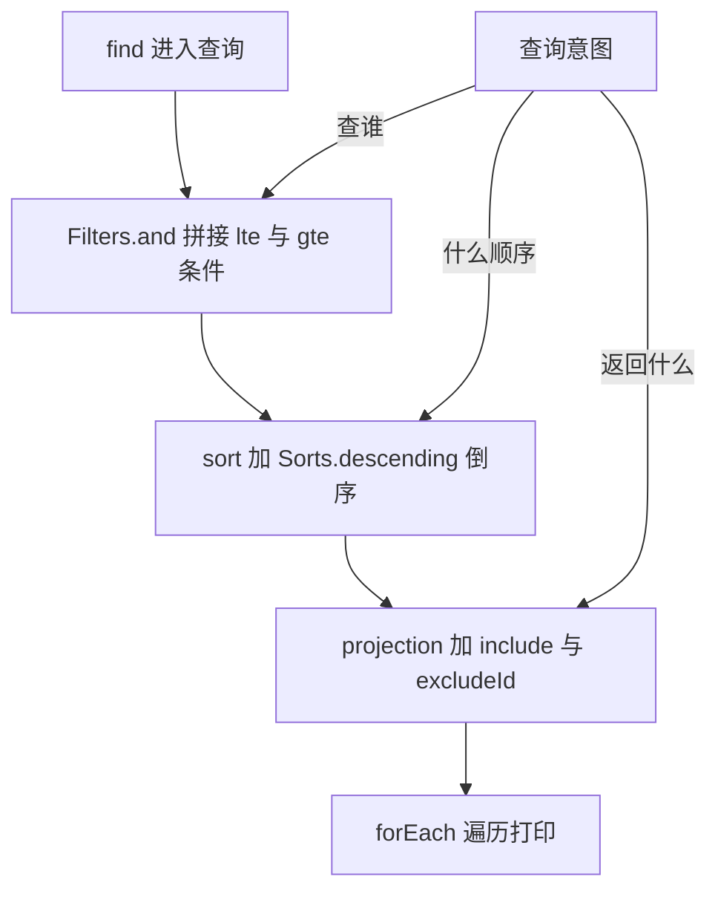
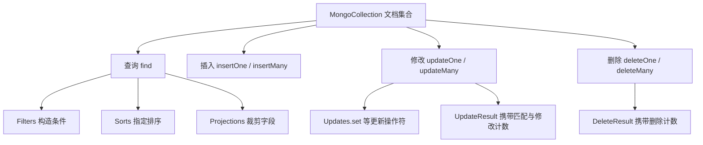
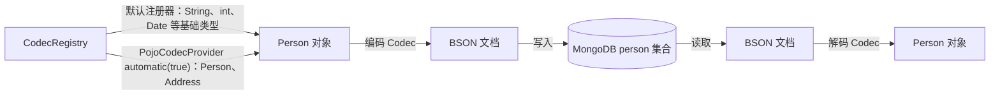

# MongoDB 的 JavaApi 操作之合辑：连接链路、Filters 复杂查询与 POJO 编解码

## 先给结论

- 三篇内容完成 Java 操作 MongoDB 的三段进阶：连接与集合对象获取、Filters/Sorts/Projections 复杂查询与增删改查、POJO 编解码的面向对象操作。
- 依赖 mongodb-driver-sync 一个起步；链路三步 MongoClients.create、getDatabase、getCollection，之后所有增删改查都挂在集合对象上，MongoClient 底层是连接池，用完必须 close。
- forEach 的 Lambda 会撞上两个重载，显式强转 Consumer 或改匿名内部类；整体流程与 JDBC 同构，连接协议是 `mongodb://` 不是 `jdbc:`。
- 查询三件套：Filters 构造条件 lte、gte、eq 与 and 组合，`.sort` 排序，`.projection` 投影；excludeId 必须显式写，否则 `_id` 永远跟着返回。
- 插入 insertOne(new Document().append(...)) 写完回查验证；修改 updateOne 配 Updates.set，返回 UpdateResult 区分 matchedCount 与 modifiedCount；删除 deleteMany 返回 deletedCount。
- POJO 映射的关键是 CodecRegistry：PojoCodecProvider 的 automatic(true) 生成编解码器，与默认编解码器合并后注册到 MongoDatabase 上。
- 取集合多传一个类型参数 `getCollection("person", Person.class)`，从此增删改查全部面向对象；插入与查询变化最大（对象进出），更新删除与 Document 版完全一致。
- 实体就是普通 JavaBean 配 Lombok，无需继承任何父类；嵌套的 Address 落库后就是一个子文档，MongoDB 天然支持嵌套结构。

## 第1部分：Java 直连 MongoDB：MongoClient、MongoDatabase、MongoCollection 三步链路

MySQL 能用 Java 操作，靠的是 JDBC 驱动；MongoDB 要进 Java 程序，同样走「官方驱动包」这条路。第一次写 MongoDB 的 Java 代码，最容易卡住的是三个陌生类名：`MongoClient`、`MongoDatabase`、`MongoCollection`，以及一个链在查询后面的 `forEach` 编译报错。这一节从建工程开始，把第一个可运行的 Demo 完整走通，并对照 JDBC 把整条链路吃透。

整个流程与 JDBC 操作 MySQL 高度同构：建立连接、选择数据库、选择表（集合）、执行操作、关闭连接释放资源。理解了这层对应关系，MongoDB 的 Java API 就不再是全新知识，而是换了一套类名的老流程。

### 一、工程搭建：三个依赖起步

新建一个普通 Maven 工程（groupId 取 `com.study`，artifactId 取 `mongodb-demo`），在 `pom.xml` 里补上三组依赖：MongoDB 驱动、单元测试、Lombok。Lombok 是给后面写实体类用的，能省掉大段 getter 和 setter；JUnit 用来跑测试用例。

```xml
<?xml version="1.0" encoding="UTF-8"?>
<project xmlns="http://maven.apache.org/POM/4.0.0"
         xmlns:xsi="http://www.w3.org/2001/XMLSchema-instance"
         xsi:schemaLocation="http://maven.apache.org/POM/4.0.0 http://maven.apache.org/xsd/maven-4.0.0.xsd">
    <modelVersion>4.0.0</modelVersion>
    <groupId>com.study</groupId>
    <artifactId>mongodb-demo</artifactId>
    <version>1.0-SNAPSHOT</version>
    <dependencies>
        <!-- MongoDB 官方同步驱动 -->
        <dependency>
            <groupId>org.mongodb</groupId>
            <artifactId>mongodb-driver-sync</artifactId>
            <version>3.11</version>
        </dependency>
        <dependency>
            <groupId>junit</groupId>
            <artifactId>junit</artifactId>
            <version>4.12</version>
            <scope>test</scope>
        </dependency>
        <dependency>
            <groupId>org.projectlombok</groupId>
            <artifactId>lombok</artifactId>
            <version>1.18.16</version>
            <scope>provided</scope>
        </dependency>
    </dependencies>
</project>
```

两个工程配置别漏：Maven 面板里点一下 `Enable Auto-Import`，依赖改动才会自动拉取；编译版本设为 Java 1.8，后面的 Lambda 表达式、方法引用都依赖它。`mongodb-driver-sync` 是 3.x 起官方推荐的同步驱动坐标，`Document` 类型来自它传递依赖的 `bson` 包。

### 二、五步链路：从连接到关闭

新建测试类 `MongoDbDemo`，写一个 `main` 方法，把五步链路一次写全（课程代码在屏幕上有两处笔误：`forEach` 的括号少配对、缺 `Consumer` 的 import，下面按可编译版本修正）：

```java
package com.study.mongodb;

import com.mongodb.client.MongoClient;
import com.mongodb.client.MongoClients;
import com.mongodb.client.MongoCollection;
import com.mongodb.client.MongoDatabase;
import org.bson.Document;

import java.util.function.Consumer;

public class MongoDbDemo {
    public static void main(String[] args) {
        // 1. 建立连接，连接串为 mongodb://IP:端口
        MongoClient mongoClient = MongoClients.create("mongodb://127.0.0.1:27017");
        // 2. 选择数据库
        MongoDatabase database = mongoClient.getDatabase("testdb");
        // 3. 选择表（集合）
        MongoCollection<Document> userCollection = database.getCollection("user");
        // 4. 操作：无条件查询全部，limit(10) 只取 10 条，遍历打印
        userCollection.find().limit(10).forEach((Consumer<? super Document>) document -> {
            System.out.println(document.toJson());
        });
        // 5. 关闭连接，释放资源
        mongoClient.close();
    }
}
```

**连接串的协议头是 `mongodb://`。** 格式为 `mongodb://IP:端口`，端口默认 27017 可省略，远程服务器换成对应 IP。它与 JDBC 的 `jdbc:mysql://...` 长得像但毫无关系，协议头写错会在建立连接时直接报 `IllegalArgumentException` 之类的非法地址异常。

**`getDatabase` 与 `getCollection` 都是「先拿句柄、不校验存在」。** `MongoDatabase` 对应库，`MongoCollection<Document>` 对应集合（MongoDB 里的「表」）。调用时即使库名或集合名不存在也不会报错，只有真正写入数据时才按名字创建。泛型 `Document` 表示每行结果用 `org.bson.Document` 承载，它本质上是一个有序的键值对容器，键是 String，值可以继续嵌套 Document 或数组，正好对应文档模型。

**`Document.toJson()` 转成 JSON 字符串打印。** 运行后控制台输出 10 条文档，`_id` 字段以 ObjectId 形式出现，这就是 MongoDB 自动生成的主键。

### 三、forEach 报错：两个重载撞在一起

最值得琢磨的一行是 `forEach`。直接写 Lambda，IDE 会提示类型不明确，原因是集合接口上存在两个同名方法：

- `MongoIterable` 自己声明的 `forEach(Block<? super T>)`，`Block` 是驱动包自定义的回调接口；
- 从 `Iterable` 继承的默认方法 `forEach(Consumer<? super T>)`，`Consumer` 是 JDK 8 的标准函数式接口。

Lambda 表达式本身没有类型信息，编译器在两个重载之间无法抉择，只能报错。解决办法有二：显式强转参数类型 `(Consumer<? super Document>) document -> {...}`，指明走标准接口；或者不用 Lambda，老老实实写匿名内部类：

```java
// 等价写法：匿名内部类实现 Consumer，不依赖 Lambda
userCollection.find().limit(10).forEach(new Consumer<Document>() {
    @Override
    public void accept(Document document) {
        System.out.println(document.toJson());
    }
});
```

两种写法语义完全一致，Lambda 更简洁，匿名内部类更直观。日常开发选前者，读别人代码时两种都要认识。

### 四、对照 JDBC：同构的流程

```mermaid
flowchart TD
    subgraph J["JDBC 操作 MySQL"]
        A1["加载驱动"] --> A2["DriverManager.getConnection 获取连接"]
        A2 --> A3["选择库 SQL 里写 use 或库名前缀"]
        A3 --> A4["Statement 执行 SQL"]
        A4 --> A5["close 关闭连接"]
    end
    subgraph M["Java 驱动操作 MongoDB"]
        B1["引 mongodb-driver-sync 依赖"] --> B2["MongoClients.create 建立连接"]
        B2 --> B3["getDatabase 选择数据库"]
        B3 --> B4["getCollection 选择集合"]
        B4 --> B5["find / insertOne / updateOne / deleteOne"]
        B5 --> B6["close 关闭客户端"]
    end
```



流程逐级对应：连接对象对连接对象（`Connection` 对 `MongoClient`），库对库，`Statement` 对 `MongoCollection`，甚至连「用完必须 close」这条纪律都一样。差别在于 SQL 换成了方法调用，结果集 `ResultSet` 换成了文档流。把这张图记住，后面学习 JDBC 连接池的思路也能平移过来：真实项目里 `MongoClient` 通常全局一份、应用生命周期内复用，而不是每次操作都新建。

## 第2部分：MongoDB Java 驱动 CRUD 实战：Filters 条件、Sorts 排序、Projections 投影与增删改查

五步链路跑通后，手里只有一个不带条件的 `find()`，离真实业务还差得远：条件怎么拼？排序加在哪？只返回部分字段怎么写？插入、修改、删除又分别对应哪个方法？这一节用一个 JUnit 测试类把增删改查一次补全，查询部分专门挑了一个「组合需求」来做：条件加排序加投影三件套同时上，把驱动里最常用的三个工具类 Filters、Sorts、Projections 全部过一遍。

所有代码基于上一节的 `mongodb-driver-sync 3.11` 驱动与 `testdb.user` 集合（1000 多条测试数据），包名统一为 `com.study.mongodb`。插入、更新、删除的返回值是另一条主线：`UpdateResult` 与 `DeleteResult` 里的计数字段，是判断「到底改了几条、删了几条」的唯一凭据。

### 一、测试基类：@Before 复用初始化

每个测试方法都要先有连接，把初始化抽到 `@Before` 方法里，JUnit 4 会在每个 `@Test` 执行前先跑它一次。测试类与导入如下：

```java
package com.study.mongodb;

import com.mongodb.client.MongoClient;
import com.mongodb.client.MongoClients;
import com.mongodb.client.MongoCollection;
import com.mongodb.client.MongoDatabase;
import com.mongodb.client.model.Projections;
import com.mongodb.client.model.Sorts;
import com.mongodb.client.result.DeleteResult;
import com.mongodb.client.result.UpdateResult;
import org.bson.Document;
import org.junit.Before;
import org.junit.Test;

import java.util.function.Consumer;
import static com.mongodb.client.model.Filters.*;

public class TestMongoDB {
    private MongoClient mongoClient;
    private MongoCollection<Document> collection;

    @Before
    public void init() {
        // 建立连接
        mongoClient = MongoClients.create("mongodb://127.0.0.1:27017");
        // 选择数据库
        MongoDatabase database = mongoClient.getDatabase("testdb");
        // 选择表（集合）
        collection = database.getCollection("user");
    }
}
```

`import static com.mongodb.client.model.Filters.*;` 是一个静态导入，把 `Filters` 的全部静态方法导入当前类，之后可以直接写 `lte("age", 50)` 而不是 `Filters.lte("age", 50)`。原始写法在屏幕上出现时都是 `Filters.xxx` 全限定调用，视觉噪音明显；`Sorts` 与 `Projections` 同理也能静态导入，课程里查询代码的简化正是从这一步开始的。

### 二、复杂查询：条件、排序、投影三件套

需求是一条完整业务查询的缩影：查询年龄小于等于 50 并且 id 大于等于 100 的用户，按 id 倒序排列，只返回 id 与 age 两个字段，连 `_id` 主键也不要。

**第一步，用 Filters 拼 AND 条件。** `find()` 的参数就是条件，两个比较条件是「与」关系，外面套一层 `Filters.and`：

```java
@Test
public void testQuery() {
    this.collection.find(
        Filters.and(
            Filters.lte("age", 50),   // age <= 50
            Filters.gte("id", 100)    // id >= 100
        )
    ).forEach((Consumer<? super Document>) document -> {
        System.out.println(document.toJson());
    });
}
```

`Filters` 里的方法名与 shell 里的比较操作符一一对应：`eq` 是等于，`lt`、`lte` 是小于、小于等于，`gt`、`gte` 是大于、大于等于，`or` 表达或关系。运行后返回的 id 从 101 往后、age 最大恰好 50，条件生效。

**第二步，追加倒序排序。** 在 `find()` 结果上链 `.sort()`，`Sorts.descending("id")` 表示按 id 降序；正序用 `Sorts.ascending`，多字段排序传可变参数。此时输出从 140 一路倒到 101，与之前的正序结果刚好相反。

**第三步，追加投影，只留指定字段。** 投影链在排序之后，写法上有个细节：`Projections.include("id", "age")` 只声明保留哪些字段，但 `_id` 是主键、默认永远返回，想把它也去掉必须在同一个投影组里再叠一个 `Projections.excludeId()`：

```java
@Test
public void testQuery() {
    this.collection.find(
        Filters.and(
            lte("age", 50),
            gte("id", 100)
        )
    ).sort(Sorts.descending("id"))
     .projection(
         Projections.fields(
             Projections.include("id", "age"),
             Projections.excludeId()
         )
     )
     .forEach((Consumer<? super Document>) document -> {
         System.out.println(document.toJson());
     });
}
```

最终输出只剩 `"id"` 与 `"age"` 两个键，`_id`、`username` 全部消失。三个环节连起来看，驱动查询的组装方式是一条链：条件决定「查谁」，sort 决定「什么顺序」，projection 决定「给什么」，forEach 负责「逐条消费」。



图中每个节点对应链上的一环，也对应需求里的一条子要求：拼条件、定顺序、裁字段、消费结果，四步对齐后再复杂的查询也就是方法链变长而已。

### 三、插入数据：Document 与 insertOne

插入的对象是 `org.bson.Document`，字段一个一个 `append` 上去，然后交给 `insertOne`。课程代码先插入一条 id 为 9999 的文档，再用 `eq` 条件回查，打印得出来就说明数据真的写进去了：

```java
@Test
public void testInsert() {
    Document document = new Document();
    document.append("id", 9999);
    document.append("username", "张三");
    document.append("age", 30);
    this.collection.insertOne(document);

    // 回查验证：能打印出来说明已落库
    this.collection.find(eq("id", 9999)).forEach((Consumer<? super Document> document1 -> {
        System.out.println(document1.toJson());
    });
}
```

（画面原样代码的 `forEach` 括号少一处配对，上面保持讲解语义、按可编译形式修正。）`Document` 也支持构造时链式写法：`new Document("id", 9999).append("username", "张三").append("age", 30)`，一行到底，效果相同。

插入没有指定 `_id` 时，驱动会在客户端自动生成一个 ObjectId 填进去，回查打印时能看到。批量插入对应 `insertMany`，传入一个 `Document` 列表，比如一次灌 10 条测试数据，比循环调 `insertOne` 少了多次网络往返（此为按本课写法补全的延伸说明）。

### 四、修改数据：updateOne 与 Updates.set

修改方法 `updateOne` 收两个参数，第一参数是查询条件，第二参数是更新内容；更新内容由 `Updates` 工具类构造，`Updates.set("字段", 值)` 对应 shell 里的 `$set` 操作符，只改指定字段、不动其余字段。把刚插入的这条数据的年龄改成 35，并打印返回值：

```java
@Test
public void testUpdate() {
    UpdateResult updateResult = this.collection.updateOne(
        eq("id", 9999),
        Updates.set("age", 35)
    );
    System.out.println(updateResult);
    // 回查验证
    this.collection.find(eq("id", 9999)).forEach((Consumer<? super Document> document -> {
        System.out.println(document.toJson());
    });
}
```

返回值 `UpdateResult` 是理解更新行为的关键。把 set 的值反复执行，控制台输出是：

```bash
# 第一次执行，值从 30 改为 35，匹配 1 条，修改 1 条
AcknowledgedUpdateResult{matchedCount=1, modifiedCount=1, upsertedId=null}
# 再次执行同样的 set("age", 35)，值本来就是 35
AcknowledgedUpdateResult{matchedCount=1, modifiedCount=0, upsertedId=null}
```

`matchedCount` 是按条件匹配到的条数，`modifiedCount` 是其中真正发生了变更的条数。数据没变时驱动不做无谓写入，所以第二个输出里修改条数为 0，这不是失败，是幂等。`upsertedId` 非 null 时代表触发了 upsert、插入了新文档。批量修改对应 `updateMany`，条件能匹配多条时全部生效；`Updates` 里还有 `combine` 组合多个更新、`inc` 自增、`unset` 删字段等操作符，套路与 `set` 一致（延伸说明，按本课写法补全）。

### 五、删除数据：deleteOne、deleteMany 与 DeleteResult

删除有 `deleteOne` 与 `deleteMany` 两个方法，前者删匹配的第一条，后者删全部匹配。课程演示选了 `deleteMany`，条件是年龄等于 25：

```java
@Test
public void testDelete() {
    DeleteResult deleteResult = this.collection.deleteMany(eq("age", 25));
    System.out.println(deleteResult);
}
```

输出与重复执行的结果对比：

```bash
# 第一次执行：匹配并删除了 1 条
AcknowledgedDeleteResult{deletedCount=1}
# 再执行一遍：这条数据已经不存在了
AcknowledgedDeleteResult{deletedCount=0}
```

`deletedCount` 从 1 变 0，直观地演示了「删过就没了」。写操作三兄弟的返回值可以归成一张表：

| 方法 | 返回类型 | 关键字段 | 判读方式 |
|---|---|---|---|
| `insertOne` / `insertMany` | `InsertResult`（或 void） | 插入后带 `_id` | 异常即失败，正常即成功 |
| `updateOne` / `updateMany` | `UpdateResult` | matchedCount、modifiedCount | matched 为 0 是条件没命中，modified 为 0 可能是值本就相同 |
| `deleteOne` / `deleteMany` | `DeleteResult` | deletedCount | 为 0 说明没有匹配数据，重跑无害 |

整个 CRUD 的方法版图如下，`MongoCollection` 就是所有操作的入口：



图里四条主分支就是增删改查本身，查询分支最重，因为它额外挂了三个构造器工具类；修改与删除分支的出口都是 Result 对象，用计数说话。

## 第3部分：MongoDB Java 驱动进阶：用 Codec 让 POJO 与 Document 自动互转

前两节的增删改查全部围绕 `org.bson.Document` 展开：写入要一个一个 `append`，读出来要 `getString`、`getInteger` 再强转，字段名全靠手写字符串，写错一个编译器毫无反应。业务对象明明已经定义好了 `Person`、`Address`，却还要在它们和 Document 之间手工搬砖，这层重复劳动正是驱动给出的第二个入口要解决的：面向对象的操作，让 `MongoCollection` 直接收发自定义 POJO。

解决的手段是给数据库注册一个 POJO 编解码器（Codec），之后 `insertOne` 收对象、`find` 还对象，Document 到对象的映射由驱动代劳。这一节把映射的环境搭好，再把增删改查用 `Person` 对象重跑一遍。

### 一、两个实体类：普通 JavaBean 就够

先定义 `Address` 与 `Person`，字段都是基础类型，`Person` 里嵌一个 `Address` 对象模拟「人有住址」的常见模型（包名统一改为 `com.study.mongodb`）：

```java
package com.study.mongodb;

import lombok.AllArgsConstructor;
import lombok.Data;
import lombok.NoArgsConstructor;
import org.bson.types.ObjectId;

@Data
@AllArgsConstructor
@NoArgsConstructor
public class Person {
    private ObjectId id;      // 主键
    private String name;
    private int age;
    private Address address;  // 嵌套对象
}
```

```java
package com.study.mongodb;

import lombok.AllArgsConstructor;
import lombok.Data;
import lombok.NoArgsConstructor;

@Data
@AllArgsConstructor
@NoArgsConstructor
public class Address {
    private String street;
    private String city;
    private String zip;
}
```

三个 Lombok 注解各司其职：`@Data` 生成 getter、setter、`toString` 等，`@AllArgsConstructor` 与 `@NoArgsConstructor` 生成全参与无参构造器。无参构造器一定不能省，编解码器把 Document 反序列化成对象时靠它先造出空实例，缺了它读取就会失败。

主键类型用 `org.bson.types.ObjectId`，插入前调 `ObjectId.get()` 即可在客户端生成一个全局唯一值，对应库里文档的 `_id` 字段，与上一节「客户端自动生成 `_id`」的行为一致，只是这次显式拿到、显式塞进对象。

### 二、init：注册 POJO 编解码器

测试类的初始化与上一节大同小异，多的只有「解码器」一段固定写法：

```java
public class TestMongoDBDemo {
    private MongoCollection<Person> personCollection;

    public void init() {
        // 定义对象的解码注册器：默认编解码器 + POJO 编解码器
        CodecRegistry pojoCodecRegistry = CodecRegistries.fromRegistries(
                MongoClientSettings.getDefaultCodecRegistry(),
                CodecRegistries.fromProviders(
                        PojoCodecProvider.builder().automatic(true).build()));
        // 建立连接
        MongoClient mongoClient = MongoClients.create("mongodb://127.0.0.1:27017");
        // 选择数据库，并注册解码器
        MongoDatabase mongoDatabase = mongoClient.getDatabase("testdb")
                .withCodecRegistry(pojoCodecRegistry);
        // 选择表（集合），带上实体类型
        this.personCollection = mongoDatabase.getCollection("person", Person.class);
    }
}
```

这段代码分三层看：

**第一层，编解码器的组成。** `PojoCodecProvider.builder().automatic(true).build()` 生成的提供者负责 POJO 与 BSON 的互转，`automatic(true)` 表示对所有符合 JavaBean 规范（有无参构造器、有 getter/setter）的类自动生成编解码器，不用挨个注册实体类。它与 `MongoClientSettings.getDefaultCodecRegistry()` 合并，是因为默认注册器里有 `String`、`int`、`Date` 这些基础 BSON 类型的编解码器，缺了它连 `name`、`age` 这类字段都转不动。

**第二层，注册位置。** `withCodecRegistry` 把注册器挂到 `MongoDatabase` 上，之后从这个库取出的集合都带这套编解码器。注册也可以挂到 `MongoClient` 级别（构造 `MongoClientSettings` 时设置），作用范围更大，本例数据库级别够用。

**第三层，取集合的方式变了。** 上一节是 `getCollection("user")`，返回 `MongoCollection<Document>`；这里多传 `Person.class`，返回 `MongoCollection<Person>`。正是这个类型参数让后面的所有操作从「操作文档」变成「操作对象」。



图里一条写入线一条读取线，编解码器就是两条线上的翻译官：编码方向把对象图（Person 里还嵌着 Address）摊平成嵌套 BSON，解码方向把 BSON 还原成对象图。注册器是两个提供者的合体，基础类型与 POJO 各管一摊。

### 三、插入与查询：对象进出，不再碰 Document

插入单条。全参构造器一行造出对象，`insertOne` 直接收下：

```java
@Test
public void testInsert() {
    Person person = new Person(ObjectId.get(), "张三", 20,
            new Address("人民路", "上海", "666666"));
    this.personCollection.insertOne(person);
    System.out.println("插入数据成功");
}
```

执行后到 shell 里回看，`db.person.find()` 能查到这条数据，结构长这样：

```json
{
    "_id": ObjectId("5c0c8a19235e19494a6e6cc"),
    "name": "张三",
    "age": 20,
    "address": { "street": "人民路", "city": "上海", "zip": "666666" }
}
```

重点看 `address` 字段：它在库里是一个子文档，键值结构与 `Address` 类的字段一一对应，而不是被序列化成 JSON 字符串塞进一个 `String` 字段。对象嵌套对象，落库就是文档嵌套文档，这是 MongoDB 与关系库最大的心智差异之一，后面微聊系统里「消息里嵌发送者」会直接复用这一点。

批量插入只是换个方法，`insertMany` 收一个 `List<Person>`：

```java
@Test
public void testInserts() {
    List<Person> personList = Arrays.asList(
            new Person(ObjectId.get(), "张三", 20, new Address("人民路", "上海", "666666")),
            new Person(ObjectId.get(), "李四", 21, new Address("北京西路", "上海市", "666666")),
            new Person(ObjectId.get(), "王五", 22, new Address("南京东路", "上海市", "666666")),
            new Person(ObjectId.get(), "赵六", 23, new Address("陕西南路", "上海市", "666666")),
            new Person(ObjectId.get(), "孙七", 24, new Address("南京西路", "上海市", "666666"))
    );
    this.personCollection.insertMany(personList);
    System.out.println("插入数据成功");
}
```

查询的返回值从 `Document` 换成了 `Person`，条件构造 `Filters.eq` 照旧：

```java
@Test
public void testQuery() {
    this.personCollection.find(Filters.eq("name", "张三"))
            .forEach(person -> {
                System.out.println(person);
            });
}
```

forEach 拿到的直接是装好数据的 `Person` 实例，`toString` 一打，`name`、`age`、`address` 全部就位。对比 Document 版本的 `document.getString("name")`、`document.getInteger("age")`，字段取错名、类型强转失败的两类低级错误在这里被编译期检查挡掉了大半。

### 四、更新与删除：和 Document 版一模一样

更新用 `updateMany`，条件 `name` 等于张三，`Updates.set` 把年龄改成 22：

```java
@Test
public void testUpdate() {
    UpdateResult updateResult = this.personCollection.updateMany(
            eq("name", "张三"),
            Updates.set("age", 22)
    );
    System.out.println(updateResult);
    // AcknowledgedUpdateResult{matchedCount=2, modifiedCount=2, upsertedId=null}
}
```

输出里匹配 2 条、修改 2 条，回查确认两条张三的年龄都到了 22。删除分单条与多条，方法名不同、行为不同：

```java
@Test
public void testDelete() {
    // 只删匹配的第一条
    DeleteResult deleteResult = this.personCollection.deleteOne(eq("name", "张三"));
    System.out.println(deleteResult);   // AcknowledgedDeleteResult{deletedCount=1}
    // 删除全部匹配
    this.personCollection.deleteMany(eq("name", "张三"));
}
```

库里此时只剩一条张三，`deleteOne` 打出 `deletedCount=1`；想删多条换 `deleteMany` 即可。可以发现这两个方法与上一节 Document 版的代码几乎逐字相同，差别只在集合是 `MongoCollection<Person>` 而已。整节的新东西集中在「环境搭建」与「插入、查询」两处，更新、删除原封不动。

## 常见误区

- **连接串协议头写成 `jdbc:`。** MongoDB 的连接串以 `mongodb://` 开头，`jdbc:mysql://` 那套写法在这里直接无效，报非法连接串异常。
- **Lambda 遍历不处理重载歧义。** `forEach` 同时匹配 `Block` 与 `Consumer` 两个参数类型，不强转也不写匿名内部类，代码编译不过。看到「forEach 的参数不明确」提示，先想到加 `(Consumer<? super Document>)` 强转。
- **忘记 `close()`。** `MongoClient` 内部维护连接池，不断 new 而不关闭，连接句柄持续泄漏。Demo 里用完即关；真实项目里反过来，全局复用一个 `MongoClient`，随应用关闭而关闭。
- **以为 `getCollection` 拿不到集合会报错。** 不会报错，返回的只是名字句柄；集合在首次写入时才真正创建。排查「集合不存在」问题时，先确认有没有写入行为，而不是盯着 getCollection 的返回值。
- **依赖引成了老的驱动坐标。** 3.x 前的 `mongo-java-driver` 与新的 `mongodb-driver-sync` API 有差异，新建工程统一用 `mongodb-driver-sync`，避免教程代码对不上。
- **以为 `updateOne` 会改所有匹配。** 它只更新匹配的第一条，批量修改必须用 `updateMany`。经验法则是：条件写得宽（如按年龄、按状态），就先想清楚要一条还是一批，再选方法。
- **把 modifiedCount 为 0 当成修改失败。** 匹配到了但值没变，驱动不会发起无意义的写入，`modifiedCount` 就是 0。判断成败看 `matchedCount` 是否为 0 与是否抛异常，而不是单看 modified 计数。
- **投影只写 include，以为 `_id` 会一起消失。** `_id` 默认永远返回，`include("id","age")` 的输出仍然带着主键。要把主键裁掉，必须用 `Projections.fields(...)` 把 `include` 与 `excludeId()` 组进同一个投影。
- **deleteMany 条件写得过宽。** 条件对象传空文档等于清空集合，删之前先拿同一条件跑一遍 `find` 回看影响范围，确认无误再删；`deletedCount` 是事后唯一能对账的数字。
- **查询条件类型与库里的 BSON 类型不一致。** 库里 `age` 存的是数字，条件却写 `eq("age", "25")` 传字符串，BSON 类型强匹配直接查不到。条件值的类型要与写入时保持一致。
- **实体缺无参构造器。** 只写全参构造器，编码（对象转文档）没问题，读取时解码器造不出空实例，直接抛映射异常。Lombok 实体上 `@NoArgsConstructor` 必须带着，`@Data` 不自动生成无参构造。
- **`automatic(true)` 忘了写。** `PojoCodecProvider.builder().build()` 只服务显式注册过的类，`Person` 没注册就取不出来，运行时报找不到对应 Codec 的异常。学习阶段一律 `automatic(true)` 最省事。
- **自己 new 的注册器把默认的顶掉了。** 只用 `fromProviders(PojoCodecProvider...)` 而不合并 `getDefaultCodecRegistry()`，`String`、`int` 等基础字段没有编解码器可用，同样报错。合并写法 `fromRegistries(默认, POJO)` 是固定套路。
- **取集合时漏传类型参数。** `getCollection("person")` 返回的是 `MongoCollection<Document>`，塞给 `MongoCollection<Person>` 变量编译都过不了；泛型不一致时插入的又回到了 Document 世界，编解码器等于白配。
- **以为嵌套对象会存成字符串。** `Address` 落库是子文档，可以按 `address.city` 直接建索引、做条件；当成字符串字段去存反而是错误的建模。

## 面试可能被问到的问题

1. 面试官追问：「MongoDB 的 Java 连接串怎么写？和 JDBC 的有什么区别？」
   答：格式是 `mongodb://IP:端口`，如 `mongodb://127.0.0.1:27017`，多实例副本集可以在后面拼接多个主机地址。区别在于协议头不同、参数体系不同，JDBC 通过 `useUnicode`、`characterEncoding` 这类参数控制行为，MongoDB 连接串的参数跟在 `?` 后面，如 `authSource` 指定认证库。

2. 面试官追问：「`MongoClient` 是线程安全的吗？应该怎么管理它的生命周期？」
   答：线程安全，内部自带连接池，官方明确建议整个应用共享一个实例。频繁创建销毁既浪费连接资源又增加握手开销，正确做法是全局初始化一份、应用关闭时统一 `close()`，这一点与数据库连接池的管理思路一致。

3. 面试官追问：「`getDatabase` 传入一个不存在的库名会怎样？」
   答：不报错，返回一个该名字的 `MongoDatabase` 句柄，`getCollection` 同理。MongoDB 的库和集合都是懒创建，只有执行写入操作时才会真正建立，所以凭返回值判断不了库是否存在，要靠 `listDatabaseNames`、`listCollectionNames` 这类列举命令。

4. 面试官追问：「`forEach` 里的 `(Consumer<? super Document>)` 强转是为什么？」
   答：因为驱动在 `MongoIterable` 上自定义了 `forEach(Block)`，同时从 `Iterable` 继承了 `forEach(Consumer)`，两个重载并存。Lambda 缺少目标类型信息，编译器无法确定匹配哪一个，强转成 `Consumer` 就消除了歧义。也可以改写匿名内部类避开该问题。

5. 面试官追问：「`Document` 是什么类型，和 JSON 是什么关系？」
   答：`org.bson.Document` 是驱动的核心数据结构，一个保持插入顺序的键值对容器，对应数据库里的 BSON 文档。BSON 是二进制化的 JSON，扩展了日期、ObjectId、二进制等数据类型。`toJson()` 与 `parse()` 方法负责 Document 与 JSON 字符串之间的互转。

6. 面试官追问：「操作完不调 `close()` 会发生什么？」
   答：`MongoClient` 持有的连接池与监控线程不会自动回收，短期内表现为连接数堆积，长期会耗尽句柄或占用服务端连接上限。短命对象用完即关；长生命周期应用则共享单例，让连接池随进程退出而释放。

7. 面试官追问：「Java 驱动里 Filters 类的作用是什么？和手拼 Document 当条件相比好在哪？」
   答：`Filters` 是查询条件的构造器工具类，`eq`、`lte`、`gte`、`and`、`or` 等静态方法生成的 Bson 对象直接传给 `find`。好处一是类型安全、方法名即语义，比手写 `{age: {$lte: 50}}` 这种嵌套 Document 更不易拼错；二是支持静态导入后代码极短；三是与 `Sorts`、`Projections` 风格统一，复杂条件可以层层组合。

8. 面试官追问：「updateOne 和 updateMany 的区别是什么？」
   答：`updateOne` 只更新匹配的第一条，`updateMany` 更新全部匹配，对应 shell 里 multi 参数的两种取值。生产代码里条件不唯一时尤其要小心 `updateOne`，它改哪一条取决于存储顺序，通常业务语义要求全量生效时一律 `updateMany`。

9. 面试官追问：「UpdateResult 里 matchedCount 与 modifiedCount 有什么区别，什么时候不一致？」
   答：matchedCount 是条件匹配到的文档数，modifiedCount 是其中实际发生变更的数。set 的值与原值相同时，匹配 1 条但修改 0 条，两者就不一致；这是驱动的幂等优化，不代表失败。另外 upsert 触发插入时 modifiedCount 为 0 而 upsertedId 有值。

10. 面试官追问：「Java API 怎么只返回文档的部分字段？_id 能去掉吗？」
   答：链式调用 `projection`，用 `Projections.include("字段1", "字段2")` 声明保留字段。`_id` 是主键默认永远返回，去掉它要用 `Projections.fields(include(...), excludeId())` 把两个投影合成一组，`excludeId` 单独写才生效。

11. 面试官追问：「插入文档时没有指定 _id，这个 _id 是什么时候、在哪里生成的？」
   答：由驱动在客户端侧生成，ObjectId 包含时间戳、机器标识、进程号与随机数，天然趋近全局唯一且大致按时间有序。客户端生成的好处是不依赖服务端往返就能拿到主键，插入前即可用它做关联。

12. 面试官追问：「用 Java API 实现分页查询怎么做？」
   答：`find` 结果链上 `skip` 与 `limit`，第 page 页每页 size 条就是 `skip((page - 1) * size).limit(size)`，总数用 `countDocuments` 统计。深分页时 skip 会扫描并丢弃大量文档，数据量大要改成基于排序字段的范围条件翻页，这个坑与 SQL 分页相同。

13. 面试官追问：「Java 驱动怎么做到直接对 POJO 做增删改查？」
   答：靠驱动提供的 Codec 机制。`PojoCodecProvider` 生成 POJO 与 BSON 双向转换的编解码器，通过 `CodecRegistries.fromRegistries` 与默认注册器合并，再经 `withCodecRegistry` 注册到数据库或客户端级别；取集合时传入实体类的 Class 得到 `MongoCollection<T>`，后续方法的入参出参都是 T。

14. 面试官追问：「`PojoCodecProvider.builder().automatic(true)` 里的 automatic 是什么意思？」
   答：声明对所有符合 JavaBean 规范的类自动创建编解码器，无需逐个注册。前提是类具备公共无参构造器和 getter/setter。不开启时只能手工 `register` 每个实体类，漏注册就取不出来。

15. 面试官追问：「对象里嵌套另一个对象，存进 MongoDB 是什么结构？」
   答：嵌套对象被编码成子文档，字段结构原样保留在父文档内部，例如 `address: {street: ..., city: ...}`。查询可以直达内层如 `address.city`，也能对内层字段建索引，这是 MongoDB 文档模型表达聚合关系的天然优势。

16. 面试官追问：「ObjectId 为什么要设计成在客户端生成？」
   答：ObjectId 由时间戳、机器标识、进程号与计数器组成，客户端就能生成趋近全局唯一且大致按时间有序的主键。好处是写入前即可拿到 `_id` 做关联，不依赖服务端往返，也天然分摊了生成压力。

17. 面试官追问：「面向对象方式操作 MongoDB，更新删除的代码有变化吗？」
   答：基本没有。`updateMany`、`deleteOne`、`deleteMany` 的方法签名与 Document 版一致，条件仍用 `Filters`、更新仍用 `Updates`，变的只是集合泛型是实体类，插入与查询两端的类型安全收益最明显。

## 配套资料

- day08 资料包未收录源码：`materials/code/03/day08-MongoDB入门以及实现微聊即时通讯功能/` 目录存在，其解压清单 `_extracted.json` 记录解压文件数为 0
- 文中 pom 依赖与 Demo 代码取自课程讲义画面（2.2 编写 Demo 小节），包名由课程原值统一改写为 `com.study`，工程名改为 `mongodb-demo`；forEach 重载原理、JDBC 对照与连接管理说明为按本课写法补全的延伸解释
- 文中 TestMongoDB 测试类、Filters/Sorts/Projections 组合查询、insertOne、updateOne 加 Updates.set、deleteMany 加 DeleteResult 代码及控制台输出取自课程讲义画面（2.3 CRUD 小节四个小视频）；forEach 括号按可编译形式修正，insertMany、updateMany、Updates 其他操作符与分页说明为按本课写法补全的延伸示例
- 文中 Person、Address 实体、CodecRegistry 初始化、testInsert、testInserts、testQuery、testUpdate、testDelete 代码取自课程讲义画面（2.4 面向对象操作小节）；包名统一改为 `com.study.mongodb`，连接地址沿用系列文章的 `127.0.0.1`，`init` 方法画面原样中 `MongoClients.create` 的类名按可编译形式修正，shell 回查结果为按库中实际数据补全的示例
